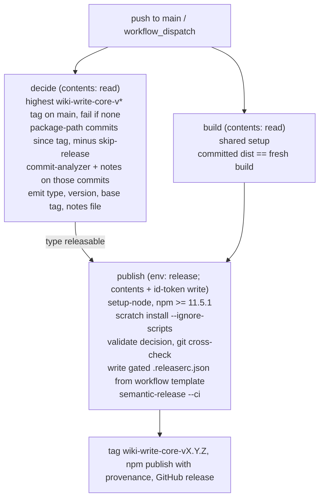

# feat: Publish wiki-write-core to npm as @fro.bot/wiki-write-core

## Overview

Rename the package `@fro-bot/wiki-write-core` to `@fro.bot/wiki-write-core` and publish it to npm on every merge to `main` that changes it. The directory stays at `packages/wiki-write-core`.

semantic-release produces the releases, configured the way `marcusrbrown/systematic` and `fro-bot/agent` configure it. A repo-owned decision step filters commits to the package. A credential-free build verifies that the committed `dist` equals a fresh build. An OIDC publish job in the main-only `release` environment then publishes that committed `dist` from its own checkout and runs no repository code. The version line is 0.x, starting from a `wiki-write-core-v0.0.0` tag.

---

## Problem Frame

fro-bot/dashboard's `wiki-writer` consumes this package through a pnpm git-subdirectory spec, `github:fro-bot/.github#<sha>&path:packages/wiki-write-core`. Bun has no subdirectory selector for git dependencies. It encodes the `#<sha>&path:…` fragment into the ref, and GitHub returns 404. `wiki-writer` cannot join the dashboard's Bun workspace until the package installs from a registry. Issue #3998 asks for a versioned public package that Renovate keeps current.

`docs/plans/2026-08-29-001-feat-editable-wiki-path-plan.md` chose git-subdirectory consumption and deferred npm publishing. This plan supersedes that decision, because the Bun constraint makes registry publishing the only way the dashboard can consume the package.

---

## Requirements Trace

**Package**

- R1. The package is published to npm as `@fro.bot/wiki-write-core` with public access and npm provenance.
- R2. The export map (`.` plus 13 subpaths) and the `files` allowlist are unchanged.
- R3. Every live reference uses the new specifier. Dated plans, `knowledge/log.md` and generated `knowledge/**` pages are exempt.

**Versioning**

- R4. Only commits that change `packages/wiki-write-core/` count toward a release.
- R5. Release types follow fro-bot/agent's rules: `breaking` → minor, `feat` → minor, `fix` → patch, `build` → patch, `build(dev)` → none, `docs(readme)` → patch, `skip` → none.
- R6. Tags use `wiki-write-core-v${version}`. semantic-release creates every tag after the initial `wiki-write-core-v0.0.0`. No release commit lands on `main`.

**Publish boundary**

- R7. The published `dist` is the committed `dist` at the release commit, which a credential-free job verified equals a fresh build of that commit.
- R8. The job holding `id-token: write` runs no repository code, executes no command taken from another job's output, and installs with lifecycle scripts disabled.
- R9. Only `main` reaches the publish credential, through the `release` environment's deployment-branch policy.
- R10. Steady-state publishing uses npm OIDC trusted publishing, with token publishing disallowed on the package.

---

## Scope Boundaries

- Moving the dashboard to the registry package is out of scope.
- Pruning the package's fro-bot-specific defaults (`DEFAULT_OWNER`, the canonical `fro-bot/.github@data` tuple, the `metadata/repos.yaml` default path) is out of scope. The README documents them.
- The required `Check Wiki Write Core Dist` check and the 14 required contexts in `.github/settings.yml` are unchanged.
- No PR-title lint is added.

### Deferred to Separate Tasks

- Dashboard migration to `@fro.bot/wiki-write-core@^0.1.0`: separate PR in fro-bot/dashboard.

---

## Context & Research

### Relevant Code and Patterns

- **The package manifest.** `packages/wiki-write-core/package.json` is private, at 0.0.0, ESM-only, with exports to `dist/*` and `files` set to `README.md`, `dist` and `package.json`. Dependencies are `@octokit/rest ^22.0.1` and `yaml ^2.6.0`. There is no `license`, `repository` or `publishConfig`. `dist/` is committed (37 files) and contains no reference to the package name.
- **How the specifier resolves today.** It goes through the pnpm workspace link (`pnpm-workspace.yaml` `packages: ['packages/*']`). The root `package.json` does not list the package.
- **Live references.** 45 lines in 28 files, plus the escaped specifier in the scanner regex in `scripts/check-mutation-guards.ts`. `scripts/` accounts for 35 lines in 22 files. The others are the package `README.md` and `package.json`, `src/gate-contract.test.ts`, the four `mutation-guards.json` reason strings, `quartz-site/README.md`, and `docs/solutions/best-practices/a-mutation-score-can-measure-nothing-2026-09-08.md`.
  - `knowledge/index.md`, `knowledge/wiki/repos/fro-bot--dashboard.md` and `knowledge/wiki/topics/github-actions-ci.md` also mention the package. They are guarded by `scripts/check-wiki-authority.ts`, so only the `data` pipeline writes them.
- **The mutation-guard scanner.** `scripts/check-mutation-guards.ts` hard-codes the specifier in its import-discovery regex. `wikiWriteCoreSubpathSourceFiles` and `buildImportClosure` depend on that regex. A specifier the regex misses drops edges from the closure, and the result is that no guard triggers.
- **The dist build.** `scripts/build-wiki-write-core.ts` `computeSourceTreeHash` hashes `src/` (excluding tests), the resolved build tsconfig, `exports` and `files`. It does not hash `name`, `version`, dependencies, `README` or `LICENSE`.
- **License file.** `npm pack` in the package directory includes `package.json`, `README.md` and `dist/`, but no license file. `@semantic-release/npm` publishes with `npm publish <pkgRoot>` (`lib/publish.js`). npm includes a `LICENSE*` file from the package root automatically, without it being listed in `files`.
- **CI setup and the existing split.** `.github/actions/setup` installs mise and runs `pnpm bootstrap`, which runs dependency lifecycle scripts. `.github/workflows/publish-wiki.yaml` is the in-repo build/deploy split: `permissions: {}`, a `build` job with `contents: read`, and a `deploy` job with `id-token: write` in the `github-pages` environment. Its contract test is `scripts/publish-wiki-workflow.test.ts`.
- **App-token census.** `scripts/app-token-scope-guard.test.ts` pins every `actions/create-github-app-token` mint. The release workflow mints no App token.
- **README workflow count.** `README.md` states 31 workflows and lists one table row per workflow.
- **Renovate preset.** `default.json` extends `sanity-io/renovate-config:semantic-commit-type`, which types runtime dependency updates `fix(deps)` and other npm updates `chore(deps)`. Its automerge rule matches `@fro-bot/**`. The inherited bfra-me regex manager tracks `# renovate: datasource=npm depName=…` comments in workflow files.
- **Repo settings.** There is no `release` environment. The only ruleset targets `data`, and the repo has no tags. `@fro.bot/wiki-write-core` does not exist on npm.

### Precedent

- **marcusrbrown/systematic `.github/workflows/release.yaml`.**
  - The `verify` and `build` jobs hold read scopes and run repository code. `build` uploads `dist/` with a sha256 digest of the sorted file list.
  - `publish` runs in `environment: release` (deployment policy: `main`) with `contents: read` and `id-token: write`. It runs no repository code. It uses `setup-node` without `registry-url`, gates on npm ≥ 11.5.1, and installs with `--frozen-lockfile --ignore-scripts`. It downloads and re-verifies `dist`, writes a pure-data `.releaserc.json` in place of `.releaserc.yaml`, mints a release App token, and runs `npx --no-install semantic-release --ci` with `GITHUB_TOKEN`/`GH_TOKEN` set to that token and `npm_config_ignore_scripts: 'true'`.
- **marcusrbrown/systematic `scripts/release/gated-config.ts`.** It builds the publish job's config as data. It keeps every top-level key from `.releaserc.yaml` and replaces `plugins` with:
  - commit-analyzer;
  - `@semantic-release/exec`, with `verifyReleaseCmd` asserting the approved version and `generateNotesCmd` reading approved notes;
  - npm;
  - github, with comments and labels off.
- **marcusrbrown/systematic first publish.** 1.0.0 was published on 2026-01-26 from CI run 21344538930 at `dba42015`, using `NODE_AUTH_TOKEN: secrets.NPM_TOKEN`, `id-token: write` and `NPM_CONFIG_PROVENANCE: true`. The version carries a provenance attestation.
- **fro-bot/agent `.releaserc.yaml`.** `releaseRules` are `breaking: true → minor` (listed first so the line stays 0.x), `build → patch`, `build(dev) → false`, `docs(readme) → patch`, `docs(rfcs) → patch` and `skip → false`. The config uses `preset: conventionalcommits` with a `presetConfig.types` section list. Agent's 0.x line started from existing `v0.0.x` tags, and its first semantic-release release was `v0.1.0`.
- **Tool versions.** Both repos pin `semantic-release` 25.0.9, `@semantic-release/exec` 7.1.0 and `conventional-changelog-conventionalcommits` 10.4.1, with the override `conventional-changelog-writer: '>=9'`. `@semantic-release/release-notes-generator` 14.1.1 depends on `conventional-changelog-writer ^8`, and the `conventionalcommits` 10 preset requires writer 9 or later.

### Institutional Learnings

- `docs/solutions/best-practices/a-policy-scanner-must-parse-tokens-not-prose-2026-09-08.md`: a scanner that matches nothing must fail, and each rule's test must fail when the rule is removed.
- `docs/solutions/best-practices/a-mutation-score-can-measure-nothing-2026-09-08.md`: mutation targets keep source-tree test imports, never the package specifier or `dist`.
- `docs/solutions/best-practices/repo-wide-app-token-scope-contract-2026-10-10.md`: workflow contract tests parse YAML, reject empty scans and use non-vacuity floors.
- `docs/solutions/best-practices/credential-mint-time-permission-scoping-2026-06-22.md`: credentials are scoped at the job and mint boundary, and a separate secret name is not a boundary.
- `docs/solutions/best-practices/agent-drafts-trusted-publish-split-2026-10-10.md`: the write happens in a trusted job that re-validates its inputs.
- `docs/solutions/workflow-issues/verify-renovate-predicates-against-live-taxonomy-2026-08-31.md`: Renovate rules are tested against the real dependency shape.

### External References

- **semantic-release 25.0.9:**
  - `lib/get-next-version.js`: with no previous release, the next version is `FIRST_RELEASE` (`1.0.0`).
  - `index.js`: `verifyAuth` runs a push dry-run. A branch behind its remote exits 0 with no release.
  - `lib/get-git-auth-url.js`: push authentication comes from `GITHUB_TOKEN`/`GH_TOKEN` in the environment.
- **@semantic-release/npm 13.x:** `verify-auth` tries the npm OIDC exchange first, then falls back to `NPM_TOKEN`. `pkgRoot` is supported. Provenance is automatic under trusted publishing. A package with `private: true` is skipped.
- **@semantic-release/exec 7.1.0:** provides `analyzeCommitsCmd`, `verifyReleaseCmd` and `generateNotesCmd`.
- **@semantic-release/github 12.x:** a GitHub release needs `contents: write`. Issue and PR write are needed only when comments are enabled.
- **npm trusted publishing** (https://docs.npmjs.com/trusted-publishers/):
  - Requires npm CLI 11.5.1 or later and Node 22.14 or later.
  - The package must already exist (https://docs.npmjs.com/cli/v11/commands/npm-trust/).
  - The binding is owner, repo and workflow filename, with an optional environment.
  - `repository.url` must match the repo.
  - A new configuration expires if it has no successful publish within 2 days. An expired configuration cannot be edited, only deleted and recreated.
  - Configurations created after Sep 03, 2026 allow only `npm stage publish` unless `npm publish` is also selected.
  - npm does not validate a configuration when it is saved.
  - "Require two-factor authentication and disallow tokens" blocks token publishing but not OIDC.
- **GitHub environments:** referencing an environment that does not exist creates it with no protection rules.
- **semantic-release troubleshooting:** before deleting a release tag, check that the version is absent from the registry.
- **GitHub Changelog, 2026-10-02:** `npm stage publish` can create a new package, with the first version queued until a maintainer promotes it. `@semantic-release/npm` publishes with `npm publish` and has no staged mode.

---

## Prior-Art Survey

```json
{
  "schema_version": 2,
  "verdict": "build-new-within-scope",
  "scope": "packages/wiki-write-core, with root release-adjacent surfaces: .github/workflows, .github/renovate.json5, default.json, scripts/, package.json, pnpm-workspace.yaml",
  "freshness": {
    "vcs_reference": "c2f4806a3c6fb94ae5ffe707d00ec98c62e41101"
  },
  "budget": {
    "max_search_passes": 10,
    "max_candidate_inspections": 12,
    "exhausted": true
  },
  "candidates": [
    {
      "path_or_symbol": "packages/wiki-write-core/package.json",
      "description": "Manifest for @fro-bot/wiki-write-core at version 0.0.0: private true; exports map to dist/*.js; files allowlist of README.md, dist, package.json; no publishConfig and no repository field.",
      "disposition": "insufficient",
      "insufficiency_reason": "Owns package identity and export surface, not release state. It is private, at 0.0.0, and has no repository field, which npm provenance checks against the source repo. The exports map and files allowlist carry over unchanged."
    },
    {
      "path_or_symbol": "scripts/build-wiki-write-core.ts",
      "description": "Builds committed packages/wiki-write-core/dist via tsc, embeds a source-tree hash and gate-contract.json, and in --check mode fails when committed dist differs from a fresh build.",
      "disposition": "insufficient",
      "insufficiency_reason": "Owns build and drift verification for committed output, not release. It creates no tarball, bumps no version, and makes no tag. The release workflow's build job calls it as a step."
    },
    {
      "path_or_symbol": "package.json",
      "description": "Root scripts: build and check:wiki-write-core-dist run the dist build and its check; lint chains check:md-links, check:override-floors, check:solutions-examples, and eslint. No version, pack, publish, or tag script.",
      "disposition": "insufficient",
      "insufficiency_reason": "Declares the gates a release path depends on, but no script owns versioning, packing, publishing, or tagging."
    },
    {
      "path_or_symbol": "packages/wiki-write-core/src/gate-contract.ts",
      "description": "Exports GATE_CONTRACT_VERSION = 1, a manually bumped integer for intentional consumer-visible gate contract breaks, and a source-hash placeholder replaced at build time.",
      "disposition": "insufficient",
      "insufficiency_reason": "A gate-compatibility version, not a release version. The npm version and GATE_CONTRACT_VERSION stay independent."
    },
    {
      "path_or_symbol": ".github/workflows/main.yaml",
      "description": "PR and push-to-main CI with workflow permissions contents: read. Jobs: lint (pnpm lint, which includes check:override-floors), check-types, test, check-wiki-write-core-dist, test-scripts-load, check-workflows.",
      "disposition": "insufficient",
      "insufficiency_reason": "Gate-only: validates changes before they reach main and has no publish, tag, or release job."
    },
    {
      "path_or_symbol": ".github/workflows/publish-wiki.yaml",
      "description": "GitHub Pages publish with job-scoped privilege: build job has contents read and no id-token; deploy job (needs build, environment github-pages) holds pages write and id-token write. Shape asserted in scripts/publish-wiki-workflow.test.ts.",
      "disposition": "insufficient",
      "insufficiency_reason": "Owns Pages deployment, not npm. It is the in-repo template for id-token and environment isolation, but it has no npm, provenance, tag, or GitHub release step."
    },
    {
      "path_or_symbol": "scripts/check-override-floors.ts",
      "description": "Dependency gate: runs pnpm audit --json, parses advisories, and fails when pnpm-workspace.yaml override floors sit below patched_versions. Fail-closed on unparseable audit output. Reached through pnpm lint.",
      "disposition": "insufficient",
      "insufficiency_reason": "Owns the pre-merge audit gate that the new devDependency tree must pass. It does not version, publish, or tag."
    },
    {
      "path_or_symbol": "pnpm-workspace.yaml",
      "description": "Workspace membership packages/*, plus security override floors (ajv, undici, vite, yaml, others) and minimumReleaseAgeExclude for @bfra.me/eslint-config.",
      "disposition": "insufficient",
      "insufficiency_reason": "Governs membership and dependency floors only. It has no publish, access, or release configuration."
    },
    {
      "path_or_symbol": ".github/renovate.json5",
      "description": "Repo-local Renovate config extending local>fro-bot/.github. Disables patch updates except python and typescript, holds typescript below 6.1, and excludes harness-shaped fro-bot/agent tags.",
      "disposition": "insufficient",
      "insufficiency_reason": "Owns dependency-update policy, not release behavior."
    },
    {
      "path_or_symbol": "default.json",
      "description": "Renovate preset (consumed as local>fro-bot/.github) extending bfra-me/renovate-config; automerges minor and patch updates for @fro-bot/** and fro-bot/** with minimumReleaseAge null.",
      "disposition": "insufficient",
      "insufficiency_reason": "Owns dependency-update policy, not release. Its automerge rule matches @fro-bot/** and fro-bot/**, which does not match the @fro.bot scope."
    },
    {
      "path_or_symbol": "docs/plans/2026-08-29-001-feat-editable-wiki-path-plan.md",
      "description": "Decision record: wiki-write-core is consumed as a git subdirectory dependency pinned by immutable SHA with committed dist; npm publishing is deferred until a second independent consumer appears or committed output becomes painful.",
      "disposition": "insufficient",
      "insufficiency_reason": "Governing prior decision that deferred npm publishing. This plan supersedes it: Bun cannot install a git subdirectory dependency, so the dashboard's Bun workspace cannot consume the package without a registry release."
    },
    {
      "path_or_symbol": "docs/brainstorms/2025-04-15-frobot-control-plane-requirements.md",
      "description": "R24 and R25 requirements: control-plane changes versioned with changesets adapted from bfra-me/.github; releases create GitHub releases, changelogs, git tags, and floating major branches.",
      "disposition": "insufficient",
      "insufficiency_reason": "Scoped to the control plane and not implemented at HEAD: no .changeset directory, release config, or release workflow exists. It is a requirement, not an owner."
    }
  ],
  "excluded_scopes": [
    {
      "scope": "marcusrbrown/systematic and fro-bot/agent (external repositories)",
      "reason": "Outside this repository. Their semantic-release configuration and release workflows are the pattern source for this plan; they own nothing in this repository."
    },
    {
      "scope": "bfra-me/renovate-config (external preset)",
      "reason": "Extended by default.json. External to this repository; it governs dependency updates, not releases."
    },
    {
      "scope": ".github/actions/setup (within repository)",
      "reason": "Shared CI bootstrap: installs mise and runs pnpm bootstrap. It owns no release, version, or publish behavior."
    }
  ]
}
```

---

## Key Technical Decisions

- **Release on every merge to `main`.** `common-settings.yaml` declares required review, required code-owner review and `enforce_admins` for `main`. The `release` environment's main-only deployment-branch policy is the publish boundary. No release PR or release schedule is added.

- **Release tooling runs from a pinned install outside the lockfile.**
  - Why: the semantic-release dependency tree brings in `braces@3.0.3`, which carries GHSA-vfj7-8cjw-p6xm (high severity, no patched version). Through `pnpm audit`, that fails `check-override-floors` inside the required `Lint` check.
  - Rejected alternative: a devDependency plus `auditConfig.ignoreGhsas`. That would weaken the repo-wide audit gate to admit one advisory.
  - How: each job that needs the tools generates a scratch `package.json` under `$RUNNER_TEMP` and installs it with lifecycle scripts disabled. #3793 uses the same approach for Renovate.
  - The scratch directory is outside the checkout, so `@semantic-release/npm` runs the `npm` on `PATH` from `setup-node`, which is the one the npm ≥ 11.5.1 gate checks.
  - Each version lives in a workflow `env` entry carrying a `# renovate:` comment. `.github/renovate.json5` disables patch updates by default, so a package rule re-enables them for these dependency names.
  - Exact pins:
    - `semantic-release` 25.0.9
    - `@semantic-release/exec` 7.1.0
    - `@semantic-release/npm` 13.2.0
    - `@semantic-release/github` 12.0.10
    - `@semantic-release/commit-analyzer` 13.0.1
    - `@semantic-release/release-notes-generator` 14.1.1
    - `conventional-changelog-conventionalcommits` 10.4.1
    - `conventional-changelog-writer` 9.3.0
  - `publish` installs the first four. `decide` installs all eight.
  - The `decide` scratch `package.json` declares `conventional-changelog-writer` both as a direct dependency and as an `overrides` entry, each at exactly 9.3.0. Without the override, `@semantic-release/release-notes-generator` resolves its own writer 8, which the `conventionalcommits` 10 preset rejects. npm rejects an override that differs from the direct spec.
  - The transitive tree is not locked. It resolves at install time and runs inside the credentialed `semantic-release` process.

- **A credential-free `decide` job does the path filtering. The `publish` job runs no repository code and executes no command taken from another job's output.**
  - `decide` runs repo code:
    1. It reads `packages/wiki-write-core/.releaserc.yaml`.
    2. It takes the highest-semver `wiki-write-core-v*` tag merged into `main` as the base.
    3. It keeps the commits since the base that changed `packages/wiki-write-core/`, minus commits marked `[skip release]` or `[release skip]`. This is the same base-tag and skip rule semantic-release applies.
    4. It calls `@semantic-release/commit-analyzer` and `@semantic-release/release-notes-generator` as libraries, with the configured rules and preset. The context they need is the filtered commits (`hash`, `message`), a logger, `options.repositoryUrl`, `lastRelease` (`gitTag`, `gitHead`) and `nextRelease` (`version`, `gitTag`, `gitHead`).
    5. It computes the version by incrementing the base tag's version by the release type.
  - Handoff from `decide` to `publish`:
    - The type, version and base tag go out as job outputs.
    - The notes go out as an uploaded artifact.
  - In `publish`:
    - It downloads the notes to a fixed path.
    - It validates each output against a fixed pattern.
    - It recomputes the version from the base tag and type, and asserts it equals the received version.
    - It deletes `packages/wiki-write-core/.releaserc.yaml` from its working tree.
    - It writes `.releaserc.json` at the repository root from a template in the workflow file. That leaves the gated config as the only config semantic-release can discover.
  - The template sets `branches: [main]`, `tagFormat: 'wiki-write-core-v${version}'` and `repositoryUrl`. A contract test asserts that the template's `branches` and `tagFormat` equal the values in `.releaserc.yaml`. The template's plugins are:
    - `@semantic-release/exec`, where `analyzeCommitsCmd` echoes the type, `verifyReleaseCmd` asserts the version, and `generateNotesCmd` reads the notes file from its fixed path;
    - `@semantic-release/npm` with `pkgRoot: packages/wiki-write-core`;
    - `@semantic-release/github` with `releasedLabels`, `successComment`, `failComment` and `failTitle` off.
  - This adapts systematic's gated config. Systematic keeps `commit-analyzer` in its publish job. Here the approved type replaces it, because `publish` cannot recompute a path-filtered type: semantic-release's `getCommits` returns every commit since the tag. Two alternatives are rejected:
    - Running `commit-analyzer` in `publish` would release commits that only touch `scripts/`.
    - Running a local path-filter plugin in `publish` would execute repository code alongside `id-token: write`.
  - `publish` also uses git alone to confirm that at least one commit since the base tag touches `packages/wiki-write-core/`.

- **No release without a base tag.**
  - With no previous release, semantic-release computes 1.0.0.
  - `decide` fails when no `wiki-write-core-v*` tag is merged into `main`.
  - `verifyReleaseCmd` rejects any version other than the approved one, and semantic-release runs `verifyRelease` before it creates the tag.

- **Three jobs.**
  - `decide` and `build` run in parallel with `contents: read`. `publish` needs both, and runs only when `decide` reports a releasable type.
  - `decide`:
    - checks out full history and tags;
    - runs the shared setup and installs the release tools;
    - runs the real-plugin integration tests, which fail when the scratch prefix is absent;
    - emits its decision.
  - `build` runs the shared setup and `pnpm check:wiki-write-core-dist`. That proves the committed `packages/wiki-write-core/dist` at this commit equals a fresh build.
  - `publish` runs in `environment: release` with `contents: write` and `id-token: write`:
    - checks out the same commit with full history and tags, with `persist-credentials: false`;
    - sets up `setup-node` 24 without `registry-url` and gates on npm ≥ 11.5.1;
    - installs the release tools with scripts off;
    - validates the decision, writes the gated config, and runs `semantic-release --ci`.
  - `publish` publishes the committed `dist` from its own checkout, so no build output crosses jobs.
  - Triggers and concurrency:
    - One `concurrency` group with `cancel-in-progress: false`.
    - Triggers: every push to `main` and `workflow_dispatch`, with no `paths:` filter.
  - When `main` has moved past the checkout, semantic-release logs that the branch is behind and exits 0 without releasing. The next run, or a `workflow_dispatch` on `main`, releases the pending commits.

- **The job's `GITHUB_TOKEN` pushes the tag and creates the GitHub release.**
  - `publish` holds `contents: write` on this repository. semantic-release reads it from `GITHUB_TOKEN`/`GH_TOKEN`.
  - An App token minted in the same job would have the same reach and would add a secret pair and an App-token census row.
  - `decide` and `build` hold `contents: read` only.

- **The publish job does not use `.github/actions/setup`.** That action runs `pnpm bootstrap`, which executes lifecycle scripts. The `decide` and `build` jobs use it.

- **Pull requests run the release integration tests.** A `main.yaml` step installs the `decide` tool set into a scratch prefix and runs the integration tests in `scripts/wiki-write-core-release.test.ts`. That gives the release rules a pre-merge check. #3793 has the same second step for Renovate.

- **The first publish uses a temporary npm token, and U4 moves publishing to OIDC.**
  - The first publish (0.1.0) is the merge of PR 2. It runs with an `NPM_TOKEN` environment secret on `release` and `NPM_CONFIG_PROVENANCE: true`.
  - The token is a granular access token with:
    - read-and-write permission;
    - bypass-2FA enabled;
    - the shortest available expiry;
    - the `@fro.bot` scope as its package selection, because npm offers package selection only for existing packages.
  - Until it is revoked, the token can publish every `@fro.bot` package.
  - U4 removes `NPM_TOKEN` from the workflow. The trusted publisher is configured immediately before U4 merges: owner `fro-bot`, repo `.github`, workflow `release-wiki-write-core.yaml`, environment `release`, allowed action `npm publish`. The U4 release then proves the OIDC path.
  - On the day of the U4 merge, token publishing is disallowed on the package, the token is revoked and the secret is deleted, whether or not the OIDC release succeeds.
  - Rejected alternative: `npm stage publish`. `@semantic-release/npm` publishes with `npm publish` and has no staged mode.

- **Consumers automerge minor and patch releases.** `default.json` gains `@fro.bot/wiki-write-core` in its minor/patch automerge rule. So every repo extending the preset takes those releases without a consumer-side review. The review gate is the merge to `main` here.

- **The manifest changes:**
  - Remove `private`.
  - Set `version` to `0.0.0-semantic-release`.
  - Add `publishConfig.access: public`.
  - Add `repository` (`git+https://github.com/fro-bot/.github.git`, `directory: packages/wiki-write-core`), `license`, `homepage`, `bugs` and `engines.node: '>=24'`.
  - Raise `yaml` to `^2.8.3`, the floor this repo enforces.
  - Add a package-local `LICENSE.md` copy and keep it out of `files`, so `GATE_SOURCE_TREE_HASH` stays the same.

- **The workflow filename is `release-wiki-write-core.yaml`.** The npm trusted publisher binds to this filename.

---

## Open Questions

### Resolved During Planning

- **Path-filter mechanism.** A repo-owned `decide` job, not `semantic-release-monorepo`. Version 8.0.2 of that plugin was published three years ago and has never been tested against semantic-release 25 with our `tagFormat`.
- **Release cadence.** Every merge to `main`.
- **braces advisory.** Release tooling stays outside the lockfile.
- **Dependency bumps.** Renovate's `fix(deps)` updates to the package's runtime dependencies release a patch. `chore(deps)` updates release nothing. This follows the configured rules.
- **Config location.** `.releaserc.yaml` lives in `packages/wiki-write-core/` and is read only by `decide`. In `publish`, semantic-release runs from the repository root and finds only the gated `.releaserc.json`.

### Deferred to Implementation

- **How `decide` imports the scratch-installed plugins.** For example, `createRequire` rooted at the scratch prefix. Unit tests inject the analyzer and notes functions.

---

## High-Level Technical Design

> *This illustrates the intended approach and is directional guidance for review, not implementation specification. The implementing agent should treat it as context, not code to reproduce.*



---

## Implementation Units

### U1. Rename the package and make it publishable

**Goal:** The package becomes `@fro.bot/wiki-write-core` with publish metadata, and every live reference uses the new specifier.

**Requirements:** R1, R2, R3

**Dependencies:** None

**Files:**
- Modify:
  - `packages/wiki-write-core/package.json` and `packages/wiki-write-core/README.md`
  - `packages/wiki-write-core/src/gate-contract.test.ts`
  - the 22 `scripts/*.ts` files that reference the specifier
  - `scripts/check-mutation-guards.ts`, `mutation-guards.json`
  - `quartz-site/README.md`
  - `docs/solutions/best-practices/a-mutation-score-can-measure-nothing-2026-09-08.md`
  - `default.json`
- Create: `packages/wiki-write-core/LICENSE.md`
- Test: `scripts/check-mutation-guards.test.ts`, new `scripts/wiki-write-core-package.test.ts`

**Approach:**
- Replace the specifier in imports, tests, reason strings and docs. Rewrite the manifest and README.
- The README covers npm install, runtime requirements, the fro-bot-specific defaults, and the `GITHUB_TOKEN` read when no Octokit client is passed.
- In the scanner regex, escape the dot (`@fro\.bot\/`) so it does not also match `@fro-bot/`.
- Make no edits under `knowledge/`.
- Add `@fro.bot/wiki-write-core` to the `default.json` minor/patch automerge rule.

**Patterns to follow:** the existing manifest field order. Use `scripts/publish-wiki-workflow.test.ts` as the style for parsed-config assertions.

**Test scenarios:**
- Happy path: the scanner regex matches `@fro.bot/wiki-write-core` and `@fro.bot/wiki-write-core/<subpath>` imports and maps them to `packages/wiki-write-core/src/<subpath>.ts`.
- Edge case: the scanner regex rejects `@fro-bot/wiki-write-core` and `@froxbot/wiki-write-core`.
- Error path: the scanner fails when the scripts tree yields zero package references.
- Happy path: the manifest test checks:
  - `name` is `@fro.bot/wiki-write-core`;
  - `private` is absent;
  - `version` is `0.0.0-semantic-release`;
  - `publishConfig.access` is `public`;
  - `repository.url` and `repository.directory` are exact;
  - `license` is present;
  - the `yaml` range admits no version below 2.8.3;
  - `exports` and `files` deep-equal their current values.
- Edge case: `packages/wiki-write-core/LICENSE.md` is byte-equal to the root `LICENSE.md`.
- Integration: `npm pack --dry-run --json` in the package directory lists `LICENSE.md`, `README.md`, `package.json` and every `dist` file reachable from `exports`, and nothing from `src/`.
- Happy path: a minor update of `@fro.bot/wiki-write-core` matches the `default.json` automerge rule.

**Verification:**
- A clean clone with `pnpm install --frozen-lockfile` passes `check-types`, `lint`, `test` and the `Test Scripts Load` loop.
- `check:wiki-write-core-dist` and `check:mutation-guards` are clean.
- No `@fro-bot/wiki-write-core` remains outside the R3 exemptions.

---

### U2. Release decision step

**Goal:** A repo-owned step computes the package-scoped release type, version, base tag and notes.

**Requirements:** R4, R5, R6

**Dependencies:** U1

**Files:**
- Create:
  - `packages/wiki-write-core/.releaserc.yaml`
  - `scripts/wiki-write-core-release.ts` (decision logic and CLI)
  - `scripts/wiki-write-core-release.test.ts`
- Modify: `.github/workflows/main.yaml` (scratch install of the `decide` tool set and an integration-test step)

**Approach:**
- `.releaserc.yaml` sets:
  - `branches: [main]`;
  - `tagFormat: 'wiki-write-core-v${version}'`;
  - fro-bot/agent's `releaseRules` without `docs(rfcs)`;
  - `preset: conventionalcommits` and agent's `presetConfig.types`.
- The base tag is the highest-semver `wiki-write-core-v*` tag merged into `main`.
- The commits considered are those since the base tag whose changed paths include a path under `packages/wiki-write-core/`. Commits marked `[skip release]` or `[release skip]` are excluded.
- The analyzer and notes generator are called as libraries with the context listed in Key Technical Decisions. The version is the base tag's version incremented by the type.
- Output: the type (`major`, `minor`, `patch` or none), the version and the base tag as job outputs, plus a notes file.

**Execution note:** Implement the commit filter and the base-tag selection test-first.

**Patterns to follow:** the #3793 Renovate gate, which has a scratch install plus a second test step.

**Test scenarios:**
- Happy path: with tag `wiki-write-core-v0.0.0`, one `feat` commit touching `packages/wiki-write-core/src/x.ts` yields `minor` and `0.1.0`.
- Happy path: a `fix` touching the package and `scripts/` yields `patch`.
- Edge case: a `feat` touching only `scripts/` yields none.
- Edge case: a `feat!` touching the package yields `minor`.
- Edge case: `build(dev)` touching the package yields none. `build` yields `patch`.
- Edge case: `docs(readme)` touching the package README yields `patch`. `docs` without that scope yields none.
- Edge case: a change under `packages/wiki-write-core-extra/` does not count.
- Edge case: when only one of three commits touches the package, only that commit's type and notes are used.
- Edge case: when tags `wiki-write-core-v0.2.0` and `wiki-write-core-v0.10.0` both exist, the base is `0.10.0`, whatever order the tags were created in.
- Edge case: a `feat [skip release]` commit touching the package is excluded.
- Error path: when no `wiki-write-core-v*` tag is merged into `main`, the step fails without emitting a decision.
- Error path: a commit whose changed paths cannot be read fails the step.
- Integration (real plugins from the scratch prefix, using the actual `.releaserc.yaml`): `feat`, `fix`, `build`, `build(dev)`, `docs(readme)`, `skip` and breaking commits yield the R5 types. The notes contain only the filtered commits. The suite fails when the scratch prefix is absent.

**Verification:**
- Unit tests pass under `pnpm test`.
- The `main.yaml` integration step passes on the PR.

---

### U3. Release workflow and contract test

**Goal:** `release-wiki-write-core.yaml` implements the three jobs and the gated publish, with its contract test and registrations.

**Requirements:** R1, R6, R7, R8, R9

**Dependencies:** U2

**Files:**
- Create: `.github/workflows/release-wiki-write-core.yaml`, `scripts/release-wiki-write-core-workflow.test.ts`
- Modify:
  - `.github/renovate.json5` (re-enable patch updates for the release-tool dependency names)
  - `README.md` (workflow count 31 → 32, plus a table row)
  - `.github/copilot-instructions.md` (one line on the package release path)

**Approach:**
- Follow the job layout in Key Technical Decisions. Pin every remote action to the SHA already used in this repo.
- Track the release tool versions in `env` entries with `# renovate:` comments.
- In `publish`:
  - The decision values are validated against fixed patterns before use: type `^(major|minor|patch)$`, version `^\d+\.\d+\.\d+$`, and a base tag matching the tag format.
  - The version is recomputed from the base tag and type and compared with the received version.
  - The notes artifact is downloaded to a fixed path.
  - `packages/wiki-write-core/.releaserc.yaml` is deleted, and the gated `.releaserc.json` is written from the workflow template.
  - The semantic-release step's environment is `GITHUB_TOKEN`/`GH_TOKEN` from `github.token`, `NPM_TOKEN` from the environment secret, `NPM_CONFIG_PROVENANCE: true` and `npm_config_ignore_scripts: 'true'`.

**Patterns to follow:**
- marcusrbrown/systematic `.github/workflows/release.yaml` and `scripts/release/gated-config.ts`.
- `.github/workflows/publish-wiki.yaml` and `scripts/publish-wiki-workflow.test.ts`.
- `scripts/workflow-step-test-helper.ts`, which runs a workflow step's shell under bash with stubbed commands.

**Test scenarios:**
- Permissions:
  - Workflow-level `permissions` is `{}`.
  - `decide` and `build` hold only `contents: read`.
  - Only `publish` holds `contents: write` and `id-token: write`, and only `publish` references `environment: release`.
- Gating: `publish` needs `decide` and `build`. Its `if:` requires both to succeed and checks `decide`'s type output.
- `publish` contents:
  - It has no step that uses `./.github/actions/setup` or runs a repository script.
  - Its install step installs exactly `semantic-release`, `@semantic-release/exec`, `@semantic-release/npm` and `@semantic-release/github`, at their pinned versions, with lifecycle scripts disabled.
  - Its `setup-node` has no `registry-url`.
  - The npm version gate, the decision validation, the version recomputation and the git cross-check all run before `semantic-release`.
- Gated config:
  - The template's plugin list is exec, npm (`pkgRoot: packages/wiki-write-core`) and github, in that order.
  - Its `branches` and `tagFormat` equal the values in `packages/wiki-write-core/.releaserc.yaml`.
- Behavior: these run the `publish` validation steps under bash, through the step test helper.
  - Error path: a type outside the enum, a malformed version, or a base tag outside the tag format stops before `semantic-release`.
  - Error path: a received version that differs from the recomputed one stops before `semantic-release`.
  - Error path: a releasable type with no package-path commit since the base tag stops before `semantic-release`.
  - Happy path: valid values with a package-path commit reach `semantic-release`.
- Step environment: `NPM_TOKEN`, `GITHUB_TOKEN`/`GH_TOKEN` and `npm_config_ignore_scripts` appear only on the `semantic-release` step.
- Triggers: `push` targets `main` with no `paths:` filter, and `workflow_dispatch` is present.
- Concurrency: the group sets `cancel-in-progress: false`.
- Pins and checkout:
  - Every remote `uses:` is pinned to a 40-character SHA. Local `./` actions are exempt, matching `scripts/publish-wiki-workflow.test.ts`.
  - Every checkout sets `persist-credentials: false`.
  - `decide` and `publish` fetch full history and tags.
- Renovate: every release-tool `env` entry has a `# renovate:` comment, and the package rule in `.github/renovate.json5` enables patch updates for those dependency names.
- No job name collides with a required context in `.github/settings.yml`.
- The test fails when the workflow file is absent or has no jobs.

**Verification:** The contract test and `actionlint` pass, and `pnpm check-types`, `lint` and `test` pass.

---

### U4. OIDC cutover and package release docs

**Goal:** Publishing moves to npm OIDC, and the package README documents how the package is released.

**Requirements:** R10

**Dependencies:** U3 released 0.1.0 (bootstrap step 5). The trusted publisher is configured immediately before merge (bootstrap step 7).

**Files:**
- Modify:
  - `.github/workflows/release-wiki-write-core.yaml` (remove `NPM_TOKEN`)
  - `scripts/release-wiki-write-core-workflow.test.ts`
  - `packages/wiki-write-core/README.md`

**Approach:**
- Remove the `NPM_TOKEN` entry from the `semantic-release` step.
- Add a "Releasing" section to the package README. It covers the release rules, the tag format, which commit types release, how to verify provenance on npm, and the failure-recovery table.
- The PR title uses `docs(readme)`, which releases a patch.

**Test scenarios:**
- Happy path: the workflow references no `NPM_TOKEN` and no `secrets.` value in any job.

**Verification:**
- The merge publishes 0.1.1.
- `npm view @fro.bot/wiki-write-core dist-tags.latest` returns `0.1.1`.
- The version carries a provenance attestation for `fro-bot/.github` at `release-wiki-write-core.yaml`.

---

## System-Wide Impact

- **Interaction graph:**
  - The `scripts/` imports change only their specifier.
  - The mutation-guard scanner and the required dist check keep running.
  - The new workflow runs on every push to `main`, and publishes only when `decide` finds a releasable package commit.
- **Error propagation:**
  - A failure in `decide`, `build`, the decision validation, the git cross-check or `verifyConditions` ends the run before any tag exists.
  - semantic-release pushes the tag before `npm publish`, so a publish failure after the tag push leaves a tag with no npm version.
- **State lifecycle risks:**
  - Version state is the set of `wiki-write-core-v*` tags.
  - A tag whose version never reached npm becomes the base for the next release unless it is resolved first.
- **API surface parity:** `exports` and `files` are unchanged. Consumers change only the specifier.
- **Unchanged invariants:**
  - `GATE_SOURCE_TREE_HASH` and `GATE_CONTRACT_VERSION` are unchanged.
  - The required checks are unchanged.
  - `main` receives no automated commits.
  - The App-token census is unchanged.

---

## Risks & Dependencies

| Risk | Mitigation |
|------|------------|
| The scanner regex misses the new specifier and the mutation guard passes vacuously | Escaped-dot regex plus tests for the new-only match and the zero-match failure (U1) |
| A release computes 1.0.0 | `decide` fails without a base tag on `main`. `verifyReleaseCmd` rejects any unapproved version before the tag is created |
| `private: true` survives and npm silently skips the publish | The manifest test pins the absence of `private` (U1) |
| A non-`main` ref reaches the publish credentials | `release` environment with a main-only deployment-branch policy, created and read back before the workflow exists |
| Code from the unlocked transitive tree runs in the `semantic-release` process, which can request an OIDC token and holds `contents: write` | Exact direct pins, lifecycle scripts disabled, and no repository code or artifact-supplied command in `publish`. The transitive tree itself is not locked |
| The App private key `APPLICATION_PRIVATE_KEY` is a repository secret that any writer can read | Not used by this workflow. The environment gate protects only the credentials minted in `publish` |
| A scope-wide npm token can publish every `@fro.bot` package | Shortest expiry, used for one release, revoked on the day of the U4 merge whether or not the OIDC release succeeds |
| A forged `decide` output (for example from a dependency lifecycle script in `decide`) | `publish` validates every value against its pattern, recomputes the version from the base tag and type, and confirms package-path commits exist. Published content is always the committed `dist` |
| The trusted publisher is stage-only by default, unvalidated on save, and expires after 2 days | Configured with `npm publish` allowed, immediately before U4 merges, with U4 already approved and green |
| A squash message containing `[skip ci]` suppresses the push run | Recovery is a `workflow_dispatch` on `main` |
| A PR title with the wrong commit type silently skips a release | Accepted. The `decide` log shows the analyzed commits and the result |

---

## Documentation / Operational Notes

### Bootstrap sequence

Each step is an operator action or needs operator approval. Package-path merges other than PR 2 and PR 3 stay frozen from step 4 until step 8 is complete.

| Step | Action | Evidence before the next step |
|---|---|---|
| 1 | Merge U1 (PR 1) | CI is green on the merge commit. `npm view @fro.bot/wiki-write-core` returns not found |
| 2 | Create the `release` environment with deployment-branch policy "Selected branches" and the single rule `main` | The deployment-branch-policies API lists exactly one branch rule, `main`, and no tag rule |
| 3 | Create the granular npm token (see Key Technical Decisions) and store it as the `NPM_TOKEN` environment secret on `release` | The environment secrets list shows `NPM_TOKEN`. The operator's npm account owns the `@fro.bot` scope |
| 4 | Push tag `wiki-write-core-v0.0.0` at the U1 merge commit | `git ls-remote --tags` shows the tag at that commit, and it is the only `wiki-write-core-v*` tag |
| 5 | Open PR 2 (U2 and U3) with a `feat(wiki-write-core): …` title. Merge it after review | `dist-tags.latest` is `0.1.0`. The version has a provenance attestation. Tag `wiki-write-core-v0.1.0` and its GitHub release exist |
| 6 | Open PR 3 (U4) with a `docs(readme): …` title and get it approved and green | PR 3 is mergeable |
| 7 | Configure the trusted publisher: owner `fro-bot`, repo `.github`, workflow `release-wiki-write-core.yaml`, environment `release`, allowed action `npm publish` | The npm package settings show the configuration |
| 8 | Merge PR 3 the same day | `dist-tags.latest` is `0.1.1` with a provenance attestation |
| 9 | The same day as step 8, whatever its outcome: disallow tokens on the package, revoke the npm token, delete the `NPM_TOKEN` secret | Package settings show "Require two-factor authentication and disallow tokens". The token is absent from npm. The secret is absent from `release` |

### Failure recovery

Recovery starts from registry and tag state, not from the run's conclusion. A green run can release nothing.

| State after a failed run | Recovery |
|---|---|
| No tag, no npm version | Fix the cause, then `workflow_dispatch` on `main` |
| Green run, package commits since the base tag, no release (`main` moved past the checkout, or the push run was skipped) | `workflow_dispatch` on `main` |
| Tag present, version neither live nor staged on npm, no higher version published | Delete the tag and its GitHub release if one exists, then `workflow_dispatch` on `main`. Do this before any further package-path merge |
| Tag and GitHub release present, npm skipped the publish (for example `private`) | Fix the manifest, delete the tag and GitHub release, then `workflow_dispatch` on `main` |
| Version staged on npm instead of live | Promote it on npm, then set the trusted publisher to allow `npm publish` |
| OIDC publish fails after `NPM_TOKEN` is removed (expired, misconfigured or stage-only trusted publisher) | Complete step 9 anyway. Do not re-add `NPM_TOKEN`. Delete and recreate the trusted publisher, then resolve the tag as in row 3 |
| Tag and version live, no GitHub release | Create the GitHub release from the tag, using the notes from the run's decision artifact. Never delete the tag |
| Bad version published | Deprecate it and ship a fix release. Never delete the tag |

### PR sequence

- PR 1 is U1.
- PR 2 is U2 and U3. It opens after bootstrap steps 1–4 are verified.
- PR 3 is U4.

---

## Sources & References

- Issue #3998
- Superseded decision: `docs/plans/2026-08-29-001-feat-editable-wiki-path-plan.md`
- Precedent: marcusrbrown/systematic `.releaserc.yaml`, `.github/workflows/release.yaml`, `scripts/release/gated-config.ts`; fro-bot/agent `.releaserc.yaml`
- semantic-release v25.0.9 source: `index.js`, `lib/get-next-version.js`, `lib/get-git-auth-url.js`
- @semantic-release/npm v13.x: `lib/verify-auth.js`, `lib/publish.js`
- npm trusted publishing: https://docs.npmjs.com/trusted-publishers/
- npm trust CLI: https://docs.npmjs.com/cli/v11/commands/npm-trust/
- GHSA-vfj7-8cjw-p6xm: https://github.com/advisories/GHSA-vfj7-8cjw-p6xm
