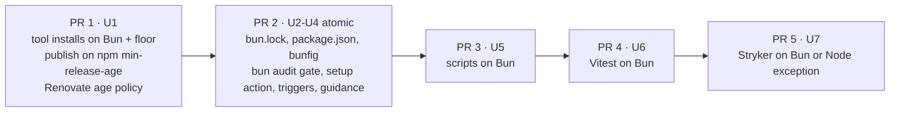

# refactor: Migrate from pnpm to Bun

## Overview

fro-bot/.github moves from pnpm to Bun in five PRs, opened one at a time. PR 1 moves the two tool installs that run outside the repo lockfile to Bun, with a 3-day release-age floor. That closes the 2026-10-19 incident class. PR 2 switches the package manager in one atomic change. PRs 3, 4 and 5 switch the runtime for scripts, Vitest and Stryker. A tool switches only after its required checks pass on Bun. A tool that fails them stays on Node as a named exception. The migration is parity only: it adds no gates, tests or checks beyond what the pnpm setup has today.

## Problem Frame

agent, dashboard and space-bus use Bun. This repo still runs pnpm, with Node 24 executing its TypeScript. Its tool installs (`npm install --prefix`) have no lockfile and no release-age check. On 2026-10-19 one of them resolved a package that had been published minutes earlier. That package depended on a version that did not exist yet, so the install failed with ETARGET and turned the required "Check Workflows" job red. (see origin: docs/brainstorms/2026-10-19-bun-migration-requirements.md)

## Requirements Trace

- R1 to R6 (Bun package management, overrides in `package.json`, build allowlist, 3-day release age with three name exemptions, hoisted layout, workspace): U2.
- R7 to R9 (Bun runtime for scripts, Vitest and Stryker, each switched only after its checks pass, named Node exceptions otherwise): U5, U6, U7.
- R10 (override-floor gate on `bun audit`): U3.
- R11 and R12 (tool installs on Bun with the floor, publish job on npm `min-release-age`, no cache in publish): U1.
- R13 and R14 (Renovate 3-day age including security updates, per-incident exemption): U1, U4.
- R15 (shared setup with SHA-pinned action, frozen install, no dependency or Bun-binary cache, separate private-leak install): U4.
- R16 (`npm publish` and the publish job on npm): U1.
- R17 and R18 (guidance with the exception list, Quartz on npm): U4 to U7.
- Success criteria: every required check passes on its assigned runtime, with only the named exceptions left on Node.

## Scope Boundaries

- Parity only. No new gates, contract tests or checks. Existing tests and gates change only so they keep their current meaning on Bun. The one deliberate exception is the audit gate's strict rule (see Key Technical Decisions).
- `default.json` keeps its behavior for downstream consumers.
- Tests stay on Vitest.
- semantic-release and `npm publish` stay.
- Historical solution docs stay unchanged.
- No other repos change.
- The 55 legacy entry guards stay as they are. Bun 1.4.3 and Node 24.21.0 handle them identically.

## Context & Research

### Relevant Code and Patterns

- `.github/actions/setup/action.yaml` is the single CI install owner, used by 21 workflows. It installs mise, checks `which pnpm`, restores the pnpm store cache and runs `pnpm bootstrap`.
- `pnpm-workspace.yaml` holds:
  - 13 override floors, with their rationale written as YAML comments
  - the build allowlist (esbuild, unrs-resolver)
  - `shamefullyHoist`, `savePrefix: ''` and `shellEmulator`
  - a release-age exemption scoped to one version
- `scripts/check-override-floors.ts` parses pnpm's audit shape through an injectable `runAudit` seam.
- `scripts/check-mutation-guards.ts` spawns `pnpm exec stryker run`. Its `FIXED_TRIGGER_FILES` names `pnpm-lock.yaml` and `pnpm-workspace.yaml`.
- `scripts/build-wiki-write-core.ts` runs `pnpm exec tsc`. The dist check is byte-exact.
- `scripts/renovate-runtime.ts` (with its RE2 rebuild) and `scripts/wiki-write-core-release.ts` run `npm install --prefix`. So does the publish job's inline install in `.github/workflows/release-wiki-write-core.yaml`.
- `scripts/workflow-step-test-helper.ts` stubs only `git` and `node`.
- About 50 test lines pin `pnpm`, `npm` or `node` command strings. These tests must be updated to keep their meaning.

### Institutional Learnings

- `docs/solutions/best-practices/a-policy-scanner-must-parse-tokens-not-prose-2026-09-08.md`: the ported audit parser must stay structural and fail closed on input it cannot read.
- `docs/solutions/best-practices/a-mutation-score-can-measure-nothing-2026-09-08.md`: when Stryker is compared across runtimes, check the report's modules, not only its score.
- `docs/solutions/best-practices/agent-drafts-trusted-publish-split-2026-10-10.md`: keep repo code out of the publish job.

### External References

- Bun 1.4.3 documentation:
  - [install and `minimumReleaseAge`](https://bun.com/docs/pm/cli/install#minimum-release-age)
  - [audit](https://bun.com/docs/pm/cli/audit)
  - [overrides](https://bun.com/docs/pm/overrides)
  - [lifecycle](https://bun.com/docs/pm/lifecycle)
  - [publish provenance](https://bun.com/docs/pm/cli/publish#provenance), which Bun does not support
- npm config [`min-release-age`](https://docs.npmjs.com/cli/v11/using-npm/config/), which shipped in npm 11.10.0.
- `oven-sh/setup-bun` v2.2.0 at commit `0c5077e51419868618aeaa5fe8019c62421857d6`. It defaults to `no-cache: false`.
- Vitest [coverage](https://vitest.dev/guide/coverage/): the V8 provider is incompatible with Bun.

### Probe evidence (Bun 1.4.3, scratch directories only)

- Importing `pnpm-lock.yaml` preserves all 591 package versions, except one pnpm-only entry. Bun moves the overrides and workspaces into `package.json`. It does not carry over `trustedDependencies`, exemptions or `packageManager`.
- `bun audit --json` output:
  - `{}` with exit 0 when the tree is clean.
  - A map keyed by package name with exit 1 when there are advisories. Each record has `id`, `severity` and `vulnerable_versions`, but no `patched_versions`.
  - Empty stdout with exit 1 when the registry fails or there is no lockfile.
- A poisoned entry in Bun's install cache reached `node_modules` under `--frozen-lockfile`. A cold install takes about 5 seconds.
- Entry guards and `import.meta.main` behave identically under Bun and Node.

## Prior-Art Survey

```json
{
  "schema_version": 2,
  "verdict": "extend",
  "scope": "fro-bot/.github repository root at 4032d58 (.worktrees/chore-bun-migration checkout); excludes knowledge/, node_modules/, other .worktrees/",
  "freshness": {
    "vcs_reference": "4032d58"
  },
  "budget": {
    "max_search_passes": 6,
    "max_candidate_inspections": 15,
    "exhausted": true
  },
  "candidates": [
    {
      "path_or_symbol": ".github/actions/setup/action.yaml",
      "description": "Composite Setup: installs mise 2026.10.6, requires pnpm on PATH, keys actions/cache on `pnpm store path` and hashFiles('**/pnpm-lock.yaml'), then runs `pnpm bootstrap`. Every pnpm CI job calls it. Disposition: extend. It is the single install owner, so the Bun swap (setup-bun, bun.lock cache key, frozen install) belongs here. The pnpm store-path and presence checks must be rewritten, not parameterized.",
      "disposition": "extend"
    },
    {
      "path_or_symbol": "pnpm-workspace.yaml",
      "description": "pnpm workspace file: `overrides` ledger of 13 advisory floors (ajv@8, brace-expansion, fast-uri, flatted, minimatch, nanoid, picomatch, postcss, qs, source-map-js, undici, vite, yaml), `minimumReleaseAgeExclude` (one entry: @bfra.me/eslint-config@0.54.0), allowBuilds, onlyBuiltDependencies, shamefullyHoist, shellEmulator, savePrefix ''. No minimumReleaseAge value is set.",
      "disposition": "insufficient",
      "insufficiency_reason": "Pnpm-only keys (allowBuilds, onlyBuiltDependencies, shamefullyHoist, shellEmulator, minimumReleaseAgeExclude, savePrefix) and a pnpm-only ledger location. This file cannot be the install-time owner for Bun. The floor and exemption state must move, and any Bun release-age setting is unverified in this repo."
    },
    {
      "path_or_symbol": "package.json",
      "description": "Root manifest for @fro-bot/.github: packageManager pnpm@11.28.0; bootstrap is `pnpm install`; lint chains check:override-floors; check:renovate-config chains install-renovate.ts; exact devDependency pins (vitest 4.1.11, typescript 6.0.3, eslint 10.12.0); no overrides key. Disposition: extend. This is the dependency manifest the migration must rewrite (packageManager, Bun override floors, every pnpm script), so it is the right owner.",
      "disposition": "extend"
    },
    {
      "path_or_symbol": "scripts/check-override-floors.ts",
      "description": "Fail-closed override floor gate. runPnpmAudit execs `pnpm audit --json` (injectable runAudit); parseAuditOutput requires metadata.vulnerabilities and advisories objects; extractOverridesMap reads pnpm-workspace.yaml; parseRangeGroups and overrideCoveredByPatched do interval coverage. Disposition: extend. Interval math and fail-closed classification are runtime-neutral; the audit command, JSON shape, and workspace input are pnpm-bound and need a Bun adapter.",
      "disposition": "extend"
    },
    {
      "path_or_symbol": "scripts/renovate-runtime.ts",
      "description": "Scratch install of the Renovate pinned at main.yaml env.RENOVATE_VERSION: `npm install --prefix --no-save --no-package-lock --ignore-scripts`, exact-version post-condition, then `npm run install` in node_modules/re2 to restore the RE2 binding. Injectable RunInstall seam. Disposition: extend. The seam and post-conditions are reusable; command 'npm' and the RE2 npm-run rebuild are hardcoded, and Bun's install-script handling must be verified.",
      "disposition": "extend"
    },
    {
      "path_or_symbol": "scripts/wiki-write-core-release.ts",
      "description": "Release-tools section: parseToolPins reads pins from release-wiki-write-core.yaml env; buildToolManifest writes a scratch package.json with a writer overrides entry; installReleaseTools runs `npm install --prefix --ignore-scripts`; assertToolsInstalled checks exact versions; loadReleasePlugins loads two plugins. Disposition: extend. Pin parsing and plugin loading are reusable; the npm command and overrides manifest are npm-specific; install helpers near-copy renovate-runtime.ts.",
      "disposition": "extend"
    },
    {
      "path_or_symbol": "scripts/install-renovate.ts",
      "description": "CLI entry: reads the pinned Renovate version, calls installRenovate into RENOVATE_PREFIX or the runner temp dir, prints the prefix on stdout. Disposition: reuse. Thin wrapper with no install logic of its own. Behavior changes only when renovate-runtime.ts changes, and it needs no edit for a Bun install.",
      "disposition": "reuse"
    },
    {
      "path_or_symbol": "scripts/check-renovate-config.ts",
      "description": "Renovate preset gate, chained after install-renovate.ts by check:renovate-config. Calls loadRenovateRuntime, runs renovate-config-validator --strict --no-global over local configs and pinned github> presets, then runs check-renovate-ranges. Disposition: reuse. Consumes only loadRenovateRuntime, readPinnedVersion, and resolvePrefix, and owns no package-manager call; the pnpm chaining lives in package.json.",
      "disposition": "reuse"
    },
    {
      "path_or_symbol": "scripts/check-mutation-guards.ts",
      "description": "Mutation gate. classifyMutationReport maps Stryker JSON to fail-closed verdicts (pure). defaultStrykerSpawner runs `pnpm exec stryker run` with buildStrykerSpawnEnv removing GITHUB_STEP_SUMMARY, GH_TOKEN, and GITHUB_TOKEN. Reads stryker.config.json reporters and testFiles. Disposition: extend. Classifier and env scrub are runtime-neutral. The spawner is one hardcoded pnpm exec call, so the Bun change is one site. Stryker's vitest runner under Bun is unverified.",
      "disposition": "extend"
    },
    {
      "path_or_symbol": "scripts/build-wiki-write-core.ts",
      "description": "Builds packages/wiki-write-core/dist. runTypeScriptBuild and resolveBuildConfig both shell `pnpm exec tsc` through injectable spawn seams. --check mode verifies the committed dist matches a fresh build. Disposition: extend. The two call sites are already behind seams, so the runner swap is mechanical. The dist-equality check is what the release build job depends on and must still pass after the swap.",
      "disposition": "extend"
    },
    {
      "path_or_symbol": "scripts/workflow-step-test-helper.ts",
      "description": "Test support: runs a workflow run: block under bash with stub git and node on PATH and records an invocation trace. Owns no install or package-manager call. Disposition: extend. The stub list is hardcoded to git and node, so any step that calls bun needs a bun stub added. Otherwise runtime-neutral.",
      "disposition": "extend"
    },
    {
      "path_or_symbol": "default.json",
      "description": "Shared public Renovate preset consumed via local>fro-bot/.github. Sets minimumReleaseAge null for @bfra.me, @fro-bot, fro-bot, pro-actions, and bfra-me package matches and for matching source URLs, with immediate PR creation for those matches.",
      "disposition": "insufficient",
      "insufficiency_reason": "Governs Renovate proposal timing for first-party packages only, not install-time release-age enforcement, and it already exempts first-party packages from any age floor. Changes propagate to every repo that extends it, so Bun-only settings belong in .github/renovate.json5."
    },
    {
      "path_or_symbol": ".github/renovate.json5",
      "description": "Repo-local Renovate config: extends local>fro-bot/.github; disables patch updates except the release-tool packages; holds TypeScript below 6.1; postUpgradeTasks.commands ['pnpm run bootstrap', 'pnpm run fix']. Disposition: extend. This is the correct home for Bun-specific Renovate settings, and the two post-upgrade commands must become Bun commands so one manager regenerates the lockfile.",
      "disposition": "extend"
    },
    {
      "path_or_symbol": ".github/workflows/release-wiki-write-core.yaml",
      "description": "Release workflow with decide, build, and publish jobs. Publish gates on npm --version >= 11.5.1 for npm trusted publishing (OIDC), uses setup-node 24 with no registry-url, installs semantic-release tools with `npm install --prefix --ignore-scripts`, and runs semantic-release --ci. Decide and build use the shared setup action and pnpm.",
      "disposition": "insufficient",
      "insufficiency_reason": "Trusted publishing is npm-bound here (npm version gate, npm-installed plugins, @semantic-release/npm publish). The repo has no Bun publish path, and whether Bun performs OIDC publish with provenance is unverified, so this job cannot migrate on this survey alone."
    },
    {
      "path_or_symbol": ".github/workflows/main.yaml",
      "description": "CI job graph: lint, check-types, test, check-wiki-write-core-dist, test-scripts-load, check-workflows, check-wiki-authority, check-mutation-guards. Sets env.RENOVATE_VERSION 44.165.2 as the single Renovate pin. Eight steps invoke pnpm directly, and every pnpm job uses the setup action. Disposition: extend. The job graph is the integration boundary. The change is eight command rewrites plus setup, with RENOVATE_VERSION kept as the one declaration.",
      "disposition": "extend"
    }
  ]
}
```

## Key Technical Decisions

- **Five PRs, opened one at a time.** PR 1 is the incident fix (U1). PR 2 is the atomic package-manager cutover (U2 to U4). Splitting it would leave Lint red, or let a lock-only change skip the mutation gate. Then come scripts (U5), Vitest (U6) and Stryker (U7).
- **Strict audit rule (operator decision, the one deviation from parity).** Bun audits only installed versions and reports no `patched_versions`. The gate therefore fails on any reported advisory at `high` or above, on an unknown severity, and on output it cannot parse. It no longer reads the overrides. This rule is stricter than today's gate in one case: a vulnerable copy of a package can stay installed beside a floored copy, as `ajv@6` does beside `ajv@8`. Today's gate passes that case and the strict rule fails it. The strict rule also drops one pre-emptive check: a floor below the patched range now passes as long as the locked version is patched. On a0641bc both rules give the same result, because there are no high or critical advisories.
- **No dependency cache and no cached Bun binary.** The shared setup drops `actions/cache`, and every `setup-bun` step sets `no-cache: true`. Bun does not re-verify cache entries against `bun.lock`, and a cold install takes about 5 seconds.
- **Floors on tool installs are explicit flags.** Each prefix is a fresh directory with no bunfig, so `--minimum-release-age` goes on the command line and the prefix manifest pins exact versions. Existing tests that pin the install argv get updated to the Bun argv.
- **The publish job stays on npm.** Its inline install keeps npm and adds `min-release-age=3`. The npm version gate rises to 11.10.0. No repo code and no Bun binary enter the job that holds `id-token: write`.
- **Bun pin in two steps.** In U1, `setup-bun` takes an explicit Renovate-tracked `bun-version`, because `packageManager` is still pnpm. In U4 it switches to `bun-version-file: package.json`, and the explicit pin is deleted.
- **`bun run <script>` everywhere.** Bare `bun test` and `bun build` would run Bun's built-in tools instead of the package scripts.
- **Named exceptions:**
  - `coverage` runs on Node, because V8 coverage does not work under Bun.
  - "Test Scripts Load" stays on Node with its context name unchanged.
  - The private-leak scan stays on Node.
  - `npm publish`, the publish job's install, and `npm pack` in the package test stay on npm.
  - The Quartz build stays on npm.
  - The Renovate validator moves to Bun only if Check Workflows passes on Bun in U5.
  - If re2's install script does not build under Bun, that one step keeps npm.
  - Every exception is listed in the origin's R17, and in `.github/copilot-instructions.md` once it ships.
- **Override rationale moves to a doc.** JSON cannot carry the YAML comments that explain each floor, so they move to `docs/override-floors.md` unchanged. Nothing tests that file.
- **Reverts.** PRs 3 to 5 revert by reverting their squash commit. PR 1 can be reverted only before PR 2 merges. Reverting PR 2 means restoring `pnpm-lock.yaml` and `pnpm-workspace.yaml` from the pre-cutover commit, carrying forward any floors added since, and checking the result with pnpm.

## Open Questions

### Resolved During Planning

- **pnpm lock import:** it preserves versions, and U2 uses it.
- **`bun audit` output shape:** recorded in the probe evidence above, and used by U3.
- **`bun publish`:** it lacks provenance, so `npm publish` stays.
- **`setup-bun` caching:** it caches by default, so every use sets `no-cache: true`.
- **Release-age floor:** probed on Bun 1.4.3 with `@aws-sdk/client-s3@3.1153.0`, published 3 hours earlier.
  - The floor applies to transitive dependencies.
  - When no version is old enough, the install fails and does not fall back. The error is `blocked by minimum-release-age`.
  - A bare-name exclude exempts the package, but an exact `name@version` exclude does not. The current docs describe a newer Bun. The three name exemptions therefore stay as R4 states.
- **Local Bun:** `mise.toml` replaces `pnpm = "11.28.0"` with `bun = "1.4.3"`. That keeps today's two-pin setup (`packageManager` plus mise). Renovate tracks both pins.

### Deferred to Implementation

- Does re2's install script build the RE2 binding when run through Bun? U1 proves it. If it doesn't, that one step keeps an npm invocation. The existing RE2 assertions stay either way.
- Does Review Dependencies handle `bun.lock`? Observe it on PR 2. If it fails, stop and ask.
- Does the Renovate host allow `bun run` in `postUpgradeTasks`? Watch the first Renovate PR after PR 2 merges.
- Do Vitest and Stryker run on Bun's runtime with the same results as Node? U6 and U7 decide this from evidence.
- Does every package script run correctly under Bun's script shell, since Bun has no `shellEmulator`? Check this in U2.
- The lock import drops one pnpm-only entry, `ts-declaration-location@1.0.7`. U2 confirms that nothing in the Bun tree requires it before relying on the import.

## High-Level Technical Design

> *This illustrates the intended approach and is directional guidance for review, not implementation specification. The implementing agent should treat it as context, not code to reproduce.*



## Implementation Units

- [ ] **Unit 1: Tool installs on Bun with the 3-day floor (PR 1)**

**Goal:** Close the incident class.

**Requirements:** R11, R12, R13, R14, R16, AE1, AE6.

**Dependencies:** #4017 merged.

**Files:**
- Modify: `scripts/renovate-runtime.ts`, `scripts/renovate-runtime.test.ts`, `scripts/wiki-write-core-release.ts`, `scripts/wiki-write-core-release.test.ts`
- Modify: `.github/actions/setup/action.yaml`, which gains `setup-bun` pinned by SHA, with an explicit `bun-version` carrying a `# renovate:` comment and `no-cache: true`.
- Modify: `.github/workflows/release-wiki-write-core.yaml`. In the publish job, the npm gate rises to 11.10.0 and the inline install gets `min-release-age=3`.
- Modify: `scripts/release-wiki-write-core-workflow.test.ts`, updating its existing install-argv pins and npm-gate assertion.
- Modify: `.github/renovate.json5`, adding a top-level `minimumReleaseAge: "3 days"`, `vulnerabilityAlerts.minimumReleaseAge: "3 days"`, and tracking for the Bun pin.
- Modify: `.github/copilot-instructions.md`, changing the scratch-install sentence.

**Approach:**
- Each installer writes the prefix `package.json` with exact versions. The release tools keep the changelog-writer override. The installer then runs `bun install` in the prefix with `--minimum-release-age=259200`, `--ignore-scripts` and `--no-save`.
- The existing exact-version post-conditions stay.
- The RE2 rebuild runs re2's install script inside the prefix, and the existing RE2 assertions stay.
- Module resolution through `createRequire` against the prefix `package.json` is unchanged.
- In the publish job, semantic-release keeps running on Node from `setup-node`.

**Patterns to follow:** the `RunInstall` seam and `assertToolsInstalled`.

**Test scenarios:**
- Happy path: the existing argv tests now assert the Bun command, with the floor flag, `--ignore-scripts`, `--no-save`, and the prefix as cwd.
- Error path: the existing tests for a failed install, a failure to start and a version mismatch keep passing, with messages that name Bun.
- Happy path: the existing publish-job pins assert the npm install with `min-release-age=3`.
- Integration: the real-plugin suites in Check Workflows pass against the trees Bun installed.

**Verification:** Check Workflows passes.

- [ ] **Unit 2: Manifests and lockfile on Bun (PR 2)**

**Goal:** Bun manages packages, and every floor, build allowlist entry and workspace link is preserved.

**Requirements:** R1 to R6.

**Dependencies:** PR 1 merged.

**Files:**
- Create: `bunfig.toml`. Its `[install]` section sets `linker = "hoisted"`, `exact = true`, `minimumReleaseAge = 259200`, and `minimumReleaseAgeExcludes` for the three `@bfra.me` names.
- Create: `bun.lock`, imported from `pnpm-lock.yaml`.
- Create: `docs/override-floors.md`, which holds the floor rationale moved out of the YAML comments.
- Modify: `package.json`. It gets the Bun `packageManager`, `workspaces`, the 13 `overrides`, and `trustedDependencies` (esbuild, unrs-resolver). Scripts switch to `bun run`.
- Delete: `pnpm-workspace.yaml`, `pnpm-lock.yaml`.
- Modify: `mise.toml` (`pnpm` becomes `bun = "1.4.3"`), `.prettierignore`, and `packages/wiki-write-core/package.json` if its scripts call pnpm. The consumer install line in `packages/wiki-write-core/README.md` stays as is.

**Approach:**
- Create `bun.lock` by importing the pnpm lock, so resolved versions are preserved.
- Add the keys the import does not carry.
- `exact = true` replaces `savePrefix: ''`.

**Test expectation:** none. This unit changes configuration, and Check Types, Test and Check Wiki Write Core Dist cover it.

**Verification:**
- A frozen install succeeds.
- `bun pm ls` shows each floored package at or above its floor, including `ajv` resolving to 8.x where the selector applies.
- `bun pm untrusted` lists nothing that needs a build.
- The dist hash is unchanged.

- [ ] **Unit 3: Override-floor gate on `bun audit` (PR 2)**

**Goal:** Keep the gate fail-closed on Bun's audit output.

**Requirements:** R10, AE5.

**Dependencies:** Lands with Unit 2.

**Files:**
- Modify: `scripts/check-override-floors.ts`, `scripts/check-override-floors.test.ts`, and the reason text in `mutation-guards.json`.

**Approach:**
- The adapter runs `bun audit --json` through the existing `runAudit` seam.
- `{}` means clean.
- In a map of advisories, any record at `high` or above fails, and so does any record with an unknown severity. Records below `high` are skipped, as they are today.
- Output the gate cannot parse fails, as it does today. Empty stdout counts as unparseable.
- Delete the overrides read and the patched-interval code, since the strict rule makes them dead.
- Messages name the package, advisory id, severity and vulnerable range.

**Patterns to follow:** the existing injected-`runAudit` tests.

**Test scenarios:** These replace today's tests one for one.
- Happy path: `{}` is clean. A map that holds only moderate or low records is clean.
- Error path: a high record fails, and so does a critical record. An unknown severity fails.
- Error path: empty or non-JSON output fails. A record without `severity` or `vulnerable_versions` fails.
- Integration: the real `bun audit` on this repo passes in Lint.

**Verification:** `bun run check:override-floors` passes, and mutation guards report 0 survivors for this module.

- [ ] **Unit 4: CI, gates, prompts and guidance on Bun (PR 2)**

**Goal:** Every CI install path uses Bun. Every gate watches the Bun files. Guidance matches the new setup.

**Requirements:** R1, R13, R15, R17, R18.

**Dependencies:** Lands with Units 2 and 3.

**Files:**
- Modify: `.github/actions/setup/action.yaml`. `setup-bun` reads `bun-version-file: package.json`. Remove the explicit pin, the `which pnpm` check, the store-path step and `actions/cache`. Run `bun install --frozen-lockfile`. mise keeps Node and Python.
- Modify: `.github/workflows/check-private-leak.yaml`. Add a standalone `setup-bun` with `no-cache: true`, and run `bun install --frozen-lockfile --ignore-scripts`. mise keeps Node for the scan.
- Modify: the `pnpm` calls in `main.yaml`, `release-wiki-write-core.yaml` (decide and build), `copilot-setup-steps.yaml` (keep the job name) and any other workflow. They become `bun run <script>`, or `bunx` for direct package binaries.
- Modify: the agent prompts in `.github/workflows/fro-bot.yaml` and `.github/workflows/draft-solutions.yaml`, including the override text that names `pnpm-workspace.yaml`.
- Modify: `.github/renovate.json5`, where `postUpgradeTasks` becomes `bun run bootstrap` and `bun run fix`.
- Modify: `scripts/check-mutation-guards.ts`. `FIXED_TRIGGER_FILES` swaps the pnpm files for `bun.lock` and `bunfig.toml`, and the spawner runs `bunx stryker run`. Also modify `scripts/check-mutation-guards.test.ts`.
- Modify: `scripts/build-wiki-write-core.ts` and `scripts/build-wiki-write-core.test.ts` (`bunx tsc`).
- Modify: the existing workflow contract tests that pin `pnpm` strings: `main-workflow`, `release-wiki-write-core-workflow`, `survey-repo-workflow`, `draft-solutions-workflow`, `fro-bot-workflow`, `dispatch-renovate`, `improvement-metrics-workflow`, `rename-tracked-repo-workflow` and `fro-bot-workflow-wiki-handoff`.
- Modify guidance: `.github/copilot-instructions.md`, `README.md`, `llms.txt` and `.agents/skills/generating-project-docs/SKILL.md`.

**Approach:**
- The runtime does not change in this PR. Calls to `node scripts/*.ts` stay as they are.
- The PR commits are split for review in this order: lock import, audit gate, setup and CI, private-leak, mutation triggers, test updates, Renovate config, prompts and docs. Merges are squash-only, so the split is for review, not for revert.
- No PR run exercises the private-leak install, because it runs from `main`. The PR body records a local dry run of that install, and the first scan after merge is checked.

**Test scenarios:**
- Happy path: the updated contract tests assert the Bun commands where they used to assert pnpm commands.
- Happy path: the mutation trigger set contains `bun.lock` and `bunfig.toml` where it used to contain the pnpm files.
- Happy path: the `build-wiki-write-core` spawn argv uses `bunx tsc` with the same flags.

**Verification:** All 14 required contexts pass on the PR. After merge, the first private-leak scan and the first Renovate PR succeed.

- [ ] **Unit 5: Scripts on Bun (PR 3)**

**Goal:** Run `scripts/*.ts` under Bun, except the named exceptions.

**Requirements:** R7, R9, R17.

**Dependencies:** PR 2 merged.

**Files:**
- Modify: the workflow calls `node scripts/…` and `node ../scripts/…` (about 77 sites in 20 workflows). They become `bun scripts/…`. The exceptions are the private-leak scan and "Test Scripts Load". `publish-wiki.yaml` needs a standalone `setup-bun` with `no-cache: true` for its `wiki-lockfile-gates.ts` calls.
- Modify: the package scripts that run `node scripts/…`, and the agent prompt commands.
- Modify: `scripts/workflow-step-test-helper.ts` (add a `bun` stub) and `scripts/data-branch-probe-workflows.test.ts`, so its `node` assertions check `bun` and keep their meaning.
- Modify: the existing contract tests and the operator remediation text that pin `node scripts/` strings.
- Modify: guidance.

**Approach:** `check-renovate-config.ts` spawns `process.execPath`, so the validator runs on Bun. If Check Workflows fails on it, `check:renovate-config` keeps `node`.

**Test scenarios:**
- Happy path: the updated contract tests and probe-step tests assert `bun scripts/…`.
- Integration: every workflow script that PR CI runs passes under Bun.

**Verification:** The required contexts pass. After merge, dispatches of the scheduled workflows succeed, run one at a time with operator approval.

- [ ] **Unit 6: Vitest on Bun (PR 4)**

**Goal:** Run the test suite on Bun's runtime with the same results.

**Requirements:** R8, R9.

**Dependencies:** PR 3 merged.

**Files:**
- Modify: `package.json`, so that `test` runs Vitest under `bun --bun` and `coverage` stays on Node. Also the Vitest steps in `main.yaml` and `release-wiki-write-core.yaml`.
- Modify: `scripts/renovate-runtime.test.ts`, whose Node-only `--input-type=module --eval` becomes a temp module file. Also any test that assumes `process.execPath` is Node.
- Modify: guidance.

**Approach:** Switch only if the Bun run reports the same file, test and skip totals as the Node run on the same commit. Otherwise Vitest keeps a named Node exception, with the evidence recorded.

**Test expectation:** none new. The existing suite is the proof.

**Verification:** "Test" and "Check Workflows" pass on Bun. The PR body records the count comparison.

- [ ] **Unit 7: Stryker on Bun or a named Node exception (PR 5)**

**Goal:** Settle the mutation gate's runtime with evidence.

**Requirements:** R8, R9, AE3.

**Dependencies:** PR 4 merged.

**Files:**
- Modify: `scripts/check-mutation-guards.ts` (run the spawner under `bun --bun`), `scripts/check-mutation-guards.test.ts` (its existing spawner argv pin), and guidance.

**Approach:** Switch only if the Bun report matches the Node report on the same commit: the same modules, the same mutant counts and the same Killed counts. Otherwise keep the spawner on Node and record the named exception.

**Test scenarios:** Happy path: the updated spawner argv pin matches the runtime chosen.

**Verification:** Check Mutation Guards passes. The PR body records the per-module comparison.

## System-Wide Impact

- **Interaction graph:** the 21 workflows that use the setup action, the agent prompts, Renovate's post-upgrade tasks and the release pipeline.
- **State lifecycle risks:** Open Renovate PRs that touch `pnpm-lock.yaml`, `package.json`, `mise.toml` or workflows will conflict with PR 2. Settle them before PR 2 merges, or close them after it. Expect the first full re-resolve to change about 188 packages.
- **Unchanged invariants:** These stay the same:
  - required-context names
  - the npm trusted publisher binding
  - the dist hash
  - the 13 floors
  - `default.json`

## Risks & Dependencies

| Risk | Mitigation |
|---|---|
| A security fix less than 3 days old cannot install, so Lint stays red. | The R14 temporary exact-name exemption. This is the same kind of window today's gate has. |
| The three `@bfra.me` name exemptions cover every version of those packages. | Accepted. They are CI-only dev tooling, and tool installs and the publish job carry no exemptions. |
| A broken private-leak install on `main` blocks every PR, because the scan runs `main`'s workflow and `enforce_admins` is on. | The scan stays on Node. The install change gets a local dry run before PR 2. The first post-merge scan is watched. |
| Review Dependencies cannot read `bun.lock`. | Stop and ask. |
| The Renovate host rejects `bun run`. | Watch the first Renovate PR. The operator updates the host config. |
| Vitest or Stryker misbehave under Bun. | U6 and U7 switch only on matching evidence. |
| A squash title could trigger a release. | PR titles use `refactor:`, `chore:` or `ci:`, which do not release. Never dispatch the release workflow during the rollout. |

## Documentation / Operational Notes

- Guidance ships in the same PR as the switch it describes. The final list of exceptions lives in `.github/copilot-instructions.md`.
- After each merge, run the checks one at a time:
  - PR 1: the next release decide run.
  - PR 2: the first private-leak scan and the first Renovate PR.
  - PR 3: the scheduled script workflows, in ascending blast-radius order, each dispatched with operator approval.

## Sources & References

- **Origin document:** [docs/brainstorms/2026-10-19-bun-migration-requirements.md](../brainstorms/2026-10-19-bun-migration-requirements.md)
- Related PRs: #3793, #3998, #4017.
- Triggering run: Main run 39305952489, job 118242962583 ("Check Workflows"), step "Validate Renovate Config".
- Sibling precedents: fro-bot/agent (`bunfig.toml`, `.github/renovate.json5`), fro-bot/dashboard (`bunfig.toml`), fro-bot/space-bus.
