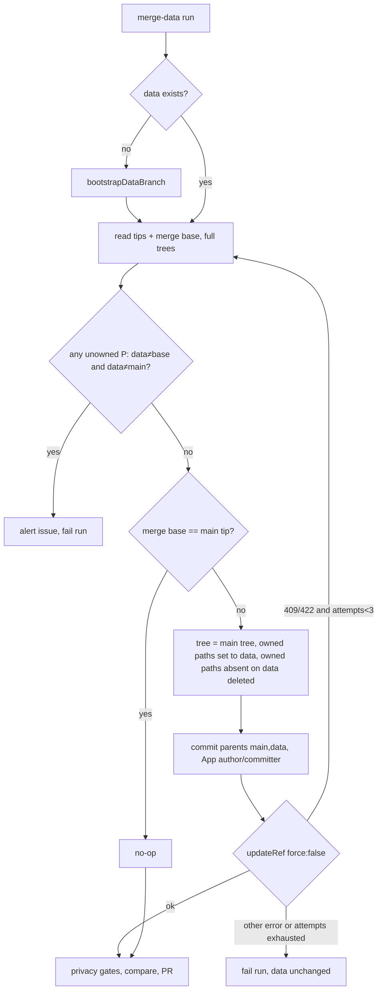

# fix: Keep the data branch present through promotion

## Overview

Once U5 applies, a deletion-only ruleset with no bypass actors stops promotion merges from removing `data`. Each merge-data run first writes an ownership merge onto `data`: one App-authored commit whose tree is `main` with the data-owned paths taken from `data`. After that, the promotion compare shows only new writes. The bootstrap stays as the recovery path for a missing branch. Before any code is written, a probe checks whether the App can make this write at all, since the commit brings `main`'s workflow files onto `data` and the App has no `workflows` permission.

## Problem Frame

Every squash promotion deletes `data` through `delete_branch_on_merge`. The gateway and dashboard then read no policy until a writer bootstraps the branch again. Issue #4018 recorded gaps of 53 and 54 minutes, and in the second one the gateway denied every repo for about 40 minutes. The delete-and-reseed cycle was deliberate: a kept `data` would replay history that had already been squash-promoted and would conflict on the next promotion (see origin: `docs/brainstorms/2026-10-20-keep-data-branch-present-requirements.md`).

## Requirements Trace

- R1 to R3 (deletion ruleset with no bypass, App ruleset unchanged, auto-delete still on): U5.
- R4, R8, R9 (bootstrap if missing, merge-back when `data` lacks `main`, no-op when it contains it, App author): U3, U4.
- R5 (tree matches `data` on owned paths and `main` elsewhere, including absent paths): U2, U3.
- R6 (fail closed on unowned changes, with an alert): U3. The rule was refined during planning, see Key Technical Decisions.
- R7 (non-force update, rebuild and recheck, 3 attempts): U3.
- R10 (a failed merge-back blocks compare, PR and labels): U4.
- R11, R12 (promotion diff shows only new writes, stale alert measures the write backlog): U4.
- R13, R14 (bootstrap is recovery only, docs and tests updated): U4, U5, U6.
- Precondition for all of the above: U1, the workflow-file feasibility probe.

## Scope Boundaries

- Gateway or dashboard fallback to `main`, disabling auto-delete repo-wide, changing merge methods, and moving the promotion PR head off `data` are all out (see origin).
- The reconcile integrity check stays a tip-author check (see origin).
- No run-start readback of the rules, and no alert when `data` goes missing. The first live promotion is checked once, by hand (see Documentation / Operational Notes).

### Deferred to Separate Tasks

- **`packages/wiki-write-core/src/wiki-ingest.ts` JSDoc** on `bootstrapDataBranch` still says GitHub deletes `data` after a promotion. Editing package source rebuilds `dist` and releases the package, so the wording waits for the next functional change to the package.
- **Promotion PR body refresh.** The body is written only when the PR is created and never updated on later runs, so overlapping runs can leave it stale. This predates the change and the merge-back does not affect it.

## Context & Research

### Relevant Code and Patterns

- `scripts/rename-tracked-repo.ts`: the Git Data writer to follow. It fails closed on a truncated tree, writes `updateRef` with `force: false`, turns 409 and 422 into a ref race, and rebuilds from the fresh head for up to 3 attempts.
- `packages/wiki-write-core/src/data-branch-bootstrap.ts`: `bootstrapDataBranch` (idempotent, tolerates a create race), plus the App author and committer constant. That constant is not exported, so the script defines its own.
- `packages/wiki-write-core/src/wiki-ingest.ts`: `sha: null` deletion entries. Do not copy its handling of truncated trees, which skips deletions silently.
- `scripts/check-wiki-authority.ts`: `guardedPatterns()`, a zero-arity function so that its mutants stay killable. It is in the Stryker `mutate` list.
- `scripts/merge-data-pr.ts`:
  - `compareBranches`
  - the "no PR" gate
  - `maybeCreateStaleDivergenceAlert`, which reads `commits.at(-1)`
  - `maybeCreateConflictAlert`
  - `findExistingPullRequest`, which uses `listPullRequestsAssociatedWithCommit` and so also returns closed PRs
  - `maybeUpdateBehindPullRequest`
- `.github/workflows/merge-data.yaml`: App mint (contents, pull-requests and issues write), the `main` checkout, Setup at about line 47, the `data` checkout for the privacy gates at about lines 51-55, the gates, then `merge-data-pr.ts`.
- `scripts/git-data-fake.ts`: a Git Data test fake whose `updateRef` checks fast-forward.
- `scripts/merge-data-workflow.test.ts`: the YAML step contract test.
- `scripts/settings-data-ruleset.test.ts`: pins the single `data` ruleset. Its header documents that the plugin deletes any ruleset not declared in `.github/settings.yml`.

### Institutional Learnings

- `docs/plans/2026-10-09-004-fix-reconcile-redirect-rename-plan.md` and `docs/solutions/integration-issues/identity-probe-follows-redirects-hides-repo-renames-2026-10-10.md`:
  - Build from full trees and throw on truncation.
  - Only an `updateRef` 409 or 422 is retryable. Retry by re-reading the tip and rebuilding.
  - Blob, tree and commit errors are terminal.
- `docs/solutions/integration-issues/bootstrap-data-branch-before-autonomous-writes-2026-05-09.md`: the App must be both author and committer.
- `docs/solutions/best-practices/shared-invariants-need-one-implementation-2026-08-31.md`: one shared definition, and a test that every consumer adopts it.
- `docs/solutions/best-practices/a-mutation-score-can-measure-nothing-2026-09-08.md`: pattern lists must sit behind a function, not a module-level `const`.
- `docs/solutions/best-practices/test-the-integration-seam-not-the-endpoints-2026-07-06.md`: prove the order of workflow steps with a YAML contract test.
- `docs/solutions/best-practices/github-issues-api-same-run-eventual-consistency-2026-05-20.md`: deduplicate alerts within a run.
- `docs/solutions/best-practices/review-shared-settings-against-effective-inherited-config-2026-10-09.md`: settings changes don't run in PR CI. Read the ruleset back after it is applied.

### External References

- GitHub docs, "Managing the automatic deletion of branches": repository rules can block automatic head-branch deletion.
- GitHub REST, compare two commits: `behind_by` is not capped by pagination, the `commits` list is capped at 250, and `files` is capped (measured at 300).
- GitHub REST, Git trees: `sha: null` deletes an entry. A recursive read truncates at 100,000 entries or 7 MB.
- GitHub App permissions: the `workflows` permission gates changes to workflow files. A Community report (discussions #108402) shows `update-branch` failing on this check. GitHub doesn't document which diff it checks for Git Data ref updates.

### Live Evidence

- The `main...data` compare at `aff178a` shows them diverged: data is 5 ahead and 15 behind, with merge base `a0641bc`. Every file `data` changed is data-owned. All 5 commits are `fro-bot[bot]` commits with one parent each.
- On #3937, #3951, #3975, #3984 and #4007, the App's `updateBranch` merges landed on `data` as author `fro-bot[bot]`, committer `web-flow`. Their diffs against the first parent included 1 to 20 changed workflow files. So GitHub's own server-side merge passes the workflow check with this App token. Git Data API ref updates remain unproven.

## Prior-Art Survey

```json
{
  "schema_version": 2,
  "verdict": "extend",
  "scope": "fro-bot/.github@aff178a: .github/, scripts/, packages/wiki-write-core/src (excludes .worktrees/)",
  "freshness": {
    "vcs_reference": "aff178a"
  },
  "budget": {
    "max_search_passes": 6,
    "max_candidate_inspections": 15,
    "exhausted": true
  },
  "candidates": [
    {
      "path_or_symbol": "packages/wiki-write-core/src/data-branch-bootstrap.ts:bootstrapDataBranch",
      "description": "Creates the missing data branch from main. Calls getBranch(data) first and returns it unchanged if present. On 404 it builds a restore commit with main's tree, parent main's head, author fro-bot[bot], then calls createRef. A 422 race returns the existing ref.",
      "disposition": "extend"
    },
    {
      "path_or_symbol": "scripts/data-branch-bootstrap.ts",
      "description": "Thin CLI shim. Re-exports @fro.bot/wiki-write-core/data-branch-bootstrap and runs runDataBranchBootstrapCli when invoked directly. Owns no ref or tree logic.",
      "disposition": "insufficient",
      "insufficiency_reason": "Holds no ref or tree logic. Any change belongs in the package module packages/wiki-write-core/src/data-branch-bootstrap.ts."
    },
    {
      "path_or_symbol": "packages/wiki-write-core/src/wiki-ingest.ts",
      "description": "Overlay writer for the data branch. Runs getRef(heads/branch), createBlob per file, then createTree with base_tree set to the head tree and sha null for deletions, then createCommit with parents [head], then updateRef with force false. Retries 409 with a delay and re-bootstraps data on 404.",
      "disposition": "extend"
    },
    {
      "path_or_symbol": "scripts/rename-tracked-repo.ts:writeCommit",
      "description": "Git Data writer for the tracked-repo rename. Runs createBlob, createTree with base_tree set to the snapshot tree, createCommit with parents [headSha], and updateRef with force false. A 409 or 422 becomes RefRaceError, and the renameTrackedRepo loop rebuilds from the fresh head (3 attempts).",
      "disposition": "insufficient",
      "insufficiency_reason": "Single parent and overlay-only tree. Every write passes assertChangePolicy first, which rejects any path outside rename operations, so a reseed or main-owned-path write fails policy. The retry loop is reusable only by extraction."
    },
    {
      "path_or_symbol": "scripts/rename-tracked-repo.ts:assertChangePolicy",
      "description": "Per-operation path allowlist for the rename. create-page, edit-page and delete-page are limited to knowledge/wiki/repos pages. write-index, append-log and write-row are limited to fixed paths. Anything else raises PATH_POLICY. Enforces the no-overwrite invariant.",
      "disposition": "insufficient",
      "insufficiency_reason": "The allowlist is keyed to rename operations, not to a standing branch ownership map. It cannot express which side owns a path across a sync."
    },
    {
      "path_or_symbol": "scripts/merge-data-pr.ts:maybeUpdateBehindPullRequest",
      "description": "Calls pulls.updateBranch with expected_head_sha only when a promotion PR exists and mergeable_state is 'behind'. A head-sha 422 returns 'behind'. Retryable errors log a warning and return null.",
      "disposition": "insufficient",
      "insufficiency_reason": "Runs only after a promotion PR exists, so a missing or closed PR gets no update. GitHub's server-side merge builds the commit, so this code controls neither parents nor author. It cannot reseed a deleted data branch."
    },
    {
      "path_or_symbol": "scripts/merge-data-pr.ts:AUTO_MERGE_PATH_PREFIXES",
      "description": "Two-prefix list ['knowledge/', 'metadata/'] used by selectLabel. It picks automerge when every promotion-diff file falls under those prefixes, and needs-review otherwise.",
      "disposition": "insufficient",
      "insufficiency_reason": "Classifies the promotion diff for labeling only. It names no per-side ownership and no path that main owns."
    },
    {
      "path_or_symbol": "scripts/commit-metadata.ts:commitMetadata",
      "description": "Writes one metadata/<name>.yaml on data through repos.createOrUpdateFileContents. Retries 409 up to maxRetries, bootstraps data before writes and on 404, and refuses main. METADATA_PATH_PATTERN restricts paths.",
      "disposition": "insufficient",
      "insufficiency_reason": "Single-file contents-API write. It cannot build a tree, set a second parent, or write main-owned paths."
    },
    {
      "path_or_symbol": ".github/workflows/merge-data.yaml",
      "description": "Trigger and gate owner: repository_dispatch promote-data, weekly cron, and workflow_dispatch. Checks out main, fetches data for the privacy gates, then runs merge-data-pr.ts with the App token. Workflow-level contents is read. Performs no ref write.",
      "disposition": "insufficient",
      "insufficiency_reason": "Owns the trigger and the gates only. A reseed step would have to be added here, but the reseed logic belongs in a package module."
    },
    {
      "path_or_symbol": ".github/settings.yml:rulesets['data branch: Fro Bot App only']",
      "description": "Active branch ruleset on refs/heads/data with rules update, non_fast_forward and creation, and no deletion rule (a comment says this keeps the reseed working). It has one bypass actor: Integration 218644, always. scripts/settings-data-ruleset.test.ts pins these values.",
      "disposition": "insufficient",
      "insufficiency_reason": "Constrains writes but provides no sync mechanism and no path ownership. The always-bypass means non_fast_forward does not stop App force-updates, so the non-force guarantee rests only on code (updateRef with force false)."
    },
    {
      "path_or_symbol": "scripts/git-data-fake.ts",
      "description": "Test double for the Git Data API: createTree, createCommit, and updateRef with a fast-forward check and failNext hooks. Used by the rename-tracked-repo tests.",
      "disposition": "insufficient",
      "insufficiency_reason": "Test fake only, not a production owner. It is the natural verification harness for an extended writer."
    }
  ]
}
```

## Key Technical Decisions

- **Probe before code (U1).** The merge-back commit gives `data` main's `.github/workflows/**`. GitHub refuses App pushes that change workflow files without the `workflows` permission, and repo policy forbids minting that permission. Server-side `updateBranch` merges already pass, but a Git Data `updateRef` has never been tried. If the probe fails, we stop and change the design. Granting `workflows` would need its own decision.
- **Parent order `[main, data]`.** With this order, `data`'s first-parent history follows `main`, and the first-parent diff shows only owned paths. The order is not a workaround for GitHub's workflow check. The `updateBranch` merges that passed have `data` as their first parent, and their diffs against that parent include workflow files. If U1 fails, putting the parents in the other order is not a fallback.
- **Refined R6 rule.** The merge-back fails only for an unowned path P where `data[P]` differs from both the merge base and `main`. Two entries differ when their sha, mode or type differs, and absence counts as a value. This changes origin R6 on purpose. Only the App can write `data`, so the origin's "any unowned change" rule could never clear and would block every later run. With this rule, the operator clears a stuck change by landing the same content on `main` through an ordinary PR. The check runs on every run, including no-op runs, and compares full trees, because `compare.files` caps at 300.
- **Containment test.** `compare(main...data).merge_base_commit.sha` equal to `main`'s tip means `data` contains `main`. The plan doesn't rely on `status` literals.
- **The writer lives in `scripts/merge-back-data.ts`.** Putting it in `@fro.bot/wiki-write-core` would mean a package release and a `dist` rebuild for what is only control-plane logic.
- **Separate workflow step.** The merge-back runs after Setup and before the `data` checkout, so the privacy gates and the compare both see the merged-back `data`. Its failure fails the job, and every later step is skipped.
- **`updateBranch` stays.** `main` requires branches to be up to date, and the server-side merge already passes the workflow check. On an open promotion PR it cannot conflict on owned paths, because no other promotion lands while that PR is open. A 422 merge conflict goes to the existing conflict alert instead of a generic throw.
- **Alerts reuse merge-data's existing deduplicated issue alerts.** `merge-data-pr.ts` exports its helpers unchanged, and no new channel is added. When the head is `data`, the conflict alert drops its "push to the head branch" instruction, because only the App can write `data` and the next merge-data run rebuilds it.
- **Cross-run concurrency.** Dispatch runs and manual or scheduled runs keep their separate concurrency groups. Compare-and-set on the `data` ref is the only guarantee between runs. Overlapping runs can leave a promotion PR's file list stale until the next run, and they cannot lose or corrupt a write.
- **Mutation coverage.** `scripts/merge-back-data.ts` and its test are added to the Stryker `mutate` and `testFiles` lists. The config tests don't require this, but the script writes to `data` unattended, so it gets the full gate.
- **One delivery.** The ruleset and the merge-back merge together. A ruleset without the merge-back would keep stale history and replay it. A merge-back without the ruleset does nothing, since a bootstrapped `data` already contains `main`.

## Open Questions

### Resolved During Planning

- **Readback for the first live promotion:** the `data` tip SHA read before and after the merge, plus `GET /rules/branches/data` listing `deletion`. Neither a missing timeline event nor an empty rule-suites result counts as proof.
- **Merge-back placement:** its own step, after Setup and before the `data` checkout.
- **`updateBranch`:** stays. Conflicts are routed to the alert.
- **"No PR" signal:** the changed-file list alone. The stale alert uses the newest commit with one parent.
- **Truncated trees:** fail closed.
- **Compare truncation:** a 399-commit compare returned 250 commits, with `main`'s tip last. The API keeps the newest 250, so `commits.at(-1)` is safe for the PR lookup and the stale filter.
- **Settings credential:** Update Repo Settings already created the existing `data` ruleset from `.github/settings.yml` (#3932), so it can create the second ruleset.
- **Who creates the deletion ruleset:** declared in `.github/settings.yml` and applied by Update Repo Settings when the PR merges to `main`.

### Deferred to Implementation

- **Empty bypass list:** whether GitHub accepts `bypass_actors: []`. The plugin passes the value through unchanged, and U5's readback confirms what GitHub stored.
- **Error shape:** the exact HTTP status and body for a workflow-permission rejection. U1 records them.

## High-Level Technical Design

> *This illustrates the intended approach and is directional guidance for review, not implementation specification. The implementing agent should treat it as context, not code to reproduce.*



## Implementation Units

- [x] **Unit 1: Workflow-file feasibility probe**

**Goal:** Show, with the production App token, whether a Git Data commit with parents `[main, X]` and a tree that differs from X in workflow files can be written to a branch with `updateRef`.

**Requirements:** a precondition for R4 and R5.

**Dependencies:** operator approval to push a temporary probe branch.

**Files:**
- A temporary workflow on a `probe/merge-back` branch. It is never merged and is deleted afterwards.

**Approach:**
- The operator pushes a scratch branch at the current `data` tip, whose workflow files are older than `main`'s.
- A push to the probe branch triggers the temporary workflow. The workflow sets `permissions: {}` and mints the App token with `permission-contents: write` only. It must not mint `workflows`, because the check under test depends on that permission alone.
- The workflow first checks that the scratch tree differs from `main` on `.github/workflows/**`. If they match, it fails with a precondition error and writes nothing.
- It refuses any target ref other than `refs/heads/probe/…`.
- It builds `main`'s tree with the scratch branch's owned paths and creates a commit with parents `[main, scratch]` and the App as author and committer. Then it calls `updateRef` with `force: false` on the scratch branch.
- It logs only the HTTP status and GitHub's error message, never the full error object or the request.
- A final `if: always()` step deletes both branches.
- If the write passes, continue with the plan. If it fails, stop and revisit the design before U2.

**Test expectation:** none. This is a live probe, and its evidence is the saved run log.

**Result:** passed (run 39500750191). With a `contents: write`-only token, `updateRef` returned 200 and moved the scratch ref to `b13331a`. That commit has parents `[aff178a, e535a17]` and `fro-bot[bot]` as author and committer. It changes 24 workflow files compared with the old tip, and its diff against `main` contains only the 7 data-owned files. Both probe branches were deleted.

**Verification:**
- **Pass:** `updateRef` returns 200, and a read of the scratch branch returns the new commit SHA. Any other status, or a tip that did not move, is a failure, and the plan stops before U2.
- Neither probe branch remains on the remote.

- [x] **Unit 2: Share the data-owned path set**

**Goal:** Give the authority guard and the merge-back a single definition of data-owned paths.

**Requirements:** R5.

**Dependencies:** U1 passed.

**Files:**
- Modify: `scripts/check-wiki-authority.ts`
- Test: `scripts/check-wiki-authority.test.ts`

**Approach:**
- Export `guardedPatterns()` unchanged. It stays zero-arity, because the Stryker workaround depends on that. If a path predicate is also exported, it is a separate one-argument function that calls `guardedPatterns()`. The guard's behavior does not change.

**Patterns to follow:**
- The function-not-const workaround already used in `check-wiki-authority.ts`.

**Test scenarios:**
- Happy path: each guarded form is owned. That covers wiki pages under each subdirectory, `knowledge/index.md`, `knowledge/log.md`, `knowledge/corrections.yaml` and `metadata/<name>.yaml`.
- Edge case: `knowledge/wiki/README.md`, `knowledge/schema.md`, `metadata/README.md`, `.github/workflows/x.yaml` and `scripts/x.ts` are not owned.
- Integration: the guard's verdicts on the existing fixtures are unchanged.

**Verification:**
- The guard tests pass unchanged.
- Mutation guards still report clean for `check-wiki-authority.ts`.

- [x] **Unit 3: Merge-back writer**

**Goal:** Implement the ownership merge, the refined R6 check and the retry contract.

**Requirements:** R4 to R9.

**Dependencies:** U2.

**Files:**
- Create: `scripts/merge-back-data.ts`
- Test: `scripts/merge-back-data.test.ts`
- Modify: `stryker.config.json` (add the script to `mutate` and its test to `testFiles`)
- Modify, if needed: `scripts/git-data-fake.ts` (recursive trees, compare)

**Approach:**
- If `data` is missing, bootstrap it and re-read.
- Read both tips, the merge base and three full recursive trees. A truncated tree fails the run.
- Run the refined R6 check on every run. If it fails, file or update the deduplicated alert issue and exit non-zero.
- If the merge base equals `main`'s tip, exit as a no-op.
- Otherwise:
  - Build the tree on top of `main`'s tree. Each owned path present on `data` takes `data`'s entry, with its mode and type. Each owned path present on `main` but absent on `data` gets a `sha: null` entry. Unowned paths are left as `main` has them.
  - Create the commit with parents `[main, data]` and the App as author and committer.
  - Call the shared `assertBranchWritable` (the canonical `fro-bot/.github@data` exemption), the same way every `data` writer does. Then call `updateRef` with `force: false`.
- On a 409 or 422 from `updateRef`, start again from the read step, up to 3 attempts. Every other error is terminal.
- The CLI sets `process.exitCode` and does not call `process.exit` on the success path.
- No parameter properties or enums, so the strip-only load still works.

**Execution note:** Implement test-first against the Git Data fake.

**Patterns to follow:**
- The `rename-tracked-repo.ts` write loop and truncation check.
- The `data-branch-bootstrap.ts` author constant.
- The `merge-data-pr.ts` alert helpers.

**Test scenarios:**
- Happy path (AE2): the base has a row set to `complete`, `main` has the squash, and `data` sets it to `stale`. The result tree reads `stale`, and its unowned paths equal `main`'s.
- Happy path: `main` changed `.github/workflows/a.yaml` and `scripts/b.ts` since the base. The result carries `main`'s versions.
- Edge case (AE3): `data` deleted the page at the old slug and added a new one. The result lacks the old page and has the new one.
- Edge case: `data` adds a new owned file in a new directory. The result contains it.
- Edge case (AE7): the merge base equals `main`'s tip and there are no unowned differences. Nothing is written, and a second run also writes nothing.
- Edge case (AE8): `data` is missing. The run bootstraps it, and the merge-back itself writes nothing.
- Error path (AE4): `data` changed `metadata/README.md` to content that is neither the base's nor `main`'s. Nothing is written, the alert exists and the exit is non-zero.
- Edge case: `data` changed `metadata/README.md` to the same content `main` has. The check passes.
- Error path: a recursive tree read comes back truncated. The run fails before any write.
- Error path (AE5): the first `updateRef` returns 409 after a concurrent owned write. The rebuild includes that write and the second attempt succeeds.
- Error path (AE6): the concurrent write is unowned and novel. The re-check fails the run and `data` is unchanged.
- Error path: `updateRef` returns 409 three times. The run fails and `data` is unchanged.
- Error path: `createTree` returns 422. The run fails at once with no retry.
- Integration: the recorded `createCommit` call passes parents `[main, data]` in that order, and the App as both author and committer. The fake keeps its seeded author, so the assertion reads the call arguments.

**Verification:**
- Every scenario passes against the fake.
- The script loads under strip-only Node.
- `check:mutation-guards` reports clean, with the new module in the report and no surviving mutants.

- [x] **Unit 4: Wire into merge-data and fix the promotion script**

**Goal:** Run the merge-back first, block on its failure, and make the promotion script correct when `data` keeps its history.

**Requirements:** R10 to R13.

**Dependencies:** U3.

**Files:**
- Modify: `.github/workflows/merge-data.yaml`
- Modify: `scripts/merge-data-pr.ts`
- Test: `scripts/merge-data-workflow.test.ts`
- Test: `scripts/merge-data-pr.test.ts`

**Approach:**
- Add a step that runs `scripts/merge-back-data.ts` with the existing App token. It goes after Setup and before the `data` checkout.
- The "no PR" gate decides on the changed-file list alone.
- The stale-divergence alert dates from the newest commit that has exactly one parent.
- The existing-PR lookup ignores PRs that are not open.
- An `updateBranch` 422 merge conflict routes to `maybeCreateConflictAlert`.

**Test scenarios:**
- Integration: the merge-back step comes before the `data` checkout, the privacy gates and the promotion script. It receives the App token and has no `continue-on-error`.
- Happy path: the compare reports `ahead_by` above zero, `behind_by` of zero, and no changed files. No PR is created.
- Edge case: the newest compare commit is a two-parent merge-back from today, and the newest one-parent commit is 15 days old. The stale alert fires.
- Edge case: the head commit's associated PRs include a merged promotion PR. A new PR is created instead of reusing the merged one.
- Error path: `updateBranch` returns a 422 merge conflict. The conflict alert is filed, and its body does not ask the operator to push to `data`. The run reports the PR as conflicted.

**Verification:**
- The workflow contract and merge-data-pr tests pass, and actionlint is clean on `merge-data.yaml`.

- [x] **Unit 5: Deletion ruleset**

**Goal:** Declare a separate deletion-only ruleset on `data` with no bypass actors.

**Requirements:** R1 to R3, R14.

**Dependencies:** none for the code. It ships together with U3 and U4.

**Files:**
- Modify: `.github/settings.yml`
- Test: `scripts/settings-data-ruleset.test.ts`

**Approach:**
- Add a second named ruleset: active, branch target, `refs/heads/data` included and nothing excluded, the single rule `deletion`, and an explicit empty `bypass_actors`.
- Rewrite the lifecycle comment so it states that `data` persists and the bootstrap is used only for recovery.
- Bring the settings test header's plugin version up to the pinned v4.42.0.

**Test scenarios:**
- Happy path: the App-only ruleset, selected by name, keeps exactly update, non_fast_forward and creation, with the App as its only bypass actor.
- Happy path: the deletion ruleset, selected by name, has exactly the `deletion` rule. Its `bypass_actors` key is present, is an array and is empty. No `?? []` fallback is used.
- Edge case: no ruleset that targets `data` has both a `deletion` rule and a bypass actor.
- Edge case: there are exactly two rulesets targeting `data`.

**Verification:**
- The settings test passes.
- After merge, the readback lists both rulesets, and the deletion ruleset shows an empty bypass list.

- [x] **Unit 6: Docs and comments**

**Goal:** Describe the persistent lifecycle accurately.

**Requirements:** R14.

**Dependencies:** U3 to U5.

**Files:**
- Modify: `metadata/README.md`
- Modify: `scripts/check-private-leak.ts`
- Modify: `scripts/commit-metadata.ts`
- Modify: `docs/solutions/integration-issues/bootstrap-data-branch-before-autonomous-writes-2026-05-09.md`

**Approach:**
- `metadata/README.md`:
  - Replace the reseed framing with the merge-back.
  - Note that deleting `data` on purpose means removing the deletion ruleset from `.github/settings.yml` first.
  - Note that an unowned change is cleared by landing the same content on `main`.
  - Note that owned paths change only through `data`. The authority guard blocks a revert PR on `main`, so a bad promotion is reverted with an App write to `data`, and the next promotion carries it.
- `check-private-leak.ts`: drop "post-squash window" from the absent-branch message and keep the pinned substring `data branch absent`.
- `commit-metadata.ts` JSDoc: say the bootstrap is used only for recovery.
- The solutions doc: state the current facts, with no dated banners.

**Test expectation:** none. These are wording changes, and the existing private-leak test pins the substring that stays.

**Verification:**
- `check:md-links`, lint and `check:mutation-guards` pass. `check-private-leak.ts` is in the `mutate` list.
- No remaining comment says `data` is deleted on every promotion, apart from the deferred package JSDoc.

## System-Wide Impact

- **Interaction graph:** merge-data gains a write to `data` ahead of its read-only gates. Every other `data` writer is unchanged and races only through `updateRef`.
- **Error propagation:** a merge-back failure fails the job and skips everything after it. An R6 failure also files an alert issue.
- **State lifecycle risks:** `data` history now grows without bound. The compare `commits` list caps at 250, but the code reads only the newest entries, and the stale filter scans from the end.
- **Unchanged invariants:**
  - The App-only write ruleset.
  - The authority guard's verdicts.
  - The privacy gates.
  - The bootstrap contract.
  - `delete_branch_on_merge` for every other branch.
  - Squash-only merges.

## Risks & Dependencies

| Risk | Mitigation |
|------|------------|
| The App cannot write main's workflow files onto `data` through Git Data. | U1 probes this before any code is written. A failure stops the plan for a redesign. |
| The deletion rule does not stop automatic deletion. | The bootstrap recovers as it does today, and the readback on the first live promotion catches it. |
| GitHub rejects or rewrites `bypass_actors: []`. | U5 reads the ruleset back after the settings run. |
| A promotion lands between the merge-back and the compare. | The next run merges back again. Until then the PR may show already-promoted lines, and the operator sees this in the diff. |

## Documentation / Operational Notes

- After this merges, confirm that Update Repo Settings applied the deletion ruleset (U5 readback) before the next promotion.
- On the first live promotion, record the `data` tip before and after the squash merge, and check that `GET /rules/branches/data` lists `deletion`. Then dispatch merge-data, with operator approval, and check that it wrote one merge-back commit and that the next promotion diff is empty or holds only new writes.

## Sources & References

- **Origin document:** [docs/brainstorms/2026-10-20-keep-data-branch-present-requirements.md](../brainstorms/2026-10-20-keep-data-branch-present-requirements.md)
- Related issue: #4018
- Related plans: `docs/plans/2026-09-26-001-feat-data-branch-app-only-ruleset-plan.md`, `docs/plans/2026-10-09-004-fix-reconcile-redirect-rename-plan.md`
- External: GitHub docs on automatic branch deletion, compare, Git trees and App permissions. GitHub Community discussion #108402.
