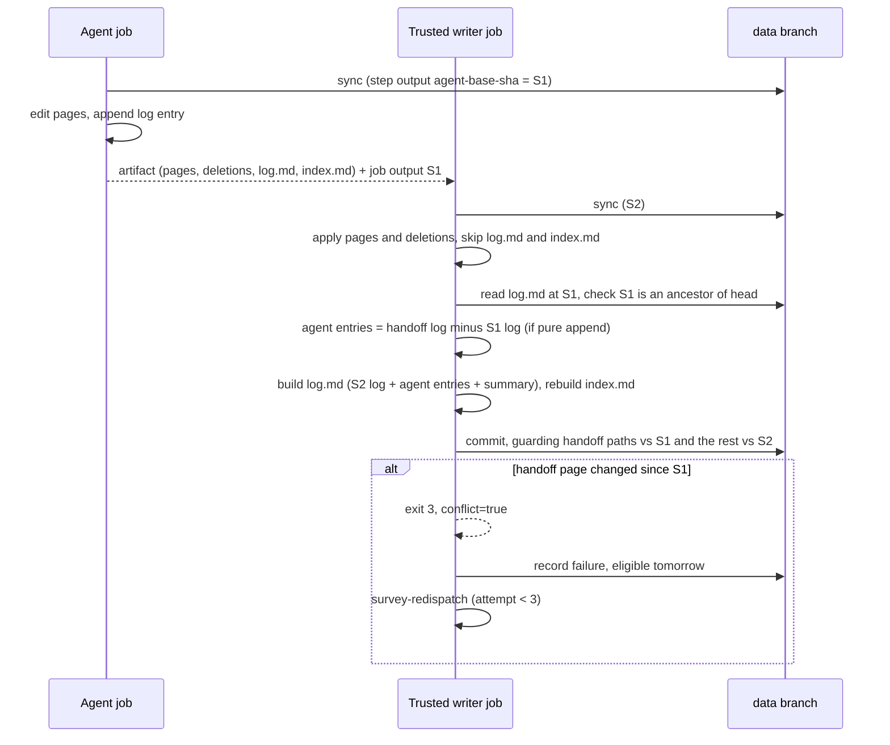

# fix: Stop wiki handoffs from overwriting other writers

## Overview

Trusted wiki writers (survey persist and the two fro-bot ingest jobs) apply the agent's handoff over a fresh sync of `data`. Today they apply the agent's stale copies of `knowledge/log.md`, `knowledge/index.md` and every page it touched, and those copies replace whatever another survey committed in between. This plan changes the writers in five ways:

- `log.md` and `index.md` are no longer applied from the artifact. The writer derives the agent's appended log entries and rebuilds both files from its own sync.
- Every handed-off page and deletion is checked against the commit the agent job synced.
- Agent deletions are committed.
- A survey that hits a page conflict is re-dispatched.
- wiki-repair fails the job when it aborts.

## Problem Frame

Reconcile dispatches surveys about 1.5 minutes apart. Agent jobs run 6–8 minutes and overlap. Persist jobs take 30–37 s and run one after another. The second agent syncs before the first survey persists. Its handoff carries `log.md`, `index.md` and the topic pages as full files, because the survey prompt tells the agent to edit them and the allowlist in `scripts/wiki-handoff-core.ts` admits them. Persist applies those files over its own fresh sync and commits. On 2026-10-20 and 2026-10-21 this dropped two log entries, two index rows and one topic-page edit from the earlier survey. The #4032 guard does not fire, because its base is persist's own sync (see origin: `docs/brainstorms/2026-10-21-wiki-writer-lost-updates-requirements.md`).

## Requirements Trace

- R1. A handed-off `log.md` or `index.md` is never applied as a file.
- R2. The agent's appended entries are the suffix of its `log.md` beyond `log.md` at its starting commit. A non-append edit drops them.
- R3. Ingest builds `log.md` and `index.md` from the writer's sync. It appends the agent's entries plus its own summary entry, and keeps the existing entries in order.
- R4. Prompts stop asking for `index.md` edits. Pre-change handoffs apply unchanged under R1 and R2.
- R5. Handed-off pages and deletions are checked against the agent job's sync commit, which comes from the sync step and not the artifact.
- R6. If a handed-off page changed on `data` after that commit, the writer refuses with no commit and no merging.
- R7. A missing, empty, unknown or non-ancestor agent commit refuses the write.
- R8. Agent deletions are removed from `data`.
- R9. On a page conflict, the survey re-runs straight away with a fresh agent run, up to a bound.
- R10. A survey that is still conflicting after its last attempt fails loudly and is eligible again the next day.
- R11. Observe and event ingests fail loudly on a page conflict and are not re-run.
- R12. wiki-repair fails the job when it aborts.

## Scope Boundaries

- No writer queue or concurrency-group change. The window of about 30 s between a writer's sync and its commit stays covered by the #4032 guard.
- Ingest's write set is not narrowed. Pages that differ from `main` are still rewritten from the writer's own sync, as they are today.
- No commit-layer rebuild-per-attempt machinery, and no page merging.
- No change to the rename writer, merge-back, or the drafted-solutions handoff.
- No recovery of the content lost on 2026-10-20 and 2026-10-21.

### Deferred to Separate Tasks

- A `docs/solutions/` write-up of the root cause and the misdiagnosis path, via `ce:compound` after merge.

## Context & Research

### Relevant Code and Patterns

- `packages/wiki-write-core/src/wiki-ingest.ts`:
  - `runWikiIngestCli`, `loadExistingWikiFiles` and `getChangedWikiPaths`/`parsePorcelainPaths` (where deletions are dropped).
  - `buildWikiIngestChanges`, which calls `appendLogEntry` and `buildIndexDocument`.
  - `commitWikiChanges` with the #4032 `baseCommitSha` guard, `assertWriteSetUnchanged` and `readCommitTreeSha`.
- `scripts/wiki-handoff-core.ts`: `isAllowedWikiHandoffPath`, `buildWikiHandoff` (manifest `{changed, deleted}`) and `validateAndApplyHandoff`/`validateAndApplyWikiHandoff`. The manifest stays on disk after apply.
- `scripts/wiki-handoff-apply.ts` is the CLI entry for apply.
- `.github/workflows/survey-repo.yaml`:
  - the agent job's unnamed `sync-wiki` step and job `outputs:`;
  - `survey-persist`: sync, apply, ingest with `WIKI_INGEST_DATA_TIP_SHA`, then `record-survey-result`;
  - the prompt lines that ask for `index.md` and `log.md` edits.
- `.github/workflows/fro-bot.yaml`: the event and observe agent jobs' `sync-wiki` steps, `fro-bot-wiki-ingest` and `fro-bot-observe-wiki-ingest`, and the prompts that permit `index.md` edits.
- `.github/workflows/reconcile-repos.yaml` shows the App-token mint shape for dispatching `survey-repo.yaml`.
- `scripts/record-survey-result.ts` and `scripts/repos-metadata.ts` (`computeNextEligibleAt`, `CHANNEL_INTERVAL_DAYS`) hold the survey cadence.
- `scripts/wiki-repair.ts` `main` writes the JSON result and exits 0. The `wiki-lint.yaml` summary step (`if: always()`) reads that JSON.
- `scripts/git-data-fake.ts` is the multi-branch Git Data fake (`advance`, `beforeUpdateRef`, `truncate`) used by the rename and merge-back tests.
- `scripts/rename-tracked-repo.ts` is the precedent for rebuilding the log and index from the head and for `appendLogEntry` reuse.

### Institutional Learnings

- `docs/solutions/best-practices/agent-drafts-trusted-publish-split-2026-10-10.md`: treat the agent artifact as untrusted, and compare handed-off paths against a trusted pinned base.
- `docs/solutions/integration-issues/identity-probe-follows-redirects-hides-repo-renames-2026-10-10.md`: Git Data writes use a non-force ref update, fail closed on a truncated tree, and keep Fro Bot as both author and committer.
- `docs/brainstorms/2026-07-03-wiki-authority-repair-loop-requirements.md`: `index.md` can be derived from pages; `log.md` is append-only and cannot be.
- Repo-wide App-token scope contract (`scripts/app-token-scope-guard.test.ts`): every new mint needs an explicit `permission-*`, explicit `repositories:` and a table row.
- Stryker: put source tests next to the mutated module, never import `dist`, and avoid top-level decision constants.
- Package release: any edit under `packages/wiki-write-core/src` requires a rebuilt, committed `dist`, and a `fix:` merge publishes a patch release.

### External References

- GitHub job outputs come from a named step's output file, and a later step cannot overwrite them through its own `$GITHUB_OUTPUT`. This is not a defense against code that tampers with the runner, so R5 guards against staleness and is not a security boundary.
- "Re-run failed jobs" reuses outputs from upstream jobs that succeeded. Re-running the agent therefore needs a fresh `workflow_dispatch`, and `GITHUB_TOKEN`-triggered dispatches do create runs.

## Prior-Art Survey

```json
{
  "schema_version": 2,
  "verdict": "extend",
  "scope": "fro-bot/.github: .github/, scripts/, packages/wiki-write-core/src",
  "freshness": {
    "vcs_reference": "6d77d074a0052232c2b4f90291132393b0dc222e"
  },
  "budget": {
    "max_search_passes": 10,
    "max_candidate_inspections": 20,
    "exhausted": false
  },
  "candidates": [
    {
      "path_or_symbol": "packages/wiki-write-core/src/wiki-ingest.ts :: commitWikiChanges",
      "description": "Data-branch Git Data commit of files and deletedPaths. Each attempt pins the base tree (baseCommitSha, or the first head read when omitted), runs assertWriteSetUnchanged over the write-set paths, then createBlob, createTree, createCommit and a non-force updateRef. updateRef 409/422 re-reads the head and replays. Disposition reason (extend): it owns the write-set guard this concern needs, but a guard refusal is terminal with no re-derivation on the new head, and baseCommitSha is optional.",
      "disposition": "extend"
    },
    {
      "path_or_symbol": "packages/wiki-write-core/src/wiki-ingest.ts :: runWikiIngestCli and loadExistingWikiFiles",
      "description": "Reads knowledge/index.md, knowledge/log.md and wiki pages from the working tree, then pins baseCommitSha from WIKI_INGEST_DATA_TIP_SHA before calling commitWikiChanges. Disposition reason (extend): the only place a base pin enters the commit path. It trusts the tip exported by the same job's sync-wiki step, so an artifact's edits are guarded against that tip, not the tip the agent read.",
      "disposition": "extend"
    },
    {
      "path_or_symbol": "scripts/rename-tracked-repo.ts :: renameTrackedRepo, writeCommit, assertTipIntegrity",
      "description": "Rebuild-from-head writer: each attempt re-reads the snapshot (readSnapshot), checks tip integrity, builds createTree on the snapshot tree with parents=[headSha], non-force updateRef; 409/422 rebuilds up to 3 attempts. Extend: it already rebuilds log/index from head each attempt, but has no handoff and no page guard; generalize the pattern, not the repos.yaml planner.",
      "disposition": "extend"
    },
    {
      "path_or_symbol": "scripts/wiki-repair.ts :: repair attempt loop (tree reload on CONFLICT_EXHAUSTED)",
      "description": "Rebuild-from-head loop around commitWikiChanges. Pins baseCommitSha to tree.tipSha, compares getCurrentDataTipSha before committing, and on CONFLICT_EXHAUSTED reloads the tree and re-plans up to maxRetries. Disposition reason (extend): the only existing re-derive-on-conflict loop for wiki files. Its planner is lint-repair specific (planAndVerifyWikiRepairs), so wiki ingest has no re-plan step.",
      "disposition": "extend"
    },
    {
      "path_or_symbol": "packages/wiki-write-core/src/wiki-ingest.ts :: rebuildWikiIndex",
      "description": "Deterministic regeneration of knowledge/index.md from the wiki page set; preserves header and footer prose from existingIndex. Disposition reason (reuse): it derives the index from a head-aligned page snapshot, so it is the rebuild step for re-deriving after a guard refusal. No I/O and no ref handling.",
      "disposition": "reuse"
    },
    {
      "path_or_symbol": "packages/wiki-write-core/src/wiki-ingest.ts :: appendLogEntry",
      "description": "Appends one entry to knowledge/log.md while keeping existing text byte-for-byte. Documented as the append-only primitive and exported for the rename path. Disposition reason (reuse): it is the correct rebase primitive, applying this writer's entry onto a head log without rewriting other writers' entries.",
      "disposition": "reuse"
    },
    {
      "path_or_symbol": "packages/wiki-write-core/src/wiki-ingest.ts :: mergeWikiLogs",
      "description": "Merges log sources, dedupes entries by (timestamp, target), sorts all entries chronologically and rebuilds the canonical header. Used for operator healing of log merge conflicts.",
      "disposition": "insufficient",
      "insufficiency_reason": "Global sort and key-based dedupe rewrite other writers' entries, and a second entry with the same timestamp and target overwrites the first in entryMap. That breaks the append-only log contract for a rebase onto a moved head."
    },
    {
      "path_or_symbol": "scripts/rebuild-wiki-index.ts :: runRebuildIndex and runMergeLogs",
      "description": "Operator CLI that rebuilds knowledge/index.md from working-tree wiki files, or merges log files into knowledge/log.md.",
      "disposition": "insufficient",
      "insufficiency_reason": "Operates on the local working tree with no data-branch head, no write-set guard and no ref update. It is a post-incident healer, not a write path, so it cannot serialize or detect concurrent writers."
    },
    {
      "path_or_symbol": "scripts/commit-metadata.ts :: commitMetadata",
      "description": "Single-file metadata writer. Retries 409 with a fresh read, calls createOrUpdateFileContents with the file sha, short-circuits on serialized equality, and requires a pure mutator. Also runs a data-branch bootstrap hook.",
      "disposition": "insufficient",
      "insufficiency_reason": "Path is restricted to metadata/<name>.yaml and uses the single-file contents API, so it has no multi-file write set and cannot write knowledge/ pages, index or log. Its retry convention is a precedent, not an owner."
    },
    {
      "path_or_symbol": "scripts/merge-back-data.ts :: mergeBackData",
      "description": "Second writer on heads/data. Merges main into data via createTree (base_tree main.sha), createCommit and a non-force updateRef, re-reading all state for up to 3 attempts on 409/422.",
      "disposition": "insufficient",
      "insufficiency_reason": "Its write set is the whole main-to-data merge, not wiki paths, so it cannot guard knowledge/ writes. The wiki write-set guard only sees it through head movement, and it is not in the wiki writers' concurrency domain."
    },
    {
      "path_or_symbol": "scripts/wiki-handoff-core.ts :: captureWikiBaseline and buildWikiHandoff",
      "description": "Build side. After sync-wiki, captureWikiBaseline content-hashes git-status wiki deltas. buildWikiHandoff scopes changed and deleted paths against that baseline and writes files/ plus manifest.json.",
      "disposition": "insufficient",
      "insufficiency_reason": "The manifest records changed and deleted paths only, with no data-branch commit SHA. Baseline hashes are relative to the build-time working tree, not a commit, so the trusted side cannot tell which data commit an edited page derived from."
    },
    {
      "path_or_symbol": "scripts/wiki-handoff-core.ts :: validateAndApplyHandoff and validateAndApplyWikiHandoff",
      "description": "Trusted apply. Validates manifest shape, traversal, symlinks, regular files, size cap and allowlist, then writes files/ content over the workspace and removes deleted paths.",
      "disposition": "insufficient",
      "insufficiency_reason": "The apply job runs its own sync-wiki before download-artifact and apply, so full-file page edits overwrite whatever another writer committed after the build-side sync. Nothing at this layer compares the artifact's source base with the workspace."
    },
    {
      "path_or_symbol": ".github/workflows/survey-repo.yaml :: concurrency",
      "description": "Concurrency group survey-repo-${{ inputs.node_id }} with cancel-in-progress false.",
      "disposition": "insufficient",
      "insufficiency_reason": "Serializes runs per repository only. Surveys of different repositories, the daily batch and event ingests can run in parallel against the same data branch, so this group serializes nothing across wiki writers."
    },
    {
      "path_or_symbol": ".github/workflows/fro-bot.yaml :: concurrency",
      "description": "Concurrency group keyed on issue, PR, discussion, or 'daily' for schedule and dispatch, with cancel-in-progress false.",
      "disposition": "insufficient",
      "insufficiency_reason": "Keys on the triggering event, so only same-issue runs or daily schedule and dispatch runs serialize. It does not cover survey-repo.yaml, merge-data.yaml or other data-branch writer workflows."
    },
    {
      "path_or_symbol": ".github/workflows/survey-repo.yaml :: survey-agent-retry-1 and survey-agent-retry-2",
      "description": "Re-runs the survey agent in the same job when wiki changed is false, up to three attempts, then fails on exhaustion.",
      "disposition": "insufficient",
      "insufficiency_reason": "Triggered by missing wiki changes, not by a ref race. It re-runs the agent rather than the commit and never re-derives against a moved data head."
    },
    {
      "path_or_symbol": "scripts/dispatch-renovate.ts :: dispatch flow",
      "description": "Workflow re-dispatch helper. Lists the Renovate workflow's runs and calls createWorkflowDispatch only when idle.",
      "disposition": "insufficient",
      "insufficiency_reason": "Idle probe for Renovate only. It has no data-branch awareness and no retry on a wiki ref race, so it cannot re-dispatch a wiki writer that lost a race."
    },
    {
      "path_or_symbol": "scripts/cross-repo-dispatch.ts :: CasWriteInput, CAS_MAX_RETRIES, readLatestMarkerComment",
      "description": "Optimistic concurrency on a single tracker-issue marker comment. CasWriteInput carries expectedPriorHash and nextState, with up to 3 retries, and the latest bot-authored marker is updated in place.",
      "disposition": "insufficient",
      "insufficiency_reason": "The CAS guards one issue comment's state hash, not git refs or file sets. It cannot guard multi-file data-branch writes, though its expected-prior-hash pattern is a precedent."
    },
    {
      "path_or_symbol": "packages/wiki-write-core/src/data-branch-bootstrap.ts :: bootstrapDataBranch",
      "description": "Idempotent recreation of the data branch from main, called before data-branch writes.",
      "disposition": "insufficient",
      "insufficiency_reason": "Branch-existence recovery only. It does not compare heads or guard write sets."
    },
    {
      "path_or_symbol": "packages/wiki-write-core/src/branch-safety.ts :: assertBranchWritable",
      "description": "Refuses protected or non-writable branches before a write, reporting the reason through a callback.",
      "disposition": "insufficient",
      "insufficiency_reason": "Permission and protection gate. It does not read or compare the data-branch head, so it provides no concurrency protection."
    }
  ]
}
```

## Key Technical Decisions

- **Derive the agent's log entries on the trusted side.** The ingest CLI reads `log.md` from the handoff's `files/` directory and `log.md` at the agent's commit through the Git Data API. If the handoff copy starts with the base copy byte for byte, the remainder is the agent's entries. Otherwise the CLI emits a warning naming no page, and only the summary entry is used. This needs no prompt or artifact change, and handoffs built before the deploy keep working.
- **Apply skips `log.md` and `index.md`; it does not reject them.** `validateAndApplyWikiHandoff` leaves both files out of the workspace, so the writer's synced copies stay in place, and ingest rebuilds the index from the pages as it does today. Rejecting them would fail every artifact built before the deploy.
- **The page guard lives in `commitWikiChanges` as a second, per-path base.** A new optional handoff input carries the agent commit and the handed-off changed and deleted paths. Each attempt runs the existing `assertWriteSetUnchanged` for those paths against the agent commit, and the #4032 base check still covers the rest of the write set. A failure raises a new code, `HANDOFF_PAGE_CHANGED`, distinct from `CONFLICT_EXHAUSTED`.
- **The ancestry check uses the compare API.** The agent commit must be identical to the head, or the head must be ahead of it. Otherwise, or on a 404, the CLI raises `HANDOFF_BASE_INVALID` before any write, and a missing or empty value refuses the write the same way. A 404 here must never reach the bootstrap-on-404 path.
- **The CLI exits with a distinct code for a page conflict.** `HANDOFF_PAGE_CHANGED` exits with code 3. The persist step maps that code to a `conflict=true` output and still fails the step. Every other failure keeps its current exit code.
- **The re-run is a fresh dispatch from a new job.** A `survey-redispatch` job runs after `survey-persist` when `conflict == 'true'` and the attempt count is below 3. It mints an App token with `permission-actions: write` and `repositories: .github`, then dispatches `survey-repo.yaml` with `node_id` and `attempt + 1`. The new `attempt` input is a string that is strictly parsed as an integer from 1 to 3. The dispatched run queues behind the current run's `survey-repo-${node_id}` group.
- **A conflict failure is eligible again the next day.** `record-survey-result` takes a conflict flag. When it is set, the result still records `failure`, but `next_survey_eligible_at` becomes the next day instead of the channel interval.
- **Observe and event ingests keep their current failure behavior.** The new exit code fails the job loudly, and nothing re-dispatches it.

## Open Questions

### Resolved During Planning

- Re-run bound: 3 attempts in total, so up to 2 re-runs.
- Format of the agent's log entry: unchanged. The entries are derived from the agent's `log.md` (see Key Technical Decisions).
- Telling refusals apart: `HANDOFF_PAGE_CHANGED` and exit code 3 apply only to page conflicts.

### Deferred to Implementation

- The exact shape of the new `commitWikiChanges` handoff input and its interaction with the existing `baseCommitSha` parameter, settled while writing the guard tests.
- Whether the derivation of the agent's entries lives inside `runWikiIngestCli` or in a small helper module. This only affects where the Stryker `mutate` entry points.

## High-Level Technical Design

> _This illustrates the intended approach and is directional guidance for review, not implementation specification. The implementing agent should treat it as context, not code to reproduce._



## Implementation Units

- [ ] **Unit 1: Carry the agent's sync commit to the trusted writers**

**Goal:** Each trusted writer receives the commit its agent job synced, from the sync step rather than the artifact.

**Requirements:** R5, R7

**Dependencies:** None

**Files:**

- Modify: `.github/workflows/survey-repo.yaml`
- Modify: `.github/workflows/fro-bot.yaml`
- Test: `scripts/survey-repo-workflow.test.ts`
- Test: `scripts/fro-bot-workflow.test.ts`
- Test: `scripts/trusted-wiki-env-source-guard.test.ts`

**Approach:**

- Give each agent job's `sync-wiki` step an id. These are the survey agent job and the fro-bot event and observe agent jobs.
- Expose `agent-base-sha` from that step's `data-sha` as a job output.
- In each of the three ingest steps, set `WIKI_HANDOFF_BASE_SHA` from `needs.<agent-job>.outputs.agent-base-sha`. Keep `WIKI_INGEST_DATA_TIP_SHA` as the writer's own sync.
- Add the new variable to the trusted-env allowlist.

**Patterns to follow:**

- The #4032 `data-sha` wiring for `WIKI_INGEST_DATA_TIP_SHA`, and its contract tests.

**Test scenarios:**

- Happy path: each ingest step's `WIKI_HANDOFF_BASE_SHA` reads exactly `needs.<agent-job>.outputs.agent-base-sha`, and that job output reads the sync step's `data-sha`.
- Edge case: the agent job's sync step has the id the output references, and the agent job has no step before the sync step.
- Error path: the trusted-env guard rejects a `WIKI_HANDOFF_BASE_SHA` sourced from anywhere other than a job output.

**Verification:**

- The contract tests pin the three wirings, and actionlint is clean on both workflows.

- [ ] **Unit 2: Skip shared files on apply and derive the agent's log entries**

**Goal:** A handoff's `log.md` and `index.md` never land as files. The agent's appended entries are re-appended onto the writer's own `log.md`.

**Requirements:** R1, R2, R3, R4

**Dependencies:** Unit 1

**Files:**

- Modify: `scripts/wiki-handoff-core.ts`
- Modify: `packages/wiki-write-core/src/wiki-ingest.ts`
- Create (if extracted): `packages/wiki-write-core/src/handoff-log.ts`
- Modify: `packages/wiki-write-core/dist/**`
- Modify: `stryker.config.json`
- Modify: `mutation-guards.json`
- Test: `scripts/wiki-handoff-core.test.ts`
- Test: `scripts/wiki-ingest.test.ts`
- Test: `packages/wiki-write-core/src/handoff-log.test.ts` (if extracted)

**Approach:**

- `validateAndApplyWikiHandoff` still validates `knowledge/log.md` and `knowledge/index.md` but does not write them. The allowlist stays as it is, so artifacts built before this change still validate.
- The ingest CLI reads the handoff `log.md` from the handoff `files/` directory and `log.md` at `WIKI_HANDOFF_BASE_SHA`. It passes the derived suffix to the builder, which appends it to the workspace (synced) `log.md` before its own summary entry.
- When the handoff has no `log.md`, or the derivation fails, the CLI appends only the summary entry and emits a fixed warning line.

**Patterns to follow:**

- `appendLogEntry`, which appends and preserves bytes. Do not use `mergeWikiLogs`, which re-sorts.
- The rename writer's head-derived log and index.

**Test scenarios:**

- Happy path: the handoff `log.md` equals the base log plus one entry. The result is the synced log, plus that entry, plus the summary entry, with every synced entry unchanged and in order.
- Happy path: the handoff carries `index.md` with extra rows. The applied workspace `index.md` is the synced copy, and the built index covers the synced pages plus the handed-off pages.
- Edge case: the handoff `log.md` is identical to the base, so only the summary entry is appended.
- Edge case: the handoff has no `log.md`, so only the summary entry is appended.
- Error path: the handoff `log.md` rewrites an earlier entry and appends one. The agent entries are dropped, a warning is emitted, only the summary is appended, and all synced entries survive (AE6).
- Integration: an artifact built before the change, containing `log.md` and `index.md`, applies without error (R4).

**Verification:**

- The tests pass. The `dist` check is clean. Mutation guards are clean, with the derivation module (wherever it lands) listed in `mutate` with no survivors.

- [ ] **Unit 3: Guard handed-off pages against the agent's commit and commit deletions**

**Goal:** The writer refuses when a handed-off page or deletion has changed since the agent's commit, validates that commit, and commits agent deletions.

**Requirements:** R5, R6, R7, R8

**Dependencies:** Units 1 and 2 (shared file `wiki-ingest.ts`, so run serially)

**Files:**

- Modify: `packages/wiki-write-core/src/wiki-ingest.ts`
- Modify: `packages/wiki-write-core/dist/**`
- Modify: `scripts/wiki-handoff-apply.ts` (only if the manifest path has to be surfaced)
- Test: `scripts/wiki-ingest.test.ts`
- Test: `scripts/wiki-handoff-sequence.test.ts` (new integration test)

**Approach:**

- The CLI reads `manifest.json` (`changed`, `deleted`) from the handoff directory after apply.
- It validates `WIKI_HANDOFF_BASE_SHA` before any write: it must be present, be a SHA, resolve, and be an ancestor of or identical to the head. A failure raises `HANDOFF_BASE_INVALID`.
- It passes the handoff paths and the agent commit to `commitWikiChanges`, which checks them on every attempt and raises `HANDOFF_PAGE_CHANGED`.
- Manifest deletions are added to `deletedPaths`, because the porcelain filter still drops them.
- `HANDOFF_PAGE_CHANGED` exits 3. Error messages name no pages.

**Execution note:** Start with the integration test that replays the 2026-10-21 sequence and fails on the current code.

**Patterns to follow:**

- `assertWriteSetUnchanged`, which treats absence as a value, and `readCommitTreeSha`.
- The `merge-back-data.ts` tests on `scripts/git-data-fake.ts`.

**Test scenarios:**

- Integration (AE1): two agents sync at S0. A persists, which moves the head. B's handoff carries a stale `log.md`, `index.md` and a page that only B edited. B lands, and `data` keeps A's log entries, A's index rows and A's pages, plus B's page and entry.
- Integration (AE2, first half): A and B both edit `topics/github-actions-ci.md`. B is refused with `HANDOFF_PAGE_CHANGED`, nothing is committed, and the CLI exits 3.
- Happy path (AE3): another writer changed only page Q after S1. Page P lands and Q's change stays.
- Edge case (AE4): B deletes page X after A edited it, so B is refused. In the reverse order, A deleted X and B edited it, and B is refused.
- Happy path: an agent deletion of an unchanged page is removed from `data`.
- Error path (AE5): an empty, malformed or unknown (404) SHA, or one that is not an ancestor, refuses with `HANDOFF_BASE_INVALID`. No bootstrap call happens and nothing is written.
- Error path: a ref race that exhausts retries still raises `CONFLICT_EXHAUSTED` and does not exit 3.

**Verification:**

- The integration test fails on the pre-change code and passes after the change. The `dist` check is clean.

- [ ] **Unit 4: Re-dispatch a conflicting survey and retry it the next day**

**Goal:** A page conflict in survey persist triggers a bounded fresh survey run. A final conflict failure is eligible again the next day.

**Requirements:** R9, R10, R11

**Dependencies:** Unit 3

**Files:**

- Modify: `.github/workflows/survey-repo.yaml`
- Modify: `scripts/record-survey-result.ts`
- Modify: `scripts/repos-metadata.ts`
- Test: `scripts/survey-repo-workflow.test.ts`
- Test: `scripts/record-survey-result.test.ts`
- Test: `scripts/repos-metadata.test.ts`
- Test: `scripts/app-token-scope-guard.test.ts`

**Approach:**

- Add an `attempt` string input to `survey-repo.yaml` (default `'1'`), parsed strictly.
- The ingest step maps exit 3 to `conflict=true` and still fails. `record-survey-result` receives the conflict flag.
- Add a `survey-redispatch` job: `needs: survey-persist`, guarded on `conflict == 'true'` and `attempt < 3`. It mints an App token with `permission-actions: write` and `repositories: .github`, then dispatches `survey-repo.yaml` with `node_id` and the incremented attempt.
- Leave the fro-bot ingest jobs unchanged. Their exit code already fails the run (R11).

**Patterns to follow:**

- The reconcile dispatch mint in `reconcile-repos.yaml`.
- The scope-guard table rows for dispatch mints.

**Test scenarios:**

- Happy path: with `conflict=true` and attempt `1`, the redispatch job runs and dispatches attempt `2` for the same `node_id`.
- Edge case (AE7): with attempt `3`, the redispatch job is skipped and the run fails.
- Error path: `attempt` values such as `0`, `4`, `abc` or `''` are rejected before any work runs.
- Happy path: a conflict result records `failure` with `next_survey_eligible_at` set to the next day. A non-conflict failure keeps the channel interval.
- Integration: the scope guard has a row for the new mint, with an exact permission and reach.
- Edge case (AE8): the fro-bot event and observe ingest steps let exit 3 fail the job, and no fro-bot job dispatches a re-run.

**Verification:**

- The workflow contract tests, the `record-survey-result` and `repos-metadata` tests, and the scope guard pass, and actionlint is clean.

- [ ] **Unit 5: Stop asking agents to edit the index**

**Goal:** Agent prompts no longer ask for `index.md` edits. The log entry instruction stays.

**Requirements:** R4

**Dependencies:** Unit 2

**Files:**

- Modify: `.github/workflows/survey-repo.yaml`
- Modify: `.github/workflows/fro-bot.yaml`
- Test: `scripts/survey-repo-workflow.test.ts`
- Test: `scripts/fro-bot-workflow.test.ts`

**Approach:**

- Drop the index update step from the survey prompt, and drop the `index.md` permission from the fro-bot prompts. The prompts state that the writer maintains the index.

**Test scenarios:**

- Happy path: no agent prompt instructs edits to `knowledge/index.md`, and the survey prompt still instructs appending a log entry.

**Verification:**

- The contract tests pin the prompt text.

- [ ] **Unit 6: Fail wiki-repair when it aborts**

**Goal:** An aborted repair fails the job after writing its JSON result.

**Requirements:** R12

**Dependencies:** None

**Files:**

- Modify: `scripts/wiki-repair.ts`
- Test: `scripts/wiki-repair.test.ts`

**Approach:**

- After the JSON is written, set `process.exitCode = 1` when `aborted > 0`. Do not call `process.exit` on the success path. Privacy and path refusals keep their current behavior.

**Test scenarios:**

- Error path (AE9): when `aborted` is 1, the exit code is 1 and the JSON is still written.
- Happy path: a clean run, or one where only `privacy_blocked` or `path_refused` are non-zero, exits 0.

**Verification:**

- The tests pass, and the `wiki-lint.yaml` summary step still runs, through `if: always()`.

## System-Wide Impact

- **Interaction graph:** survey persist, the fro-bot event and observe ingests, the handoff apply CLI, and `record-survey-result`. The new redispatch job adds a `workflow_dispatch` source for `survey-repo.yaml`.
- **Error propagation:** a page conflict exits 3. Survey maps it to a conflict output and a redispatch, and the fro-bot ingests fail the run. An invalid base fails without a redispatch.
- **State lifecycle risks:** a refused write commits nothing. `record-survey-result` still writes `failure` to `metadata/repos.yaml`, and the re-run overwrites it.
- **API surface parity:** `commitWikiChanges` gains an optional input, which is additive for external consumers of `@fro.bot/wiki-write-core`.
- **Integration coverage:** the replay test exercises apply, ingest and commit together on the Git Data fake.
- **Unchanged invariants:**
  - The #4032 base guard and `WIKI_INGEST_DATA_TIP_SHA` are unchanged.
  - The rename writer, merge-back and the drafted-solutions handoff are unchanged.
  - The handoff allowlist and manifest shape are unchanged.
  - Persist and ingest token scopes are unchanged.

## Risks & Dependencies

| Risk | Mitigation |
| --- | --- |
| A deploy during a run in flight: the persist job uses new scripts but the old workflow, so there is no `WIKI_HANDOFF_BASE_SHA`, the write is refused, and the survey takes the normal failure cadence | Merge outside the ~10:00Z survey batch and the 04:00Z fro-bot schedule. Check `gh run list` for in-progress survey and fro-bot runs first |
| A hot shared page that more than 3 surveys edit in one batch exhausts its re-runs | Accept this. Daily batches are about 2 surveys, and the last attempt becomes eligible again the next day |
| The agent rewrites history in `log.md` | Its entries are dropped and the summary entry still lands, so no existing entry is lost |
| A runner-level tamper with the agent job's outputs | Out of scope. R5 is a guard against stale data, not a security boundary |
| The new dispatch mint broadens credentials | The mint has `actions: write` on this repo only, a scope-guard row, and is gated on `conflict` and `attempt < 3` |

## Documentation / Operational Notes

- Update the handoff description in the `scripts/wiki-handoff-core.ts` header, and any `metadata/README.md` text that says agents maintain the index.
- After merge:
  - The `fix:` title publishes a patch release of `@fro.bot/wiki-write-core`.
  - Read back the first daily survey batch. Every survey's log entry and index rows should be on `data`.
  - Watch for any `HANDOFF_PAGE_CHANGED` run followed by a redispatch.

## Sources & References

- **Origin document:** [docs/brainstorms/2026-10-21-wiki-writer-lost-updates-requirements.md](../brainstorms/2026-10-21-wiki-writer-lost-updates-requirements.md)
- Related code: `packages/wiki-write-core/src/wiki-ingest.ts`, `scripts/wiki-handoff-core.ts`, `.github/workflows/survey-repo.yaml`, `.github/workflows/fro-bot.yaml`, `scripts/record-survey-result.ts`, `scripts/wiki-repair.ts`
- Related issues and PRs: #4031, #4032
- External docs: <https://docs.github.com/en/actions/how-tos/manage-workflow-runs/re-run-workflows-and-jobs>, <https://docs.github.com/en/actions/reference/workflows-and-actions/workflow-syntax#jobsjob_idoutputs>
