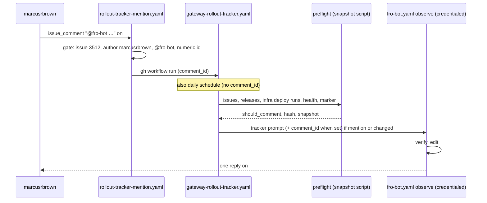

# feat: Fro Bot keeps the #3512 rollout tracker current

## Overview

When `marcusrbrown` comments `@fro-bot` on #3512, a credentialed tracker run starts. The scheduled tracker also wakes when a release ships, when infra finishes a deploy, or when the health contract changes. Both kinds of run work from one tracker prompt that tells Fro Bot to:

- verify the claims made in the thread;
- rewrite the body;
- update Project 1;
- maintain the acceptance list;
- reply.

## Problem Frame

The comment thread on #3512 stays current, but the body and Project 1 drift. Mentions run the general reply job. fro-bot/agent withholds the gh credential on `issue_comment`, so that job can verify claims but cannot edit anything. The scheduled tracker wakes only when a tracked issue opens or closes, and its prompt never covers the body. On 2026-10-22, a single `workflow_dispatch` run (39831791869) with a tracker prompt edited the body and Project 1 correctly. The missing pieces are a route from mentions to a credentialed run, and a wider wake check. (see origin: docs/brainstorms/2026-10-22-rollout-tracker-autonomy-requirements.md)

## Requirements Trace

- R1. An operator mention on #3512 starts a credentialed tracker run that receives the comment. Covered by Units 2 and 3.
- R2–R5. The run verifies each claim against the evidence it can reach, updates the body and Project 1, and replies once. Covered by Unit 2.
- R6. The scheduled tracker wakes on new agent or dashboard releases, successful infra deploy runs, health `contractVersion` changes, and issue or PR state changes. Covered by Units 1 and 2. The origin also lists infra deploy runs rather than infra releases, because infra's release tags don't identify what is deployed.
- R7. A scheduled run with nothing to change posts nothing. Covered by Unit 2.
- R8–R9. Fro Bot maintains the acceptance list and labels each entry operator-reported or agent-verified. Covered by Unit 2.
- Success criteria: within a day of any change, and right after any operator mention, the body and Project 1 match live state without hand edits. The daily report stops flagging #3512 drift. Covered by all units plus the post-merge checks.

## Scope Boundaries

- No new state store, writer layer or comment syntax. Fro Bot writes directly with `FRO_BOT_PAT` (see origin).
- No change to credentials or token scopes beyond `actions: write` on the hop job's `GITHUB_TOKEN`.
- No CI-run acceptance automation. The agent-browser acceptance pass stays operator-run, and Fro Bot reads its posted results.
- Other trackers, cross-repo dispatch, and opening or merging PRs are out of scope.

### Deferred to Separate Tasks

- An upstream fro-bot/agent input that provisions the credential for trusted-author comments. It is not needed once the hop exists. Raise it only if more issues need the same pattern.

## Context & Research

### Relevant Code and Patterns

- `.github/workflows/gateway-rollout-tracker.yaml`:
  - Triggers are a daily schedule and `workflow_dispatch` with no inputs.
  - The concurrency group is `gateway-rollout-tracker` with `cancel-in-progress: false`.
  - The update job runs only when `should_comment == 'true'`.
  - It calls `fro-bot.yaml` with `prompt` only. Working-dir is the default, which routes the run to `fro-bot-observe`.
- `scripts/rollout-tracker-snapshot.ts`:
  - `hashSnapshot` hashes `toGatingEvidence`, which keeps only item identity and issue state. Any new field must be added there explicitly or it never reaches the hash.
  - Fetch failures write a FATAL line to stderr and exit 1 with empty stdout.
  - Success sets `process.exitCode`.
  - `extractPreviousMarker` checks only that `hash` is a string and `snapshot` is an object, so old markers still parse.
  - Fixture env vars drive `runCliFixture`.
- `.github/workflows/fro-bot.yaml`:
  - Workflow-level `permissions: contents: read`.
  - Concurrency is `fro-bot-<issue|pr|daily|run_id>`. Called runs share `fro-bot-daily` with the 00:00 daily pass.
  - On `workflow_dispatch`, `TASK_PROMPT` prefers `github.event.inputs.prompt` over `inputs.prompt`. The tracker therefore must not add an input named `prompt`.
  - The content job `fro-bot` gates on an `@fro-bot` mention, a non-`fro-bot` author, and OWNER, MEMBER or COLLABORATOR association.
- `.github/workflows/survey-repo.yaml` `survey-redispatch`: validates its input against a fixed pattern, then runs `gh workflow run`. This is the template for the hop step.
- `.github/workflows/cross-repo-dispatch.yaml`: gates on `sender.login == 'marcusrbrown'` before taking any action.
- `scripts/workflow-step-test-helper.ts`: runs a workflow step's bash with stubbed binaries.
- marcusrbrown/infra:
  - `deploy-gateway.yaml` builds `fro-bot/agent@<ref>` from `apps/gateway/upstream.json`. It is pinned to `v0.124.1`, while `v0.125.2` is released.
  - `deploy-dashboard.yaml` deploys a CalVer version.
  - The `deploy.yaml` router also deploys both.
  - infra's own `@marcusrbrown/infra@X.Y.Z` releases and its `infra-*@0.0.x` tags do not identify what is deployed.

### Institutional Learnings

- `docs/solutions/workflow-issues/agent-credential-preflights-are-workflow-contracts-2026-10-09.md`:
  - `issue_comment` is credential-withheld.
  - Gate on the comment author with a closed set that denies by default.
  - Keep `persist-credentials: false` on agent jobs.
  - Contract tests run step shells through the helper.
- `docs/solutions/workflow-issues/autonomous-rollout-tracker-workflow-2026-06-17.md`:
  - A reusable call keeps the caller's `event_name`.
  - Daily-only work needs the `inputs.prompt == ''` guard.
  - Tracker writes serialize through caller-level concurrency.
  - The doc predates the preflight, so it is stale.
- `docs/solutions/best-practices/repo-wide-app-token-scope-contract-2026-10-10.md`: every App mint needs a scope-guard row. The hop avoids a mint.
- Memory 10362, Bun exit rule: no `process.exit` on success paths that write stdout.

## Prior-Art Survey

```json
{
  "schema_version": 2,
  "verdict": "extend",
  "scope": "fro-bot/.github: .github/workflows/*.yaml and scripts/*.ts (excluding .worktrees/)",
  "freshness": {"vcs_reference": "d8df4f6730a39488cc585afbdd9f8d56d8169b4c"},
  "budget": {"max_search_passes": 4, "max_candidate_inspections": 12, "exhausted": false},
  "candidates": [
    {
      "path_or_symbol": ".github/workflows/gateway-rollout-tracker.yaml",
      "description": "Daily cron plus workflow_dispatch. Job preflight runs scripts/rollout-tracker-snapshot.ts and emits should_comment/reason/hash/snapshot; job update-rollout-tracker runs only when should_comment == 'true' and calls fro-bot.yaml via workflow_call with the tracker prompt and marker contract.",
      "disposition": "extend"
    },
    {
      "path_or_symbol": "scripts/rollout-tracker-snapshot.ts (buildSnapshot, hashSnapshot, toGatingEvidence, extractPreviousMarker, decideComment, main)",
      "description": "LLM-free preflight: reads Project 1 items and tracked issue state, hashes only item identity plus issue state, compares to the last fro-bot marker on #3512; fails closed on any read failure; fixture env overrides exist.",
      "disposition": "extend"
    },
    {
      "path_or_symbol": ".github/workflows/fro-bot.yaml (workflow_dispatch/workflow_call inputs; issue_comment job gate)",
      "description": "Credentialed agent entrypoint for schedule/workflow_dispatch callers; the issue_comment path is gated on '@fro-bot' plus OWNER/MEMBER/COLLABORATOR association and runs credential-withheld.",
      "disposition": "reuse"
    },
    {
      "path_or_symbol": ".github/workflows/cross-repo-dispatch.yaml + scripts/cross-repo-dispatch.ts",
      "description": "Event-to-dispatch control plane gated on label and sender.login == marcusrbrown before any credential is used.",
      "disposition": "extend"
    },
    {
      "path_or_symbol": ".github/workflows/survey-repo.yaml (job survey-redispatch)",
      "description": "Same-repo workflow re-dispatch: validates its input against a fixed pattern, then gh workflow run with an actions:write token.",
      "disposition": "reuse"
    },
    {
      "path_or_symbol": "scripts/dispatch-renovate.ts",
      "description": "Cross-repo createWorkflowDispatch plus listWorkflowRuns for planning.",
      "disposition": "insufficient",
      "insufficiency_reason": "No comment trigger, no hash gate, and no wake decision for an agent."
    },
    {
      "path_or_symbol": "scripts/capture-learnings-harvest.ts",
      "description": "Reads workflow runs during learnings harvest.",
      "disposition": "insufficient",
      "insufficiency_reason": "Not a preflight fingerprint; not wired to any dispatch or gate."
    },
    {
      "path_or_symbol": "scripts/improvement-metrics-core.ts (buildEdgeFingerprint)",
      "description": "sha256 edge fingerprints in a report issue body.",
      "disposition": "insufficient",
      "insufficiency_reason": "Fingerprints metrics edges, not upstream release/deploy/health evidence."
    },
    {
      "path_or_symbol": "scripts/check-renovate-config.ts (fetch with timeout)",
      "description": "Only network fetch() in scripts; downloads a config URL.",
      "disposition": "insufficient",
      "insufficiency_reason": "Not a health probe and no state comparison; no release-tag, deploy-run or health read exists in scope."
    },
    {
      "path_or_symbol": "scripts/handle-invitation.ts (createWorkflowDispatch)",
      "description": "Invitation-driven workflow dispatch.",
      "disposition": "insufficient",
      "insufficiency_reason": "No comment trigger or fingerprint gate."
    }
  ]
}
```

## Key Technical Decisions

- **The hop is its own workflow, not part of `fro-bot.yaml`.**
  - Other workflows call `fro-bot.yaml` under `contents: read`. A job inside it that requests `actions: write` would exceed its callers' ceiling and fail at startup.
  - The hop uses the comment event only to decide whether to dispatch. The run it starts takes the comment ID as plain data.
- **The dispatch token is `GITHUB_TOKEN` with `actions: write`.** GitHub allows a `workflow_dispatch` created with `GITHUB_TOKEN` to start a run. That means no App mint and no scope-guard row.
- **The gate is closed and checks the comment author.** The hop requires all of:
  - the comment is on issue #3512 and is not a PR comment;
  - the comment author is `marcusrbrown`;
  - the body contains `@fro-bot`;
  - the comment ID is purely numeric.

  The comment ID only triggers the run. The agent fetches each comment it answers by ID (see the mention ID anchor below).

- **The general reply job skips these mentions.** The content job's `if:` excludes `marcusrbrown` `@fro-bot` comments on #3512, so the operator gets one reply, not two.
- **Mention runs share the tracker queue, and the marker anchors them by comment ID.** The marker carries `last_mention_id`, the highest operator `@fro-bot` comment ID the tracker has answered. The baseline is the highest valid value across every parseable marker comment, so a damaged latest marker cannot lower it. When no marker carries a valid value, including a thread with no marker at all, the baseline comes from position: the highest operator mention that precedes the latest `fro-bot` or `fro-bot[bot]` comment of any kind, so only later mentions are pending. With no `fro-bot` comment at all, every operator mention is pending. The new `last_mention_id` is the highest pending ID, or the baseline when nothing is pending. The latest marker comment is the newest `fro-bot` or `fro-bot[bot]` comment on #3512 with a parseable tracker marker (the `selectLatestMarkerCommentBody` rule). Once the marker carries the field, thread position never decides what is pending, so a mention that lands while a run is in flight is still pending afterwards.
- **Unanswered mentions wake the tracker.** The preflight lists the `marcusrbrown` `@fro-bot` comments on #3512 whose ID is above the marker's `last_mention_id` as `pending_mention_ids`. `decideComment` returns `should_comment` true when the hash changed or that list is non-empty. The pending IDs are not part of the hash, so answering a mention causes no spurious wake. The preflight also outputs the new `last_mention_id` (the highest operator mention ID seen, never below the previous one) inside a complete marker string. The dispatched `comment_id` reaches the preflight as `ROLLOUT_TRACKER_COMMENT_ID`: it is pending when above the baseline (which also covers a lagging comment read) and ignored when at or below it, so a queued dispatch for an already-answered comment does not wake. The agent answers exactly the pending IDs, fetching each by ID. A mention stays unanswered when one of these happens:
  - the hop failed;
  - the preflight failed;
  - the run was displaced in a concurrency group.

  The next scheduled run, or a manual `workflow_dispatch` of `gateway-rollout-tracker.yaml` (optionally with `comment_id`), reruns the preflight and answers whatever is pending.
- **The preflight script builds the marker.** `<`, `>` and `&` are escaped inside the marker JSON (`\u003c`, `\u003e`, `\u0026`), so Project text containing `-->` cannot close the HTML comment early. The prompt embeds the finished marker, and the agent copies it verbatim into every reply and in-place edit.
- **The deploy signal is the latest successful infra deploy run.** The hash covers the run ID and head SHA of the latest successful run of `deploy-gateway.yaml`, `deploy-dashboard.yaml` and `deploy.yaml`. It also covers the agent and dashboard `releases/latest` tags and the health `contractVersion`. infra's own release tags are excluded because they don't identify what is deployed. A router run that deploys nothing can wake the agent with no work to do. That run posts nothing.
- **A failed or empty fetch is fatal.** Every new input fails the preflight the same way the existing reads do. A fetch failure must never read as "no change".
- **The preflight always runs and gates both modes.** The update job runs only after a successful preflight that reports `should_comment` true. A failed preflight fails the run visibly and leaves the mention for the next scheduled run or a manual dispatch. Every agent run therefore has a valid marker to write.
- **One prompt serves both modes.** Its duties:
  - verify claims against issue and PR state, releases, the infra deploy runs, health, and the operator's posted acceptance-run results;
  - rewrite every stale section of the body;
  - update Project 1, including adding missing dependencies;
  - maintain the acceptance list with operator-reported and agent-verified labels;
  - reply once to the pending and dispatched comments.

  When pending mention IDs are listed it always replies. With none listed it replies only when something changed. When nothing changed it posts no new comment and edits the marker comment named by the preflight's `marker_comment_id` in place, replacing its marker (a seed comment only when that ID is empty), so the hash and `last_mention_id` stay current and the next scheduled run does not wake again for the same state.

## Open Questions

### Resolved During Planning

- **Where does the hop live?** In a new workflow. See Key Technical Decisions.
- **Which infra signal counts?** Deploy runs, not infra tags.
- **Do mention and scheduled runs share a concurrency group?** Yes. The marker's `last_mention_id` keeps every mention answerable by ID.
- **Does the marker stay the gate record?** Yes. It carries the wider hash and `last_mention_id`. Only a string `hash` is required to parse, so older markers still parse and wake for the hash change, and their mention baseline comes from position.

### Deferred to Implementation

- Whether the new fetches use `gh api` or `fetch`, and the exact fixture env names. Follow the script's existing `gh` usage and its fixture convention.
- `status-truth.yaml` (lines 101-108) runs the snapshot script as best effort. A new fetch failure there leaves its rollout claims unresolved and does not fail the job. That outcome is accepted, and no mode flag is needed.

## High-Level Technical Design

> _This illustrates the intended approach and is directional guidance for review, not implementation specification. The implementing agent should treat it as context, not code to reproduce._



## Implementation Units

- [x] **Unit 1: Widen the preflight wake check**

**Goal:** The preflight hash changes on new agent or dashboard releases, new successful infra deploy runs, and changes to the health `contractVersion`, as well as on issue state.

**Requirements:** R6

**Dependencies:** None

**Files:**

- Modify: `scripts/rollout-tracker-snapshot.ts`
- Test: `scripts/rollout-tracker-snapshot.test.ts`

**Approach:**

- Add an external-signals record to the snapshot. It holds the agent and dashboard latest release tags, the run ID and head SHA of the latest successful run of each of the three infra deploy workflows, and the health `contractVersion`. Include it in `toGatingEvidence`.
- Read the #3512 comments through the REST API, which carries numeric comment IDs. Compute `pending_mention_ids`: the `marcusrbrown` comments containing `@fro-bot` whose ID is above the baseline `last_mention_id`. Keep them out of the hash. `decideComment` returns `should_comment` true when the hash changed or any mention is pending, and it gives a reason for each case. Output the new `last_mention_id`, a complete, escaped marker string and the REST ID of the latest marker comment.
- Each fetch fails closed. A fetch error or an empty value writes a FATAL line, leaves stdout empty and sets a non-zero exit code. It never calls `process.exit` on a success path that writes stdout.
- Add a fixture env var for each new input so fixture runs never reach the network.

**Patterns to follow:** the existing `gh issue view` fetch and its FATAL handling; `runCliFixture`.

**Test scenarios:**

- Happy path: the same inputs produce the same hash. A changed agent release, dashboard release, gateway or dashboard or router deploy run ID, or `contractVersion` each changes the hash.
- Edge case: a changed Project field on its own still leaves the hash unchanged.
- Edge case: a marker from before this change still parses, and the new hash differs from it, so `decideComment` returns a change.
- Error path: each new fetch failing, or returning an empty value, ends the run with empty stdout and a non-zero exit.
- Happy path: a `marcusrbrown` `@fro-bot` comment with an ID above `last_mention_id` sets `should_comment` true with an unchanged hash, even when it precedes the latest marker comment in thread order. A mention at or below `last_mention_id`, a comment without `@fro-bot`, or a comment by another author does not. A marker without `last_mention_id` makes only the mentions after the latest `fro-bot` or `fro-bot[bot]` comment pending (a reply without a marker still answered the mentions before it), and its replacement marker records the highest mention ID before that comment. A thread with no marker uses the same position rule, and with no `fro-bot` comment at all every operator mention is pending. A `comment_id` above the baseline is pending even when the comment list lacks it, one at or below the baseline is ignored, and `last_mention_id` never advances over a mention outside the pending set.
- Edge case: after a reply that carries the new marker, the same comments give no pending IDs, and the hash matches the marker. A marker whose Project text contains `-->` round-trips through `extractPreviousMarker`.
- Integration: a fixture CLI run with all inputs supplied prints valid JSON and makes no network calls.

**Verification:** the tests pass, and `bun scripts/rollout-tracker-snapshot.ts` in fixture mode prints the extended snapshot.

- [x] **Unit 2: Tracker workflow, mention mode and prompt**

**Goal:** The tracker accepts a `comment_id` dispatch input. It runs the agent for mentions or for gating changes. Its prompt carries the full tracker duties.

**Requirements:** R1–R9

**Dependencies:** Unit 1

**Files:**

- Modify: `.github/workflows/gateway-rollout-tracker.yaml`
- Test: `scripts/rollout-tracker-snapshot.test.ts` (its tracker-workflow shape pins)

**Approach:**

- Add a `comment_id` input to `workflow_dispatch`. Do not add an input named `prompt`.
- The update job needs a successful preflight and runs when it reports `should_comment == 'true'`. The preflight receives `comment_id` as `ROLLOUT_TRACKER_COMMENT_ID`.
- Template `${{ inputs.comment_id }}` into the prompt. It is empty for scheduled runs.
- Rewrite the prompt.
  - In both modes:
    - verify claims against linked issue and PR state, agent and dashboard releases, the infra Deploy Gateway, Deploy Dashboard and router runs, `/operator/health`, and the operator's acceptance-run results on #3512;
    - rewrite stale body sections;
    - update Project 1 fields and add missing dependencies;
    - maintain the acceptance list with operator-reported and agent-verified labels.
  - Answer exactly the pending mention IDs, fetching each by ID, and always reply once.
  - With no pending mention ID listed, reply only when something changed. When nothing changed, PATCH exactly the `marker_comment_id` comment and replace its marker; post a seed comment only when the ID is empty.
- The marker contract stays. Every tracker reply and in-place edit ends with the finished marker the preflight outputs.

**Patterns to follow:** the current prompt's marker block; `fro-bot-workflow.test.ts`, which pins the tracker calling `fro-bot.yaml` with no `output-mode`.

**Test scenarios:**

- Happy path: the workflow defines a `comment_id` dispatch input and no `prompt` input.
- Happy path: the update job's `if:` admits a run whose preflight reports a wake (a pending mention or a gating change) and rejects a run whose preflight reports none, even with a `comment_id`.
- Edge case: a failed preflight blocks the update job in both modes.
- Integration: the prompt receives `comment_id`, tells the agent to answer exactly the pending IDs, and requires every reply and in-place edit to end with the marker.
- Integration: the prompt names every evidence source, both acceptance labels, the pending-ID rule, the in-place edit rule and the mode-specific reply rule.

**Verification:** the workflow tests pass, and actionlint is clean.

- [x] **Unit 3: Mention hop and reply-job exclusion**

**Goal:** A `marcusrbrown` `@fro-bot` comment on #3512 dispatches the tracker. The credential-withheld reply job ignores that comment.

**Requirements:** R1

**Dependencies:** Unit 2

**Files:**

- Create: `.github/workflows/rollout-tracker-mention.yaml`
- Modify: `.github/workflows/fro-bot.yaml` (content job `if:`)
- Test: `scripts/rollout-tracker-mention-workflow.test.ts`
- Modify: `scripts/fro-bot-workflow.test.ts` (content-job predicate pins)

**Approach:**

- Trigger on `issue_comment` with type `created`.
- The job's `if:` requires issue 3512, no `pull_request` on the issue, `comment.user.login == 'marcusrbrown'`, and an `@fro-bot` mention in the body.
- Workflow `permissions: {}`, and the job gets only `actions: write`. No checkout.
- One step validates the comment ID against `^[0-9]+$` and then runs `gh workflow run gateway-rollout-tracker.yaml --ref main -f comment_id=<id>` with `GH_TOKEN` set to `GITHUB_TOKEN` and `GH_REPO` set to `${{ github.repository }}`, as `survey-repo.yaml` does. The job has no checkout, so `gh` needs the repo from the environment.
- A hop failure surfaces as a red run in Actions. The pending mention ID answers the comment on the next scheduled run or a manual dispatch, so no fallback reply is needed.
- In `fro-bot.yaml`, add the inverse clause to the content job so it skips exactly these comments.

**Patterns to follow:** `survey-repo.yaml` `survey-redispatch`; the sender check in `cross-repo-dispatch.yaml`; `workflow-step-test-helper.ts`.

**Test scenarios:**

- Happy path: with a valid numeric ID, the step calls `gh workflow run gateway-rollout-tracker.yaml` with `comment_id`.
- Error path: a non-numeric or multi-line ID makes the step fail before `gh` runs.
- Happy path: the job `if:` pins the issue number, the author login, the mention check and the PR exclusion. The permissions are exactly `actions: write`, and there is no checkout.
- Integration: the content job predicate excludes `marcusrbrown` `@fro-bot` comments on #3512. It still admits a mention from another trusted author, and a `marcusrbrown` mention on any other issue.

**Verification:** the new and updated tests pass, and actionlint is clean.

- [x] **Unit 4: Docs**

**Goal:** The docs describe the tracker as it now works.

**Requirements:** Success criteria

**Dependencies:** Units 1–3

**Files:**

- Modify: `README.md` (workflow table: tracker triggers, new mention workflow row)
- Modify: `docs/solutions/workflow-issues/autonomous-rollout-tracker-workflow-2026-06-17.md`

**Approach:** Describe the following in present tense, with no dated narration:

- the preflight and its wake inputs;
- the marker;
- the mention hop and why it exists (credential-withheld comment runs);
- shared concurrency, with mentions anchored by comment ID in the marker;
- the tracker's ownership of the body and Project 1.

Remove the stale content.

**Test expectation:** none, docs only. Lint and markdown link checks cover the change.

**Verification:** `bun run lint` passes.

## System-Wide Impact

- **Interaction graph:** the new workflow dispatches the tracker. The tracker calls `fro-bot.yaml`. The content job in `fro-bot.yaml` stops handling #3512 operator mentions. Status Truth runs the snapshot script and now makes the extra fetches.
- **Error propagation:** a preflight fetch failure fails the run visibly in either mode. A hop failure fails the hop run visibly. In both cases the next daily preflight wakes the tracker for the unanswered mention.
- **State lifecycle risks:** the first run after merge wakes because the hash shape changed, and the legacy marker's mention baseline comes from position. A mention dropped from a concurrency queue stays pending until the next scheduled run or a manual dispatch.
- **Unchanged invariants:** the `FRO_BOT_PAT` wiring, the agent version, and the `fro-bot-daily` concurrency of the called workflow. Other issues' mentions still go to the general reply job.

## Risks & Dependencies

| Risk | Mitigation |
| --- | --- |
| A pending mention run in `fro-bot-daily` or in the tracker group is displaced by a newer queued run. | The mention stays pending by ID. The next scheduled run or a manual dispatch answers it. The cost is latency of up to a day. |
| A new fetch fails inside Status Truth. | Its rollout claims become unresolved. The step is already best effort (`status-truth.yaml:101-108`). |
| Router deploy runs that deploy nothing wake the agent. | The run posts nothing, at the cost of one agent run. |
| Rate or availability limits on `dashboard.fro.bot`. | One GET per day plus one per mention. A failure is fatal and visible. |

## Documentation / Operational Notes

After merge, each of these needs its own approval:

1. Dispatch `gateway-rollout-tracker.yaml` by hand. Expect a wake from the hash-shape change, then either "no change" or a correct reconciliation.
2. Post a test `@fro-bot` mention on #3512. Confirm the hop run, the credentialed tracker run, a single reply, and that the reply job skipped.

Check the next scheduled run's skip reason as well.

## Sources & References

- **Origin document:** [docs/brainstorms/2026-10-22-rollout-tracker-autonomy-requirements.md](../brainstorms/2026-10-22-rollout-tracker-autonomy-requirements.md)
- Proof run: fro-bot/.github Actions run 39831791869 (dispatched `fro-bot.yaml`, edited #3512 and Project 1)
- fro-bot/agent v0.125.1 `packages/runtime/src/agent/response-delivery.ts` `classifyEvent`, and `src/services/setup/setup.ts` (credential withholding)
- marcusrbrown/infra `.github/workflows/deploy-gateway.yaml`, `deploy-dashboard.yaml`, `deploy.yaml`; `docs/runbooks/operator-surface-acceptance-automated.md`
