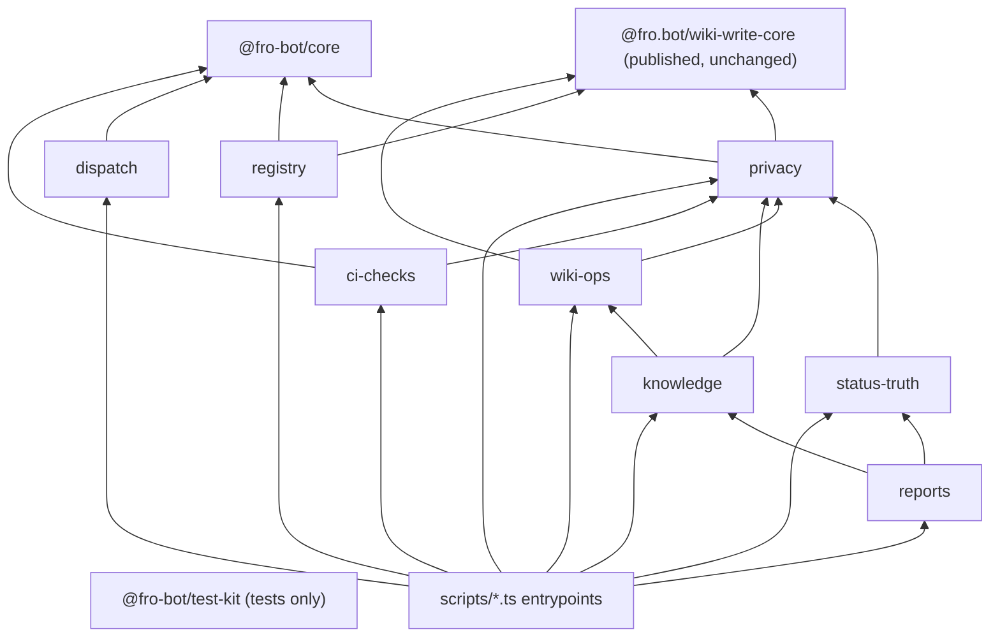

# refactor: Consolidate scripts into private workspace packages

## Overview

Move the control-plane code in `scripts/` into unpublished `@fro-bot/` workspace packages, one PR at a time. Foundation work comes first: a core package, a test kit, the gate changes that keep moved code covered, and a goke runner. After that, each domain moves into its own package behind a thin `scripts/<name>.ts` entrypoint. Workflows, agent prompts and CLI contracts stay the same throughout. Phase 2 (workflow shell to CLI calls, MCP) is out of scope.

## Problem Frame

`scripts/` holds 81 source modules (40.7k lines) that re-implement the same plumbing many times over:

- 22 `isRecord` copies
- 25 JSON stdout sites
- 14 `$GITHUB_OUTPUT` writers
- 9 retry loops
- about 15 Octokit constructions

The copies have drifted apart. Four modules are over 2k lines, and nothing documents the shared layer (see origin: `docs/brainstorms/2026-10-24-scripts-workspace-packages-requirements.md`). Phase 2 needs a stable library and CLI layer to build on.

## Requirements Trace

- R1. Shared code lives in `@fro-bot/` packages marked `private: true`. `@fro.bot/wiki-write-core` stays the only published package.
- R2. Core provides one copy of each duplicated primitive, and every duplicating module uses it.
- R3. The test kit provides the shared fakes and helpers.
- R4. Every module has a home: registry, dispatch, status-truth, ci-checks, wiki-ops, knowledge, reports, plus `privacy`, added in planning. Release and build scripts stay in `scripts/`.
- R5. Modules of 2k lines or more are split as they move.
- R6. Each package has a README.
- R7. CLIs run on goke with schema-typed options, and every command declares whether it is read-only or writes.
- R8. CLI contracts don't change. That covers flags, env, stdout and JSON, the stderr prefixes that workflows parse, `$GITHUB_OUTPUT` keys and exit codes.
- R9. Each PR keeps behavior intact: a recorded test baseline, mutated code stays mutated, and `check:mutation-guards` reaches 100%.
- R10. Every gate that covers a script today still covers its code after the move.
- R11. Bun runs the CLIs, Node exceptions keep working, and no new success-path `process.exit` is added.
- R12. Security boundaries don't move.
- R13. No change under `packages/wiki-write-core/`. The three one-line re-exports may go, and the four CLI wrappers stay.
- R14. MCP waits for fro-bot/agent#1931. Until then, agents call the CLIs through bash.

## Scope Boundaries

- No change to any workflow `run:` block, workflow input or agent prompt, with one exception. The `fro-bot.yaml` sentence that says Test Scripts Load covers `scripts/*.ts` is updated when that gate starts covering packages, so it doesn't go stale.
- No behavior fixes. `apply-branding.yaml` sed escaping and `manage-issues.yaml` `|| true` get their own PRs.
- No change under `packages/wiki-write-core/`, including the four CLIs inside that package.
- These stay in `scripts/` unchanged:
  - `wiki-lockfile-gates.ts`. `publish-wiki.yaml` runs it with no dependency install, so it must keep importing only `node:*`.
  - `build-wiki-write-core.ts`
  - `wiki-write-core-release.ts`
- `wiki-context-expand` and `correction-lifecycle` move but keep their hand-written argv parsing. Agents pass them free text that goke rejects. For example, goke refuses `query "-1 retries"` and accepts `query ""`.

### Deferred to Separate Tasks

- **Phase 2:** workflow shell to CLI calls, `@goke/mcp` exposure, and deduplicating the 17 copies of the metadata overlay. Gated on fro-bot/agent#1931 (smart note #499).
- **`ce:compound-refresh` over `docs/solutions/`** after the last domain PR. 44 docs cite script paths, but only the `verify:` markers are machine-checked.

## Context & Research

Lane files are under `/tmp/rr/scripts-bs/plan/lanes/` (untracked, local to this session). This section copies the facts the plan depends on.

### Relevant Code and Patterns

- **Export target.** `exports` pointing at `src/*.ts` loads under Node 24 strip-only (`node -e "import('./scripts/x.ts')"`), Bun and `tsc` Bundler resolution. This was checked with hand-made links, not a real `bun install` link. Today `@fro.bot/wiki-write-core` resolves to committed `dist/`.
- **Mutation trigger closure.** In `scripts/check-mutation-guards.ts`, `WIKI_WRITE_CORE_SPECIFIER_PATTERN` matches only `@fro.bot/wiki-write-core`. `FIXED_TRIGGER_FILES` lists only that package's manifest. A PR that touches only `@fro-bot/` code is reported `not-applicable`. `check-mutation-guards.test.ts` pins the `@fro-bot` scope as rejected and asserts 10 or more `@fro.bot` references.
- **Stryker sandbox.** The sandbox links `node_modules` to the real tree. A test that imports mutated code by package name never runs against the mutants. A Stryker probe confirmed this: it is a survivor, not a lint error.
- **Mutation config test.** `scripts/mutation-guards-config.test.ts` Test 1 requires every non-test `.ts` under `packages/*/src` to be listed in `mutate` or `not-mutated`. Test 2 matches `scripts/check-*.ts` by name.
- **`verify:` resolver.** `findSignature` in `scripts/check-solutions-examples.ts` matches only top-level declarations in the named file. Five markers point at `guardedPatterns`, `isPureReexportBarrel`, `parseFrontmatterSources` and `sourceUrlMatchesRepo` (twice).
- **Test Scripts Load.** The gate loops over `scripts/*.ts` only (`.github/workflows/main.yaml`).
- **Private-leak job.** `check-private-leak.yaml` checks out `main` and runs `bun install --frozen-lockfile --ignore-scripts`, then Node. A stale `bun.lock` breaks it only after merge.
- **Renovate automerge.** The `default.json` automerge rule matches `@fro-bot/**`. Whether Renovate skips `workspace:*` dependencies is unverified.
- **Release prefix.** The release trigger is `packages/wiki-write-core/` with a trailing slash, and sibling directories are tested as not counting. No new package may be named `wiki-write-core*`.
- **Seam pattern.** `check-wiki-private-presence.ts` and `wiki-lockfile-gates.ts` already expose a pure `runCli(argv, env)` that returns `{exitCode, stdout, stderr}`. The goke runner follows this shape.
- **Entry guards.** 55 scripts guard their entrypoint with `import.meta.url === file://${argv[1]}`, and 3 use `import.meta.main`. The entry-guard tests import the script in-process with a cache-busting query.
- **Exit codes.** The non-default exit codes are 3 (`scripts/wiki-ingest.ts`, consumed by `survey-repo.yaml`), 2 (`wiki-lockfile-gates` unknown mode) and 0 on the `record-survey-result` non-fatal skip. `check-private-leak` writes `scan_result` before every exit.
- **Primitive behavior that must be kept:**
  - `isRecord`: `correction-lifecycle.ts` and `private-repo-resolution.ts` accept arrays.
  - ENOENT guards come in two families: `instanceof Error` and any object.
  - `isApiStatus` has 8 variants.
  - `$GITHUB_OUTPUT` writers: `dispatch-renovate.ts` and `wiki-change-detect.ts` throw when the variable is unset, and the rest skip.
  - Multiline output delimiters are used only in `wiki-query.ts` and `solutions-query.ts`, and use `Math.random()`.
  - JSON output is compact plus a newline everywhere except `reset-survey-status.ts`, which indents by 2.
  - `requiredEnv` treats an empty value as missing and reports `${name} is required` (10 copies). Two copies throw `DraftedSolutionsError`.
  - Retry policies, which all differ: `commit-metadata` retries 409 with no delay. `wiki-ingest` uses jittered backoff capped at 10s. `private-repo-resolution` uses 2s × 2^n on rate-limit messages. `merge-data-pr` uses 1s fixed on 429, ≥500 and network errors. `gateway-announce` retries once after 5s.
  - Octokit: `cross-repo-dispatch` uses a 15s timeout, and `status-truth-*` uses 10s with a no-op logger. There are dynamic-import and static constructor seams. Reconcile and invitation keep one credential per client.
  - YAML write: `stringify({indent: 2, lineWidth: 0, singleQuote: true})` plus a newline, in `commit-metadata.ts` and `rename-tracked-repo.ts`. Both are registry modules.
- **Import graph.**
  - There is one group-level cycle, knowledge ↔ status-truth. It runs through `capture-learnings-privacy`, `status-truth-public-output` and `loadRedactedCanonicalIdsFromDisk`, which is the only symbol outsiders import from `status-truth-proposals`.
  - `check-wiki-authority.ts` is a 230-line leaf with no relative imports. `merge-back-data` and `check-mutation-guards` import it.
  - `createOctokitFromEnv` lives in `capture-learnings-harvest.ts`, and knowledge and reports import it dynamically.
  - `renovate-runtime` ↔ `check-renovate-ranges` is a module cycle inside one group.

### Institutional Learnings

- `docs/solutions/runtime-errors/node-strip-only-typescript-2026-04-18.md`: use erasable syntax only, since Node strip-only loading is the gate.
- `docs/solutions/best-practices/a-mutation-score-can-measure-nothing-2026-09-08.md`: list the mutated set explicitly, use in-memory fixtures (the Stryker sandbox is shared), and keep the reach checks.
- `docs/solutions/best-practices/pure-core-privacy-gates-shared-module-2026-06-22.md`: extract a shared invariant once independent consumers must enforce it. Privacy gates fail closed.
- `docs/solutions/best-practices/enumerate-mutator-variants-before-a-stryker-directive-2026-09-05.md`: add no new Stryker directives. Use a seam instead.
- Memory #10362: converted stdout writers must not call `process.exit` on the success path under Bun.

### External References

- goke 6.17.0 (https://github.com/remorses/goke):
  - Accepts Standard Schema options. infra uses zod ^4.3.6.
  - `parse(argv, {run: false})` followed by `runMatchedCommand()`, which is infra's `packages/cli/src/cli.ts` pattern.
  - Probe results in a scratch workspace:
    - With no matched command and no `cli.help()`, it exits 0 silently.
    - Help for an unknown command goes to stdout.
    - Errors thrown from an action print `error:` plus a stack, with ANSI codes when `CI` is set.
    - It calls `process.exit` unless an exit function is injected.
    - It honors `process.exitCode = 3` set inside an action.
    - Unknown flags, missing values and repeated scalar flags exit 1.
    - Extra positionals are accepted.
    - It is ESM with no dependencies, and it loads under Node strip-only and Bun.
- Node 24 refuses to strip types under `node_modules`. A workspace link that resolves to the real path outside `node_modules` avoids this.

## Prior-Art Survey

```json
{
  "schema_version": 2,
  "verdict": "extend",
  "scope": "scripts/ and packages/wiki-write-core/src (.worktrees/ skipped)",
  "freshness": {"vcs_reference": "1da36c9"},
  "budget": {"max_search_passes": 6, "max_candidate_inspections": 25, "exhausted": true},
  "candidates": [
    {
      "path_or_symbol": "scripts/schemas.ts",
      "description": "Re-export shim over @fro.bot/wiki-write-core/schemas metadata shape types and guards; 14 importers.",
      "disposition": "reuse"
    },
    {
      "path_or_symbol": "scripts/commit-metadata.ts",
      "description": "commitMetadata: mutator-based metadata/*.yaml read-modify-write via Git Data with conflict retry; private createOctokitFromEnv and isRecord.",
      "disposition": "extend"
    },
    {
      "path_or_symbol": "scripts/repos-metadata.ts",
      "description": "Domain layer over metadata/repos.yaml shared by five scripts.",
      "disposition": "reuse"
    },
    {
      "path_or_symbol": "scripts/git-data-fake.ts",
      "description": "createGitDataFake: in-memory Git Data API fake.",
      "disposition": "reuse"
    },
    {
      "path_or_symbol": "scripts/workflow-step-test-helper.ts",
      "description": "runStepWithStubs: runs a workflow run: step with stubbed commands and a temp GITHUB_OUTPUT.",
      "disposition": "reuse"
    },
    {
      "path_or_symbol": "scripts/workflow-expression-test-helper.ts",
      "description": "evaluateExpression: GitHub Actions if: expression evaluator.",
      "disposition": "reuse"
    },
    {
      "path_or_symbol": "scripts/capture-learnings-privacy.ts#isRecord",
      "description": "Exported isRecord used by five modules; about 20 private copies elsewhere.",
      "disposition": "extend"
    },
    {
      "path_or_symbol": "scripts/record-survey-result.ts#requiredEnvFrom",
      "description": "Testable required-env reader; private requiredEnv copies in at least seven scripts.",
      "disposition": "extend"
    },
    {
      "path_or_symbol": "packages/wiki-write-core/src/index.ts",
      "description": "Published wiki-domain barrel.",
      "disposition": "insufficient",
      "insufficiency_reason": "Published npm artifact with wiki-domain scope only; adding repo-private CI plumbing would widen a public API and cut releases."
    },
    {
      "path_or_symbol": "scripts/private-repo-resolution.ts#RetryOptions",
      "description": "Rate-limit retry welded to a gh GraphQL resolver.",
      "disposition": "insufficient",
      "insufficiency_reason": "Retry is bound to one failure mode; no generic retry primitive exists."
    },
    {
      "path_or_symbol": "scripts/wiki-context-expand.ts#parseArgv",
      "description": "Only named argv parser.",
      "disposition": "insufficient",
      "insufficiency_reason": "Bespoke to one CLI; no shared argv, runner or main-guard helper exists."
    },
    {
      "path_or_symbol": "scripts/wiki-handoff-core.ts",
      "description": "Handoff policy shared by four scripts.",
      "disposition": "insufficient",
      "insufficiency_reason": "Domain logic only; owns no env, argv, output, retry or client plumbing."
    },
    {
      "path_or_symbol": "scripts/status-truth-public-output.ts",
      "description": "applyPublicOutputGate privacy filter used by five modules.",
      "disposition": "insufficient",
      "insufficiency_reason": "A content privacy gate, not an output writer; it moves to the privacy package unchanged."
    },
    {
      "path_or_symbol": "scripts/*.ts inline GITHUB_OUTPUT / GITHUB_STEP_SUMMARY writers",
      "description": "About 14 inline writers with divergent unset-variable behavior.",
      "disposition": "undispositioned"
    },
    {
      "path_or_symbol": "scripts/*.ts inline Octokit construction",
      "description": "About 15 inline constructions plus per-module factories.",
      "disposition": "undispositioned"
    }
  ]
}
```

## Key Technical Decisions

- **Packages export `.ts` source with no build step.** Nothing compiles, and Bun, Node strip-only, `tsc` and Vitest all load source. Unit 1 proves a real `bun install` link before anything depends on it. If it fails, the fallback is a per-package `tsc` emit with committed `dist/`, which matches wiki-write-core.
- **Subpath exports per module, no wide barrels.** A barrel that re-exports `check-solutions-examples` would make every importer load `typescript`.
- **Retry, the GitHub client and `check-wiki-authority` become core modules, not separate packages.** Each one is a separate PR. Fewer packages mean fewer manifests, lock entries and enumeration rows, and the dependency graph stays acyclic either way.
- **New `@fro-bot/privacy` package.** It takes the whole private-leak family and the shared redaction helpers: `capture-learnings-privacy`, `status-truth-public-output`, `loadRedactedCanonicalIdsFromDisk`, `private-repo-resolution`, `resolve-private`, `check-private-leak`, `check-wiki-private-presence` with its detector, and `enumerate-existing-leaks`. This breaks the knowledge ↔ status-truth cycle and keeps the mutated privacy modules with their tests.
- **Metadata YAML write lives in registry, not core.** Both copies are registry modules (`commit-metadata`, `rename-tracked-repo`). This narrows R2's "metadata read/write in core", since no other domain writes metadata.
- **Mutated code and its tests move together** into the same package, and those tests import by relative path. A new enumeration test fails any `mutate` entry whose paired test reaches it only through an `@fro-bot/` name.
- **Divergent behavior becomes explicit options, not a single blessed default.**
  - `isRecord`, which rejects arrays, ships alongside `isObject`. The two array-accepting callers use `isObject`.
  - ENOENT guards are not unified.
  - The output writer takes an `onMissing: 'skip' | 'throw'` policy and a collision-checked UUID delimiter.
  - JSON output takes an indent parameter.
  - `requiredEnv` takes an error factory, so per-caller messages and error types survive.
  - Retry takes the policy (attempts, delay function, retry predicate) from each caller, which keeps today's numbers.
  - The client factory takes timeout and logger options and one token per call.
- **One goke runner in core** owns exit code, stdout, stderr and help. Every goke CLI goes through it. The runner:
  - registers help explicitly;
  - treats "no matched command" as each CLI's documented usage-error code;
  - disables colour;
  - sends unknown-command help to stderr;
  - injects `exit`;
  - catches action errors into the CLI's own message format, so a stack trace never reaches a workflow;
  - uses `process.exitCode` instead of `process.exit`.

  It returns `{exitCode, stdout, stderr}` like the existing `runCli` seams.

- **Hand-parsed exceptions.** `wiki-context-expand` and `correction-lifecycle` keep their argv parsers in phase 1, and are marked read-only or write in their README so phase 2 can still classify them.
- **Env-only CLIs may change behavior for input no caller sends.** For example, `--help` now prints help, and an unknown flag exits 1. Every invocation that a workflow or prompt actually uses stays byte-identical.
- **zod is the goke schema library.** It matches infra and is already resolved at 4.6.7 through Stryker. goke and zod are imported only by the core runner module and the package CLI modules, never by library modules.
- **The entry guard stays in each `scripts/<name>.ts`.** The shim imports the package function, maps its result to an exit code, and keeps the entry-guard test next to it. The exit-code mapping itself lives in the package, so it stays mutated where it is mutated today.
- **`scripts/` shims are listed as not-mutated** with a reason (pure delegation). Their names still match Test 2.
- **Reverts are last-in-first-out.** Later PRs import earlier packages and lock entries. The `scripts/` entrypoints keep workflow paths stable, so a revert never breaks a workflow.

## Open Questions

### Resolved During Planning

- Package placement of the privacy checks: their own `privacy` package (see Key Technical Decisions).
- `check-wiki-authority` ownership: a core module.
- Domain order: core and test-kit, retry, GitHub client, CLI runner, privacy, registry, dispatch, status-truth, wiki-ops, knowledge, reports, ci-checks. The mutation gate is self-referential and resolves paths from `import.meta.dirname`, so it goes last.
- Schema library: zod.
- `verify:` markers: repoint each marker to the package file in the PR that moves its symbol. The resolver is not taught to follow re-exports.
- Mutation trigger closure: resolve `@fro-bot/<pkg>[/<sub>]` through each package's `exports` map. Every `packages/*/package.json` (except wiki-write-core's, which already has its own rule) becomes a fixed trigger.

### Deferred to Implementation

- Whether Renovate skips `workspace:*` dependencies. Unit 1 dry-runs an extract. If Renovate proposes them, a local `.github/renovate.json5` rule disables them, so the shared `default.json` preset stays untouched.
- Exact module boundaries inside each split (R5). Decide these while reading the file. Split by responsibility, not by line count.
- The Stryker runtime increase from adding core modules to `mutate`. Unit 1 times the baseline, and each PR records the new time.
- Whether `daily-digest-counts` reads better in reports or registry. It defaults to reports, as the origin doc says.

## Output Structure

    packages/
      core/            @fro-bot/core: guards, env, output, json, retry, github, cli runner, wiki-authority
      test-kit/        @fro-bot/test-kit: git-data fake, octokit fake, workflow step/expression helpers
      privacy/         @fro-bot/privacy
      registry/        @fro-bot/registry
      dispatch/        @fro-bot/dispatch
      status-truth/    @fro-bot/status-truth
      wiki-ops/        @fro-bot/wiki-ops
      knowledge/       @fro-bot/knowledge
      reports/         @fro-bot/reports
      ci-checks/       @fro-bot/ci-checks
      wiki-write-core/ (unchanged, published)
    scripts/           thin entrypoints + wiki-lockfile-gates, build/release scripts, 4 wiki-write-core CLI wrappers

Each package has `package.json` (`private: true`, `type: module`, subpath `exports` to `src/*.ts`, `workspace:*` internal dependencies), `README.md` and `src/` with colocated tests.

## High-Level Technical Design

> _This illustrates the intended approach and is directional guidance for review, not implementation specification. The implementing agent should treat it as context, not code to reproduce._



Entrypoint shape, directional:

    scripts/<name>.ts:
      import { main } from '@fro-bot/<pkg>/<name>-cli'
      if (entry guard) { const r = await main(process.argv.slice(2), process.env); write r.stdout/r.stderr; process.exitCode = r.exitCode }

## Per-PR Checklist (applies to every unit that moves code)

Each moving unit treats this checklist as part of its verification:

1. Record the baseline Vitest count on the parent commit, using one fixed command, in the PR body. Account for every test that moves, is added or is removed.
2. Use `git mv` for each moved module and its tests, so history follows.
3. Mutated modules:
   - The new path is in `mutate` and the test path is in `testFiles`.
   - Tests use relative imports.
   - The `scripts/` shim is in `mutation-guards.json` not-mutated, with a reason.
   - `bun run check:mutation-guards` reports 100% and the Stryker time is recorded.
4. Every new non-test `packages/*/src` module is listed in `mutate` or `not-mutated`.
5. Every `verify:` marker that names a moved symbol is repointed, and `bun run lint` passes.
6. CLI parity: run every invocation the workflows and prompts actually use, before and after, and diff stdout, stderr and the exit code. Use a table-driven test where a pure `runCli` exists. Cover:
   - the stderr prefixes `wiki-ingest:warning:`, `wiki-ingest:finding:` and `corrections:warning:`;
   - `::error::` lines;
   - `$GITHUB_OUTPUT` keys;
   - exit codes 0, 1, 2 and 3.
7. `bun install --frozen-lockfile` passes with the committed `bun.lock`, and `check-override-floors` passes.
8. Package `README.md` exists (R6). Root docs that list the layout are updated:
   - `.github/copilot-instructions.md`
   - `README.md`
   - `llms.txt`
   - `.agents/skills/generating-project-docs/SKILL.md`
9. Run the full gate unpiped: `bun run bootstrap`, `check-types`, `lint`, `test` and `check:mutation-guards`.
10. Confirm that no path under `packages/wiki-write-core/` changed.

## Implementation Units

### Phase A: Foundation

- [ ] **Unit 1: Probe the workspace mechanics on the real repo**

**Goal:** Confirm the assumptions the foundation rests on, before any code depends on them.

**Requirements:** R1, R8, R10, R11

**Dependencies:** None

**Files:** None committed. Results go under `/tmp/rr/scripts-bs/probe/` and are summarized in Unit 2's PR body.

**Approach:**

- In a scratch worktree, add two throwaway packages that export `src/*.ts`, wire a script to import one, and run `bun install` with the hoisted linker. Then confirm:
  - Test Scripts Load's exact `node -e "import(...)"` form loads the script through the real install link;
  - `bun run check-types`, `lint` and `test` pass;
  - the private-leak job's `bun install --frozen-lockfile --ignore-scripts` passes, followed by its Node invocation;
  - a timed `bun run check:mutation-guards` baseline;
  - a Renovate local `--dry-run=extract` shows how `workspace:*` dependencies are treated;
  - a stub goke CLI behaves as listed in External References under Bun with stdout piped: help, unknown command, unknown flag, thrown action error, `CI=true` and `exitCode`.

**Test scenarios:** Test expectation: none -- this is a probe, and its result decides the source-export decision and the Renovate rule.

**Verification:** Each probe has a saved log with an exit code. Any failure changes Key Technical Decisions before Unit 2 starts.

- [ ] **Unit 2: Core and test-kit packages, gate wiring and mechanical primitives** (PR A)

**Goal:** Land `@fro-bot/core` and `@fro-bot/test-kit`, make every gate see `@fro-bot/` code, and migrate the mechanical primitives.

**Requirements:** R1, R2, R3, R9, R10, R11

**Dependencies:** Unit 1

**Files:**

- Create:
  - `packages/core/{package.json,README.md}`
  - `packages/core/src/{guards,output,json}.ts` and their tests
  - `packages/test-kit/{package.json,README.md}`
  - `packages/test-kit/src/{git-data-fake,octokit-fake,workflow-step,workflow-expression}.ts`
- Modify:
  - root `package.json` (workspaces) and `bun.lock`
  - `scripts/check-mutation-guards.ts` and `scripts/check-mutation-guards.test.ts` (resolver, fixed triggers, updated scope pins)
  - `scripts/mutation-guards-config.test.ts` (new tests below), `mutation-guards.json`, `stryker.config.json`
  - `.github/workflows/main.yaml`: Test Scripts Load also loops over `packages/*/src/**/*.ts`, excluding tests and `packages/wiki-write-core/`. The PR CI job also replays the private-leak frozen install.
  - the `fro-bot.yaml` Test Scripts Load sentence
  - the scripts that duplicate guards, output writers and JSON emit
- Delete / move:
  - `scripts/git-data-fake.ts`, `scripts/workflow-step-test-helper.ts` and `scripts/workflow-expression-test-helper.ts` move to test-kit, and their importers are rewritten.
- Test:
  - `packages/core/src/*.test.ts`
  - `scripts/package-layout.test.ts`: every `@fro-bot/*` package is `private: true` and `type: module`, internal dependencies are `workspace:*`, every import of an `@fro-bot/` name is declared as a dependency, and the package graph has no cycles.

**Approach:**

- `guards` exports `isRecord` (rejects arrays), `isObject` and the variants in use today. ENOENT guards stay where they are.
- `output` writes `$GITHUB_OUTPUT` and the step summary with a `skip` or `throw` policy and a collision-checked delimiter. It is in `mutate` with 100% kills before any gate module uses it.
- Gate modules (`check-private-leak` and the other mutated files) keep their local writers in this PR.
- Mechanical migration replaces only copies whose behavior is identical. Array-accepting callers move to `isObject`, and the indented JSON caller passes its indent.

**Execution note:** Write the new mutation-guard trigger tests first. A core-only change must be reported applicable, and it must fail before the resolver change.

**Patterns to follow:** The `runCli` seam in `scripts/check-wiki-private-presence.ts`. The mutation-guard closure tests in `scripts/check-mutation-guards.test.ts`.

**Test scenarios:**

- Happy path: a PR touching only `packages/core/src/guards.ts` makes `check:mutation-guards` report applicable and run Stryker for the mutated modules that import it.
- Happy path: changing a `packages/<pkg>/package.json` triggers the mutation-guard gate.
- Error path: a `mutate` entry whose paired test imports it only through `@fro-bot/` fails the enumeration test.
- Error path: a non-test `packages/core/src/x.ts` that is in neither `mutate` nor `not-mutated` fails Test 1.
- Error path: an undeclared `@fro-bot/` import, a non-`workspace:*` internal dependency, or a package cycle fails `package-layout.test.ts`.
- Edge case: `isRecord([])` returns false and `isObject([])` returns true.
- Edge case: the output writer with the variable unset skips under `skip` and throws under `throw`.
- Edge case: a multiline value containing the delimiter is rejected.
- Integration: Test Scripts Load loads `packages/core/src/*.ts` under Node strip-only, and a module using non-erasable syntax fails it.
- Integration: the PR CI frozen-install replay fails on a stale `bun.lock`.

**Verification:** The Per-PR Checklist passes. The test count only moves where tests moved. No test in `scripts/` defines its own Git Data fake or workflow step runner.

- [ ] **Unit 3: Retry primitive** (PR B)

**Goal:** One retry module that carries each caller's policy.

**Requirements:** R2, R8, R9

**Dependencies:** Unit 2

**Files:** Create `packages/core/src/retry.ts` and its test. Modify the 9 retry callers (`commit-metadata`, `private-repo-resolution`, `merge-data-pr`, `gateway-announce` and the rest from the repo lane) and their tests. `packages/wiki-write-core` keeps its own copy.

**Approach:** The caller passes attempts, a delay function and a retry predicate. Each call site keeps its current numbers and predicate. Tests use injected delay and clock seams, not real sleeps.

**Patterns to follow:** The existing retry tests in `scripts/commit-metadata.test.ts` and `scripts/merge-data-pr.test.ts`.

**Test scenarios:**

- Happy path: each caller's policy table runs, for example 409 retried with no delay for commit-metadata, and 429, 5xx or network error retried with 1s fixed delay for merge-data-pr.
- Edge case: the final attempt's error propagates unchanged.
- Edge case: a non-retryable error is thrown on the first attempt.
- Integration: the existing caller tests pass unchanged.

**Verification:** No retry loop remains outside core and wiki-write-core, and the caller tests are unchanged.

- [ ] **Unit 4: GitHub client factory** (PR C)

**Goal:** One Octokit construction module with explicit options.

**Requirements:** R2, R8, R12

**Dependencies:** Unit 3

**Files:** Create `packages/core/src/github.ts` and its test. Move `createOctokitFromEnv` out of `scripts/capture-learnings-harvest.ts` and rewrite its dynamic importers. Modify the inline construction sites.

**Approach:** One token per call, with timeout and logger options. The factory keeps a `loadOctokitConstructor` seam, so both `vi.mock('@octokit/rest')` shapes keep working. Reconcile and invitation keep separate credentials per client.

**Patterns to follow:** `scripts/commit-metadata.ts` (dynamic-import seam) and `scripts/reconcile-repos.ts` (static seam).

**Test scenarios:**

- Happy path: the factory passes the token, a 15s timeout and a no-op logger through to the constructor.
- Edge case: a missing token produces each caller's current error.
- Integration: caller tests that mock `@octokit/rest` still pass, for both seam shapes.

**Verification:** No inline `new Octokit(` remains outside core and wiki-write-core.

- [ ] **Unit 5: goke CLI runner and env reader** (PR D)

**Goal:** The single runner every goke CLI uses, plus the shared env reader.

**Requirements:** R2, R7, R8, R11

**Dependencies:** Unit 2

**Files:** Create `packages/core/src/{cli,env}.ts` and their tests. Add `goke` and `zod` as dependencies of `packages/core` and update `bun.lock`. Update the `docs/override-floors.md` zod note now that zod is a direct dependency. Migrate the `requiredEnv` copies whose behavior is identical.

**Approach:**

- The runner wraps goke `parse(argv, {run: false})` with injected `exit`, `stdout` and `stderr`, colour off, explicit help and stderr help. It maps "no matched command" and action errors to the CLI's configured code and message format, and returns `{exitCode, stdout, stderr}`.
- Each command declares `readOnly: true | false`.
- `requiredEnv` takes an error factory.

**Execution note:** Pin each goke behavior from Unit 1 as a failing test before the runner handles it.

**Test scenarios:**

- Error path: no args, or an unknown command, returns the configured usage code, leaves stdout empty and writes help to stderr.
- Error path: an unknown flag or a missing value returns exit 1 with goke's message on stderr and empty stdout.
- Error path: an action that throws returns the configured message format with no stack and no ANSI codes under `CI=true`.
- Happy path: an action that sets exit 3 returns 3.
- Happy path: `--help` returns 0 with help on stdout.
- Edge case: a 300 KB stdout payload is delivered complete under Bun when piped.
- Edge case: `options['--']` never appears in the JSON output.
- Happy path: `requiredEnv` treats an empty value as missing and uses the caller's message.

**Verification:** The runner is in `mutate` at 100%, and no domain CLI exists yet.

### Phase B: Domains

Each domain unit follows the Per-PR Checklist. Splitting means focused modules by responsibility, with the public CLI surface unchanged.

- [ ] **Unit 6: `@fro-bot/privacy`**

**Goal:** Move the privacy family into one package and break the knowledge ↔ status-truth cycle.

**Requirements:** R4, R8, R9, R10, R12

**Dependencies:** Units 2–5

**Files:**

- Move to `packages/privacy/src/` with their tests:
  - `capture-learnings-privacy`
  - `status-truth-public-output`
  - `loadRedactedCanonicalIdsFromDisk`, extracted from `status-truth-proposals`
  - `private-repo-resolution`
  - `resolve-private`
  - `check-private-leak`
  - `check-wiki-private-presence`
  - `enumerate-existing-leaks`
- Keep `scripts/` entrypoints for every CLI.
- Rewrite the five `loadRedactedCanonicalIdsFromDisk` call sites.
- Repoint the `verify:` markers for `parseFrontmatterSources` and `sourceUrlMatchesRepo`.

**Approach:**

- `check-private-leak` keeps writing `scan_result` before every exit, and keeps running on Node from both invocations (the standalone job and the `merge-data.yaml` promotion step).
- The privacy CLIs adopt the runner only where their argv surface is flags-only. `enumerate-existing-leaks` keeps its `--help` exit code.

**Test scenarios:**

- Happy path: the `check-private-leak` parity table, including `scan_result` values and exit codes for clean, leak and missing-input runs.
- Integration: the Node strip-only loading of the `check-private-leak` entrypoint through the package passes, and it fails closed when an input is missing (origin AE5).
- Integration: `check-wiki-private-presence` `runCli` table output is unchanged.

**Verification:** Mutated privacy modules reach 100% from their new paths, and the import graph has no knowledge ↔ status-truth edge.

- [ ] **Unit 7: `@fro-bot/registry`** (includes the `check-wiki-authority` move into core)

**Goal:** Move the metadata writers, reconcile, invitations, survey, `merge-back-data` and `rename-tracked-repo`, and split `reconcile-repos`.

**Requirements:** R4, R5, R8, R9, R12

**Dependencies:** Unit 6

**Files:**

- Move to `packages/registry/src/`:
  - `repos-metadata`, `commit-metadata`, `update-metadata`, `metadata-wiki-rename-guard`
  - `reconcile-repos` (split), `handle-invitation`
  - `record-survey-result`, `reset-survey-status`, `check-repo-onboarded`
  - `merge-back-data`, `merge-data-pr`, `rename-tracked-repo`
  - `repo-page-move-fixtures` (test support)
- Move `check-wiki-authority` to `packages/core/src/wiki-authority.ts`, with its tests. Repoint the `guardedPatterns` marker. `check-mutation-guards` imports it from core.
- Delete `scripts/schemas.ts`, `scripts/wiki-utils.ts` and `scripts/markdown-links.ts` after rewriting their importers to `@fro.bot/wiki-write-core` subpaths.

**Approach:**

- The YAML write options live in one registry module.
- Data writers keep App-token-only isolation, and nothing here runs in an agent job.
- `record-survey-result` keeps its exit-0 skip.

**Test scenarios:**

- Happy path: the `reconcile-repos` parity table covers stdout JSON, `$GITHUB_OUTPUT` keys and the `DATA_BRANCH_TAMPER` exit for each integrity variant, before and after the split (origin AE1).
- Happy path: `merge-back-data` keeps 100% kills from its new path.
- Integration: the `wiki-write-core-package.test.ts` shim list matches the remaining four wrappers.

**Verification:** No module in `packages/registry/src` exceeds the split threshold.

- [ ] **Unit 8: `@fro-bot/dispatch`**

**Goal:** Move `cross-repo-dispatch` (split) and `dispatch-renovate`.

**Requirements:** R4, R5, R8

**Dependencies:** Units 2–5

**Files:** `packages/dispatch/src/` and tests. `scripts/` entrypoints for both.

**Approach:** Keep `planDispatch` and the executor's pending re-check behavior. `dispatch-renovate` keeps throwing when `$GITHUB_OUTPUT` is unset.

**Test scenarios:**

- Happy path: the parity table for dispatch plan output on a #4050-shaped goal and on a goal with mixed statuses.
- Error path: `dispatch-renovate` with no output variable throws as it does today.

**Verification:** The existing dispatch tests pass from their new paths.

- [ ] **Unit 9: `@fro-bot/status-truth`**

**Goal:** Move `status-truth-detect`, `status-truth-proposals` and `status-truth-prs`, plus `rollout-tracker-snapshot`, and split detect and proposals.

**Requirements:** R4, R5, R8

**Dependencies:** Unit 6

**Files:** `packages/status-truth/src/` and tests. `scripts/` entrypoints.

**Approach:** Snapshot stdout stays complete when piped (the `process.exitCode` rule). The plan-status detector keeps accepting only `complete`.

**Test scenarios:**

- Happy path: the `rollout-tracker-snapshot` 300 KB piped output is delivered complete.
- Happy path: the status-truth dry-run claim output matches the baseline fixture.

**Verification:** Detect and proposals are split, and the tracker preflight outputs are unchanged.

- [ ] **Unit 10: `@fro-bot/wiki-ops`**

**Goal:** Move the wiki handoff, context, query, repair, index and corrections modules.

**Requirements:** R4, R8, R9

**Dependencies:** Unit 6

**Files:**

- Move to `packages/wiki-ops/src/`:
  - `wiki-handoff-{apply,baseline,build,core}`
  - `wiki-change-detect(-core)`
  - `wiki-context-expand`, `wiki-context-safety`
  - `wiki-query`, `wiki-repair`, `wiki-lint-issues`, `rebuild-wiki-index`
  - `render-corrections-context`, `correction-lifecycle`
  - `solutions-query`, `solution-docs-paths`
- The four wiki-write-core CLI wrappers stay in `scripts/`.

**Approach:**

- `wiki-context-expand` and `correction-lifecycle` keep their hand-written parsers.
- The `corrections:warning:` prefix and the `wiki-change-detect` throwing output writer are kept.
- `wiki-context-safety` keeps 100% kills.

**Test scenarios:**

- Happy path: the agent-style `wiki-context-expand` invocations from `fro-bot.yaml` and `README.md` produce the same output, including free text that starts with `-`.
- Happy path: the `render-corrections-context` stderr prefix is unchanged.

**Verification:** The handoff sequence replay tests pass from their new paths.

- [ ] **Unit 11: `@fro-bot/knowledge`**

**Goal:** Move capture-learnings, capture-patterns and drafted-solutions.

**Requirements:** R4, R8

**Dependencies:** Units 4, 6, 10

**Files:** `packages/knowledge/src/` and tests for `capture-learnings-{harvest,open}`, `capture-patterns-{cluster,open,synthesis}` and `drafted-solutions-*`. `scripts/` entrypoints.

**Approach:** The label and marker constants stay in knowledge. The client comes from core. The `drafted-solutions` exitCode path stays.

**Test scenarios:**

- Happy path: the parity table for each harvest and open CLI's dry-run output.
- Edge case: `DraftedSolutionsError` messages for a missing env var are unchanged.

**Verification:** The knowledge package doesn't import status-truth.

- [ ] **Unit 12: `@fro-bot/reports`**

**Goal:** Move improvement-metrics, the daily digest and gateway-announce.

**Requirements:** R4, R8

**Dependencies:** Units 9, 11

**Files:** `packages/reports/src/` and tests for `improvement-metrics-{core,detect,report}`, `daily-digest-counts` and `gateway-announce`. `scripts/` entrypoints.

**Test scenarios:**

- Happy path: the `daily-digest-counts` output keeps `should_post` behavior.
- Happy path: the `gateway-announce` HMAC payload is byte-identical for a fixed input.

**Verification:** The workflow-invoked report CLIs match the parity table.

- [ ] **Unit 13: `@fro-bot/ci-checks`** (last)

**Goal:** Move the repo-level checks, the Renovate tooling and the mutation gate itself.

**Requirements:** R4, R9, R10

**Dependencies:** Units 6–12

**Files:**

- Move to `packages/ci-checks/src/`:
  - `check-mutation-guards`, `mutation-guards-reach` and the paired config test
  - `check-md-links`, `check-override-floors`, `check-solutions-examples`
  - `check-renovate-{config,ranges}`, `renovate-runtime`, `install-renovate`
- Repoint the `isPureReexportBarrel` marker.
- Keep `wiki-lockfile-gates.ts` in `scripts/`.

**Approach:**

- Repo-root resolution changes from `scripts/`-relative to package-relative. `FIXED_TRIGGER_FILES` names the new paths.
- `check:renovate-config` stays on Node, because `re2`'s ABI requires it.
- `check-solutions-examples` keeps `typescript` behind its own subpath.

**Test scenarios:**

- Happy path: `check:mutation-guards` run from its new path classifies a core-only change as applicable and a docs-only change as not-applicable.
- Happy path: `mutation-guards-reach` still reports its reach set.
- Integration: `check:renovate-config` passes under Node.

**Verification:** `scripts/` holds only entrypoints plus `wiki-lockfile-gates.ts`, the build and release scripts and the four wiki-write-core wrappers. That is the phase 1 end state.

## System-Wide Impact

- **Interaction graph:** Workflows → `scripts/<name>.ts` → package function. Agent prompts invoke `scripts/wiki-context-expand.ts`, `check-override-floors.ts` and `drafted-solutions-validate-rows.ts` by path, and those paths stay.
- **Error propagation:** Exit codes and stderr prefixes are part of the contract. The runner never lets a goke default (silent 0, stack trace, ANSI, stdout help) reach a workflow.
- **State lifecycle risks:** `bun.lock` changes in every PR. A stale lock breaks the main-only private-leak job, and the PR CI replay catches that before merge.
- **API surface parity:** `@fro.bot/wiki-write-core` keeps its own primitive copies. The two layers can drift, and that is accepted (origin Key Decisions).
- **Integration coverage:** The CLI parity tables and the Test Scripts Load glob cover what unit tests can't.
- **Unchanged invariants:**
  - The `data` writer's App-only isolation.
  - Privacy gates fail closed.
  - Handoff trust revalidation.
  - App-token mint scopes.
  - Workflow `run:` blocks.
  - The wiki-write-core release trigger.

## Risks & Dependencies

| Risk | Mitigation |
| --- | --- |
| A real `bun install` link breaks Node strip-only loading | Unit 1 probe. Fall back to compiled `dist/` per package. |
| Mutated code silently drops out of mutation coverage after a move | Tests move with their code, plus the enumeration test for named-import pairing and the trigger resolver (Unit 2). |
| goke defaults change a workflow-visible contract | The single runner and the per-CLI parity tables. Free-text CLIs stay hand-parsed. |
| Renovate automerges `workspace:*` bumps | Unit 1 dry-run. A local rule disables them if needed. |
| Long-running moves conflict with Fro Bot PRs touching `scripts/` | One PR at a time (memory #10128), `git mv`, and merge soon after review. |
| Stryker runtime grows with core in `mutate` | Time recorded per PR. Mutate only modules that hold logic. |
| A revert out of order breaks the frozen install | Revert last-in-first-out, documented here and in each PR body. |

## Documentation / Operational Notes

- Each package gets a README (R6). Root docs are updated in the PR that changes the layout.
- After Unit 13, run `ce:compound-refresh` over `docs/solutions/` for stale script paths.
- PRs land one at a time (memory #10128). Rebase and re-gate before each push.

## Sources & References

- **Origin document:** [docs/brainstorms/2026-10-24-scripts-workspace-packages-requirements.md](../brainstorms/2026-10-24-scripts-workspace-packages-requirements.md)
- Related issues: fro-bot/agent#1931 (caller MCP servers, the phase 2 gate)
- Research lanes (local, untracked): `/tmp/rr/scripts-bs/plan/lanes/{repo.md,flow.md,framework-docs.md,prior-art.json}`
- External: https://github.com/remorses/goke, marcusrbrown/infra `packages/cli/`
