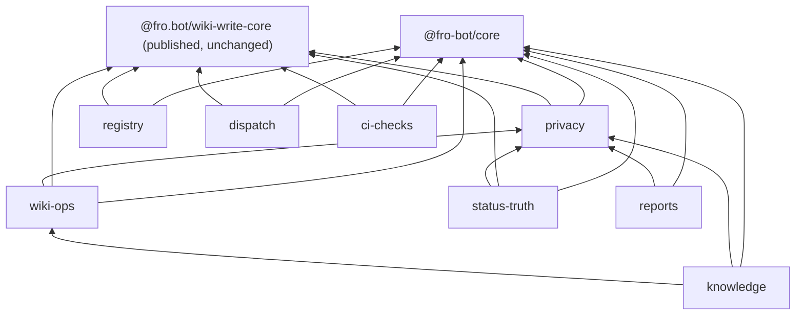

# refactor: Consolidate scripts into private workspace packages

## Overview

Move the control-plane code in `scripts/` into unpublished `@fro-bot/` workspace packages, one PR at a time. Foundation work comes first: a core package, a test kit, the gate changes that keep moved code covered, and a goke runner. The foundation creates primitives and migrates no callers, except retry and the GitHub client. After that, each domain moves into its own package behind a thin `scripts/<name>.ts` entrypoint, and migrates that domain's own copies of the primitives. Workflows, agent prompts and CLI contracts stay the same throughout. Phase 2 (workflow shell to CLI calls, MCP) is out of scope.

## Problem Frame

`scripts/` holds 81 source modules (40.7k lines) that re-implement the same plumbing many times over:

- `isRecord` defined in 20 script files, plus 9 in wiki-write-core
- 25 JSON stdout sites
- 14 `$GITHUB_OUTPUT` writers
- 9 retry loops in scripts, plus one in wiki-write-core
- `new Octokit(` in 11 files

The copies have drifted apart. Four modules are over 2k lines, and nothing documents the shared layer (see origin: `docs/brainstorms/2026-10-24-scripts-workspace-packages-requirements.md`). Phase 2 needs a stable library and CLI layer to build on.

## Requirements Trace

- R1. Shared code lives in `@fro-bot/` packages marked `private: true`. `@fro.bot/wiki-write-core` stays the only published package.
- R2. Core provides one copy of each duplicated primitive, and every duplicating module uses it. The foundation PRs create the primitives and their tests but migrate no callers. Retry (Unit 3) and the GitHub client (Unit 4) are the exceptions: they migrate their callers in their own PRs, because those callers span domains and need parity tests in one place. Each domain PR migrates all of its modules' copies of the other primitives exactly once, using the option that keeps their behavior. The metadata YAML write lives in registry (see Key Technical Decisions).
- R3. The test kit provides the shared fakes and helpers. `octokit-fake` is created in the first domain PR that has two Octokit builders of the same shape, and later domain PRs move their builders onto it.
- R4. Every module has a home: registry, dispatch, status-truth, ci-checks, wiki-ops, knowledge, reports, plus `privacy`, added in planning. Release and build scripts stay in `scripts/`.
- R5. Modules of 2k lines or more are split as they move.
- R6. Each package has a README.
- R7. CLIs run on goke with schema-typed options, and every command declares whether it is read-only or writes. `wiki-context-expand` and `correction-lifecycle` are the hand-parsed exceptions, and they declare read-only or write in their package README.
- R8. CLI contracts don't change. That covers flags, env, stdout and JSON, the stderr prefixes that workflows parse, `$GITHUB_OUTPUT` keys, and exit codes including parse errors and `--help`. Env-only CLIs may change behavior for argv that no caller sends, including `--help` and unknown argv.
- R9. Each PR keeps behavior intact: a recorded test baseline, mutated code stays mutated, and `check:mutation-guards` reaches 100%.
- R10. Every gate that covers a script today still covers its code after the move.
- R11. Bun runs the CLIs, Node exceptions keep working, and no new success-path `process.exit` is added.
- R12. Security boundaries don't move.
- R13. No change under `packages/wiki-write-core/`. The three one-line re-exports may go, and the four CLI wrappers stay.
- R14. MCP waits for fro-bot/agent#1931. Until then, agents call the CLIs through bash.

## Scope Boundaries

- No change to how any workflow invokes a script, to any workflow input, or to any prompt behavior. The only workflow edits are gate wiring and one comment-only correction, each landing in the PR that needs it:
  - the Test Scripts Load loop in `.github/workflows/main.yaml` (Unit 2);
  - the `fro-bot.yaml` sentence that says Test Scripts Load covers `scripts/*.ts` (Unit 2);
  - the Test Renovate Gate step in `main.yaml`, which names the three Renovate test files Unit 13 moves (Unit 13);
  - the stale schedule comment at `.github/workflows/improvement-metrics.yaml:5-6` (Unit 12).
- No behavior fixes. `apply-branding.yaml` sed escaping and `manage-issues.yaml` `|| true` get their own PRs.
- No change under `packages/wiki-write-core/`, including the four CLIs inside that package.
- These stay in `scripts/` unchanged:
  - `wiki-lockfile-gates.ts`. `publish-wiki.yaml` runs it with no dependency install, so it must keep importing only `node:*`.
  - `build-wiki-write-core.ts`
  - `wiki-write-core-release.ts`
- `wiki-context-expand` and `correction-lifecycle` move but keep their hand-written argv parsing. Agents pass them free text that goke rejects. For example, goke refuses `query "-1 retries"` and accepts `query ""`.

### Deferred to Separate Tasks

- **Phase 2:** workflow shell to CLI calls, `@goke/mcp` exposure, and deduplicating the 17 copies of the metadata overlay. Gated on fro-bot/agent#1931 (smart note #499).
- **`ce:compound-refresh` over `docs/solutions/`** after the last domain PR. 44 docs cite script paths, but only the `verify:` markers are machine-checked.

## Context & Research

Lane files are under `/tmp/rr/scripts-bs/plan/lanes/` (untracked, local to this session). This section copies the facts the plan depends on.

### Relevant Code and Patterns

- **Export target.** `exports` pointing at `src/*.ts` loads under Node 24 strip-only (`node -e "import('./scripts/x.ts')"`), Bun and `tsc` Bundler resolution. This was checked with hand-made links, not a real `bun install` link. Today `@fro.bot/wiki-write-core` resolves to committed `dist/`.
- **Mutation trigger closure.** In `scripts/check-mutation-guards.ts`, `WIKI_WRITE_CORE_SPECIFIER_PATTERN` matches only `@fro.bot/wiki-write-core`. `FIXED_TRIGGER_FILES` lists only that package's manifest. A PR that touches only `@fro-bot/` code is reported `not-applicable`. `check-mutation-guards.test.ts` pins the `@fro-bot` scope as rejected and asserts 10 or more `@fro.bot` references.
- **Stryker sandbox.** The sandbox links `node_modules` to the real tree. A test that imports mutated code by package name never runs against the mutants. A Stryker probe confirmed this: it is a survivor, not a lint error.
- **Mutation config test.** `scripts/mutation-guards-config.test.ts` Test 1 requires every non-test `.ts` under `packages/*/src` to be listed in `mutate` or `not-mutated`. Test 2 matches `scripts/check-*.ts` by name.
- **`verify:` resolver.** `findSignature` in `scripts/check-solutions-examples.ts` matches only top-level declarations in the named file. Five markers point at `guardedPatterns`, `isPureReexportBarrel`, `parseFrontmatterSources` and `sourceUrlMatchesRepo` (twice).
- **Test Scripts Load.** The gate loops over `scripts/*.ts` only (`.github/workflows/main.yaml`).
- **Private-leak job.** `check-private-leak.yaml` checks out `main` and runs `bun install --frozen-lockfile --ignore-scripts`, then Node. A lock that lacks an entry breaks it. Frozen install does not catch every manifest and lock drift (see Unit 1).
- **Renovate.** The `default.json` automerge rule matches `@fro-bot/**`. Renovate extracts `workspace:*` with `skipReason: unspecified-version` and proposes nothing (Unit 1).
- **Release prefix.** The release trigger is `packages/wiki-write-core/` with a trailing slash, and sibling directories are tested as not counting. No new package may be named `wiki-write-core*`.
- **Seam pattern.** `check-wiki-private-presence.ts` and `wiki-lockfile-gates.ts` already expose a pure `runCli(argv, env)` that returns `{exitCode, stdout, stderr}`. The goke runner follows this shape.
- **Entry guards.** 55 scripts guard their entrypoint with `import.meta.url === file://${argv[1]}`, and 3 use `import.meta.main`. The entry-guard tests import the script in-process with a cache-busting query.
- **Exit codes.** The non-default exit codes are 3 (`scripts/wiki-ingest.ts`, consumed by `survey-repo.yaml`), 2 (`wiki-lockfile-gates` unknown mode) and 0 on the `record-survey-result` non-fatal skip. `check-private-leak` writes `scan_result` before every exit.
- **Primitive behavior that must be kept:**
  - `isRecord`: `correction-lifecycle.ts` and `private-repo-resolution.ts` accept arrays.
  - ENOENT guards come in two families: `instanceof Error` and any object.
  - `isApiStatus` is copied in 7 scripts. Six exclude arrays and require a numeric `status`. `status-truth-prs.ts:880` accepts any object (`'status' in error`).
  - `$GITHUB_OUTPUT` writers: `dispatch-renovate.ts` and `wiki-change-detect.ts` throw when the variable is unset, and the rest skip.
  - Multiline output delimiters are used only in `wiki-query.ts` and `solutions-query.ts`, and use `Math.random()`.
  - JSON output is compact plus a newline everywhere except `reset-survey-status.ts`, which indents by 2.
  - `requiredEnv` treats an empty value as missing and reports `${name} is required` (10 copies). Two copies throw `DraftedSolutionsError`.
  - Retry policies, which all differ: `commit-metadata` retries 409 with no delay. `wiki-ingest` uses jittered backoff capped at 10s. `private-repo-resolution` uses 2s × 2^n on rate-limit messages. `merge-data-pr` uses 1s fixed on 429, ≥500 and network errors. `merge-back-data` re-reads up to 3 attempts on 409 or 422 from `updateRef`. `gateway-announce` retries once after 5s.
  - Octokit: `cross-repo-dispatch` uses a 15s timeout, and `status-truth-*` uses 10s with a no-op logger. There are dynamic-import and static constructor seams. Reconcile and invitation keep one credential per client.
  - YAML write: `stringify({indent: 2, lineWidth: 0, singleQuote: true})` plus a newline, in `commit-metadata.ts` and `rename-tracked-repo.ts`. Both are registry modules.
- **Import graph.**
  - There is one group-level cycle, knowledge ↔ status-truth. It runs through `capture-learnings-privacy`, `status-truth-public-output` and `loadRedactedCanonicalIdsFromDisk`, which is the only symbol outsiders import from `status-truth-proposals`.
  - `check-wiki-authority.ts` is a 230-line leaf with no relative imports. `merge-back-data` and `check-mutation-guards` import it.
  - `createOctokitFromEnv` lives in `capture-learnings-harvest.ts`, and knowledge and reports import it dynamically.
  - `renovate-runtime` ↔ `check-renovate-ranges` is a module cycle inside one group. It is type-only: `renovate-runtime.ts` uses `import type`, which is erased at load time.

### Institutional Learnings

- `docs/solutions/runtime-errors/node-strip-only-typescript-2026-04-18.md`: use erasable syntax only, since Node strip-only loading is the gate.
- `docs/solutions/best-practices/a-mutation-score-can-measure-nothing-2026-09-08.md`: list the mutated set explicitly, use in-memory fixtures (the Stryker sandbox is shared), and keep the reach checks.
- `docs/solutions/best-practices/pure-core-privacy-gates-shared-module-2026-06-22.md`: extract a shared invariant once independent consumers must enforce it. Privacy gates fail closed.
- `docs/solutions/best-practices/enumerate-mutator-variants-before-a-stryker-directive-2026-09-05.md`: add no new Stryker directives. Use a seam instead.
- Memory #10362: converted stdout writers must not call `process.exit` on the success path under Bun.

### External References

- goke 6.17.0 (https://github.com/remorses/goke):
  - Accepts Standard Schema options. infra uses zod ^4.3.6.
  - `parse(argv, {run: false})` followed by `runMatchedCommand()`, which is infra's `packages/cli/src/cli.ts` pattern.
  - Unit 1 probe results (a stub CLI under Bun with stdout piped; see Unit 1):
    - With no `.help()` registered, an unknown command or a stray positional on a zero-argument root exits 0 silently. With `.help()`, it prints help to stdout and calls `exit(1)`. The same split applies to `--help`.
    - A root that declares positionals silently drops undeclared extras and runs the action.
    - Zod validation covers type, int and enum only. Refinements such as `.min(1)` are not enforced.
    - Errors thrown from an action print `error:` plus a stack, with ANSI codes when `CI` is set. `NO_COLOR=1` overrides `CI`. There is no console injection, and `--no-color` is an unknown option.
    - It calls `process.exit` unless an exit function is injected. A no-op `exit` makes `parse()` reject on parse errors and resolve on async action errors. Calling the injected `exit` from inside an action leaks a stack.
    - It honors `process.exitCode = 3` set inside an action.
    - Unknown flags, missing values and repeated scalar flags exit 1.
    - It is ESM with no dependencies, and it loads under Node strip-only and Bun.
- Node 24 refuses to strip types under `node_modules`. A workspace link that resolves to the real path outside `node_modules` avoids this.

## Prior-Art Survey

```json
{
  "schema_version": 2,
  "verdict": "extend",
  "scope": "scripts/ and packages/wiki-write-core/src (.worktrees/ skipped)",
  "freshness": {"vcs_reference": "1da36c9"},
  "budget": {"max_search_passes": 6, "max_candidate_inspections": 25, "exhausted": true},
  "candidates": [
    {
      "path_or_symbol": "scripts/schemas.ts",
      "description": "Re-export shim over @fro.bot/wiki-write-core/schemas metadata shape types and guards; 14 importers.",
      "disposition": "reuse"
    },
    {
      "path_or_symbol": "scripts/commit-metadata.ts",
      "description": "commitMetadata: mutator-based metadata/*.yaml read-modify-write via Git Data with conflict retry; private createOctokitFromEnv and isRecord.",
      "disposition": "extend"
    },
    {
      "path_or_symbol": "scripts/repos-metadata.ts",
      "description": "Domain layer over metadata/repos.yaml shared by five scripts.",
      "disposition": "reuse"
    },
    {
      "path_or_symbol": "scripts/git-data-fake.ts",
      "description": "createGitDataFake: in-memory Git Data API fake.",
      "disposition": "reuse"
    },
    {
      "path_or_symbol": "scripts/workflow-step-test-helper.ts",
      "description": "runStepWithStubs: runs a workflow run: step with stubbed commands and a temp GITHUB_OUTPUT.",
      "disposition": "reuse"
    },
    {
      "path_or_symbol": "scripts/workflow-expression-test-helper.ts",
      "description": "evaluateExpression: GitHub Actions if: expression evaluator.",
      "disposition": "reuse"
    },
    {
      "path_or_symbol": "scripts/capture-learnings-privacy.ts#isRecord",
      "description": "Exported isRecord used by five modules; about 20 private copies elsewhere.",
      "disposition": "extend"
    },
    {
      "path_or_symbol": "scripts/record-survey-result.ts#requiredEnvFrom",
      "description": "Testable required-env reader; private requiredEnv copies in at least seven scripts.",
      "disposition": "extend"
    },
    {
      "path_or_symbol": "packages/wiki-write-core/src/index.ts",
      "description": "Published wiki-domain barrel.",
      "disposition": "insufficient",
      "insufficiency_reason": "Published npm artifact with wiki-domain scope only; adding repo-private CI plumbing would widen a public API and cut releases."
    },
    {
      "path_or_symbol": "scripts/private-repo-resolution.ts#RetryOptions",
      "description": "Rate-limit retry welded to a gh GraphQL resolver.",
      "disposition": "insufficient",
      "insufficiency_reason": "Retry is bound to one failure mode; no generic retry primitive exists."
    },
    {
      "path_or_symbol": "scripts/wiki-context-expand.ts#parseArgv",
      "description": "Only named argv parser.",
      "disposition": "insufficient",
      "insufficiency_reason": "Bespoke to one CLI; no shared argv, runner or main-guard helper exists."
    },
    {
      "path_or_symbol": "scripts/wiki-handoff-core.ts",
      "description": "Handoff policy shared by four scripts.",
      "disposition": "insufficient",
      "insufficiency_reason": "Domain logic only; owns no env, argv, output, retry or client plumbing."
    },
    {
      "path_or_symbol": "scripts/status-truth-public-output.ts",
      "description": "applyPublicOutputGate privacy filter used by five modules.",
      "disposition": "insufficient",
      "insufficiency_reason": "A content privacy gate, not an output writer; it moves to the privacy package unchanged."
    },
    {
      "path_or_symbol": "scripts/*.ts inline GITHUB_OUTPUT / GITHUB_STEP_SUMMARY writers",
      "description": "About 14 inline writers with divergent unset-variable behavior.",
      "disposition": "undispositioned"
    },
    {
      "path_or_symbol": "scripts/*.ts inline Octokit construction",
      "description": "About 15 inline constructions plus per-module factories.",
      "disposition": "undispositioned"
    }
  ]
}
```

## Key Technical Decisions

- **Packages export `.ts` source with no build step.** Nothing compiles, and Bun, Node strip-only, `tsc` and Vitest all load source. Unit 1 proved a real `bun install` link (see its results). If that stops holding, reopen this plan. There is no silent `dist` fallback. Per-package `dist` would multiply the `@fro.bot/wiki-write-core` dist gate across nine packages: the `check-wiki-write-core-dist` job (`.github/workflows/main.yaml:88-104`), a `.gitignore` un-ignore block, a CodeQL ignore and the `FIXED_TRIGGER_FILES` entries. The mutation closure would also have to follow `dist`.
- **Subpath exports per module, no wide barrels.** A barrel that re-exports `check-solutions-examples` would make every importer load `typescript`.
- **Retry, the GitHub client and `check-wiki-authority` become core modules, not separate packages.** Retry and the client each get their own PR and migrate their own callers. `check-wiki-authority` moves in the registry PR (Unit 7). It has two importers, `merge-back-data` (registry) and `check-mutation-guards` (ci-checks), so it lives in neither package. Fewer packages mean fewer manifests, lock entries and enumeration rows, and the dependency graph stays acyclic either way.
- **New `@fro-bot/privacy` package.** It takes the whole private-leak family and the shared redaction helpers: `capture-learnings-privacy`, `status-truth-public-output`, `loadRedactedCanonicalIdsFromDisk`, `private-repo-resolution`, `resolve-private`, `check-private-leak`, `check-wiki-private-presence` with its detector, and `enumerate-existing-leaks`. This breaks the knowledge ↔ status-truth cycle and keeps the mutated privacy modules with their tests.
- **Metadata YAML write lives in registry, not core.** Both copies are registry modules (`commit-metadata`, `rename-tracked-repo`). This narrows R2's "metadata read/write in core", since no other domain writes metadata. Reads outside registry, such as the privacy loader of `metadata/repos.yaml`, keep parsing through `@fro.bot/wiki-write-core/schemas`.
- **Moved code never imports a `scripts/` file.** `scripts/schemas.ts`, `wiki-slug.ts`, `wiki-utils.ts`, `markdown-links.ts`, `data-branch-bootstrap.ts`, `wiki-lint.ts` and `wiki-ingest.ts` re-export `@fro.bot/wiki-write-core` subpaths (`wiki-ingest.ts` also adds the exit-3 mapping, which stays in the wrapper). Each move PR rewrites its modules' imports of them to those subpaths, such as `@fro.bot/wiki-write-core/wiki-ingest`, and declares `@fro.bot/wiki-write-core` as a dependency of the package. `package-layout.test.ts` fails any relative import that leaves its package directory.
- **Declared dependencies.**
  - The declaration rule applies to `packages/*` only. Root `scripts/` is not a package and declares nothing: it imports `@fro-bot/*` and `@fro.bot/wiki-write-core` by name through the workspace link. Unit 1 confirmed that resolution works without a root declaration.
  - Tests in a package import `@fro-bot/test-kit` as a declared devDependency. Root tests import it by name.
  - Each package declares every external npm package its non-test modules import (for example `yaml`, `@octokit/rest`, `typescript`), at the range the root declares, and `package-layout.test.ts` checks it. `packages/ci-checks` declares `typescript`, which `check-solutions-examples` imports from the root devDependencies today. Each such declaration is a manifest change that touches `bun.lock`, so the PR body flags it for operator approval.
  - `package-layout.test.ts` is the authority for internal edges and for lock drift. ESLint `compat-engines` skips `workspace:*` dependencies, so it gives internal edges no engines coverage. Frozen install passes when a manifest adds an already-locked dependency or swaps `workspace:*` for a matching range, so the test also compares each package's declared dependencies with its `bun.lock` workspace entry.
- **Mutated code and its tests move together** into the same package, and those tests import by relative path. A new enumeration test fails any `mutate` entry whose paired test reaches it only through an `@fro-bot/` name. The same attribution rule applies to production imports: a mutated module in package A that imports package B by name runs against B's real tree in the Stryker sandbox, so B's mutants are killed only by B's own tests. Core's tests must kill core's mutants on their own.
- **Divergent behavior becomes explicit options, not a single blessed default.**
  - `isRecord`, which rejects arrays, ships alongside `isObject`. The two array-accepting callers use `isObject`.
  - ENOENT guards are not unified.
  - The output writer takes an `onMissing: 'skip' | 'throw'` policy and a collision-checked UUID delimiter.
  - JSON output takes an indent parameter.
  - `requiredEnv` takes an error factory, so per-caller messages and error types survive.
  - Retry takes the policy (attempts, delay function, retry predicate) from each caller, which keeps today's numbers.
  - The client factory takes timeout and logger options and one token per call.
- **One goke runner in core** owns exit code, stdout, stderr and help. Every goke CLI goes through it, and it returns `{exitCode, stdout, stderr}` like the existing `runCli` seams. It follows these rules, and each has a Unit 5 test scenario:
  - **No-argv category.** Each CLI declares one of two categories. A CLI whose no-argv mode is a real run registers a default root action that runs its current main (for example `check-private-leak.yaml` runs the scan with no arguments, and `dispatch-renovate` treats no subcommand as dispatch). A CLI whose no-argv mode prints usage (`enumerate-existing-leaks`) returns its usage code (1) with the usage on stdout, as it does today.
  - **Declared positionals and flags.** Each CLI declares, on its root command, the positionals and flags its callers use. Only argv that matches nothing declared returns the CLI's usage code, and then no action runs. goke alone cannot enforce this. Without `.help()` it exits 0 silently on an unknown command or a stray positional, so a gate such as `check-private-leak` would report success without scanning. On a root that declares positionals it drops undeclared extras and runs the action (`a b c` on `[a] [b]` runs with `a` and `b`). The runner checks the positional count itself and returns the usage code, on every root. The unit CLI tables name every other declared argument. The callers that must keep working:
    - `fro-bot.yaml:1257`, `daily-digest-counts.ts metadata/repos.yaml "$TODAY_UTC"` (two optional positionals, argv over env);
    - `resolve-private` argv[2] (the repos path);
    - `check-renovate-ranges` positionals (config paths);
    - `wiki-lint-issues` argv[2] (after `WIKI_LINT_JSON_PATH`);
    - `check-private-leak --promotion` (`merge-data.yaml:95`).
  - **`--help` is unmatched argv** for every CLI that documents no help today: usage code, stdout empty, no action. Today `check-private-leak --help` runs the full scan, and with `.help()` registered plain goke prints help and exits 0 without scanning, which a workflow reads as a pass. The runner always registers `.help()`, because goke's behavior otherwise differs (a silent exit 0 on unknown commands, `Unknown option --help` on the flag). goke prints help to stdout, so the runner routes help to stderr for every usage error. It keeps stdout for an explicit `--help` only where a runner-fronted CLI documents help today: `enumerate-existing-leaks`, with its usage on stdout and exit 0. The two hand-parsed CLIs keep their help in their own parsers.
  - **`dispatch-renovate`** dispatches today on any argv other than `plan`, including `pln` and `--help`. It accepts `plan` and no argv. Anything else returns the usage code and dispatches nothing. No caller sends other argv, and the change is listed in Unit 8's scenarios.
  - **Injected `exit` records, it does not decide.** A no-op `exit` is unsafe. On a parse error `parse()` rejects with the original GokeError, and on an async action error it resolves with the code only recorded, so a caller that trusts the promise sees 0. The runner passes an `exit` that records the code and throws a sentinel, and it catches the sentinel from `parse()`. Action errors are caught inside the runner's own action wrapper, including non-Error throws. The wrapper records the exit code in a local variable, writes the CLI's configured message and returns. It never calls the injected `exit` from inside an action: the sentinel thrown back into goke makes it print `error: exit:1` plus a stack and call `exit` a second time. A stack never reaches a workflow.
  - **Error format and exit code are per CLI.** The default is message-only on stderr and exit 1. Uncaught-throw CLIs keep exit 1 and a non-empty stderr that contains the message. Stack text may change, because no workflow parses it. `gateway-announce` keeps exit 0 on every error, so its error exit code is 0.
  - **Colour off.** goke has no console injection (`createConsole` is exported, but `GokeOptions` has no `console` field), and `--no-color` is an unknown option. `CI=true` turns ANSI on even when piped, and `NO_COLOR=1` overrides it, but only if it is set before goke loads. The runner sets `NO_COLOR` for the parse, so core loads goke by dynamic import after setting it, and the runner's sinks strip ANSI as a backstop. There is no other mechanism. The rule covers parse errors (unknown flag, missing value, zod validation), action errors and help.
  - **Direct writes bypass the sinks.** The runner captures only output routed through its sinks, and moved modules keep their direct `process.stdout` and `process.stderr` writes (at least 108 in a 21-file sample). The in-process result can therefore miss output. Every CLI gets one spawned surface test through its `scripts/<name>.ts` entrypoint, and that test is the parity authority (Per-PR Checklist item 8). Usage-code constants are asserted per CLI, or a mutant on a constant survives.
  - **Refinements.** goke enforces only type, int and enum from a zod schema. Refinements such as `.min(1)` are not enforced. The runner re-validates the parsed options against the full schema before running the action, and returns the usage code on failure.
  - **Plumbing.** The runner uses `process.exitCode` instead of `process.exit`. A 300 KB stdout payload is complete after a natural exit and truncated to 64 KiB after `process.exit(0)`, under both Bun and Node (measured piped, on macOS). Linux is unverified.
- **Hand-parsed exceptions.** `wiki-context-expand` and `correction-lifecycle` keep their argv parsers in phase 1, and are marked read-only or write in their README so phase 2 can still classify them.
- **Env-only CLIs may change behavior for input no caller sends.** For example, an unknown flag exits 1, and `--help` returns the usage code. Every invocation that a workflow or prompt actually uses stays byte-identical, apart from the stack text of uncaught throws.
- **zod is the goke schema library.** It matches infra. zod resolves to one copy, 4.6.7, because the root `zod@4` override in `package.json` floors it at `>=4.6.6`. Stryker's lock entry requests 4.5.4 and does not decide it. Core's direct zod dependency falls under the same floor. `@fro-bot/core/cli` re-exports the runner and `z`, so domain CLI modules import only `@fro-bot/core/cli`, and goke and zod are declared once, in core. Only `*-cli.ts` modules may import `@fro-bot/core/cli`; library modules never do. Duplicate zod copies would not break goke's typing (Standard Schema), so the real risk is zod-specific helpers crossing packages.
- **The entry guard stays in each `scripts/<name>.ts`.** The shim imports the package function, maps its result to an exit code, and keeps the entry-guard test next to it. The exit-code mapping itself lives in the package, so it stays mutated where it is mutated today.
- **`scripts/` shims are listed as not-mutated** with a reason (pure delegation). Their names still match Test 2.
- **Each domain PR owns its primitive migration.** Foundation PRs create primitives and migrate no callers. The exceptions are retry and the GitHub client, which migrate their callers in their own PRs. Every other primitive is migrated once, by each domain PR, for all of that domain's modules. A file is therefore edited at most once by each primitive PR that touches it (retry, client) and once when its domain moves. For example, `commit-metadata` is edited in Units 3, 4 and 7.
- **Diagrams live next to the code they describe, as Mermaid in Markdown.** GitHub renders Mermaid C4 (verified in a comment preview: Mermaid v12.2.0, `C4Component` with a boundary renders).
  - Each package README has a `C4Component` diagram: the package as a `Container_Boundary`, its modules as `Component`s, `Rel`s between them, other `@fro-bot/` packages, `@fro.bot/wiki-write-core` and GitHub as external components, and which CLIs run on the core runner. Relationship labels get `UpdateRelStyle` offsets, because C4 uses fixed colours and labels otherwise sit on the arrow and read poorly in dark mode.
  - The root `README.md` has the cross-package dependency `flowchart`, which adapts to the theme and is the authoritative package graph, plus a `C4Container` view of packages, `scripts/` entrypoints, workflows and GitHub.
  - Diagrams are hand-maintained. The PR that adds a module, package or cross-package edge updates them. `package-layout.test.ts` enforces the real graph; the diagrams are documentation, not a gate.
- **Reverts are last-in-first-out.** Later PRs import earlier packages and lock entries. The `scripts/` entrypoints keep workflow paths stable, so a revert never breaks a workflow.

## Open Questions

### Resolved During Planning

- Package placement of the privacy checks: their own `privacy` package (see Key Technical Decisions).
- `check-wiki-authority` ownership: a core module.
- Domain order: core and test-kit, retry, GitHub client, CLI runner, privacy, registry, dispatch, status-truth, wiki-ops, knowledge, reports, ci-checks. The mutation gate goes last because it is self-referential and resolves paths from `import.meta.dirname`. Unit 2 edits its resolver, so only its module location moves last.
- Schema library: zod.
- `verify:` markers: repoint each marker to the package file in the PR that moves its symbol. The resolver is not taught to follow re-exports.
- Mutation trigger closure: resolve `@fro-bot/<pkg>[/<sub>]` through each package's `exports` map. Every `packages/*/package.json` (except wiki-write-core's, which already has its own rule) becomes a fixed trigger.
- `readOnly` rule: a static per-command capability (CLI adoption rule). An external POST and any repo-file write count as writes.
- Uncaught-throw CLIs: exit 1 with a non-empty stderr message. Stack text may change.
- Test files that cover a split module may stay whole and import the split modules by relative path. There is no facade barrel.
- Parity depth: a spawned surface test for every shim, plus seam tests where a seam exists. Surface-only is acceptable for the network-heavy CLIs.
- Renovate and `workspace:*`: skipped at extract with `skipReason: unspecified-version`, so no local rule is needed (Unit 1).
- Colour-off mechanism: `NO_COLOR` set before goke loads, plus ANSI-stripping sinks (Unit 1).

### Deferred to Implementation

- Exact boundaries inside each seam named in Units 7–9, and whether the 530-line `planStatusTruthProposalActions` splits by action kind. Decide these while reading the file. Split by responsibility, not by line count.
- The Stryker runtime increase from adding core modules to `mutate`. The Unit 1 baseline is about 199 s, and each PR records the new time.
- Whether `daily-digest-counts` reads better in reports or registry. It defaults to reports, as the origin doc says.

## Output Structure

    packages/
      core/            @fro-bot/core: guards, env, output, json, retry, github, cli runner, wiki-authority
      test-kit/        @fro-bot/test-kit: git-data fake, octokit fake, workflow step/expression helpers, repo-page-move fixtures, CLI spawn helper
      privacy/         @fro-bot/privacy
      registry/        @fro-bot/registry
      dispatch/        @fro-bot/dispatch
      status-truth/    @fro-bot/status-truth
      wiki-ops/        @fro-bot/wiki-ops
      knowledge/       @fro-bot/knowledge
      reports/         @fro-bot/reports
      ci-checks/       @fro-bot/ci-checks
      wiki-write-core/ (unchanged, published)
    scripts/           thin entrypoints + wiki-lockfile-gates, build/release scripts, 4 wiki-write-core CLI wrappers, cross-package contract tests

Each package has `package.json` (`private: true`, `type: module`, subpath `exports` to `src/*.ts`, `workspace:*` internal dependencies), `README.md` and `src/` with colocated tests.

## High-Level Technical Design

> _This illustrates the intended approach and is directional guidance for review, not implementation specification. The implementing agent should treat it as context, not code to reproduce._

Production dependency edges, checked against static and dynamic imports. Each line is `package → what it depends on`. Test-only edges are marked.

- core → external packages only. Its `check-wiki-authority` test also imports `@fro.bot/wiki-write-core`, declared as a devDependency. That is test-only, and core never depends on it in production.
- privacy → core, `@fro.bot/wiki-write-core`
- registry → core, `@fro.bot/wiki-write-core`. No privacy edge.
- dispatch → core, `@fro.bot/wiki-write-core`
- wiki-ops → core, `@fro.bot/wiki-write-core`, privacy
- status-truth → privacy, core, `@fro.bot/wiki-write-core`
- knowledge → privacy, core, wiki-ops (`solution-docs-paths`, `wiki-handoff-core`)
- reports → privacy, core. Reports needs neither knowledge nor status-truth: its `createOctokitFromEnv` import moves to core in Unit 4, and its status-truth imports move to privacy in Unit 6.
- ci-checks → core (via `check-wiki-authority`), `@fro.bot/wiki-write-core` (via the markdown-links shim), external `typescript`. No privacy, registry or wiki-ops edge: none of the ci-checks modules imports them.
- test-kit → nothing. Every package and the root scripts import it from tests only, and no non-test `src` module may import it.
- `scripts/*.ts` entrypoints → the package that fronts each of them.



The `renovate-runtime` ↔ `check-renovate-ranges` cycle is type-only. `renovate-runtime.ts` uses `import type` for `VersioningEngine`, which is erased under `verbatimModuleSyntax`, so nothing cycles at load time. The mutation-closure regex does not skip type imports, so the closure walker sees the cycle. That is harmless, because the walker keeps a visited set.

Entrypoint shape, directional:

    scripts/<name>.ts:
      import { main } from '@fro-bot/<pkg>/<name>-cli'
      if (entry guard) { const r = await main(process.argv.slice(2), process.env); write r.stdout/r.stderr; process.exitCode = r.exitCode }

## Per-PR Checklist (applies to every unit that moves code)

Each moving unit treats this checklist as part of its verification:

1. Record the baseline Vitest count on the parent commit, using one fixed command, in the PR body. Account for every test that moves, is added or is removed.
2. Use `git mv` for each moved module and its tests, so history follows.
3. Mutated modules:
   - The new path is in `mutate` and the test path is in `testFiles`.
   - Tests use relative imports.
   - The `scripts/` shim is in `mutation-guards.json` not-mutated, with a reason.
   - `bun run check:mutation-guards` reports 100% and the Stryker time is recorded.
4. Every new non-test `packages/*/src` module is listed in `mutate` or `not-mutated`.
5. Every `verify:` marker that names a moved symbol is repointed, and `bun run lint` passes. In the same PR, repoint:
   - tests that read a moved module's source text by path;
   - tests that read a repo-root-relative file through the module's location (for example a workflow YAML or `mutation-guards.json`);
   - tests that name a moved file as a real-file sample;
   - `vi.mock` targets of a moved module.
6. The moved modules' imports of `scripts/` re-exports (`schemas`, `wiki-slug`, `wiki-utils`, `markdown-links`, `data-branch-bootstrap`, `wiki-lint`, `wiki-ingest`) are rewritten to `@fro.bot/wiki-write-core` subpaths.
7. The PR migrates all of its modules' copies of core primitives exactly once (guards, output writers, JSON emit, `requiredEnv`), with the option that keeps their behavior. Retry and client construction were migrated in Units 3 and 4. A grep over the package returns no local definition of a core primitive. If the package has two Octokit builders of the same shape, they move onto `@fro-bot/test-kit` `octokit-fake`.
8. CLI parity has two tiers:
   - **Surface tier, for every shim.** A subprocess test runs `scripts/<name>.ts` through the test-kit spawn helper, with no network, for each argv and env pair in the unit's CLI table, including no argv. It asserts the exit code, stdout, the stderr prefix, any `$GITHUB_OUTPUT` written before the first network call (for example `scan_result=error`) and one usage error with the usage-code constant. This is the parity authority, because modules that write directly to `process.stdout` or `process.stderr` bypass the runner's sinks.
   - **Seam tier, where a seam exists.** Run the existing `runCli` or `main` seam tests against the package function. Only `check-wiki-private-presence` returns the `{exitCode, stdout, stderr}` shape. The other seams return a number, a result object or void.
   - **Surface-only is enough** for the network-heavy CLIs (reconcile, dispatch, capture, improvement-metrics), whose behavior the moved unit tests cover.
   - Cover the stderr prefixes `wiki-ingest:warning:`, `wiki-ingest:finding:` and `corrections:warning:`; `::error::` lines; `$GITHUB_OUTPUT` keys; exit codes 0, 1, 2 and 3; and the prompt-visible loops (`drafted-solutions-validate-rows` stdout, stderr and exit, and `check-override-floors` exit).
   - For an entrypoint that throws uncaught today, assert exit 1 and a non-empty stderr containing the message. Stack text may change, because no workflow parses it.
9. `bun install --frozen-lockfile` passes with the committed `bun.lock`, `package-layout.test.ts` confirms each package's declared dependencies match its `bun.lock` workspace entry (frozen install alone misses drift for already-locked dependencies), and `check-override-floors` passes.
10. Package `README.md` exists (R6) and carries a Mermaid `C4Component` diagram of the package (see the diagram decision). The root `README.md` package flowchart and `C4Container` view are updated for any new package or edge. Root docs that list the layout are updated: `.github/copilot-instructions.md`, `README.md`, `llms.txt` and `.agents/skills/generating-project-docs/SKILL.md`.

11. Run the full gate unpiped: `bun run bootstrap`, `check-types`, `lint`, `test` and `check:mutation-guards`.
12. Confirm that no path under `packages/wiki-write-core/` changed.
13. After merge, run the unit's verification from Operational / Rollout Notes. The next domain PR opens only after it passes.

### CLI adoption rule

Every CLI that moves adopts the core runner, except `wiki-context-expand` and `correction-lifecycle` (hand-parsed) and `wiki-lockfile-gates` (stays in `scripts/`). The four wiki-write-core wrappers are untouched. Each command declares `readOnly`, a static per-command capability, not a per-invocation outcome:

- `readOnly: false` if the command can mutate GitHub, `data`, an external service, or a tracked or hard-coded path in the checkout. A dry-run default does not change this. An external POST (`gateway-announce`) counts as a write, and so does a repo-file write (`render-corrections-context`, `rebuild-wiki-index`, `wiki-handoff-apply`).
- Writes to a caller-supplied artifact path, `$GITHUB_OUTPUT`, the step summary, stdout, or a tool-output directory (`reports/`, `.stryker-tmp`, `RENOVATE_PREFIX`) do not count.
- `dispatch-renovate` declares it per command: `plan` is true and the dispatch command is false.
- The CLI table in each unit carries the value per CLI, and the package README lists every command with its value.

## Implementation Units

### Phase A: Foundation

The foundation PRs create primitives and gates. They migrate no callers, with two exceptions: retry (Unit 3) and the GitHub client (Unit 4) migrate their callers, because those callers span domains and need parity tests in one place.

- [x] **Unit 1: Probe the workspace mechanics on the real repo**

**Goal:** Confirm the assumptions the foundation rests on, before any code depends on them.

**Requirements:** R1, R8, R10, R11

**Dependencies:** None

**Files:** None committed. Results are under `/tmp/rr/scripts-bs/probe/` (`RESULTS.md` and `logs/`) and are summarized in Unit 2's PR body.

**Probe results.** Run in a scratch clone at `1da36c9` with two throwaway packages (`probe-core` exporting `src/*.ts`, `probe-b` depending on it as `workspace:*`), the repo's `bunfig.toml` (hoisted, 3-day floor), Bun 1.4.3, Node 24.22.0, goke 6.17.0, zod 4.6.7, Renovate 44.172.1, on macOS arm64. The source-export decision holds. Log names are under `/tmp/rr/scripts-bs/probe/logs/`.

- **PASS, the workspace mechanics:**
  - The real `bun install` link loads `.ts` source under Node strip-only through the hoisted `node_modules/@fro-bot` symlink. The symlink's realpath is under `packages/`, so Node strips types (`1a-install-link.log`, `1-test-scripts-load.log`).
  - The `find` loop enumerated the package files and each loaded. A package file using `enum` failed with `ERR_UNSUPPORTED_TYPESCRIPT_SYNTAX`. `find` prints nothing when no package exists, so the loop must fail on that (`1-test-scripts-load.log`).
  - `check-types`, `lint` (including `bun audit` in `check:override-floors`) and `test` (116 files, 6189 passed) pass (`2a-check-types.log`, `2b-lint.log`, `2c-test.log`). `mutation-guards-config` Test 1 already fails on an unlisted `packages/*/src` module.
  - `bun install --frozen-lockfile` passes after the lock is regenerated (`3-frozen-installs.log`).
  - The private-leak job form (`rm -rf node_modules`, frozen `--ignore-scripts`, then Node with no inputs) gives the same stderr and exit 1 as the pristine clone, and the same with `GITHUB_EVENT_PATH=/nonexistent` (`3c-private-leak-job-form.log`, `3d-private-leak-pristine-compare.log`, `0b-baseline-private-leak.log`).
  - Vitest resolves `.ts` subpath exports, and the existing `packages/**/*.test.ts` include covers new packages (`5a-vitest-subpath.log`).
  - The `merge-data.yaml:79` shape (`bun --no-install --no-env-file ../…` from a nested cwd, and from an absolute foreign cwd) resolves package imports from the script's location. A copy outside the repo fails, so cwd does not matter (`8a-foreign-cwd.log`).
  - Exit codes propagate through `| tee`, `&&` chains via `bun run`, and `$(…)` under `bash -Eeuo pipefail`, and a 300 KB payload through `tee` arrives complete. `if bun … | jq -e` cannot tell exit 3 from a falsy result, which is existing behavior (`8b-exit-propagation.log`).
- **Stryker:** the baseline `bun run check:mutation-guards` is about 199 s with 3041 mutants over 11 files, verdict `clean` (`4a-mutation-guards-pristine.log`). One tiny mutated module adds 7 mutants and no measurable time (`4b-mutation-guards-probe-tree.log`). A test importing the mutated module by package name kills 0 of 7 mutants, and a relative import kills 7 of 7 (`4c-stryker-probe-name.log`, `4c-stryker-probe-rel.log`).
- **Renovate** (scratch config with `default.json`'s own `packageRules`): `workspace:*` is extracted with `skipReason: unspecified-version`, so nothing is proposed, and `goke` and `zod` extract as normal dependencies (`6c-renovate-extract-scratch-config.log`). No local rule is needed. `--platform=local` cannot load `local>` presets, so an extract with the real `.github/renovate.json5` is blocked and unverified (`6b-renovate-extract-asis.log`).
- **Frozen install does not catch every manifest and lock drift.** It fails for a lock restored from `main`, a new unlocked dependency and a removed dependency. It passes when a manifest adds a dependency already in the lock (for example `yaml`), and when `workspace:*` is swapped for a range that matches the workspace version (`3-frozen-installs.log`, `3b-frozen-installs-more.log`).
- **ESLint `node-dependencies/compat-engines` skips `workspace:*` dependencies.** A dependent with `engines >=18` and a workspace dependency declaring `>=99` still passes, while a real dependency fails (`5c-eslint-pkgjson.log`, `5d-eslint-compat-engines-negative.log`, `5e-eslint-compat-engines-control-nonworkspace.log`).
- **goke 6.17.0 behavior** (`7a-goke-matrix.log`, `7b-goke-matrix2.log`). The runner rules in Key Technical Decisions encode these results:
  - Undeclared extra positionals on a root that declares positionals are dropped silently.
  - Zod refinements are not enforced.
  - There is no console injection, and `--no-color` is an unknown option.
  - Behavior depends on `.help()`.
  - Calling the recording `exit` from inside an action leaks a stack.
  - A no-op `exit` behaves differently on parse errors and on async action errors.
  - A 300 KB payload truncates to 64 KiB after `process.exit(0)`.
- **Not verified:**
  - Stryker's `not-applicable` path with a real `pull_request` event and the `@fro-bot/` closure resolver. Unit 2 proves both.
  - Linux CI pipe truncation. The probe ran on macOS arm64 only.
  - An extract with the real Renovate config.
  - The Actions-only pieces (`actionlint`, CodeQL, the `Setup` composite), which ran as plain `bun install --frozen-lockfile`.
  - `check:renovate-config` and the Vitest tests that need the pinned installs.

**Test scenarios:** Test expectation: none. This was a probe.

**Verification:** Done. Every probe has a saved log with an exit code, and no result reopens the plan.

- [ ] **Unit 2: Core and test-kit packages, gate wiring and new primitives** (PR A)

**Goal:** Land `@fro-bot/core` and `@fro-bot/test-kit`, make every gate see `@fro-bot/` code, and add the guards, output and JSON primitives as new, fully tested code. The only caller edits are the importers of the four moved test helpers. No primitive migrations.

**Requirements:** R1, R2, R3, R9, R10, R11

**Dependencies:** Unit 1

**Files:**

- Create:
  - `packages/core/{package.json,README.md}`
  - `packages/core/src/{guards,output,json}.ts` and their tests
  - `packages/test-kit/{package.json,README.md}`
  - `packages/test-kit/src/{git-data-fake,workflow-step,workflow-expression,repo-page-move-fixtures}.ts`
- Modify:
  - `bun.lock`, and root `package.json` if the `workspaces` glob needs it
  - `scripts/check-mutation-guards.ts` and `scripts/check-mutation-guards.test.ts` (resolver, fixed triggers, updated scope pins)
  - `scripts/mutation-guards-config.test.ts` (new tests below), `mutation-guards.json`, `stryker.config.json`
  - `.github/workflows/main.yaml`: Test Scripts Load also loops over the files that `find packages -path '*/src/*.ts' -not -name '*.test.ts' -not -path 'packages/wiki-write-core/*'` returns. It does not use a `**` glob, because default bash has no globstar and node would receive the literal pattern. The loop fails if that `find` matches nothing once a package exists. No install replay is needed, but frozen install is not enough: `.github/actions/setup` runs `bun install --frozen-lockfile` on every PR job, which fails on a missing or unresolved lock entry but passes when a manifest adds an already-locked dependency or swaps `workspace:*` for a matching range (Unit 1). `package-layout.test.ts` closes that gap.
  - the `fro-bot.yaml` Test Scripts Load sentence
  - `README.md`: a packages section with the cross-package `flowchart` and the `C4Container` view, showing core and test-kit and the planned packages marked as planned
- Move (with `git mv`):
  - `scripts/git-data-fake.ts`, `scripts/workflow-step-test-helper.ts`, `scripts/workflow-expression-test-helper.ts` and `scripts/repo-page-move-fixtures.ts` move to test-kit. Their importers (about 14 test files) are rewritten.
- Test:
  - `packages/core/src/*.test.ts`
  - `scripts/package-layout.test.ts`: every `@fro-bot/*` package is `private: true` and `type: module`; internal dependencies are `workspace:*`; every import of an `@fro-bot/` or `@fro.bot/` name inside a package is declared as a dependency (test-kit as a devDependency); every external npm package a non-test module imports (for example `yaml`, `@octokit/rest`, `typescript`) is declared, at the range the root declares; each package's declared dependencies match its `bun.lock` workspace entry; no package imports a relative path outside its own directory; no non-test `src` module imports test-kit; and the package graph has no cycles.

**Approach:**

- Gate wiring lands first, then the test-kit move, then the core modules.
- `guards` exports `isRecord` (rejects arrays), `isObject`, and two `isApiStatus` variants. One excludes arrays and requires a numeric `status`. The other accepts any object, which preserves `status-truth-prs.ts:880` (`'status' in error`). Units 7 and 9 map each caller. ENOENT guards stay where they are.
- `output` writes `$GITHUB_OUTPUT` and the step summary with a `skip` or `throw` policy and a collision-checked delimiter.
- `json` emits compact JSON plus a newline by default and takes an indent parameter.
- Core modules are in `mutate` with 100% kills before any consumer exists. Core's own tests must kill core's mutants, because a consumer's tests never run against them (Stryker sandbox attribution).
- No script or package module changes to use these primitives in this PR. Each domain PR migrates its own copies exactly once.
- The root `scripts/` directory is not a package. `package-layout.test.ts` applies its dependency-declaration rule to `packages/*` only. Root scripts and tests import `@fro-bot/*` and `@fro.bot/wiki-write-core` by name through the workspace link, with no root declaration. Unit 1 confirmed that resolution works without a root declaration.
- The `repo-page-move-fixtures` move is test support, so it is listed as not-mutated.

**Execution note:** Write the new mutation-guard trigger tests first. A core-only change must be reported applicable, and it must fail before the resolver change.

**Patterns to follow:** The `runCli` seam in `scripts/check-wiki-private-presence.ts`. The mutation-guard closure tests in `scripts/check-mutation-guards.test.ts`.

**Test scenarios:**

- Happy path: a PR touching only `packages/core/src/guards.ts` makes `check:mutation-guards` report applicable and run Stryker for the mutated modules that import it.
- Happy path: changing a `packages/<pkg>/package.json` triggers the mutation-guard gate.
- Error path: a `mutate` entry whose paired test imports it only through `@fro-bot/` fails the enumeration test.
- Error path: a non-test `packages/core/src/x.ts` that is in neither `mutate` nor `not-mutated` fails Test 1.
- Error path: an undeclared `@fro-bot/` import, a non-`workspace:*` internal dependency, a non-test module importing test-kit, or a package cycle fails `package-layout.test.ts`.
- Error path: a package whose declared dependencies differ from its `bun.lock` workspace entry fails `package-layout.test.ts`, for an added already-locked dependency and for `workspace:*` swapped for a matching range. Frozen install passes both.
- Error path: a package module importing `../../scripts/x.ts` fails `package-layout.test.ts`.
- Edge case: `isRecord([])` returns false and `isObject([])` returns true.
- Edge case: the output writer with the variable unset skips under `skip` and throws under `throw`.
- Edge case: a multiline value containing the delimiter is rejected.
- Edge case: `json` writes compact output with a newline, and indent 2 when passed.
- Integration: Test Scripts Load loads `packages/core/src/*.ts` under Node strip-only, and a module using non-erasable syntax fails it.
- Error path: the Test Scripts Load loop fails when its `find` matches no package file while `packages/core/src` exists.
- Error path: a package importing an undeclared external npm package fails `package-layout.test.ts`.
- Integration: the relocated test-kit helpers keep the test count unchanged.

**Verification:** The Per-PR Checklist passes. The test count only moves where tests moved. No test in `scripts/` defines its own Git Data fake or workflow step runner. No `scripts/` or package module changed except importers of the moved helpers.

- [x] **Unit 3: Retry primitive** (PR B)

**Goal:** One retry module that carries each caller's policy.

**Requirements:** R2, R8, R9

**Dependencies:** Unit 2

**Files:** Create `packages/core/src/retry.ts` and its test. Modify the 9 script retry callers and their tests: `commit-metadata` (409, no delay), `wiki-repair` (conflict recompute), `rename-tracked-repo` (`RefRaceError`), `cross-repo-dispatch` (hash CAS), `private-repo-resolution` (rate limit, 2s × 2^n), `merge-data-pr` (429, 5xx, network, 1s fixed), `merge-back-data` (409 or 422 from `updateRef`, up to 3 attempts, recursive today and mutated at 100%), `gateway-announce` (one retry after 5s) and `check-renovate-config` (non-200/404, no delay). The `wiki-ingest` loop inside `packages/wiki-write-core` is excluded and keeps its own copy. `reconcile-repos` staggering is not a retry and stays.

**Approach:** The caller passes attempts, a delay function and a retry predicate. Each call site keeps its current numbers and predicate. Tests use injected delay and clock seams, not real sleeps. This PR migrates every caller, because they span domains and share one parity table.

**Patterns to follow:** The existing retry tests in `scripts/commit-metadata.test.ts` and `scripts/merge-data-pr.test.ts`.

**Test scenarios:**

- Happy path: each caller's policy table runs, for example 409 retried with no delay for commit-metadata, and 429, 5xx or network error retried with 1s fixed delay for merge-data-pr.
- Edge case: the final attempt's error propagates unchanged.
- Edge case: a non-retryable error is thrown on the first attempt.
- Integration: the existing caller tests pass unchanged.

**Verification:** No retry loop remains outside core and wiki-write-core, and the caller tests are unchanged.

- [x] **Unit 4: GitHub client factory** (PR C)

**Goal:** One Octokit construction module with explicit options.

**Requirements:** R2, R8, R12

**Dependencies:** Unit 3

**Files:** Create `packages/core/src/github.ts` and its test. Core exports a no-op logger with the factory. Replace each per-module `createOctokitFromEnv` factory with the core factory, and rewrite the dynamic importers of the `capture-learnings-harvest` one. The factories are `capture-learnings-harvest.ts:867`, `cross-repo-dispatch.ts:2063`, `status-truth-proposals.ts:1930` and `reconcile-repos.ts:4203` (three tokens, one per env var), plus `status-truth-prs.ts:1464`, `wiki-repair.ts:722`, `merge-data-pr.ts:742`, `handle-invitation.ts:597` and `commit-metadata.ts:322`. Modify the remaining inline construction sites.

**Approach:** One token per call, with timeout and logger options. The factory keeps a `loadOctokitConstructor` seam, so both `vi.mock('@octokit/rest')` shapes keep working. Reconcile and invitation keep separate credentials per client. This PR migrates every construction site, because they span domains and share one parity table.

**Patterns to follow:** `scripts/commit-metadata.ts` (dynamic-import seam) and `scripts/reconcile-repos.ts` (static seam).

**Test scenarios:**

- Happy path: the factory passes the token, a 15s timeout and a no-op logger through to the constructor.
- Edge case: a missing token produces each caller's current error.
- Edge case: an empty token on a dry run keeps its meaning (`improvement-metrics-report` runs with an empty `GITHUB_TOKEN` on dry run).
- Integration: caller tests that mock `@octokit/rest` still pass, for both seam shapes.
- Integration: every `vi.mock('./capture-learnings-harvest.ts')` that stubs `createOctokitFromEnv` (for example `scripts/improvement-metrics-report.test.ts`) is retargeted to the core module, and the test asserts the mock is hit.

**Verification:** No inline `new Octokit(` remains outside core and wiki-write-core.

- [x] **Unit 5: goke CLI runner and env reader** (PR D)

**Goal:** The single runner every goke CLI uses, plus the shared env reader. No caller migrations.

**Requirements:** R2, R7, R8, R11

**Dependencies:** Unit 2

**Files:** Create `packages/core/src/{cli,env}.ts` and their tests, plus a spawn helper in `packages/test-kit/src/` that runs a `scripts/<name>.ts` entrypoint with a given argv and env and returns exit code, stdout, stderr and the `$GITHUB_OUTPUT` file. Add `goke` and `zod` as dependencies of `packages/core` and update `bun.lock`. Update the `docs/override-floors.md` zod note now that zod is a direct dependency. Extend `scripts/package-layout.test.ts`: only `*-cli.ts` modules import `@fro-bot/core/cli`. `requiredEnv` has no caller migration here; domain PRs migrate their copies.

**Approach:**

- The runner wraps goke `parse(argv, {run: false})` with an injected `exit`, `stdout` and `stderr`, and returns `{exitCode, stdout, stderr}`. It always registers `.help()`, sets `NO_COLOR` before goke loads, counts positionals itself, re-validates parsed options against the full schema, and records the exit code locally. It follows the failure-mode rules in Key Technical Decisions.
- Each CLI declares the positionals and flags its callers use on its root command. It also configures: its category (a no-argv run, or no-argv usage), its usage-error code and the stream usage prints to (stderr by default, stdout for `enumerate-existing-leaks`), its help exit code, and its error format and error exit code. The error format defaults to message-only.
- Each command declares `readOnly: true | false`.
- `requiredEnv` takes an error factory.

**Execution note:** Pin each goke behavior from Unit 1 as a failing test before the runner handles it.

**Test scenarios:**

- Happy path, no-argv-runs category: zero argv runs the default root action, with the same stdout, stderr, `$GITHUB_OUTPUT` and exit code as the hand-written entrypoint.
- Error path, no-argv-usage category (the `enumerate-existing-leaks` shape): zero argv prints usage on stdout (its configured stream), returns the usage code (1) and runs no action. `--help` prints the same usage and returns 0.
- Error path, both categories: argv that matches nothing declared returns the usage code, leaves stdout empty and writes help to stderr (the default stream). The action does not run.
- Happy path: a declared positional runs the action with its value. Cover the caller shapes: two optional positionals (`daily-digest-counts`), one optional positional (`resolve-private`, `wiki-lint-issues`), variadic positionals (`check-renovate-ranges`) and a flag (`check-private-leak --promotion`).
- Error path: an extra positional beyond the declared count returns the usage code and does not run the action. Cover a root that declares positionals (`a b c` on `[a] [b]`, where goke alone runs the action and drops `c`) and a root that declares none (the `check-private-leak` shape).
- Error path: a parsed option that violates a zod refinement (`.min(1)` given `0` or `-3`) returns the usage code and does not run the action. goke alone runs it.
- Error path: `--help` on a CLI that documents no help returns the usage code with help on stderr, stdout empty, and does not run the action. With `.help()` registered goke would print help to stdout and exit 0, so the runner redirects it. With a help exit code of 0 and usage on stdout (the `enumerate-existing-leaks` shape), it returns 0 with usage on stdout.
- Error path: with the recording exit (it records the code and throws a sentinel), a thrown action error, a non-Error throw, an async rejection and a parse error each return a non-zero code.
- Error path: a thrown Error and a non-Error caught in the runner's action wrapper produce the CLI's message with no `error: exit:1` line and no stack, and the wrapper never calls the injected `exit`.
- Edge case: a stub goke driven with a no-op `exit` makes `parse()` reject with the original GokeError on a parse error, and resolve with the code only recorded (0 if trusted) on an async action error. Pin both. They show why the runner never accepts a caller-supplied no-op `exit`.
- Error path: an unknown flag, a missing value, a repeated scalar flag and a zod validation failure return exit 1 with the message on stderr and empty stdout.
- Error path: under `CI=true`, parse errors, zod errors, action errors and help contain no ANSI codes and no stack, with `NO_COLOR` set by the runner and with the sinks' ANSI stripping alone.
- Error path: an action that throws returns the configured message format. A CLI configured with error exit code 0 (the `gateway-announce` shape) returns 0.
- Happy path: a `dispatch-renovate`-shaped CLI runs `plan` as a read-only command, runs the dispatch command for no argv, and returns the usage code for `pln` and `--help` without dispatching.
- Happy path: an action that sets exit 3 returns 3.
- Edge case: a fixture action that writes straight to `process.stdout` is invisible to the in-process result and visible to the spawn helper. The spawned test is therefore the parity authority.
- Edge case: a 300 KB stdout payload is delivered complete under Bun and Node when piped and the process exits naturally. A control that calls `process.exit(0)` right after the write truncates to 64 KiB, which pins the `process.exitCode` rule. Run it on Linux CI, because the probe measured macOS only.
- Edge case: `options['--']` never appears in the JSON output.
- Happy path: `requiredEnv` treats an empty value as missing and uses the caller's message.

**Verification:** The runner is in `mutate` at 100%, and no domain CLI exists yet. The PR body notes that a high advisory on goke or zod now fails `bun run lint` for every PR.

### Phase B: Domains

Each domain unit follows the Per-PR Checklist. Splitting means focused modules by responsibility, with the public CLI surface unchanged. Each domain PR migrates all of its modules' copies of core primitives exactly once. Post-merge verification for each unit is in Operational / Rollout Notes.

**Split rule.** Units 7–9 split the four modules over 2,000 lines. Seams are named by responsibility and key symbols, with no line ranges, because the files change under Fro Bot PRs. Every top-level declaration lands in exactly one seam, or in core when it is a primitive. The implementer places leftovers with their nearest consumer. Each split PR's verification checks that no declaration is left in the original file beyond the `scripts/` shim. A leaf seam imports nothing else from its group, and any module that throws a shared error or that other seams import for a constant lives in a leaf.

CLI tables follow one legend:

- Workflow refs are `.github/workflows/<file>:<line>`.
- `unc.` marks an entrypoint that throws uncaught today. The runner normalizes it to exit 1 with a non-empty message on stderr and no stack.
- `RO` is `readOnly`, set by the CLI adoption rule.
- "No argv" means the caller passes none.
- Library-only modules have no row.

- [ ] **Unit 6: `@fro-bot/privacy`**

**Goal:** Move the privacy family into one package and break the knowledge ↔ status-truth cycle.

**Requirements:** R4, R8, R9, R10, R12

**Dependencies:** Units 2–5

**Files:**

- Move to `packages/privacy/src/` with their tests:
  - `capture-learnings-privacy`
  - `status-truth-public-output`
  - `loadRedactedCanonicalIdsFromDisk` and `extractRedactedCanonicalIds`, extracted together from `status-truth-proposals` (moving only the loader would re-create the cycle), with their `describe` block from `status-truth-proposals.test.ts`
  - `private-repo-resolution`
  - `resolve-private`
  - `check-private-leak`
  - `check-wiki-private-presence`
  - `enumerate-existing-leaks`
- Keep `scripts/` entrypoints for every CLI.
- Rewrite all 7 `loadRedactedCanonicalIdsFromDisk` call sites: `capture-patterns-cluster`, `capture-patterns-open`, `drafted-solutions-publish`, `improvement-metrics-detect`, `improvement-metrics-report`, `status-truth-prs` (dynamic import) and the in-file use in `status-truth-proposals`. Retarget the `vi.mock('./status-truth-proposals.ts')` stub in `improvement-metrics-report.test.ts`.
- Rewrite the moved modules' `./schemas.ts` and `./wiki-slug.ts` imports to `@fro.bot/wiki-write-core` subpaths.
- Repoint the `verify:` markers for `parseFrontmatterSources` and `sourceUrlMatchesRepo`.
- Move `scripts/repo-page-move.test.ts` whole to `packages/privacy/src/`. It imports the mutated `check-wiki-private-presence` (line 17), so it cannot stay in `scripts/` and reach it by name. Nothing stays behind. It keeps testing the wiki-write-core page move through `@fro.bot/wiki-write-core` (a declared dependency), uses the test-kit fixtures as a devDependency, and its `./schemas.ts` and `./wiki-slug.ts` imports are rewritten to `@fro.bot/wiki-write-core` subpaths. Update the `mutation-guards.json` reason that cites `scripts/repo-page-move.test.ts` as the real test of `packages/wiki-write-core/src/repo-page-move.ts` (the JSON file is not under `packages/wiki-write-core/`).

**CLIs:**

| CLI | Callers and argv | Consumed outputs and exit codes | RO |
| --- | --- | --- | --- |
| `check-private-leak` (Node) | `check-private-leak.yaml:101` no argv, continue-on-error. `merge-data.yaml:95` `--promotion`, no continue-on-error. Declares the `--promotion` flag | `scan_result` (success, detection, error) written before every exit, read by the `if: always()` status step (`:116-117`). Non-zero exit becomes `steps.scan.outcome`. The promotion exit blocks `merge-data-pr`. 7 `process.exit(1)` sites and one `process.exit(exitCode)` (`scripts/check-private-leak.ts:1225`) | true |
| `check-wiki-private-presence` | `merge-data.yaml:79` no argv, cwd `data-branch-check`, `--no-install --no-env-file`, script path `../scripts/` | Exit from `runCli(argv, env)`; stderr annotations. Takes `--operator-report` | true |
| `enumerate-existing-leaks` | none (operator, Node). Declares `--private`, `--branch`, `--help` | Usage on stdout: `--help` exits 0, and no args exits 1 (`scripts/enumerate-existing-leaks.ts:332-354`) | true |
| `resolve-private` | none (`metadata/README.md:112`, operator). Declares the optional repos-path positional (argv[2]) | stdout table | true |

**Approach:**

- `check-private-leak` keeps writing `scan_result` before every exit, and keeps running on Node from both invocations (the standalone job and the `merge-data.yaml` promotion step).
- `check-private-leak` declares only `--promotion`. Argv that matches nothing declared, including `--help`, is a usage error: it writes `scan_result=error`, exits 1 and does not scan. Today an unknown argv still scans. This is a change for argv no caller sends, and it fails closed.
- `enumerate-existing-leaks` keeps its usage text on stdout, with exit 0 for `--help` and exit 1 for no args, as it does today.
- `resolve-private` declares its optional repos-path positional, so `resolve-private metadata/repos.yaml` still runs.
- The `merge-data.yaml:79` form runs from a foreign cwd with `--no-install`. `@fro-bot/privacy` must resolve from the script's location in the main checkout, not from cwd.
- The privacy CLIs adopt the runner under the CLI adoption rule.

**Test scenarios:**

- Happy path: the `check-private-leak` surface table, including `scan_result` values and exit codes for clean, leak and missing-input runs.
- Error path: `GITHUB_EVENT_PATH` unset writes `scan_result=error` and exits 1.
- Error path: `--promotion` with `PROMOTION_REPOS_YAML_PATH` missing fails closed.
- Error path: `--help` and an unknown argv exit 1 with `scan_result=error` and no scan.
- Edge case: `GITHUB_OUTPUT` unset or empty does not throw.
- Integration: the `merge-data.yaml:79` invocation shape from a foreign cwd resolves the package and runs.
- Integration: the Node strip-only loading of the `check-private-leak` entrypoint through the package passes, and it fails closed when an input is missing (origin AE5).
- Integration: `check-wiki-private-presence` `runCli` table output is unchanged.
- Integration: the moved `repo-page-move.test.ts` passes from `packages/privacy/src/` against the `@fro.bot/wiki-write-core` barrel, and the enumeration test accepts it.
- Edge case: `enumerate-existing-leaks` prints usage on stdout and exits 1 with no args, and exits 0 with `--help`.

**Verification:** Mutated privacy modules reach 100% from their new paths, and the import graph has no knowledge ↔ status-truth edge.

- [ ] **Unit 7: `@fro-bot/registry`** (includes the `check-wiki-authority` move into core)

**Goal:** Move the metadata writers, reconcile, invitations, survey, `merge-back-data` and `rename-tracked-repo`, and split `reconcile-repos`.

**Requirements:** R4, R5, R8, R9, R12

**Dependencies:** Unit 6

**Files:**

- Move to `packages/registry/src/`:
  - `repos-metadata`, `commit-metadata`, `update-metadata`, `metadata-wiki-rename-guard`
  - `reconcile-repos` (split), `handle-invitation`
  - `record-survey-result`, `reset-survey-status`, `check-repo-onboarded`
  - `merge-back-data`, `merge-data-pr`, `rename-tracked-repo`
- Move `check-wiki-authority` to `packages/core/src/wiki-authority.ts`, with its tests. Keep `scripts/check-wiki-authority.ts` as its entrypoint, because `main.yaml` runs it. Repoint the `guardedPatterns` marker. It has two importers, `merge-back-data` (registry) and `check-mutation-guards` (ci-checks). Repoint `scripts/merge-back-data.ts:19`, `scripts/merge-back-data.test.ts:5` and `scripts/check-mutation-guards.ts:6` to the core subpath.
- Rewrite the moved modules' `./data-branch-bootstrap.ts`, `./wiki-slug.ts` and `./schemas.ts` imports to `@fro.bot/wiki-write-core` subpaths.
- Delete `scripts/schemas.ts`, `scripts/wiki-utils.ts` and `scripts/markdown-links.ts` after rewriting every remaining importer to `@fro.bot/wiki-write-core` subpaths, including the ones that move later (for example `wiki-query.ts` and `wiki-context-expand.ts`).
- `scripts/settings-labels-effective-set.test.ts` stays in `scripts/`. It pins label constants from four packages, so it imports label-only leaf subpaths and must not load Octokit or executors.
- Repoint `scripts/reconcile-repos.test.ts:10087`, which reads `.github/workflows/reconcile-repos.yaml` relative to `import.meta.url`.

**CLIs:**

| CLI | Callers and argv | Consumed outputs and exit codes | RO |
| --- | --- | --- | --- |
| `reconcile-repos` (unc.) | `reconcile-repos.yaml:100` no argv, `\| tee`, `shell: bash` | stdout JSON → 27 `jq` fields (`:119-145`, nested `.summary.*`). A missing field falls back to 0 via `// 0`, so a rename fails silently. Summary step is `if: always()`. Exit 1 on `ReconcileError` | false |
| `handle-invitation` (unc.) | `poll-invitations.yaml:44` no argv | `$GITHUB_OUTPUT` `public_invitations_accepted` (step-if `> 0` at `:51`, `--argjson` at `:62`) and `public_invitations_accepted_repos` (JSON array, `:63`). The write is skipped when the variable is unset | false |
| `record-survey-result` | `survey-repo.yaml:797` and `:860` (fallback), no argv, step-ifs on agent and recheck outcomes | Exit 0 on `RepoEntryNotFoundError` with stderr `record-survey-result: …; skipping (non-fatal)`. Exit 1 otherwise. `steps.record-result.outcome` gates `:849`. Uses `process.exit` 0 and 1 | false |
| `reset-survey-status` | `reset-survey-status.yaml:51` no argv | stdout JSON indented by 2 (the only indented output); stderr `reset-survey-status:`; exit 1 | false |
| `check-repo-onboarded` (unc.) | `survey-repo.yaml:241` and `:722` no argv | `onboarded=true\|false` → job output `:178`, step-ifs `:509,523,727`. Stderr `check-repo-onboarded: <reason>`. Never hard-fails | true |
| `merge-back-data` | `merge-data.yaml:56` no argv; deliberately no step-if or continue-on-error (`:49-52`) | Stderr `::error::merge-back-data:`; exit is the `runCli(env)` number | false |
| `merge-data-pr` | `merge-data.yaml:100` no argv | Stderr `merge-data-pr:`; `process.exitCode = 1` | false |
| `rename-tracked-repo` | `rename-tracked-repo.yaml:76` no argv; job-if `refs/heads/main` | Exit is the `runCli(env)` number | false |
| `update-metadata` (unc.) | `update-metadata.yaml:59` no argv | stdout JSON summary, unconsumed | false |
| `check-wiki-authority` (to core, mutated) | `main.yaml:203` no argv, job-if `pull_request` | Exit 1 on violation | true |

`commit-metadata` is a library with no entry guard, so the adoption rule does not apply to it.

**Approach:**

- The YAML write options live in one registry module.
- Data writers keep App-token-only isolation, and nothing here runs in an agent job.
- `record-survey-result` keeps its exit-0 skip.
- Split `reconcile-repos` (about 4,300 lines). Seams, named by responsibility:
  - `reconcile-model` (leaf): `ReconcileError`, `ReconcileErrorCode`, `ReconcileLogger`, `toApiError`, the `OctokitClient` and `OctokitConstructor` types, and the owner, repo and path defaults (`DEFAULT_OWNER`, `DEFAULT_REPO`, `DEFAULT_ALLOWLIST_PATH`, `DEFAULT_REPOS_PATH`), which both the handler and `main` read.
  - `reconcile-labels` (leaf): `TRANSITION_LABELS`, `RENAME_PENDING_LABELS` and the five private label constants (`PENDING_REVIEW_LABEL`, `ROLLUP_LABEL`, `INTEGRITY_ALERT_LABEL`, `VISIBILITY_TRANSITION_LABEL`, `RENAME_PENDING_LABEL`).
  - `reconcile-plan` (pure engine): `reconcileRepos`, `detectRenames`, `migrateRepoEntry`, `isEligibleForSurvey`, the telemetry formatters, the probe, input and result types, and the engine's private helpers and constants (`classifyTracked`, the merge helpers, `FLOOR_MIN`, `STUCK_GRACE_DAYS`).
  - `reconcile-discovery` (read probes): `fetchAccessList`, `fetchPerRepoStatus`, `fetchFieldProbes`, the repo-identity and workflow probes, `mergeAccessChannels`, `containsFroBotAgentReference`, `RENOVATE_CONFIG_PATHS`, `isGitHubRateLimit`.
  - `reconcile-integrity`: `verifyDataBranchIntegrity`, `verifyDataBranchRules`, `integrityAlertContent`, `fileIntegrityAlert`, `EXPECTED_AUTHORS`, `REQUIRED_DATA_BRANCH_RULES`, `INTEGRITY_REMEDIATION`. This is the `DATA_BRANCH_TAMPER` path. Nothing is exported today, so parity drives it through the handler.
  - `reconcile-issues` (pure renderers): `renderIssuePayload`, `IssuePayload` and the per-kind renderers.
  - `reconcile-effects` (writes): `syncStars`, `loadDispatchStaggerFromEnv`, `loadMaxDispatchesPerRunFromEnv`, `DISPATCH_DEFAULTS` with the workflow, timeout, stagger and max-dispatch defaults, `runDispatches`, `runIssueQueue`, `ensureLabelsExist`, `callIssuesCreate`, the auto-close and self-heal helpers, and the issue marker patterns (`NODE_ID_MARKER_PATTERN`, `ROLLUP_OWNER_MARKER_PATTERN`), which only these helpers read.
  - `reconcile-handler`: `handleReconcile` and its params and result types, `lookupWikiPage`, `formatCommitMessage`, `planWithWikiGuard`, `prioritizeDispatches`, `planHasChanges`, and the allowlist and metadata loaders.
  - `reconcile-cli`: `main`, the only module that touches `process.env`, argv and stdout.
- Unit 4 replaces `createOctokitFromEnv` and `loadOctokitConstructor` here with the core factory and its constructor seam, so no local copy is placed in a seam.
- `isRecord` and `isApiStatus` (`scripts/reconcile-repos.ts:4239,4243`) leave in this PR, in favor of core. `isApiStatus` maps to the array-excluding variant, and so does the `handle-invitation` copy.
- `scripts/reconcile-repos.test.ts` (over 10k lines) stays whole and imports the split modules by relative path. There is no facade barrel.
- The `dispatchSleep` seam and the staggering are not retries, and Unit 3 leaves them.

**Test scenarios:**

- Happy path: the `reconcile-repos` surface table covers argv, env and exit code. The existing behavior tests run against the split modules (origin AE1).
- Error path: `DATA_BRANCH_TAMPER` for each integrity variant asserts exit 1 and the message on stderr, not a byte-identical stack.
- Happy path: a fixture test asserts all 27 `jq` paths exist in the result type.
- Happy path: `record-survey-result` exit-0 skip, and each `formatRecordSurveyResultNonFatalOutcome` branch.
- Edge case: `check-repo-onboarded` always emits `onboarded=` and exits 0 on a refused check.
- Edge case: `handle-invitation` writes both output keys, and writes nothing when `GITHUB_OUTPUT` is unset.
- Edge case: `reset-survey-status` output stays indented.
- Happy path: `merge-back-data` keeps 100% kills from its new path, and keeps failing the job on error.
- Integration: the `wiki-write-core-package.test.ts` shim list matches the remaining four wrappers.

**Verification:** No non-test module in `packages/registry/src` is 2,000 lines or longer, and no top-level declaration of the original `reconcile-repos.ts` is left outside a seam or core.

- [ ] **Unit 8: `@fro-bot/dispatch`**

**Goal:** Move `cross-repo-dispatch` (split) and `dispatch-renovate`.

**Requirements:** R4, R5, R8

**Dependencies:** Units 2–5

**Files:** `packages/dispatch/src/` and tests. `scripts/` entrypoints for both. `@fro.bot/wiki-write-core` is a declared dependency (schemas).

**CLIs:**

| CLI | Callers and argv | Consumed outputs and exit codes | RO |
| --- | --- | --- | --- |
| `cross-repo-dispatch dispatch` | `cross-repo-dispatch.yaml:127` argv `dispatch` (declares the mode positional) | Result file `.counts.{refused,dispatched,deferred,blocked,reconciled,skippedUnsafePrompt,casDeferred}` read by the `if: always()` summary (`:143-150`). Missing event path: stderr and exit 1 | false |
| `cross-repo-dispatch track` | `cross-repo-dispatch.yaml:273` argv `track` | Result file `.counts.{goalsProcessed,itemsCompleted,itemsFailed,itemsBlocked,itemsStillOpen,goalsClosed,idempotentNoop,casDeferred}` (`:290-297`) | false |
| `dispatch-renovate plan` | `dispatch-renovate.yaml:43` argv `plan` | `repositories=a,b` → step-ifs `:48,59`, mint input `:55`, `DISPATCH_REPOSITORIES` `:63`. Throws `GITHUB_OUTPUT is required in plan mode` when the variable is unset | true |
| `dispatch-renovate` (dispatch) | `dispatch-renovate.yaml:64` no argv, step-if `plan.outputs.repositories != ''` | Stderr `dispatch-renovate: failed <name>: <error>` (`:283`) | false |

`dispatch-renovate` declares `readOnly` per command: `plan` true, dispatch false.

**Approach:**

- Keep `planDispatch` and the executor's pending re-check behavior. `dispatch-renovate` keeps throwing when `$GITHUB_OUTPUT` is unset in `plan` mode.
- `dispatch-renovate` accepts `plan` and no argv. Any other argv returns the usage code and dispatches nothing. Today anything but `plan` dispatches, including `pln` and `--help`. This is a change for argv no caller sends, and it is the safer direction on a write path.
- `cross-repo-dispatch` takes a mode argument. A missing or unknown mode keeps stderr `cross-repo-dispatch: expected argv[2] ...` and exit 1.
- Split `cross-repo-dispatch` (about 2,250 lines). Its only importer is `cross-repo-dispatch.test.ts`, which stays whole and imports the split modules by relative path. Seams, named by responsibility:
  - `dispatch-model` (leaf): all interfaces and types (including `CrossRepoDispatchOctokitClient`), every exported constant (`MARKER_PREFIX`, `MAX_ITEMS_PER_GOAL`, `RECEIPT_SLA_MS`, `ELIGIBLE_OWNERS`, `FROBOT_COMMENT_AUTHORS`, `CROSS_REPO_GOAL_LABEL`), the status sets (`ITEM_STATUSES`, `TERMINAL_STATUSES`, `IN_FLIGHT_STATUSES`) and the type guards `isDispatchTarget`, `isDispatchItem`, `isGoalStateBody`. The workflow and approval constants (`TARGET_WORKFLOW_ID`, `TARGET_WORKFLOW_REF`, `REQUIRED_APPROVER`, `CAS_MAX_RETRIES`, `MAX_PROMPT_LENGTH`) sit together here too.
  - `dispatch-marker`: `hashState`, `extractMarker`, `selectStateMarker`, `computeApprovalFingerprint`, `serializeMarker`, `buildMarkerComment`.
  - `dispatch-receipts` (text parsing): `parseDecomposition`, `extractItemPrompts`, `buildResultMarker`, `parseResult`, `repairJsonStringEscapes`, `resolveReceipts`.
  - `dispatch-plan` (pure plus prompt safety): `gateTarget`, `classifyReceiptCapability`, `planDispatch`, `planSnapshot`, `CREDENTIAL_PATTERNS`, `isPromptSafe`, `computeCorrelationId`, `mintNonce`, `hashNonce`, `buildDispatchPrompt`.
  - `dispatch-run` (executors): `runDispatch`, `runTrack`, the counts and result types, and the private `casWriteMarker`, `readLatestMarker*` and `flipItemStatus`. The pending re-check stays inside `runDispatch`.
  - `dispatch-github` (adapters): the run and goal-issue lookups, `parseTargetTokens`, `createTargetClientResolver`, `TargetClientResolver`, `buildTargetClients`.
  - `dispatch-cli`: `runDispatchCli`, `runTrackCli`, private `main`, and the CLI-only helpers (`writeResult`, `loadRegistryFromDisk`, `parseRepository`, `targetClientResolverFromEnv`).
- `createOctokitForToken`, `createOctokitFromEnv` and `loadOctokitConstructor` here are per-token builders that Unit 4 already replaced with the core factory. The resolver builds one client per owner, so the seam fits that factory.

**Test scenarios:**

- Happy path: the dispatch plan output on a #4050-shaped goal and on a goal with mixed statuses.
- Happy path: a result-file test asserts all 15 `.counts.*` keys, since the summary falls back to `// 0` and a rename is silent.
- Error path: `dispatch-renovate` with no output variable throws as it does today.
- Error path: `dispatch-renovate pln` returns the usage code and dispatches nothing (intended change).
- Error path: `cross-repo-dispatch` with no mode exits 1 with the stderr string.
- Edge case: `parseTargetTokens` keeps its failure modes for malformed per-owner token JSON.
- Integration: the 15 s Octokit timeout carries over through the core client.

**Verification:** The existing dispatch tests pass from their new paths. No non-test module in `packages/dispatch/src` is 2,000 lines or longer, and no top-level declaration of the original `cross-repo-dispatch.ts` is left outside a seam.

- [ ] **Unit 9: `@fro-bot/status-truth`**

**Goal:** Move `status-truth-detect`, `status-truth-proposals` and `status-truth-prs`, plus `rollout-tracker-snapshot`, and split detect and proposals.

**Requirements:** R4, R5, R8

**Dependencies:** Unit 6

**Files:** `packages/status-truth/src/` and tests. `scripts/` entrypoints. Repoint the source-text reads in `scripts/rollout-tracker-snapshot.test.ts` to the package file. `@fro.bot/wiki-write-core` is a declared dependency (schemas).

**CLIs:**

| CLI | Callers and argv | Consumed outputs and exit codes | RO |
| --- | --- | --- | --- |
| `status-truth-detect` | `status-truth.yaml:124` no argv | Report file → artifact upload `if: always()` (`:126`) and the summary `.status .scan_complete .counts.{total,current,drifted,unresolved,unsafe,proposal_eligible}` (`:153-160`). `process.exit(1)` at 3 sites | true |
| `status-truth-proposals` | `status-truth.yaml:249` no argv; job `if: always()` | Result file `.dryRun .labelGateFailed .counts.* .plannedCounts.* .outcomeCounts.* .plannedCountsByKind` (`:266-300`). `process.exit(1)` at 6 sites. Dry run by default | false |
| `status-truth-prs` | `status-truth.yaml:431` no argv | Result file `.armed .dryRun .plannedCounts.* .executedCounts.* .terminalFingerprint* .error` (`:448-468`). `process.exitCode` | false |
| `rollout-tracker-snapshot` | `gateway-rollout-tracker.yaml:71` as `RESULT="$(…)"` under `set -euo pipefail`. `status-truth.yaml:101` as `… 2>file \| jq -e '.snapshot'` inside an `if` | (a) stdout JSON `.should_comment .reason .pending_mention_ids .marker .marker_comment_id` → 5 job outputs (`:41-45`). (b) `.snapshot`, then `.items \| length`; a failure is swallowed as "snapshot command unavailable". Needs complete stdout when piped. `exitCode` is set at 11 sites | true |

**Approach:**

- Snapshot stdout stays complete when piped (the `process.exitCode` rule). The plan-status detector keeps accepting only `complete`.
- Split `status-truth-detect` (about 2,200 lines). Importers: `status-truth-proposals`, `status-truth-prs` (including a dynamic `validateStatusTruthArtifact`) and three test files, which stay whole and import by relative path. Seams, named by responsibility:
  - `report-model` (leaf, shared with proposals and prs): the types, `CLAIM_KIND_DEFINITIONS`, `KNOWN_SCHEMA_VERSION`, `KNOWN_FINGERPRINT_VERSION`, `normalizeClaimText`, `selectDetectFailureClass`, `computeClaimFingerprint`, `buildStatusTruthReport`, `isKnownReportVersion`, `PROHIBITED_ARTIFACT_FIELDS`, `validateStatusTruthArtifact`.
  - `detect-classify` (pure verdicts; imports only `report-model`): `detectStatusTruthClaims`, `classifyClaim`, `buildProposedCorrection`, `compoundSubResolversAllResolved`, `RESOLVER_ORDER`, `resolverTypeForKind`.
  - `detect-extract`: `SCAN_GLOB_PATTERNS` and the exclude patterns, `extractStatusTruthClaimsFromText`, `scanStatusTruthClaims`, `scanIssueStatusTruthClaims`, the issue-scan helpers (`STATUS_TRUTH_PROPOSAL_LABELS`, `isStatusTruthProposalIssue`, `issueBodyPath`, `issueCommentPath`) and the lister and fetcher types.
  - `detect-rollout`: `ROLLOUT_TRACKER_CLAIM_FIELD_MAP`, `resolveRolloutTrackerClaim`, `VALID_SNAPSHOT_ISSUE_STATES`, `isValidSnapshotItem`, `loadRolloutSnapshot`. It depends on the `rollout-tracker-snapshot` types and never on `detect-live-state`.
  - `detect-live-state`: `DetectOctokitClient`, the issue and comment listers, `proveRepoPublic`, `resolveClaimLiveState`, `resolveFileParseClaims`, `resolveAllClaims`. It may import `detect-rollout`.
  - `detect-plan-consistency`: `SUPPORTED_PLAN_STATUSES`, `resolvePlanStatusClaim`, `parsePlanUnitCheckboxes`, `buildPlanConsistencyClaim`, `resolvePlanConsistencyVerdict`, `correctPlanConsistencyStatusLine`, `reverifyPlanConsistencyCorrection`, `scanPlanConsistencyFindings` and the plan-consistency constants. The accepts-only-`complete` rule lives here, and `status-truth-prs` depends on it.
  - `detect-cli`: `buildDetectOctokitOptions` (10 s timeout, no-op logger), `runDetect` and its three `process.exit(1)` sites.
- Split `status-truth-proposals` (about 2,150 lines). The loader pair has already gone to privacy (Unit 6). Importers also include `scripts/settings-labels-effective-set.test.ts` and `improvement-metrics-report.test.ts` (a module mock). Seams:
  - `proposal-labels` (leaf): `PROPOSAL_LABEL`, `OUTCOME_LABELS` and the other outcome label sets, `REQUIRED_LABELS`, `StatusTruthLabelDescriptor`. `settings-labels-effective-set.test.ts` loads it.
  - `proposal-outcomes`: `classifyProposalOutcome`, `buildOutcomeCounts`, `buildOutcomeCountsByKind` and their types.
  - `proposal-markers`: the marker prefixes and patterns, `KNOWN_CLAIM_KINDS`, `COOLDOWN_MS`, `extractProposalFingerprint`, `extractProposalKind`, `recoverProposalKind`, `isWithinCooldown` and the marker builders.
  - `proposal-plan`: `planStatusTruthProposalActions`, its action and input types, and the title, body and comment builders. It is one 530-line function, so the module split does not shrink it. Split it by action kind only if a seam falls out cleanly.
  - `proposal-exec`: `StatusTruthOctokitClient`, `fetchExistingProposalIssues`, `ensureStatusTruthLabels`, `executeStatusTruthProposalActions`.
  - `proposals-cli`: private `runOpen`.
- The `isApiStatus` copies map as follows: `status-truth-proposals.ts:1651` to the array-excluding core variant, and `status-truth-prs.ts:880` to the any-object variant, which keeps its `'status' in error` check. Both leave in this PR.
- The three no-op logger copies leave in this PR, in favor of the core client's logger: `NOOP_LOGGER` (`status-truth-detect.ts:2018`), `NOOP_LOG` (`status-truth-proposals.ts:1910`) and `NOOP_LOG` (`status-truth-prs.ts:1434`). The proposals constant is exported and imported by `status-truth-proposals.test.ts`, so that importer is rewritten to core and its `NOOP_LOG` describe block moves to the core client's test.
- The `STATUS_TRUTH_DRY_RUN` default stays dry for `status-truth-proposals` and `status-truth-prs`.

**Test scenarios:**

- Happy path: the `rollout-tracker-snapshot` 300 KB piped output is delivered complete.
- Happy path: the status-truth dry-run claim output matches the baseline fixture.
- Happy path: fixtures pin the report and result-file key sets (30+ `jq` paths).
- Edge case: unset `STATUS_TRUTH_DRY_RUN` is a dry run for proposals and prs. Only the explicit `false` path writes.
- Edge case: in the (b) shape, a failing snapshot makes the `if` false without failing the step.
- Integration: a detect → proposals artifact round trip through `validateStatusTruthArtifact`.

**Verification:** Detect and proposals are split, no non-test module in `packages/status-truth/src` is 2,000 lines or longer, no top-level declaration of the original detect or proposals file is left outside a seam or core, and the tracker preflight outputs are unchanged.

- [ ] **Unit 10: `@fro-bot/wiki-ops`**

**Goal:** Move the wiki handoff, context, query, repair, index and corrections modules.

**Requirements:** R4, R8, R9

**Dependencies:** Unit 6

**Files:**

- Move to `packages/wiki-ops/src/`:
  - `wiki-handoff-{apply,baseline,build,core}`
  - `wiki-change-detect(-core)`
  - `wiki-context-expand`, `wiki-context-safety`
  - `wiki-query`, `wiki-repair`, `wiki-lint-issues`, `rebuild-wiki-index`
  - `render-corrections-context`, `correction-lifecycle`
  - `solutions-query`, `solution-docs-paths`
- The four wiki-write-core CLI wrappers stay in `scripts/`. `wiki-ingest.ts` is not a one-line re-export (it maps a page conflict to exit 3), and its test file `scripts/wiki-ingest.test.ts` stays.
- Rewrite the moved tests' `wiki-ingest` imports to `@fro.bot/wiki-write-core/wiki-ingest`: `scripts/wiki-repair.test.ts:3,10` (which import `./wiki-ingest.ts`), and `scripts/wiki-handoff-sequence.test.ts:6,19` (which import `../packages/wiki-write-core/src/wiki-ingest.ts`).
- `scripts/wiki-handoff-sequence.test.ts` stays in `scripts/` as a cross-package contract test. Line 23 imports the `scripts/wiki-ingest.ts` wrapper, the one path that maps a page conflict to exit 3, and a package module may not import `scripts/`. It imports `wiki-handoff-core` and the test-kit by package name.
- `wiki-lint-issues` imports the staying `./wiki-lint.ts` wrapper (`import type {WikiLintJsonReport}`). Rewrite it to the `@fro.bot/wiki-write-core/wiki-lint` subpath. Confirm the subpath exports the type without touching `packages/wiki-write-core/` (R13).

**CLIs:**

| CLI | Callers and argv | Consumed outputs and exit codes | RO |
| --- | --- | --- | --- |
| `wiki-change-detect` | `survey-repo.yaml:251` `baseline`; `:360,402,443` `detect` (step-if at `:357`) | `hash=` (baseline) and `changed=` (detect) → `:359,367,408,454-460`. Throws when `GITHUB_OUTPUT` is unset. A bad mode writes `::error::wiki-change-detect:` and exits 1 | true |
| `wiki-handoff-baseline` | `survey-repo.yaml:261`; `fro-bot.yaml:557,989` no argv | stdout `{"files":N}`, unconsumed. The baseline file is read later by `wiki-handoff-build` | true |
| `wiki-handoff-build` | `survey-repo.yaml:513` (step-if on conclusion, `changed`, `onboarded`); `fro-bot.yaml:707,1142` no argv | `changed=` → `WIKI_HANDOFF_BUILD_CHANGED` (`survey-repo.yaml:527`) and the upload gate (`:549`); stdout `{"changed":n,"deleted":n}` | true |
| `wiki-handoff-apply` | `survey-repo.yaml:685`; `fro-bot.yaml:762,1369` no argv | stdout `{applied,deleted,skipped}`; stderr `::error::wiki-handoff-apply: <message>`; `process.exit(1)`. Writes the workspace tree | false |
| `wiki-query` | `fro-bot.yaml:592,846,1012` no argv | `excerpt` (multiline), `selected-paths`, `byte-length` → `fro-bot.yaml:622`; a handoff file (0600) read later by `wiki-context-expand linked`; stderr `wiki-query:warn:handoff-write-failed` and `…baseline-query-failed` | true |
| `solutions-query` | `fro-bot.yaml:614,856,1051` no argv | `excerpt` → `fro-bot.yaml:623`. Falls back to an empty result on error (stderr `solutions-query: unexpected error…`) | true |
| `wiki-context-expand` (hand-parsed) | Agent prompt `fro-bot.yaml:657-658,920-921,1094-1095`, `README.md:272`; env set inline for `linked` | stdout result. Bad args give a structured result, not a throw. `linked`, `query "<free text>"`, `--help`, `-h` | true |
| `correction-lifecycle` (hand-parsed) | No workflow caller; `README.md:266` (agent via bash) | JSON; exit from `main()`. `record`, `retire`, `reconfirm`, `supersede`, `help`, per-command `--help`. Writes the `knowledge/corrections.yaml` sidecar | false |
| `render-corrections-context` (unc.) | `survey-repo.yaml:308` as `if bun … 2>file` | Stderr `corrections:warning:` → `grep -q` (`:314`) and `sed` (`:317`); exit re-raised at `:320`. Writes `.github/corrections-context.json` | false |
| `wiki-repair` (unc.) | `wiki-lint.yaml:206`, job-if `repairable == 'true'` | Result file read by the `if: always()` summary (`:208`); `exitCode = exitCodeFor(result)`. Dry-run capable | false |
| `wiki-lint-issues` | `wiki-lint.yaml:138`, job-if `always()`. Declares the optional JSON-path positional (argv[2], after `WIKI_LINT_JSON_PATH`) | `opened/updated/reopened/closed/failed` to output and summary (skipped if unset). Stderr `wiki-lint-issues:`. Exit 1 after the outputs are written | false |
| `rebuild-wiki-index` | No workflow caller; `--merge-logs <paths…>` | stdout `rebuilt …` and `merged …`. Writes `knowledge/index.md` and `knowledge/log.md` | false |

**Approach:**

- `wiki-context-expand` and `correction-lifecycle` keep their hand-written parsers.
- The `corrections:warning:` prefix and the `wiki-change-detect` throwing output writer are kept.
- `wiki-context-safety` keeps 100% kills.
- The build → apply artifact contract stays byte-identical (see the in-flight skew risk).

**Test scenarios:**

- Happy path: the agent-style `wiki-context-expand` invocations from `fro-bot.yaml` and `README.md` produce the same output, including free text that starts with `-`.
- Edge case: `help`, `--help` and per-command `--help` work, and `record … --text --help` is not a help request (`correction-lifecycle.test.ts:128-145`).
- Error path: `wiki-change-detect` mode errors, and the throw on unset `GITHUB_OUTPUT`.
- Happy path: `wiki-query` multiline output parses back to the same excerpt, not byte-identically, because the core delimiter is collision-checked. A handoff-write failure still exits 0.
- Happy path: the `render-corrections-context` warning lines and stderr prefix are emitted before the rethrow, and the exit is non-zero.
- Error path: `wiki-lint-issues` writes its outputs before the exit-1 path.
- Integration: the handoff chain order (baseline → build → apply) in `wiki-handoff-sequence.test.ts` stays green.

**Verification:** The handoff sequence replay tests pass, including `wiki-handoff-sequence.test.ts` from `scripts/`.

- [ ] **Unit 11: `@fro-bot/knowledge`**

**Goal:** Move capture-learnings, capture-patterns and drafted-solutions.

**Requirements:** R4, R8

**Dependencies:** Units 4, 6, 10

**Files:** `packages/knowledge/src/` and tests for `capture-learnings-{harvest,open}`, `capture-patterns-{cluster,open,synthesis}` and `drafted-solutions-*`. `scripts/` entrypoints. Repoint the source-text reads of `drafted-solutions-{harvest,publish,handoff-build}.ts` in `scripts/draft-solutions-workflow.test.ts` to the package files.

**CLIs:**

| CLI | Callers and argv | Consumed outputs and exit codes | RO |
| --- | --- | --- | --- |
| `capture-learnings-harvest` (unc.) | `capture-learnings.yaml:80` no argv, `\| tee`, `shell: bash` | stdout → `.telemetry.*` (12 keys, `:103-114`); digest file → artifact upload (`:84`) | true |
| `capture-learnings-open` (unc.) | `capture-learnings.yaml:381` no argv, `\| tee`, `shell: bash` | Result file `.learningsOpened .blockedOnPrivacy .skippedDuplicate .failed` (`:397-400`) | false |
| `capture-patterns-cluster` (unc.) | `capture-patterns.yaml:84` no argv, `\| tee`, `bash -Eeuo pipefail {0}` | stdout → 13 keys (`:111-123`, `sourcesLoaded` … `tokenLoadFailure`); artifact upload `if: always()` | true |
| `capture-patterns-open` (unc.) | `capture-patterns.yaml:361` no argv, `\| tee`, `bash -Eeuo pipefail {0}`; job-level dry-run gating | Result file, 14 keys (`:377-390`) | false |
| `drafted-solutions-harvest` | `draft-solutions.yaml:54` no argv, `\| tee`, `shell: bash` | `has_work`, `draft_base_sha`, `main_sha` → job outputs (`:36-38`) and job-ifs (`:95,284`); stdout `.hasWork .proposals .prState` (`:77-79`); stderr `::error::drafted-solutions-harvest:` and exit 1 | true |
| `drafted-solutions-validate-rows` | Agent prompt `draft-solutions.yaml:223-225`, looped until exit 0 | stdout `rows valid: N row(s), one per digest proposal`; stderr error lines and `N error(s): fix rows.json and run this again.`; exit 1 | true |
| `drafted-solutions-handoff-build` | `draft-solutions.yaml:248`, step-if `steps.agent.outcome == 'success'` | `changed=`; stdout `{"changed":n}`; stderr `::error::…`; `process.exit(1)` | true |
| `drafted-solutions-publish` | `draft-solutions.yaml:381` no argv, `shell: bash` | Result file `.mode .prNumber`; `exitCode = runCli(env)` | false |

**Approach:**

- The `isApiStatus` copies in `capture-learnings-open` and `capture-patterns-open` map to the array-excluding core variant.
- The label and marker constants stay in knowledge. The client comes from core. The `drafted-solutions` exitCode path stays.
- The agent loop on `drafted-solutions-validate-rows` reads its exact stdout, stderr and exit code, so those strings are prompt-visible contracts.
- The harvest → open and harvest → publish artifact contracts stay byte-identical (see the in-flight skew risk).

**Test scenarios:**

- Happy path: the dry-run output for each harvest and open CLI matches the surface table.
- Happy path: fixtures pin the digest and result-file key sets.
- Edge case: `drafted-solutions-validate-rows` prints the exact stdout and stderr strings and exit codes that the agent loop reads.
- Edge case: `DraftedSolutionsError` messages for a missing env var are unchanged (two `requiredEnv` copies, one factory).
- Integration: a `tee` pipeline returns the same exit code as the bare CLI under `pipefail`.

**Verification:** The knowledge package doesn't import status-truth.

- [ ] **Unit 12: `@fro-bot/reports`**

**Goal:** Move improvement-metrics, the daily digest and gateway-announce.

**Requirements:** R4, R8

**Dependencies:** Units 4, 6

**Files:** `packages/reports/src/` and tests for `improvement-metrics-{core,detect,report}`, `daily-digest-counts` and `gateway-announce`. `scripts/` entrypoints. Correct the stale comment at `.github/workflows/improvement-metrics.yaml:5-6`, which says reconcile runs at 22:30 on Sunday (reconcile is 05:17 daily; 22:30 is capture-learnings). This is a comment-only workflow edit, allowed because the PR already touches the file.

**CLIs:**

| CLI | Callers and argv | Consumed outputs and exit codes | RO |
| --- | --- | --- | --- |
| `improvement-metrics-detect` (unc.) | `improvement-metrics.yaml:92` no argv, `bash -Eeuo pipefail {0}` | Digest file, not stdout: `.digest.tokenLoadFailure .digest.gitHistoryUnavailable .edges\|length .digest.state` (`:118-121`). Stdout is a different flat shape and must not be redirected onto the digest path (`:82-85`) | true |
| `improvement-metrics-report` (unc.) | `improvement-metrics.yaml:190` no argv, `bash -Eeuo pipefail {0}`; `GITHUB_TOKEN` is empty on dry run (`:168-185`) | Result file `.outcome .tokenLoadFailure .digestReadFailure` (`:206-208`) | false |
| `daily-digest-counts` (unc.) | `fro-bot.yaml:1257` argv `metadata/repos.yaml "$TODAY_UTC"` plus env `TODAY_UTC`. Declares two optional positionals (path, date), in `RESULT="$(…)"` under `set -euo pipefail` | stdout `.repos_tracked .surveys_today .count_status` → outputs `:1261-1265` → validation `:1273-1306` (`count_status != ok` skips). Stderr `daily-digest-counts:` | true |
| `gateway-announce` (unc.) | `poll-invitations.yaml:65`, `survey-repo.yaml:826`, `fro-bot.yaml:1329`; each step-if gated | Exit 0 on every error (`scripts/gateway-announce.ts:226`). Stderr `gateway-announce: …`. Stdout JSON. POSTs to `GATEWAY_PRESENCE_URL` | false |

**Approach:**

- The `isApiStatus` copy in `improvement-metrics-report` maps to the array-excluding core variant.
- `improvement-metrics-report` with an empty token means dry run, and keeps that meaning.
- `daily-digest-counts` reads argv[2], argv[3] and `TODAY_UTC`, with argv taking precedence. The runner keeps that precedence.
- `gateway-announce` keeps exit 0 on every error. The runner's error-catch path uses the CLI's configured exit code.

**Test scenarios:**

- Happy path: `daily-digest-counts` keeps `should_post` behavior. Argv beats env. `count_status` is one of the values the workflow branches on. A malformed `repos[]` element yields a stderr line, not a throw.
- Happy path: the `gateway-announce` HMAC payload is byte-identical for a fixed input.
- Edge case: `gateway-announce` exits 0 on the kill switch, on a missing `EVENT_TYPE`, on malformed context JSON and on a non-2xx.
- Edge case: `improvement-metrics-report` with an empty token behaves as dry run.
- Integration: a `bash -Eeuo pipefail` invocation of the report CLIs propagates the CLI's exit code.

**Verification:** The workflow-invoked report CLIs match the surface table.

- [ ] **Unit 13: `@fro-bot/ci-checks`** (last)

**Goal:** Move the repo-level checks, the Renovate tooling and the mutation gate itself.

**Requirements:** R4, R9, R10

**Dependencies:** Units 2, 7. It is sequenced last by the settled order: the gate resolves paths from its own location, so only its location moves last.

**Files:**

- Move to `packages/ci-checks/src/`:
  - `check-mutation-guards`, `mutation-guards-reach` and the paired config test
  - `check-md-links`, `check-override-floors`, `check-solutions-examples`
  - `check-renovate-{config,ranges}`, `renovate-runtime`, `install-renovate`
- Repoint the `isPureReexportBarrel` marker.
- Repoint the three test paths in the `main.yaml` Test Renovate Gate step to `packages/ci-checks/src/`. Vitest exits 1 when a file filter matches nothing.
- Repoint `scripts/check-mutation-guards.test.ts:1151`, which reads `mutation-guards.json` relative to `import.meta.dirname`.
- This unit is the only owner of the `:1132` real-file sample. Replace `scripts/reconcile-repos.ts` with `packages/registry/src/reconcile-plan.ts`, the pure engine seam from Unit 7. No mutated module imports it, so it lies outside the closure after the move. The test confirms it exists (repo-root resolved from the package) and is absent from the real trigger set.
- Keep `wiki-lockfile-gates.ts` in `scripts/`.
- `packages/ci-checks/package.json` declares `typescript` (`check-solutions-examples.ts` imports it today from the root devDependencies). It uses the root's version range, so nothing new resolves. It is still a manifest change that touches `bun.lock`, so the PR body flags it for operator approval.

**CLIs:**

| CLI | Callers and argv | Consumed outputs and exit codes | RO |
| --- | --- | --- | --- |
| `check-mutation-guards` | `main.yaml:229` via `bun run check:mutation-guards`; job-if `pull_request` | Exit from `exitCodeFor(verdict)`; `reports/mutation/mutation.json` → upload step `if: always()` (`:231`); step summary | true (build output) |
| `check-md-links` | `package.json:32`; the `lint` chain with `&&` (`:36`) | Exit 1 | true |
| `check-override-floors` | `package.json:34,36`; agent prompt `fro-bot.yaml:314,329` | Exit 1 on high or critical. The prompt acts on exit 0 | true |
| `check-solutions-examples` | `package.json:35,36` | Exit 1; `verify:` markers (`findSignature`) | true |
| `install-renovate` (Node) | `package.json:33`, first half of `&&` | Exit 1 | true (scratch install) |
| `check-renovate-config` (Node) | `package.json:33`, second half; `main.yaml:158` | Exit 1 | true |
| `check-renovate-ranges` | No direct caller; used by tests and `check-renovate-config`. Declares variadic positional config paths | Exit 1 | true |

**Approach:**

- Repo-root resolution changes from `scripts/`-relative to package-relative. `FIXED_TRIGGER_FILES` names the new paths. `reports/mutation/mutation.json` comes from `stryker.config.json`, so its path does not change.
- `check:renovate-config` stays on Node, because `re2`'s ABI requires it.
- `check-solutions-examples` keeps `typescript` behind its own subpath.
- The `check-override-floors` shim keeps its path and its exit codes, because the agent prompt calls it by path.

**Test scenarios:**

- Happy path: `check:mutation-guards` run from its new path classifies a core-only change as applicable and a docs-only change as not-applicable.
- Happy path: `mutation-guards-reach` still reports its reach set.
- Happy path: `mutation-guards-config` Test 2 still matches the `scripts/check-*.ts` shims.
- Integration: `check:renovate-config` passes under Node.
- Integration: the Test Renovate Gate runs once against the new paths and matches files.
- Integration: the `&&` chains at `package.json:33,36` stop at the first non-zero exit.
- Edge case: `check-override-floors` exits non-zero on a high advisory and 0 otherwise, as the agent prompt reads it.

**Verification:** `scripts/` holds only entrypoints plus `wiki-lockfile-gates.ts`, the build and release scripts and the four wiki-write-core wrappers. That is the phase 1 end state.

## System-Wide Impact

- **Interaction graph:** Workflows → `scripts/<name>.ts` → package function. Agent prompts invoke `scripts/wiki-context-expand.ts`, `check-override-floors.ts` and `drafted-solutions-validate-rows.ts` by path, and those paths stay.
- **Error propagation:** Exit codes and stderr prefixes are part of the contract. The runner never lets a goke default (silent 0, stack trace, ANSI, stdout help) reach a workflow.
- **State lifecycle risks:** `bun.lock` changes in every PR. A lock missing an entry breaks the main-only private-leak job, and the setup action's frozen install catches that before merge. Frozen install misses drift for already-locked dependencies, so `package-layout.test.ts` compares each package's declared dependencies with its lock entry.
- **API surface parity:** `@fro.bot/wiki-write-core` keeps its own primitive copies. The two layers can drift, and that is accepted (origin Key Decisions).
- **Integration coverage:** The spawned surface test per CLI, the seam tests and the Test Scripts Load glob cover what unit tests can't.
- **Unchanged invariants:**
  - The `data` writer's App-only isolation.
  - Privacy gates fail closed.
  - Handoff trust revalidation.
  - App-token mint scopes.
  - Workflow `run:` blocks.
  - The wiki-write-core release trigger.

## Risks & Dependencies

| Risk | Mitigation |
| --- | --- |
| A real `bun install` link breaks Node strip-only loading | The Unit 1 probe passed. If a later unit finds otherwise, reopen this plan. There is no silent `dist` fallback (see Key Technical Decisions). |
| Mutated code silently drops out of mutation coverage after a move | Tests move with their code, plus the enumeration test for named-import pairing and the trigger resolver (Unit 2). |
| A mutated module imports another package by name, so the other package's mutants run against its real tree | Accepted. Each package's own tests must kill its own mutants. Core's tests do this for core. |
| goke defaults change a workflow-visible contract | The single runner, its failure-mode rules (Key Technical Decisions) and one spawned surface test per CLI. Free-text CLIs stay hand-parsed. |
| PR CI does not execute production invocations | Test Scripts Load imports modules but never runs an entry guard. The first Bun run of each moved CLI is post-merge verification (Operational / Rollout Notes). The Unit 1 Bun piped-stdout probe passed on macOS only, so the Unit 5 300 KB test runs on Linux CI. |
| A fail-soft or degrade-to-zero CLI hides a regression behind a green job | Verify through annotations and step output values, not the job conclusion (Operational / Rollout Notes). |
| One run straddles two code versions: survey-repo, fro-bot, capture-learnings and draft-solutions check out the moving default branch in a later job | Units 10 and 11 keep artifact contracts byte-identical, gated by the handoff-replay and harvest-parity tests. No merge while such a run is in flight. Fro Bot runs near-continuously, so zero in-flight cannot be guaranteed. The residual risk is accepted. |
| A weekly or write-only unit has no dry run, so a regression shows only on a live run | Four operator-approved dispatches gate Units 9–12 (three are dry-run or default-input runs, and D2 still syncs lint issues). Units 6–8 verify on their next scheduled run. Write-only CLIs are never dispatched. |
| A revert restores code but not data | Revert, then an operator-approved data repair (Operational / Rollout Notes). |
| Renovate proposes `workspace:*` bumps | Unit 1: Renovate extracts `workspace:*` with `skipReason: unspecified-version` and proposes nothing, so no rule is needed. `goke` and `zod` become normal update targets. An extract with the real config is unverified. |
| A manifest and its `bun.lock` entry drift apart, and frozen install passes | `package-layout.test.ts` compares each package's declared dependencies with its `bun.lock` workspace entry (Unit 2). |
| Long-running moves conflict with Fro Bot PRs touching `scripts/` | One PR at a time (memory #10128), `git mv`, and merge soon after review. A file is edited at most once per primitive PR (retry, client) and once when its domain moves, because domain PRs own the other primitive migrations. |
| Stryker runtime grows with core in `mutate` | Time recorded per PR. Mutate only modules that hold logic. |
| A revert out of order breaks the frozen install | Revert last-in-first-out, documented here and in each PR body. |
| A high advisory on goke or zod fails `bun run lint` for unrelated PRs, because `check-override-floors` audits the whole graph | Accepted cost of the single runner. Note it in the Unit 5 PR body. |

## Documentation / Operational Notes

- Each package gets a README (R6). Root docs are updated in the PR that changes the layout.
- After Unit 13, run `ce:compound-refresh` over `docs/solutions/` for stale script paths.
- PRs land one at a time (memory #10128). Rebase and re-gate before each push.

## Operational / Rollout Notes

### Verification modes and map

- **P:** passive, the next scheduled or natural run.
- **D:** an operator-approved `workflow_dispatch` with the inputs named under Dispatches and gating. D1, D3 and D4 are dry-run or default-input runs. D2 is not write-free.
- **X:** no verification path until first real use.
- **PR:** the CLI really executes on the PR, so it is verified before merge.

The first Bun run of every other moved CLI happens after merge.

| Unit | First exercise | Mode | Rollback trigger |
| --- | --- | --- | --- |
| 3–4 retry, client | Next `update-metadata` (04:30 daily) and `reconcile-repos` (05:17 daily) runs, since both write `data` through the migrated callers | P | A data commit the last green run did not make, or a changed step result in either workflow |
| 6 privacy | `check-private-leak`: next PR event (`check-private-leak.yaml:101`, Node). `--promotion` and `check-wiki-private-presence`: Sunday 22:00 (`merge-data.yaml:79,95`). `enumerate-existing-leaks`, `resolve-private`: operator-run | P; X for the operator CLIs | Check Private Leak fails on a PR with no real leak, or `scan_result=error` where the last run was clean |
| 7 registry | `handle-invitation`: next 15-minute poll. `update-metadata`: 04:30. `reconcile-repos`: 05:17, the first live exercise of the split. `record-survey-result`, `check-repo-onboarded`: next survey. `merge-back-data`, `merge-data-pr`: Sunday 22:00. `check-wiki-authority`: PR. `reset-survey-status`, `rename-tracked-repo`: dispatch-only writers | P; PR; X for the two dispatch-only writers | `DATA_BRANCH_TAMPER` or any failed step, a data commit, issue or PR upsert the last green run did not make, or empty `$GITHUB_OUTPUT` values |
| 8 dispatch | `dispatch-renovate` plan and dispatch: within 4 h. `cross-repo-dispatch track`: within 6 h. The `dispatch` job runs only on the operator approve label; don't create a goal item to test it | P; X for the dispatch job | `plan` outputs differ from the last green run, a `dispatch-renovate: failed` line, or a failed track run |
| 9 status-truth | `status-truth-detect` and `status-truth-proposals`: **D1**, a dispatch with defaults (dry run). `status-truth-prs` is live-only and is never dispatched. `rollout-tracker-snapshot`: next 06:00 tracker run | D; P | D1 fails, or the report or result-file key set differs from the fixture |
| 10 wiki-ops | `wiki-repair` and `wiki-lint-issues`: **D2**, a dispatch with `dry_run=true` set explicitly (its default is live), which still runs the issue-sync job. Handoff and change-detect: next survey or fro-bot run. Query and expand: next agent run. `render-corrections-context`: next survey. `correction-lifecycle`, `rebuild-wiki-index`, `solution-docs-paths`: no caller | D; P; X for the no-caller CLIs | Empty `changed=` or `hash=` output, or a `corrections:warning:` or `::error::` line where the last run was clean |
| 11 knowledge | `capture-patterns-cluster`: **D3**, a dispatch with defaults (the open job is skipped). `capture-learnings-*`: Sunday 22:30, no dry run. `drafted-solutions-*`: Monday 06:00. `capture-patterns-open` is live-only and is never dispatched. `capture-patterns-synthesis`: no caller | D; P; X | Digest or result-file key set differs, `tokenLoadFailure` is set, or an unexpected issue or PR upsert appears |
| 12 reports | `improvement-metrics-detect` and `-report`: **D4**, a dispatch with defaults (first live run is Sunday 23:00). `daily-digest-counts`: next 00:00 run. `gateway-announce`: the step log of the next accepted invitation, survey or digest | D; P | `count_status=error` where the last run was clean, a different `.outcome`, or an announce line missing from the step log |
| 13 ci-checks | All PR-executed: `check:mutation-guards`, `check:renovate-config`, `check-override-floors`, `check-md-links`, `check-solutions-examples`. `mutation-guards-reach` is Vitest-only | PR | CI red on any of these |

### Dispatches and gating

- Exactly four dispatches are approved, one per operator approval:
  - D1: status-truth with defaults. Detect holds no write credentials (`status-truth.yaml:38-40`). Before requesting D1, the Unit 9 PR confirms that the dry-run default skips every write path.
  - D2: wiki-lint with `dry_run=true` set explicitly. A plain dispatch is live. With `dry_run=true` the repair job mints no write credential (`wiki-lint.yaml:184-187`), but `wiki-lint-issue-sync` (`if: always()`, `issues: write`, no dry-run gate) still runs `wiki-lint-issues`. That job syncs lint issues to the current findings, the same open, update, reopen and close the Sunday schedule performs. The only write is lint issues that match the current findings. D2 is a dry run for the repair path, not a write-free run.
  - D3: capture-patterns with defaults (`dry_run` defaults to true).
  - D4: improvement-metrics with defaults (`dry_run` defaults to true).
- D1 and D2 go fully live with one input change (`open_prs`, `dry_run=false`). The approval text names the exact inputs.
- The next domain PR opens only after the previous unit's check passes: the next scheduled run for Units 6–8, the approved dispatch for Units 9–12.
- Never dispatch to verify: `merge-data`, `reconcile-repos`, `update-metadata`, `survey-repo`, `rename-tracked-repo`, `reset-survey-status`, `capture-learnings`, `draft-solutions`, the `cross-repo-dispatch` dispatch job, or `status-truth-prs`. All are live writes with no dry-run input.

### Merge windows

- Avoid merging a domain PR from 04:30 to 06:00 UTC daily (the `update-metadata`, `reconcile-repos` and gateway-tracker writers) and Sunday 20:00 to 23:30 UTC (the live wiki-lint, status-truth, merge-data, capture-learnings and improvement-metrics chain).
- Merge when the unit's earliest scheduled exercise can be watched. Merging just before a live cron is fine, because the cron then runs the new code under watch.
- No merge while a survey-repo or fro-bot run is in flight, because those jobs check out `main` mid-run. Unit 11 also waits on capture-learnings, draft-solutions and capture-patterns runs. Fro Bot runs near-continuously, so for Units 10 and 11 the byte-identical artifact tests are the gate.

### Silent-failure signals

- `gateway-announce` never fails the run (`poll-invitations.yaml:49`). The signal is its stderr line in the step log.
- A `daily-digest-counts` error degrades to a quiet day (`fro-bot.yaml:1267`). The signal is the warning annotation and `count_status`.
- The `check-private-leak` scan step is continue-on-error (`check-private-leak.yaml:97`). It fails closed only at the status POST (`:110`), so read `scan_result`.
- The `poll-invitations.yaml:51` gate compares a step output with `> 0`. An empty output fails nothing.
- For every fail-soft CLI, read annotations and step output values, not the job conclusion.

### Rollback

- Revert the domain PR, last-in-first-out. A revert restores code only.
- Repair data written during the window through an operator-approved change. Don't dispatch to confirm a rollback without approval.
- Signals: the run conclusion, annotations, step-summary tables and the `data` commit log. No new monitoring.
- Generic triggers, beyond the per-unit column above: a step result that differs from the last green run, a new `::error::`, a `data` commit, issue or PR upsert the last green run did not make, or empty values from a step that reads `$GITHUB_OUTPUT`.
- Units with no production path (`enumerate-existing-leaks`, `resolve-private`, `rename-tracked-repo`, `reset-survey-status`, the `cross-repo-dispatch` dispatch job, `correction-lifecycle`, `rebuild-wiki-index`, `solution-docs-paths`, `capture-patterns-synthesis`) stay unverified in production until first real use. Parity tests are their only check.

## Sources & References

- **Origin document:** [docs/brainstorms/2026-10-24-scripts-workspace-packages-requirements.md](../brainstorms/2026-10-24-scripts-workspace-packages-requirements.md)
- Related issues: fro-bot/agent#1931 (caller MCP servers, the phase 2 gate)
- Research lanes (local, untracked): `/tmp/rr/scripts-bs/plan/lanes/{repo.md,flow.md,framework-docs.md,prior-art.json}`
- Deepening reviews (local, untracked): `/tmp/rr/scripts-bs/deepen/{architecture.md,units.md,rollout.md}`
- External: https://github.com/remorses/goke, marcusrbrown/infra `packages/cli/`
