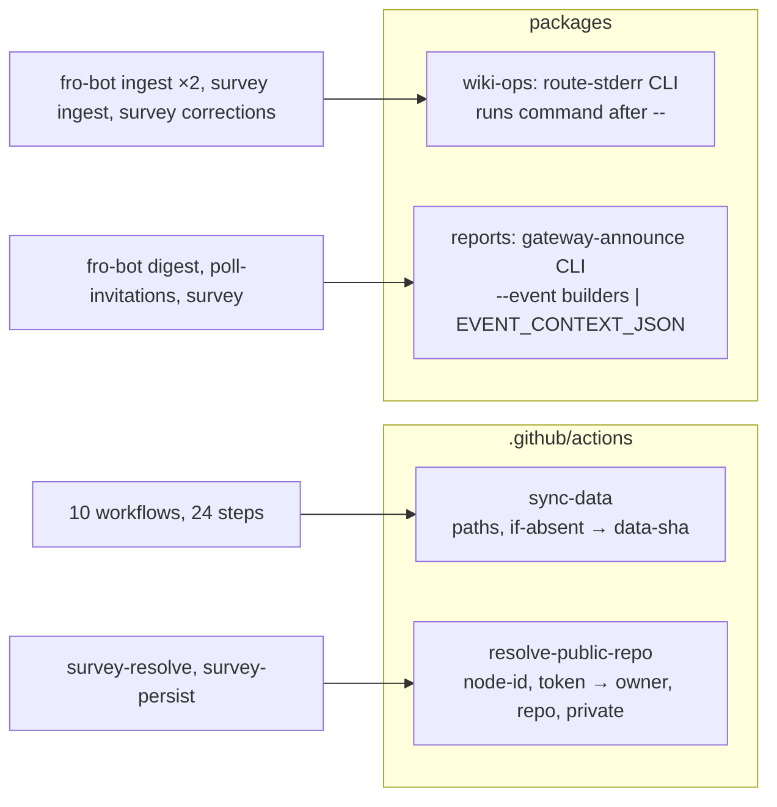

# refactor: Give every copied workflow shell block one definition

## Overview

Four blocks of shell are copied across `.github/workflows/`. This plan moves each one to a single definition:

- The data sync becomes one composite action, `.github/actions/sync-data`, renamed from `sync-wiki`, used by 24 call sites.
- The survey privacy gate becomes a second composite action used by both gate steps.
- The warning router becomes a wrapper CLI in `@fro-bot/wiki-ops` used by four steps.
- The gateway-announce event builders become typed builders inside the existing `@fro-bot/reports` CLI.

Everything else stays at parity, except the changes the origin lists in R11.

## Problem Frame

The copies have drifted in fetch form, index state, absent-branch behaviour, error text, pass checks and failure handling, and two of the four blocks sit on fail-closed privacy or data-integrity paths (see origin: `docs/brainstorms/2026-11-05-workflow-shell-dedup-requirements.md`). A fix to one copy misses the rest.

## Requirements Trace

- R1–R5. Data sync: one action, probe exit 0/2/other with a required absent-branch input, bounded retry, `--no-tags` full-depth fetch, working-tree restore by tree (`knowledge` mirrors, `metadata` overlays), exposes the synced SHA, 24 call sites.
- R6–R7. Privacy gate: one action holding the `isPrivate == false` allowlist with a node-ID shape check; refusals print a fixed reason and the node ID only.
- R8–R9. Warning router: one parameterised router outside `packages/wiki-write-core`; emitter prefixes pinned by test.
- R10. Announce: typed builders under the never-fail guard; builder errors print a fixed line, raise `::warning::`, exit 0.
- R11. Parity except the named changes, which now include survey's two metadata syncs moving from mirror to overlay.
- R12. Each shared definition pinned once; explicit caller list with declared inputs.
- R13. App-token scope contract and `env:`-only expression passing hold, inside actions too.
- R14. Data sync takes no token; the gate takes the job's App token as an input.

## Scope Boundaries

- Step-summary writers, non-duplicated inline steps, `merge-data.yaml`'s fetch and the operator text in `packages/registry/src/reconcile-issues.ts` are untouched.
- The observe and survey jobs that call the sync twice in a row keep two calls. Merging them would change which snapshot each reader sees.
- Lines beginning `::` and Markdown in routed stderr pass through verbatim, as today. The wiki-ingest emitter deliberately emits `::error::`.

### Deferred to Separate Tasks

- Retiring the data sync so metadata readers read `origin/data` directly: future plan.
- MCP exposure of package CLIs: gated on fro-bot/agent#1931.
- Unifying wiki-change detection between `fro-bot.yaml` and `survey-repo.yaml`: separate change.
- Agent prep blocks (persona, query, baseline): after the wiki-change split.

## Context & Research

### Relevant Code and Patterns

- `.github/actions/sync-wiki/action.yaml`: probe, three-attempt retry (`SYNC_WIKI_RETRY_DELAY_SECONDS`, exit 2 not retried), `git fetch origin data`, `git restore --source FETCH_HEAD --worktree -- knowledge`, `data-sha` output written only after restore. It has no inputs and hardcodes `knowledge` in its error text.
- `scripts/fro-bot-workflow.test.ts` (the `sync-wiki` block): the only test that runs composite-action shell. It has its own fake `git` with exit sequences, a fake `sleep`, `rev-parse` output and `GITHUB_OUTPUT` readback.
- `packages/test-kit/src/workflow-step.ts` `runStepWithStubs`: runs `run:` text with stubs, but has no exit sequences, no `sleep` stub, a silent `rev-parse` and no output readback.
- `scripts/data-branch-probe-workflows.test.ts`: discovers overlay steps by `ls-remote origin data` text and asserts floors (`>= 15` steps, `>= 10` files). After the move it finds nothing.
- `scripts/data-write-token-guard.test.ts` and `scripts/trusted-wiki-env-source-guard.test.ts` find writer steps by the literal `wiki-ingest.ts` in `run:` text. That literal must stay in the YAML.
- `survey-repo.yaml` `survey-resolve` (`permissions: {}`, no checkout, App-token mint `gate-token`, step `resolve`) and `survey-persist` step `recheck`. About nine later conditions read `steps.recheck` outputs and conclusion, so step ids and output names stay.
- `packages/wiki-ops/src/render-corrections-context.ts` and `packages/wiki-write-core/src/wiki-ingest.ts` emit the prefixed lines. `scripts/wiki-ingest.ts` owns the exit-3 mapping.
- `packages/reports/src/gateway-announce.ts` and `gateway-announce-cli.ts`: kill switch checked first, `EVENT_CONTEXT_JSON` parsed and redacted, `usageCode: 0`, `errorExitCode: 0`, default `errorFormat` prints `error.message`. Both modules are in Stryker's `mutate` list at 100%. `scripts/reports-flows.test.ts` pins the exact signed bytes, so context key order matters.
- `packages/core/src/output.ts` (`appendStepSummary`, `writeGithubOutputs`) and `packages/core/src/cli.ts` (`runCli`): the router reuses both.

### Institutional Learnings

- `docs/solutions/workflow-issues/workflow-consolidation-invariant-trace-2026-06-24.md`: trace every caller and invariant (concurrency, outputs, summaries) when consolidating steps.
- `docs/solutions/security-issues/survey-workflow-side-privacy-gate-2026-05-16.md`: the gate runs first, accepts only an opaque `node_id`, and every persistence or emission step rechecks visibility.
- `docs/solutions/workflow-issues/agent-credential-preflights-are-workflow-contracts-2026-10-09.md`: checkout credential persistence is a contract; the sync must work under each caller's settings.
- `docs/solutions/workflow-issues/github-actions-step-output-interpolation-2026-04-21.md`: expression values reach shell through `env:` only.
- `docs/solutions/best-practices/repo-wide-app-token-scope-contract-2026-10-10.md`: every mint is pinned in `scripts/app-token-scope-guard.test.ts`.
- `docs/solutions/best-practices/moving-a-script-into-a-workspace-package-changes-its-contract-2026-11-05.md`: runner, argv and env-threading rules for new package CLIs, and CodeQL treating package exports as library input.

## Prior-Art Survey

```json
{
  "schema_version": 2,
  "verdict": "extend",
  "scope": ".github/actions/, packages/*/src, scripts/ (workflow callers read for call sites)",
  "freshness": {
    "vcs_reference": "14862d0850b9c4080030b7d99de257b60e7b43d3"
  },
  "budget": {
    "max_search_passes": 6,
    "max_candidate_inspections": 14,
    "exhausted": false
  },
  "candidates": [
    {
      "path_or_symbol": ".github/actions/sync-wiki/action.yaml",
      "description": "Probe, bounded retry, fetch and working-tree restore of knowledge from data; exposes data-sha",
      "disposition": "extend"
    },
    {
      "path_or_symbol": "scripts/fro-bot-workflow.test.ts",
      "description": "Only harness that runs composite-action shell with fake git sequences, sleep and output readback",
      "disposition": "extend"
    },
    {
      "path_or_symbol": "packages/test-kit/src/workflow-step.ts",
      "description": "runStepWithStubs: stubbed-bash step runner",
      "disposition": "extend"
    },
    {
      "path_or_symbol": "packages/reports/src/gateway-announce.ts",
      "description": "Never-fail signed POST over EVENT_CONTEXT_JSON; no event builders",
      "disposition": "extend"
    },
    {
      "path_or_symbol": "packages/core/src/output.ts",
      "description": "appendStepSummary and writeGithubOutputs",
      "disposition": "reuse"
    },
    {
      "path_or_symbol": "packages/core/src/cli.ts",
      "description": "goke runner for package CLIs",
      "disposition": "reuse"
    },
    {
      "path_or_symbol": "packages/core/src/retry.ts",
      "description": "TypeScript retry primitive",
      "disposition": "insufficient",
      "insufficiency_reason": "TypeScript only; the data sync is shell that must run without a package runtime"
    },
    {
      "path_or_symbol": "packages/privacy/src/private-repo-resolution.ts",
      "description": "Node ID to nameWithOwner via gh",
      "disposition": "insufficient",
      "insufficiency_reason": "Makes no visibility decision, so it would fail open as a public-only gate"
    },
    {
      "path_or_symbol": "packages/wiki-write-core/src/private-leak-adapter.ts",
      "description": "Batched nodes(ids) lookup with isPrivate for the leak scan",
      "disposition": "insufficient",
      "insufficiency_reason": "Collects private names for a scan; not a single-node public allowlist, and lives in the published package"
    },
    {
      "path_or_symbol": "packages/wiki-ops/src/render-corrections-context.ts",
      "description": "Emits corrections:warning: lines",
      "disposition": "insufficient",
      "insufficiency_reason": "Producer only; nothing routes prefixed stderr into a step summary"
    }
  ]
}
```

## Key Technical Decisions

- **Two composite actions, two package changes.** Shell-only blocks become composite actions; blocks that wrap a package CLI become package code (see origin).
- **Rename the action directory `sync-wiki` to `sync-data`; keep caller step ids.** The action now syncs metadata too. Caller steps keep their ids (`sync-wiki`, `restore-wiki`, `restore-data`, `onboarded`, `onboarded-persist`), so every `steps.<id>` reference and the pin in `scripts/trusted-wiki-env-source-guard.test.ts` stay valid. The retry knob keeps its name `SYNC_WIKI_RETRY_DELAY_SECONDS`, which existing tests set.
- **`sync-data` inputs: `paths` (required, whitespace-separated) and `if-absent` (required, `skip` or `fail`).** Both reach the shell through `env:` on the action's step, and `paths` is split into an array with globbing off. Error text names neither `knowledge/` nor a caller. Callers are static and pinned by the caller table, so `paths` gets no allowlist.
- **Restore mode follows the tree.** `git restore --source FETCH_HEAD --worktree` without `--overlay` removes tracked files absent from the source. `metadata` paths restore with `--overlay`, matching the `git checkout origin/data -- metadata/` the 15 metadata callers used, so a tracked file only the checkout carries survives. `knowledge` paths restore without it, a mirror, matching `sync-wiki` and wiki-lint. A `paths` list is grouped by tree and each group restored with its own mode, `knowledge` first. A path not under `knowledge` or `metadata`, or with a `..` component, has no defined mode and fails the step before any git call. Survey's two metadata syncs were mirrors (`git restore` without overlay) and become overlays; they read only `repos.yaml`, so the change is listed in R11. An earlier draft called restore additive for every copy, which was wrong for `knowledge` and for survey.
- **Fetch never passes `--depth`.** Full-depth callers stay unshallow. Restore needs only the fetched tip, so the action does not unshallow anything. Wiki-lint and wiki-repair, which fetch `--depth=1` today, fetch the branch without a depth limit. The PR records the measured fetch time; it is a note, not a gate.
- **The fetched tip is the snapshot.** If `data` moves between probe and fetch, the action restores and reports the fetched SHA, as `sync-wiki` does.
- **A missing requested path fails the step.** `git restore` rejects an unmatched pathspec before writing, so no SHA is emitted and later steps gated on success do not run. This is today's behaviour.
- **Draft-solutions publish keeps `skip` on an absent branch.** Its privacy check is a denylist, so an absent branch leaves it reading `main`'s metadata. This is an accepted gap (see origin): `data` is persistent and a ruleset blocks its deletion.
- **The gate action takes the App token as an input.** Relying on step `env:` reaching composite inner steps is unverified. The data sync takes no token.
- **`survey-resolve` gains `contents: read` and a sparse, credential-free checkout of `.github/actions` from the default branch.** This matches `survey-persist`'s trusted-code checkout. The workflow YAML itself still comes from the dispatch ref, so pinning the checkout closes only the edit-the-action-but-not-the-caller path. A checkout under `permissions: {}` is unverified here; `contents: read` is the least privilege known to work.
- **The node-ID shape check matches the whole string.** Today's `printf | grep -qE` passes a multi-line value if any line matches (checked: `@x` + newline + `abc` passes). The action uses `[[ =~ ]]`.
- **Gate refusals print a fixed reason plus the node ID.** The raw `gh` stderr dump goes, so no upstream message can name a repository.
- **Gate outputs keep their names.** The action exposes `owner`, `repo`, `node_id` and `private`; the caller steps keep ids `resolve` and `recheck`, and the job's outputs map from the step outputs as today.
- **The warning router is a wrapper CLI in `@fro-bot/wiki-ops` that takes the wrapped command as a trailing variadic positional.** The core runner rejects any `--` in argv, so the router's own flags come first and the command follows with no separator. The wrapped commands take no flags today; a flag after the command is a usage error (usage exit 1, so a misconfigured step fails loudly). A wrapped command that needs flags would need a runner change, which is out of scope. The YAML keeps the literal `bun scripts/wiki-ingest.ts`, which the two writer-step guards depend on. wiki-ops already depends on `core` and `wiki-write-core`, so no new package edge appears.
- **Router parameters:** one or more `--route <prefix>=<heading>` (accepted as a string or an array, normalised to an array), `--summary filtered|all`, and `--conflict-exit <code> --conflict-output <name>`. The child is spawned from an argv array with no shell, inherits stdout, env and cwd unchanged, and has its stderr captured and replayed verbatim. Summary sections are written only when at least one line matches a route prefix; `all` then appends the whole stderr after the heading, `filtered` only the matching lines. The conflict output is written only on the named exit code, and the router exits with the wrapped command's code. No usage or error line echoes argv or env.
- **Router mutation status:** `route-stderr.ts` joins Stryker's `mutate` list, with its test importing it by relative path; `route-stderr-cli.ts` goes into `mutation-guards.json` `not-mutated` with a goke-entrypoint reason like the existing CLI entries.
- **Typed announce builders are a second input source.** `--event` takes today's `EVENT_TYPE` values (`daily_digest`, `invitation_accepted`, `survey_completed`) and replaces `EVENT_TYPE` in the three workflow steps. It builds the context from the env names those steps set today. `EVENT_CONTEXT_JSON` stays for its existing callers; `--event` together with `EVENT_CONTEXT_JSON` or `EVENT_TYPE` is a usage error. Context key order matches today's `jq` output so the signed bytes do not change.
- **Builder failures use a fixed `errorFormat`.** One `gateway-announce:` line naming the event type and a `::warning::` annotation, exit 0, no network call. The kill switch is still checked first. Survey's empty pages-changed value still defaults to 0. The daily-digest `validated` step stays, so its gate on the announce step is unchanged.

## Open Questions

### Resolved During Planning

- Checkout root and depth: every caller checks out at the workspace root; the action never passes `--depth`.
- Missing restore path: the step fails with no SHA, as today.
- `EVENT_CONTEXT_JSON`: kept beside the typed builders.
- Router shape and home: wrapper CLI in wiki-ops, command as a trailing variadic positional.
- Wiki-repair live coverage: it runs only on repairable findings. No fixture forces one; PR A records it as not exercised until a real repair run happens.
- Double sync calls in observe and survey: kept separate.

### Deferred to Implementation

- The router CLI's final flag spelling, within the parameters above.
- Whether `gh api graphql` exits 0 on a partial-errors payload. The gate's tests cover both outcomes.
- Whether ESLint or actionlint covers `.github/actions/**`: check, and add coverage only if neither does.
- Measured size of a full `data` fetch for wiki-lint, recorded in the PR body.

## High-Level Technical Design

> _This illustrates the intended approach and is directional guidance for review, not implementation specification. The implementing agent should treat it as context, not code to reproduce._



The data sync state machine is unchanged except for its parameters: probe → exit 0 fetch and restore and write `data-sha`; exit 2 skip (empty output) or fail per `if-absent`; any other exit retry then fail.

## Data-sync caller table

The caller-list test in Unit 3 holds this table. `paths` and `if-absent` match each site's behaviour today.

| # | Workflow | Job | Step (id) | `paths` | `if-absent` | Must follow | Must precede (first consumer) | `if` |
| --- | --- | --- | --- | --- | --- | --- | --- | --- |
| 1 | `capture-learnings.yaml` | `capture-learnings-harvest` | Overlay metadata | `metadata/` | skip | checkout | `Harvest candidates` | none |
| 2 | `capture-learnings.yaml` | `capture-learnings-publish` | Overlay metadata | `metadata/` | skip | checkout | `Open learning-proposal issues` | none |
| 3 | `capture-patterns.yaml` | `detect` | Overlay metadata | `metadata/` | skip | checkout | `Detect candidate patterns` | none |
| 4 | `capture-patterns.yaml` | `open-publish` | Overlay metadata | `metadata/` | skip | checkout | `Open pattern proposal issues` | none |
| 5 | `cross-repo-dispatch.yaml` | `dispatch` | Overlay metadata | `metadata/` | skip | checkout | `Dispatch approved goal items` | none |
| 6 | `cross-repo-dispatch.yaml` | `track` | Overlay metadata | `metadata/` | skip | checkout | `Track dispatched goal items` | none |
| 7 | `draft-solutions.yaml` | `publish` | Overlay metadata | `metadata/` | skip | checkout | `Publish drafted solution docs` | none |
| 8 | `fro-bot.yaml` | `fro-bot-observe` | Overlay metadata | `metadata/` | skip | checkout | `Query solutions context` | none |
| 9 | `fro-bot.yaml` | `fro-bot-observe-announce` | Overlay metadata | `metadata/` | skip | checkout | `Derive daily digest counts` | none |
| 10 | `improvement-metrics.yaml` | `detect` | Overlay metadata | `metadata/` | skip | checkout | `Detect improvement-metric edges` | none |
| 11 | `reconcile-repos.yaml` | `reconcile-repos` | Overlay metadata | `metadata/` | skip | checkout | `Reconcile repos` | none |
| 12 | `status-truth.yaml` | `detect` | Overlay metadata | `metadata/` | skip | checkout | `Detect status-truth drift` | none |
| 13 | `status-truth.yaml` | `open` | Overlay metadata | `metadata/` | skip | checkout | `Open status-truth proposals` | none |
| 14 | `survey-repo.yaml` | `survey-repo` | new sync step before `onboarded` | `metadata` | skip | checkout | `Check repo onboarded` | none |
| 15 | `survey-repo.yaml` | `survey-persist` | new sync step before `onboarded-persist` | `metadata` | skip | `Validate and apply wiki handoff` | `Re-check repo onboarded before the wiki commit` | `needs.survey-repo.outputs.wiki-artifact-ready == 'success' && steps.recheck.conclusion == 'success'` |
| 16 | `wiki-lint.yaml` | `wiki-lint` | `restore-wiki` | `knowledge` | fail | checkout | `Run wiki lint` | none |
| 17 | `wiki-lint.yaml` | `wiki-repair` | `restore-data` | `knowledge metadata/repos.yaml` | fail | `Grandfather main's wiki repos` | `Run wiki repair` | none |
| 18 | `fro-bot.yaml` | `fro-bot` | `sync-wiki` | `knowledge` | skip | checkout | `Capture wiki baseline` | none |
| 19 | `fro-bot.yaml` | `fro-bot-wiki-ingest` | `sync-wiki` | `knowledge` | skip | checkout | `Validate and apply wiki handoff` | none |
| 20 | `fro-bot.yaml` | `fro-bot-remediate` | (no id) | `knowledge` | skip | checkout | `Query wiki context` | none |
| 21 | `fro-bot.yaml` | `fro-bot-observe` | `sync-wiki` | `knowledge` | skip | checkout | `Capture wiki baseline` | none |
| 22 | `fro-bot.yaml` | `fro-bot-observe-wiki-ingest` | `sync-wiki` | `knowledge` | skip | checkout | `Validate and apply wiki handoff` | none |
| 23 | `survey-repo.yaml` | `survey-repo` | `sync-wiki` | `knowledge` | skip | checkout | `Capture wiki baseline` | none |
| 24 | `survey-repo.yaml` | `survey-persist` | `sync-wiki` | `knowledge` | skip | checkout | `Validate and apply wiki handoff` | `needs.survey-repo.outputs.wiki-artifact-ready == 'success' && steps.recheck.conclusion == 'success'` |

Rows 1–17 are today's `run:` blocks; rows 18–24 already use `sync-wiki`. Every job has a consuming step, so no row lacks a `Must precede` entry. The `Must precede` column is the first step that reads the files the sync restores; `Download` and token-mint steps in between do not. Rows 18–24 and 16–17 restore `knowledge` as a mirror, as `sync-wiki` did; `fro-bot-remediate`'s later `Restore knowledge/ to a clean tree` step is unchanged.

## Implementation Units

### PR A: data sync

- [x] **Unit 1: Extend the test-kit step runner for composite shell**

**Goal:** One stubbed runner can drive a composite action's shell through the full probe and retry matrix.

**Requirements:** R12

**Dependencies:** None

**Files:**

- Modify: `packages/test-kit/src/workflow-step.ts`
- Test: `packages/test-kit/src/workflow-step.test.ts`
- Modify: `packages/test-kit/README.md`

**Approach:**

- Add per-call exit-code sequences for `git` subcommands, a recording `sleep` stub, configurable `git rev-parse` output, and readback of the `GITHUB_OUTPUT` file.
- Keep the existing call signature working for current callers.

**Patterns to follow:** the fake `git` and `sleep` in the `sync-wiki` block of `scripts/fro-bot-workflow.test.ts`.

**Test scenarios:**

- Happy path: a sequence `[1, 0]` for `ls-remote` makes the first call fail and the second succeed.
- Happy path: the `sleep` stub records each delay and does not sleep.
- Happy path: output readback returns the key/value pairs the step wrote.
- Edge case: existing callers that pass a single exit code behave as before.

**Verification:** the existing workflow tests pass unchanged; the new runner reproduces the fro-bot matrix.

- [x] **Unit 2: Turn `sync-wiki` into `sync-data`**

**Goal:** One parameterised action implements R1–R5.

**Requirements:** R1, R2, R3, R5, R13, R14

**Dependencies:** Unit 1

**Files:**

- Create: `.github/actions/sync-data/action.yaml`
- Delete: `.github/actions/sync-wiki/action.yaml`
- Create: `scripts/sync-data-action.test.ts`
- Modify: `scripts/fro-bot-workflow.test.ts` (its `sync-wiki` matrix moves to the new test)

**Approach:**

- Inputs `paths` and `if-absent`, both required, passed through `env:`. Reject an `if-absent` value other than `skip` or `fail`, and an empty `paths`. Split `paths` into an array with globbing off. Group the paths by tree: `knowledge` restores as a mirror, `metadata` with `--overlay`, and any other path (or one with a `..` component) is rejected before any git call.
- Fetch `git fetch --no-tags origin data` with retry; restore `--worktree` only, one call per mode group; write `data-sha` after every restore succeeded.
- Neutral error text.

**Execution note:** Start from the moved fro-bot matrix, then add the new input cases test-first.

**Test scenarios:**

- Happy path: probe 0, fetch 0 → files restored for every listed path, `data-sha` written, index unchanged.
- Happy path: a mixed list (`knowledge metadata/repos.yaml`) restores `knowledge` as a mirror and `metadata/repos.yaml` as an overlay, one call each.
- Happy path: a `metadata` path restores with `--overlay`; a `knowledge` path restores without it.
- Edge case: probe 2 with `skip` → exit 0, no `data-sha`, no fetch.
- Error path: probe 2 with `fail` → non-zero exit, no fetch.
- Error path: probe exits 128 on every attempt → non-zero after three attempts, delays recorded.
- Error path: fetch fails twice then succeeds → restored, `data-sha` written.
- Error path: restore of a path missing on `data` → non-zero, no `data-sha`.
- Error path: missing or invalid `if-absent`, empty `paths` → non-zero before any git call.
- Error path: a path outside `knowledge` and `metadata` (`docs`, `knowledgebase`, `/etc/passwd`, `*`), or one with a `..` component → non-zero before any git call, whatever the branch state.
- Error path: a failing `knowledge` restore stops before the `metadata` restore; no `data-sha`.
- Edge case: a `paths` value containing `*` reaches `git restore` literally, not expanded against the checkout.
- Edge case: `SYNC_WIKI_RETRY_DELAY_SECONDS` unset, numeric and non-numeric behave as in today's `sync-wiki` tests.
- Integration: the action YAML contains no `${{` inside any `run:`.
- Integration: a real temporary repo with a `data` branch, a shallow clone and a full clone. Sync restores the tip, leaves `git diff --cached` empty, and leaves the full clone unshallow.
- Integration: a tracked metadata file only `main` has survives a `metadata` sync; a knowledge page deleted on `data` is removed by a `knowledge` sync; a mixed list does both; an unsupported path fails before git runs and touches nothing.

**Verification:** every scenario passes; actionlint is clean.

- [x] **Unit 3: Move all 24 call sites and replace shell-text discovery**

**Goal:** Every data sync in a workflow is a `uses: ./.github/actions/sync-data` step, and a caller-list test pins them.

**Requirements:** R4, R11, R12

**Dependencies:** Unit 2

**Files:**

- Modify: `.github/workflows/capture-learnings.yaml`, `capture-patterns.yaml`, `cross-repo-dispatch.yaml`, `improvement-metrics.yaml`, `status-truth.yaml`, `fro-bot.yaml`, `draft-solutions.yaml`, `reconcile-repos.yaml`, `survey-repo.yaml`, `wiki-lint.yaml`
- Create: `scripts/data-sync-callers.test.ts`
- Delete: `scripts/data-branch-probe-workflows.test.ts` (its exit-code matrix is covered by Unit 2's action test; its discovery role moves to the caller-list test)
- Modify: `scripts/draft-solutions-workflow.test.ts`, `scripts/capture-learnings-workflow.test.ts`, `scripts/wiki-lint.test.ts`, `scripts/survey-repo-workflow.test.ts`, `scripts/fro-bot-workflow.test.ts`, `scripts/trusted-wiki-env-source-guard.test.ts` (only if its action-path pin changes)

**Approach:**

- 17 `run:` steps become `uses:` steps; the 7 existing `uses: sync-wiki` steps point at `sync-data` and gain `with:`. The [caller table](#data-sync-caller-table) gives every site's job, step id, `paths`, `if-absent` and ordering.
- Steps keep their ids. Wiki-lint's `restore-wiki` and wiki-repair's `restore-data` are the converted steps, so `steps.restore-wiki.outcome` and both `data-sha` reads keep resolving. Wiki-lint keeps `continue-on-error: true`.
- Wiki-repair's sync stays after `Grandfather main's wiki repos`. That copy of main's pages is the privacy gate's grandfather input, so syncing first would let every data page match itself.
- Survey's onboarded checks keep their step ids and names on the `check-repo-onboarded.ts` step; the sync is a new step before it.
- Reconcile's bootstrap message goes; nothing reads it.
- Remove the reconcile NOTE about staged metadata.

**Test scenarios:**

- Happy path: the caller-list test holds the caller table (workflow, job, step id or name, `paths`, `if-absent`, the step it must follow, the first step that reads the synced files, the step's `if:`) and finds exactly those 24 `uses:` steps.
- Error path: removing a call site, adding an unlisted one, changing a declared input or `if:`, or moving a site before its anchor step or after the first step that reads the files it restores fails the test.
- Error path: any workflow `run:` step that touches `origin data` through `ls-remote`, `fetch`, `checkout` or `restore`, or that pipes a fetch, checkout or restore into `|| true`, fails the test. `merge-data.yaml`'s promotion fetch is the one named exemption.
- Integration: each call site comes after its job's `actions/checkout`; wiki-repair's comes after `Grandfather main's wiki repos`.
- Integration: every `steps.<id>.outcome` and `steps.<id>.outputs.data-sha` reference in the moved workflows names a step that exists in the same job.
- Integration: the draft-solutions and capture-learnings ordering assertions still hold with the sync step in the same position.
- Integration: wiki-lint's lint and repair paths read `data-sha`, and `WIKI_REPAIR_DATA_TIP_SHA` still comes from the repair sync.

**Verification:** the full test suite and actionlint pass; no workflow `run:` text syncs from `data`.

### PR B: privacy gate

- [x] **Unit 4: `resolve-public-repo` composite action**

**Goal:** Both survey gate steps use one allowlist.

**Requirements:** R6, R7, R11, R13, R14

**Dependencies:** Unit 1

**Files:**

- Create: `.github/actions/resolve-public-repo/action.yaml`
- Create: `scripts/resolve-public-repo-action.test.ts`
- Modify: `.github/workflows/survey-repo.yaml`
- Modify: `scripts/survey-repo-workflow.test.ts`. Its assertion that `survey-resolve` has no checkout, and the matching header comment in `survey-repo.yaml`, change on purpose to allow the sparse checkout. `scripts/app-token-scope-guard.test.ts` needs no change: mint permissions and reach do not move.

**Approach:**

- Inputs `node-id` and `token`, through `env:`. Whole-string shape check `^[A-Za-z0-9_=-]+$` before any call. One `node(id)` query selecting `nameWithOwner isPrivate`. Admit only `isPrivate == false` (boolean) and a non-empty string `nameWithOwner`.
- Outputs `owner`, `repo`, `node_id`, `private`. The `recheck` step maps `private` as today.
- Refusal and API-failure paths print a fixed reason and the node ID only, and never replay `gh` stderr.
- `survey-resolve`: `contents: read`, a sparse checkout of `.github/actions` from the default branch with `persist-credentials: false`, then the gate. `survey-persist` already checks out the default branch.

**Test scenarios:**

- Happy path: public repo → `owner`, `repo`, `node_id` written; exit 0.
- Error path: private repo, null node, non-repository node, empty `nameWithOwner`, malformed JSON → non-zero, no outputs, stderr contains neither owner nor repo.
- Error path: `isPrivate` absent, `null`, or the string `"false"` with a valid `nameWithOwner` → non-zero, no outputs.
- Error path: `gh` exits non-zero with stderr naming a repository → non-zero, that text absent from the step's output.
- Error path: `gh` exits 0 with a partial-errors payload → decided by the same allowlist; no outputs unless it passes.
- Error path: malformed node ID, including a multi-line value whose second line is valid → non-zero before `gh` runs.
- Integration: the action YAML contains no `${{` inside any `run:`, and the gate steps in `survey-repo.yaml` pass `node-id` and `token` through `with:` only.
- Integration: `steps.recheck` conditions, `REPO_PRIVATE` env and job outputs resolve to the same names as before.
- Integration: `survey-resolve` has exactly `contents: read`, its checkout is sparse to `.github/actions` and persists no credentials, and the gate step follows it.

**Verification:** survey workflow tests pass; the scope-guard test passes unchanged.

### PR C: warning router

- [x] **Unit 5: `route-stderr` CLI in `@fro-bot/wiki-ops`**

**Goal:** One router replaces the four copies with identical observable outputs.

**Requirements:** R8, R9, R11, R12

**Dependencies:** None

**Files:**

- Create: `packages/wiki-ops/src/route-stderr.ts`, `packages/wiki-ops/src/route-stderr-cli.ts`, `scripts/route-stderr.ts` (six-line shim)
- Test: `packages/wiki-ops/src/route-stderr.test.ts`, `packages/wiki-ops/src/route-stderr-cli.test.ts`, `packages/wiki-ops/src/route-stderr-prefixes.test.ts`
- Modify: `.github/workflows/fro-bot.yaml` (two ingest steps), `.github/workflows/survey-repo.yaml` (ingest and corrections steps)
- Modify: `scripts/survey-repo-workflow.test.ts`, `scripts/fro-bot-workflow.test.ts`, `scripts/fro-bot-workflow-wiki-handoff.test.ts`
- Modify: `stryker.config.json` (`route-stderr.ts` and its test), `mutation-guards.json` (`route-stderr-cli.ts` not-mutated), `packages/wiki-ops/README.md` (CLI table, C4 diagram), `.github/copilot-instructions.md` (wiki-ops CLI list and count)

**Approach:**

- The command is a trailing variadic positional after the router's flags. Spawn it from that argv array with no shell; stdout, env and cwd are inherited, stderr is captured and replayed unchanged.
- Summary sections only when a route prefix matches. `--summary all` then reproduces the corrections step's unfiltered append; `filtered` reproduces the ingest steps.
- Workflow steps read `bun scripts/route-stderr.ts --route … bun scripts/wiki-ingest.ts`, so the writer-step guards still find `wiki-ingest.ts`.
- The CLI's usage exit is 1, so a misconfigured step fails instead of skipping the ingest.

**Execution note:** Capture each current step's summary and outputs for warning, finding, exit-3 and failure inputs first; the new steps must match byte for byte.

**Test scenarios:**

- Happy path: exit 0 with two warnings → both replayed, summary has the heading and both lines, exit 0.
- Happy path: survey routes → warnings and findings in separate sections.
- Edge case: empty stderr → no summary section, exit 0.
- Edge case: `--summary all` with one prefixed line among unprefixed failure text → heading plus the whole stderr, matching today's corrections step.
- Edge case: `--summary all` with only unprefixed stderr → no summary section, stderr replayed unchanged.
- Edge case: one `--route`, two `--route`s, none → parsed as one, two, and a usage error.
- Edge case: an argument containing shell metacharacters reaches the child literally.
- Edge case: the child writes `pages_changed` to `GITHUB_OUTPUT`; the router's `conflict` line is appended without overwriting it.
- Error path: exit 3 with `--conflict-exit 3` → `conflict=true` written, exit 3.
- Error path: exit 1 → no conflict output, exit 1.
- Error path: no command, or a flag after the command → usage error, exit 1, the child never runs.
- Integration: the CLI driven through `runCli` with each workflow step's exact argv runs the wrapped command and returns its exit code.
- Integration: the prefix test runs the real emitters on fixtures and asserts every emitted prefix has a route in the workflows that call them.
- Integration: `data-write-token-guard.test.ts` and `trusted-wiki-env-source-guard.test.ts` still count the same writer steps.

**Verification:** full suite, mutation guards, Test Scripts Load, layout test pass.

### PR D: announce builders

- [x] **Unit 6: Typed event builders in `gateway-announce`**

**Goal:** The three `jq` builders go, and a malformed input cannot fail the step.

**Requirements:** R10, R11, R12

**Dependencies:** None

**Files:**

- Modify: `packages/reports/src/gateway-announce.ts`, `packages/reports/src/gateway-announce-cli.ts`
- Test: `packages/reports/src/gateway-announce.test.ts`, `packages/reports/src/gateway-announce-cli.test.ts`, `scripts/reports-flows.test.ts`
- Modify: `.github/workflows/fro-bot.yaml`, `.github/workflows/poll-invitations.yaml`, `.github/workflows/survey-repo.yaml`
- Modify: `scripts/poll-invitations-workflow.test.ts`, `scripts/survey-repo-workflow.test.ts`, `scripts/fro-bot-workflow.test.ts`, `packages/reports/README.md`

**Approach:**

- `--event <name>` takes `daily_digest`, `invitation_accepted` or `survey_completed` and reads the env names the steps set today: `REPOS_TRACKED`, `SURVEYS_TODAY`, `REPORT_URL`; `INVITATIONS_ACCEPTED`, `INVITATIONS_REPOS`; `REPO_OWNER`, `REPO_NAME`, `REPO_SLUG`, `WIKI_PAGES_CHANGED`. It validates types and builds the context with today's key order. The three steps drop `EVENT_TYPE`.
- Kill switch first; `--event` together with `EVENT_CONTEXT_JSON` or `EVENT_TYPE` is a usage error (exit 0 per the CLI's `usageCode`).
- A builder error prints `gateway-announce: <event> context invalid`, emits `::warning::`, makes no network call, exits 0.

**Test scenarios:**

- Happy path: each event's typed build signs the same bytes as the current `jq` output for the same inputs.
- Edge case: empty `WIKI_PAGES_CHANGED` → 0.
- Error path: non-numeric count, malformed repos JSON, missing required field → fixed line, warning annotation, exit 0, no fetch, input value absent from stderr.
- Error path: kill switch on with malformed input → skipped before validation.
- Error path: `--event` with `EVENT_CONTEXT_JSON` or `EVENT_TYPE` set → usage line, exit 0, no post.
- Integration: each workflow announce step's env names match the names its `--event` builder reads.
- Integration: `EVENT_CONTEXT_JSON` callers behave as before.
- Integration: each workflow announce step passes `--event` and env only, with no `jq`.

**Verification:** both modules stay at 100% mutation score; full suite passes.

## System-Wide Impact

- **Interaction graph:** ten workflows, two composite actions, two package CLIs. Survey is the densest: data sync ×4 steps, gate ×2, router ×2, announce ×1.
- **Error propagation:** data sync and gate fail closed; the router passes the wrapped exit code through; announce never fails.
- **State lifecycle:** synced files are unstaged in the working tree; nothing commits them.
- **Unchanged invariants:** step ids `resolve`, `recheck`, `onboarded`, `onboarded-persist`, `sync-wiki`, `restore-wiki`, `restore-data`; job outputs; `pages_changed` from the ingest CLI; signed announce bytes; the writer-step literal `wiki-ingest.ts`; every App-token mint's scope.

## Risks & Dependencies

| Risk | Mitigation |
| --- | --- |
| A caller silently leaves coverage when its shell moves | Caller-list test with declared inputs; a forbidden-shell check over every workflow `run:` |
| Full `data` fetch slows wiki-lint | Measured and recorded in PR A |
| The gate runs a different revision of its action than the persist job | Both jobs check out the default branch |
| Wiki-repair syncs before its grandfather copy and weakens the privacy gate | Caller table pins its anchor step; the caller test fails on reorder |
| Draft-solutions publish skips on an absent branch with a denylist check | Accepted gap (see origin); `data` is persistent and deletion-protected |
| Router replay changes a summary line | Capture current outputs before the change and match byte for byte |
| Announce key order changes the signature | Flow test compares signed bytes against the `jq` build |

## Operational / Rollout Notes

- One PR open at a time, in order A, B, C, D. Merge outside 04:30–06:00 UTC daily and Sunday 20:00–23:30 UTC, and with no survey or daily Fro Bot run in flight.
- Each PR's evidence must show the moved steps executed, not only that runs passed:
  - **A:** next reconcile (daily), cross-repo-dispatch (6-hourly), daily Fro Bot run, then the Sunday chain (status-truth, capture-learnings, improvement-metrics, wiki-lint) and Monday draft-solutions. capture-patterns and survey need a dispatch, each approved first. Wiki-repair runs only on repairable findings; record it as not exercised until it does.
  - **B:** one approved survey dispatch of a known public repo shows `resolve` and `recheck` succeeding.
  - **C:** the daily Fro Bot run, plus a new approved survey dispatch after merge, show the summary sections.
  - **D:** invitation polling and the daily digest show posted announcements; survey announce on the next survey.
- Rollback for any PR is a revert; no data repair is involved.

## Sources & References

- **Origin document:** [docs/brainstorms/2026-11-05-workflow-shell-dedup-requirements.md](../brainstorms/2026-11-05-workflow-shell-dedup-requirements.md)
- Related past work: `docs/plans/2026-10-24-001-refactor-scripts-workspace-packages-plan.md`, recorded active with phase 1 complete. It deferred this work; this plan carries it out without changing any CLI contract that phase settled.
- Related issue: fro-bot/agent#1931 (MCP, deferred).
