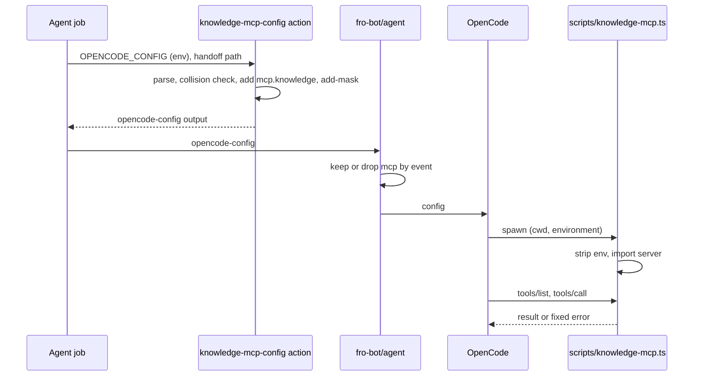

# feat: Serve knowledge lookups to agent runs as MCP tools

## Overview

A `knowledge` MCP server in `@fro-bot/wiki-ops` exposes three tools: `wiki_search`, `wiki_linked` and `solutions_search`. The model sees them as `knowledge_wiki_search`, `knowledge_wiki_linked` and `knowledge_solutions_search`. The server is a goke instance served through `@goke/mcp`. Its handlers call the existing `wiki-context-expand` and `solutions-query` code in-process. A composite action merges the server into `opencode-config` for the main `fro-bot` job, Remediate, Observe and survey. The CLIs, the pre-step excerpts and the other agent steps stay as they are.

## Problem Frame

Agents get knowledge context only from fixed pre-step excerpts and one `wiki-context-expand` bash recipe. Solutions have no on-demand path. fro-bot/agent v0.136.0 passes caller MCP servers through `opencode-config` on every event except `pull_request`, `issue_comment` and `issues`. The server runs under the agent's scrubbed env. See origin: `docs/brainstorms/2026-11-06-agent-knowledge-mcp-tools-requirements.md`.

## Requirements Trace

- R1. One server exposes exactly wiki search, linked-page expansion and solutions search, through its own goke registry and `@goke/mcp`. (Unit 2)
- R2. A test-pinned allowlist that never names a write-marked command, `resolve-private` or `enumerate-existing-leaks`. (Unit 2)
- R3. Wiki search and linked expansion return what `wiki-context-expand` returns, with its validation, filter and caps. The CLI is unchanged. (Unit 2)
- R4. Solutions search takes a query and reuses `solutions-query`'s ranking, filter and caps. A failure is an error result, not an empty match. (Units 1, 2)
- R5. The handoff path comes from the server definition. No path argument exists. A missing or malformed handoff is an error. (Units 2, 3)
- R6. Results appear only in the tool response. The server writes no file, and its stderr is fixed text. (Units 1, 2)
- R7. No credential. The server strips `OPENCODE_PASSWORD` and `OPENCODE_CONFIG_CONTENT` at startup, and its cwd is the checkout root. (Units 2, 3)
- R8. One composite action builds `opencode-config` for the four chosen jobs. (Units 3, 4)
- R9. The excerpts are unchanged. (Unit 4)
- R10. Jobs whose triggers all keep MCP use the tools in place of the bash recipe. The main job keeps the recipe. (Unit 4)
- R11. A fro-bot/agent request for credential-free local servers on withheld triggers. (Operational notes)
- R12. The main job drops the recipe once a release with R11 is pinned. (Deferred)

## Scope Boundaries

- capture-learnings, capture-patterns and draft-solutions keep the raw `OPENCODE_CONFIG` secret (see origin R8).
- No GitHub-read tools, no other CLIs, no retirement of the excerpts, no OpenCode permission rules (see origin Scope Boundaries).
- No change to the private-name filters. Privacy rests on the node-ID presence and promotion gates (see origin Key Decisions).

### Deferred to Separate Tasks

- R12, dropping the main job's bash recipe: after a fro-bot/agent release with R11 is pinned and checked on each trigger class.
- `solutions-query.ts` treats only boolean `private: true` as private, while `wiki-context-expand.ts:246` also accepts `'true'`. This is inert today, because every private owner is redacted. Align it when the filter next changes.
- `solutions-query.ts` duplicates `SOLUTION_SUBDIRS` from `solution-docs-paths.ts`.

## Context & Research

### Relevant Code and Patterns

- `packages/wiki-ops/src/wiki-context-expand.ts`:
  - `runWikiContextExpandCli(deps)` takes injected `argv`, `env`, `readDir`, `readFile`, `writeStdout` and `writeStderr`. It returns `{exitCode, result}`, so a handler gets the `ExpandResult` without capturing stdout.
  - `parseHandoffContent` and `validateQuery` are exported.
  - The corpus and `metadata/repos.yaml` reads are relative to the cwd.
- `packages/wiki-ops/src/solutions-query.ts`:
  - `assembleSolutionsContext` is an exported pure core.
  - `collectDocs` writes lines carrying paths to `process.stderr`. The loaders are private.
  - There's no query validation, only tokens of 3 or more characters.
- `packages/core/src/cli.ts` builds a private goke instance per `runCli` and replaces command actions, so it can't serve as the registry. goke is pinned at 6.18.0 in `packages/core/package.json`.
- `@goke/mcp@0.1.2`:
  - `createMcpAction({cli, commandFilter})` drives `command.commandAction` with captured streams.
  - Stdout is the JSON-RPC channel.
  - The tool name is the sanitised command name.
- marcusrbrown/infra `packages/cli/src/commands/mcp.ts` (allowlist via `commandFilter`) and `packages/cli/src/conventions.test.ts` (allowlist pins) are the precedent.
- `.github/actions/resolve-public-repo/action.yaml` and `scripts/resolve-public-repo-action.test.ts` are the composite pattern:
  - inputs pass through `env:` only, with no `${{` inside `run:`
  - an inner `if: ${{ always() }}`
  - outputs are written once, after all checks
  - `runStepWithStubs` from `@fro-bot/test-kit/workflow-step` runs the step under real bash
  - tests check that the secret never appears in the output
- `scripts/fro-bot-workflow-wiki-handoff.test.ts` iterates every agent job and pins the exact bash recipe. `scripts/wiki-ops-flows.test.ts` also references it.
- fro-bot/agent v0.136.0 applies `opencode-config` with a shallow `Object.assign` (`src/services/setup/ci-config.ts:414`) and does not mask it (`src/harness/config/inputs.ts:238-258`).

### Institutional Learnings

- `docs/solutions/best-practices/moving-a-script-into-a-workspace-package-changes-its-contract-2026-11-05.md`: thread `env` and `cwd` explicitly, use six-line shims, use `import.meta.main` (not the `file://${argv[1]}` comparison, which breaks on paths that need escaping), and probe new exports adversarially.
- `docs/solutions/best-practices/a-mutation-score-can-measure-nothing-2026-09-08.md`: classify every new module, test mutated code through relative imports, and keep constants inside functions.
- `docs/solutions/workflow-issues/agent-credential-preflights-are-workflow-contracts-2026-10-09.md`: agent-step credential and checkout settings are contracts that workflow tests pin.

## Prior-Art Survey

```json
{
  "schema_version": 2,
  "verdict": "extend",
  "scope": "fro-bot/.github: packages/wiki-ops, packages/core, packages/ci-checks, .github/workflows, .github/actions, scripts",
  "freshness": {
    "vcs_reference": "origin/main 1613d790e4c6978397506b970eb1ee982e47e09d"
  },
  "budget": {
    "max_search_passes": 6,
    "max_candidate_inspections": 15,
    "exhausted": false
  },
  "candidates": [
    {
      "path_or_symbol": "packages/wiki-ops/src/wiki-context-expand.ts#runWikiContextExpandCli",
      "description": "Linked and query assembly with validateQuery, handoff status, private tokens, the wiki-context-safety filter and the 3-page, 8 KiB cap. Returns the result without capturing stdout.",
      "disposition": "reuse"
    },
    {
      "path_or_symbol": "packages/wiki-ops/src/wiki-context-safety.ts#filterSafeCandidates",
      "description": "Runtime private-token scan before any excerpt is formatted.",
      "disposition": "reuse"
    },
    {
      "path_or_symbol": "packages/wiki-ops/src/solutions-query.ts#assembleSolutionsContext",
      "description": "Scores, filters and byte-caps docs/solutions. Needs a query entry, injectable loaders and a stderr seam.",
      "disposition": "extend"
    },
    {
      "path_or_symbol": ".github/actions/resolve-public-repo/action.yaml",
      "description": "Composite pattern: env-only inputs, fixed messages, outputs written after all checks.",
      "disposition": "extend"
    },
    {
      "path_or_symbol": "scripts/fro-bot-workflow-wiki-handoff.test.ts",
      "description": "Pins the handoff wiring and the exact bash recipe in every fro-bot.yaml agent job; must split per job.",
      "disposition": "extend"
    },
    {
      "path_or_symbol": "packages/core/src/cli.ts#runCli",
      "description": "Per-call private goke instance with replaced actions.",
      "disposition": "insufficient",
      "insufficiency_reason": "Hides its goke instance and strips command actions, so it cannot be the @goke/mcp registry."
    }
  ],
  "excluded_scopes": [
    {
      "scope": "marcusrbrown/infra packages/cli",
      "reason": "External precedent, read as a pattern only."
    },
    {
      "scope": "fro-bot/agent v0.136.0 and OpenCode 2.2.5",
      "reason": "Upstream runtimes; read for contract facts, not reuse."
    }
  ]
}
```

## Key Technical Decisions

- **Server lives in `@fro-bot/wiki-ops`.** Both wrapped modules are there, so the package graph gains no edge. Entry is a six-line `scripts/knowledge-mcp.ts` shim guarded by `import.meta.main`.
- **Server name `knowledge`; command names `wiki_search`, `wiki_linked`, `solutions_search`.** Tool ids read `knowledge_<command>`. The composite fails when the secret already defines `knowledge`.
- **Env strip happens in the shim before any import.** The shim deletes the two variables, then dynamically imports the server module, so no dependency's module code sees them.
- **Linked expansion checks the handoff first.** A missing path, file or valid shape returns a fixed error before the corpus loads (origin R5). This is a deliberate break from CLI parity, where those cases are empty results. Survey has no handoff, so it always gets the "no handoff for this run" error.
- **Solutions search validates with `validateQuery` and maps the query to `event.title`.** That reuses the hardened agent-query rules and the existing title weighting. It is stricter than the env-driven ranking, which accepts any token of 3 or more characters.
- **Config merge is shell plus `jq` in a composite, following `resolve-public-repo`.** It merges into the secret's own `mcp` object rather than replacing the key, because the agent assigns top-level keys shallowly. It adds the server under the spelling the secret already uses (`mcp.servers` when present, otherwise `mcp.<name>`), masks the compact merged JSON with `::add-mask::` before writing the output, and prints only fixed messages.
- **Server `cwd` and handoff path are absolute literals the composite computes from `GITHUB_WORKSPACE` and its input.** No `{env:}` reference is ever written, so the definition stays valid if R11 lands.
- **Config errors fail the job; runtime server failure degrades.** A bad secret or a name collision fails the composite on every trigger. A server that fails to start or crashes leaves the agent with excerpts and, in the main job, the bash recipe.
- **New dependencies are exact pins.** wiki-ops adds `goke` 6.18.0 and `@goke/mcp` 0.1.2, plus `@modelcontextprotocol/sdk` 1.32.2 as a dev dependency for the test client. All clear the 3-day floor. The lockfile change needs approval at the push gate.

## Open Questions

### Resolved During Planning

- Wiring mechanism: a composite merge step, no agent input needed (`action.yaml:98-102` is the only config channel).
- Wiki search backing: `wiki-context-expand` query mode, which already validates agent queries.
- Linked handoff source: the literal `environment.WIKI_CONTEXT_HANDOFF_PATH` in the server definition, since the agent's env filter drops the variable.
- Host package and naming: see Key Technical Decisions.
- Which jobs: main `fro-bot`, Remediate, Observe and the three survey attempts.
- `@goke/mcp` and the core runner: the server owns a separate goke instance and never touches `runCli`.

### Deferred to Implementation

- How `@goke/mcp` 0.1.2 surfaces a failed command to the client (thrown error, exit code, or `isError`). Map fixed error codes onto whatever shape it produces.
- Whether `opencode-logs` records MCP tool calls. The live Observe readback checks this. If it doesn't record them, use the agent's session output instead.
- How the jq merge handles a secret that uses both MCP spellings at once.

## High-Level Technical Design

> _This illustrates the intended approach and is directional guidance for review, not implementation specification. The implementing agent should treat it as context, not code to reproduce._



## Implementation Units

- [ ] **Unit 1: Solutions query entry for in-process callers**

**Goal:** A query-taking entry into `solutions-query` that a tool can call without writing paths to stderr.

**Requirements:** R4, R6

**Dependencies:** None

**Files:**

- Modify: `packages/wiki-ops/src/solutions-query.ts`
- Test: `packages/wiki-ops/src/solutions-query.test.ts`

**Approach:**

- Export a query entry that validates with `validateQuery`, loads docs and private names through injected readers, maps the query to `event.title`, and returns either a result or a fixed failure reason. A failure covers a rejected query, a missing corpus or an unreadable metadata file.
- Route the loaders' warnings through an injected sink. The CLI passes `process.stderr` so its output stays byte-identical.

**Execution note:** Capture the CLI's current stdout, stderr and `GITHUB_OUTPUT` for its existing invocation shapes before refactoring.

**Patterns to follow:** `runWikiContextExpandCli`'s injected deps.

**Test scenarios:**

- Happy path: a query matching a fixture doc's title returns that doc's excerpt and path.
- Edge case: a query matching nothing returns an empty result, not a failure.
- Error path: a path-like, overbroad or over-200-character query returns the rejected reason.
- Error path: a missing `docs/solutions` tree returns the corpus failure, and the injected sink receives nothing carrying a path.
- Integration: the CLI's captured outputs are unchanged for its existing shapes.

**Verification:** The CLI parity captures match. The new entry never calls `process.stderr`.

- [ ] **Unit 2: `knowledge` MCP server**

**Goal:** The allowlisted three-tool server and its entrypoint.

**Requirements:** R1, R2, R3, R4, R5, R6, R7

**Dependencies:** Unit 1

**Files:**

- Create: `packages/wiki-ops/src/knowledge-mcp.ts`
- Create: `scripts/knowledge-mcp.ts`
- Modify: `packages/wiki-ops/package.json` (exports, dependencies)
- Modify: `bun.lock`
- Modify: `stryker.config.json` or `mutation-guards.json` (classify `knowledge-mcp.ts`)
- Modify: `packages/wiki-ops/README.md` (C4 component and tool section)
- Modify: `.github/copilot-instructions.md`, `llms.txt` (wiki-ops module list)
- Test: `packages/wiki-ops/src/knowledge-mcp.test.ts`
- Test: `scripts/knowledge-mcp-server.test.ts`

**Approach:**

- `knowledge-mcp.ts` exposes the allowlist (a function returning the three command names) and a builder. The builder registers each command on a fresh goke instance with zod-typed options, and serves the instance through `createMcpAction` with `commandFilter` set to the allowlist.
- `wiki_search` takes `query`. It calls `runWikiContextExpandCli` with argv `['query', query]`, the checkout-root readers, an env holding only the handoff path, and no-op writers.
- `wiki_linked` takes no arguments. It checks the configured handoff path and file with `parseHandoffContent` before calling linked mode.
- `solutions_search` takes `query` and calls the Unit 1 entry.
- Every handler returns the JSON result as text, or a fixed error code such as `no-handoff`, `handoff-malformed`, `invalid-query`, `corpus-unavailable` or `unexpected`.
- The server writes nothing to stdout outside the transport. Its stderr is fixed lines only.
- The shim strips `OPENCODE_PASSWORD` and `OPENCODE_CONFIG_CONTENT`, then dynamically imports and starts the server. It loads cleanly under Test Scripts Load without starting anything.

**Execution note:** Implement test-first. Write the spawned-server contract test before the handlers.

**Patterns to follow:**

- infra `packages/cli/src/commands/mcp.ts`
- the `scripts/` six-line shims, with `import.meta.main` as in `scripts/check-mutation-guards.ts`

**Test scenarios:**

- Happy path: a spawned server over stdio with an SDK client against a temp fixture checkout lists exactly `wiki_search`, `wiki_linked` and `solutions_search`.
- Happy path: `wiki_search` for a fixture page title returns the same result `wiki-context-expand query` gives.
- Edge case: the query `-foo bar` gives the same result as the CLI's `query "-foo bar"`.
- Happy path: `wiki_linked` with a valid handoff returns linked pages.
- Error path: with no handoff path configured, the tool returns `no-handoff`, and neither the result nor stderr carries a path.
- Error path: a malformed handoff file returns `handoff-malformed`, even when the corpus is also missing.
- Happy path: `solutions_search` returns the matching fixture doc.
- Error path: a rejected query returns `invalid-query`.
- Error path: with the corpus missing, `solutions_search` returns `corpus-unavailable`.
- Edge case: a page tagged with a non-redacted private repository in the fixture's `metadata/repos.yaml` is left out of `wiki_search`, matching the CLI.
- Integration: when the server is spawned with sentinel values for `OPENCODE_PASSWORD`, `OPENCODE_CONFIG_CONTENT` and `GITHUB_TOKEN`, a debug-only probe reports all three absent from the handler's view. Neither stdout nor stderr ever contains a sentinel.
- Error path: across every error case, stderr contains only lines from the fixed set.
- The allowlist equals the three names and contains none of `resolve-private`, `enumerate-existing-leaks` or any name `defineCommand` marks `readOnly: false` anywhere under `packages/*/src`.
- Integration: importing `scripts/knowledge-mcp.ts` without running it as the main module starts no server.

**Verification:**

- The spawned-server tests pass under Bun.
- Test Scripts Load loads `knowledge-mcp.ts` and the shim.
- `bun run check:mutation-guards` is clean.
- `scripts/package-layout.test.ts` passes with the new dependencies declared.

- [ ] **Unit 3: `knowledge-mcp-config` composite action**

**Goal:** One shared step that turns the `OPENCODE_CONFIG` secret into an `opencode-config` value carrying the `knowledge` server.

**Requirements:** R5, R7, R8

**Dependencies:** Unit 2 (the server command it points at)

**Files:**

- Create: `.github/actions/knowledge-mcp-config/action.yaml`
- Test: `scripts/knowledge-mcp-config-action.test.ts`

**Approach:**

- Inputs `opencode-config` (the secret) and optional `handoff-path` reach the shell through `env:` only.
- The step parses the secret, treating empty as `{}`. It fails with a fixed message when the value is not a JSON object, when `mcp` is present but not an object, or when `knowledge` already exists under either spelling.
- It adds `knowledge` as `type: local` with:
  - command `bun scripts/knowledge-mcp.ts`
  - `cwd` set to `GITHUB_WORKSPACE`
  - `environment.WIKI_CONTEXT_HANDOFF_PATH`, only when the handoff path is non-empty
- It emits compact single-line JSON, masks it, then writes the output once.

**Patterns to follow:**

- `.github/actions/resolve-public-repo/action.yaml`
- `scripts/resolve-public-repo-action.test.ts`

**Test scenarios:**

- Happy path: an empty secret yields `{"mcp":{"knowledge":{…}}}` with the handoff path and an absolute `cwd`.
- Happy path: a secret with other keys and another `mcp` server keeps both unchanged and adds `knowledge`.
- Happy path: a secret using `mcp.servers` gets `knowledge` under `mcp.servers`.
- Edge case: an empty `handoff-path` writes no `environment.WIKI_CONTEXT_HANDOFF_PATH`.
- Error path: malformed JSON, a non-object value, an `mcp` that isn't an object, a `knowledge` collision under each spelling. Each fails with its fixed message and writes no output.
- Error path: the secret's raw text never appears in stdout, stderr or the output file, except inside the single `::add-mask::` line that precedes the output.
- The step env map is exact, no `run:` contains `${{`, and the output contains no `{env:` or `{file:` reference.

**Verification:** The action tests pass under real bash and jq, and actionlint is clean.

- [ ] **Unit 4: Wire the four jobs and update their prompts**

**Goal:** The main `fro-bot` job, Remediate, Observe and survey pass the composite's output to the agent. Their prompts reflect which runs have tools.

**Requirements:** R8, R9, R10

**Dependencies:** Unit 3

**Files:**

- Modify: `.github/workflows/fro-bot.yaml`
- Modify: `.github/workflows/survey-repo.yaml`
- Modify: `scripts/fro-bot-workflow-wiki-handoff.test.ts`
- Modify: `scripts/wiki-ops-flows.test.ts` (recipe reference, if affected)
- Create: `scripts/knowledge-mcp-callers.test.ts`
- Modify: `.github/workflows/README.md` or the nearest workflow doc that describes agent setup, if one exists

**Approach:**

- Each of the three `fro-bot.yaml` agent jobs gains a config step before its agent step. The step takes the job's `WIKI_CONTEXT_HANDOFF_PATH` and the agent step reads its output as `opencode-config`.
- survey adds one config step with no handoff path, and all three attempts read its output.
- Remediate and Observe replace the `<wiki_context_expansion>` bash recipe with tool guidance. The main job keeps the recipe and says to prefer the `knowledge_*` tools when the run has them. Survey prompts gain the same tool guidance as an optional aid.
- Excerpt steps and the other agent steps are untouched.

**Patterns to follow:** `scripts/data-sync-callers.test.ts`, an explicit caller table.

**Test scenarios:**

- Happy path: each of the four jobs has the config step before its agent step, with the expected inputs, and its agent step's `opencode-config` reads that step's output.
- capture-learnings, capture-patterns and draft-solutions still pass `secrets.OPENCODE_CONFIG` directly.
- Remediate and Observe prompts name the three tool ids and no longer contain the bash recipe.
- The main job's prompt still contains the exact recipe and mentions the tools.
- Handoff wiring per job is unchanged, with the split replacing the shared `describe.each`.
- The excerpt steps (`wiki-query`, `solutions-query`) and their env are unchanged in every job.

**Verification:** The workflow tests pass, actionlint is clean, and `bun run test` passes.

## System-Wide Impact

- **Interaction graph:**
  - The four agent steps now depend on the composite and on `scripts/knowledge-mcp.ts` existing in their checkout. On a PR, the main job runs the PR's version of both, which is the same trust as the PR's workflow file.
  - Remediate restores `knowledge/` to HEAD after syncing, so its tools read main's wiki rather than `data`'s. This matches what its bash recipe reads today.
- **Error propagation:**
  - A composite failure fails the job before the agent starts, on every trigger. This includes `pull_request`, where the agent would drop `mcp` anyway.
  - A server failure surfaces only to the model.
- **API surface parity:** the `wiki-context-expand` and `solutions-query` CLIs keep byte-identical behaviour.
- **Unchanged invariants:**
  - Credentials by trigger, `persist-credentials` settings and excerpt injection stay as they are.
  - The `workflow_call` secret declarations stay as they are.
  - The other five agent steps stay as they are.

## Risks & Dependencies

| Risk | Mitigation |
| --- | --- |
| `@goke/mcp` 0.1.2 is young and drives goke internals | Exact pins, the spawned-server contract test, and the infra precedent on the same versions |
| The merged config leaks through a log | `::add-mask::` before output, a test that scans for the secret, fixed messages only |
| A dependency logs to stdout and corrupts JSON-RPC | The spawned-server test runs every tool over the real transport |
| `OPENCODE_CONFIG` already defines a `knowledge` server | The composite fails with a fixed message naming the collision |
| The lockfile gains about 93 transitive packages | Dependency approval at the push gate, plus `bun audit` and `check:override-floors` on the real lock |

## Documentation / Operational Notes

- **Upstream (R11):** the fro-bot/agent request is drafted. Filing it is a separate approval gate.
- **Live proof:** read the next scheduled Observe and Remediate runs after merge.
  - The agent's log or session output shows `knowledge_*` calls.
  - The config step logs no secret.
  - A `pull_request_review_comment` mention has the tools, and a `pull_request` review behaves as before.
  - Track this with a smart note.
- **Merge window:** avoid 04:30–06:00 UTC, when the daily Remediate and Observe run.

## Sources & References

- **Origin document:** [docs/brainstorms/2026-11-06-agent-knowledge-mcp-tools-requirements.md](../brainstorms/2026-11-06-agent-knowledge-mcp-tools-requirements.md)
- Related past work: `docs/brainstorms/2026-10-24-scripts-workspace-packages-requirements.md` R7 and R14, recorded as deferred until fro-bot/agent#1931. This plan is that deferred MCP phase.
- Related past work: `docs/plans/2026-11-05-001-refactor-workflow-shell-dedup-plan.md`, status active (all units merged). Its composite-action and caller-table patterns are reused here.
- fro-bot/agent#2082 (caller MCP servers, released in v0.135.1).
- marcusrbrown/infra `packages/cli/src/commands/mcp.ts`.
