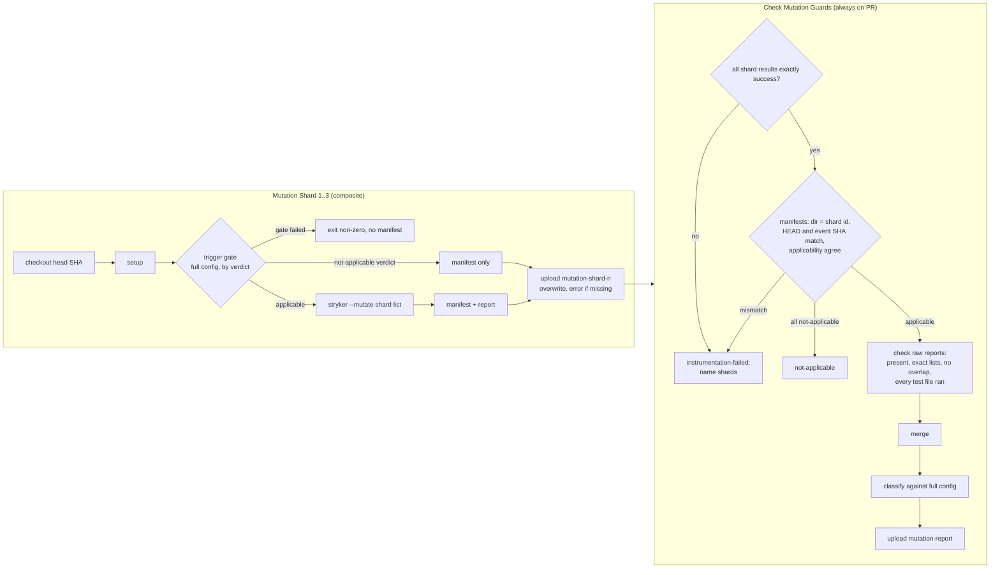

# perf(ci): run the PR mutation gate as three Stryker shards

## Overview

The required check `Check Mutation Guards` runs Stryker on the full `mutate` list in one job with 4 Stryker test runners. Most of its 700–925 s goes to Vitest's per-run overhead. This plan splits the Stryker run into three shard jobs. A final job, still named `Check Mutation Guards`, checks the three reports, merges them and classifies the result with today's fail-closed rules. The local `bun run check:mutation-guards` stays a single full run.

## Problem Frame

See origin: `docs/brainstorms/2026-11-08-sharded-mutation-gate-requirements.md`. #4138 cut about 13% by making four targets cheap. A probe then showed two things. `isolate: false` is a no-go. Two shards cut Stryker wall time by about 48%, and their merged report classifies `clean` with zero status flips.

## Requirements Trace

- R1–R3. Three parallel shards on `pull_request`. Each checks out the PR head commit and runs its committed subset with the full `testFiles`. Applicability is decided per shard from the full config. (Units 2, 4)
- R2. Every `mutate` entry belongs to exactly one shard, and a test pins it (Unit 1). A second test pins that a shard's Stryker argv never overrides `testFiles` (Unit 2).
- R4. The shard lists, the shard and merge modules, their entrypoints and the composite are trigger files. (Units 1–4)
- R5. Only the final job sets the PR status, and per-shard results never overwrite each other. (Unit 4)
- R6–R8. The final job runs on every PR whatever the shard results. It fails, naming the shard, when a shard did not succeed or its head commit differs. It fails when the shards disagree on applicability. When every shard is not-applicable, so is the final job. (Units 3, 4)
- R9–R11. The raw reports are checked before the merge, including a missing or unreadable report. The merged report is classified against the full config, and a test file any shard ran zero times fails. The merged report uploads as `mutation-report`. (Units 3, 4)
- R12. The local command gives a single full run with today's verdict. (Unit 2)
- R13. The docs say how shards are assigned and rebalanced. (Unit 5)
- Success criterion 1. Wall time at least 30% below the 858 s median of runs 42392597566, 42411246900 and 42422641309, with verdicts unchanged. (Unit 6)
- Success criterion 2. A deliberately broken guard in any shard fails the final job. (Unit 3, with a fixture survivor in each of shards 1, 2 and 3)

## Acceptance Examples Trace

| Example | Unit | Scenario |
| --- | --- | --- |
| AE1. Docs-only PR gives not-applicable | 2, 3 | Unit 2 "a not-applicable shard writes only the manifest and never spawns"; Unit 3 "three not-applicable manifests give not-applicable and exit 0" |
| AE2. Renovate `bun.lock` bump runs all shards and merges clean | 3, 6 | The existing `check-mutation-guards.test.ts:990` ("proceeds to run when the changed set includes only `bun.lock`") covers applicability; Unit 3 "three clean shard reports merge into `clean`"; Unit 6 live |
| AE3. A survivor in shard 2 fails the final job | 2, 3 | Unit 2 "a report written while Stryker exits non-zero is still copied, and the shard exits 0"; Unit 3 "a survivor in shard 2's report gives `mutants-survived` and exit 1" |
| AE4. A cancelled shard fails the final job and names it | 3, 4, 6 | Unit 3 "one result is `failure`, `cancelled` or `skipped`"; Unit 4 `if` and `needs` pins; Unit 6 live |
| AE5. An unassigned `mutate` entry fails the coverage test | 1 | "an entry in no shard fails and names it" |
| AE6. The local command is one full run | 2 | "with no shard id, the existing CLI and gate behave as before" |
| AE7. A test file one shard ran zero times fails | 3 | "shard 2 ran a configured test file zero times while shards 1 and 3 ran it" |
| AE8. A re-run of the failed shard merges with the first attempt's reports | 3, 6 | Unit 3 "three manifests on the event head SHA merge"; Unit 6 live re-run |

## Scope Boundaries

- No change to the classifier's verdict rules, precedence or output format.
- No runtime shard count and no automatic rebalancing.
- No job-attempt history reads. Re-run safety comes from per-shard artifacts and shard results (see Key Technical Decisions).
- A cancelled whole run leaves the check cancelled, as today. `always()` cannot make a cancelled run's final job complete.

### Deferred to Separate Tasks

- Making the slow killed mutants cheaper (36–42 s against a timeout of about 43 s), in the style of #4138.
- PR scoping, a full run on `main`, incremental caching.

## Context & Research

### Relevant Code and Patterns

- `packages/ci-checks/src/check-mutation-guards.ts` (1,785 lines, not mutated).
  - Reuse `evaluateTriggerGate`, `classifyMutationReport`, `readStrykerConfig`, `readMutateFileContents`, `scanDirectiveViolations` and `flattenReport` as they are.
  - `evaluateTriggerGate` returns `undefined` for "applicable", and a sentinel `ClassificationResult` for both outcomes it stops on: `not-applicable` (`NotApplicable`) and `instrumentation-failed` (`ChangedFileGateFailed`).
  - `runMutationGuardCheck` fuses the trigger gate, the report delete, the spawn, the read and the classification, and it hardcodes `strykerConfigPath()`. It returns without printing, and `check-mutation-guards-cli.ts` prints.
  - `defaultStrykerSpawner` takes no arguments, and a test pins its argv (`check-mutation-guards.test.ts`).
  - `extractReportFileKeys`, `extractReportTestFileCounts`, `readMutationReport` and `normalizeMutatePath` are private.
  - `FIXED_TRIGGER_FILES` is not exported. `check-mutation-guards.test.ts` holds two lists that enumerate it, and both are presence checks that must gain the new files.
  - `buildTriggerSet` adds `FIXED_TRIGGER_FILES` as a flat list and walks import closures only from `mutate` and `testFiles` entries.
- Classifier semantics:
  - `AbsentFromReport` means a literal `mutate` entry has no key in `files`.
  - `TestFileNotExecuted` means a configured test file whose `testFiles` entry is missing or has zero tests.
  - `killedBy` and `coveredBy` hold test ids. The probe found ids stable across shards apart from 2 timestamp-named tests.
- `packages/ci-checks/src/check-mutation-guards-cli.ts`. Its tests pin zero options, so shard and merge get their own CLIs rather than new flags. Its test stubs `node:child_process` so nothing spawns Stryker.
- Stryker 10.1.1:
  - `-m, --mutate a,b` is a comma-separated override of `mutate`, and `testFiles` is a separate option.
  - It has no report-path option. The JSON report path comes only from config (`reports/mutation/mutation.json`).
  - `--dryRunOnly` returns before the report is written, so it cannot show `files` keys.
  - Default concurrency is the available parallelism when that is 4 or fewer, so a 4-vCPU runner has 4 test runners.
- Workflow patterns to follow:
  - `.github/workflows/survey-repo.yaml` `survey-persist`: `needs` with `if: always()` and `needs.<job>.result`.
  - `.github/workflows/release-wiki-write-core.yaml`: build, then publish, with an artifact handoff.
  - `.github/workflows/private-leak-sentinel.yaml`: the only checkout of `github.event.pull_request.head.sha`.
  - Every composite `run:` step in `.github/actions/*/action.yaml` declares a `shell:`.
- `scripts/main-workflow.test.ts` pins the current job's `if`, run step, upload and timeout. `@fro-bot/test-kit` `evaluateExpression` has no status functions and throws on `always()`.
- `.github/workflows/main.yaml` has a `concurrency` group with `cancel-in-progress` off `main`. The `mutation-report` upload keeps `retention-days: 7`.
- Registration, in `packages/ci-checks/src/mutation-guards-config.test.ts`:
  - Test 1 makes every new `packages/*/src` module go into `mutate` or `not-mutated`.
  - Test 2 enforces only scripts named `check-*.ts`, `wiki-*-gates.ts`, `mutation-guards-*.ts` and `build-wiki-write-core.ts`. It does not match `mutation-shard*` or `mutation-merge*`.
  - Test 3 needs a relative-import test for every `mutate` entry.
  - `mutation-guards.json` is already a fixed trigger.

### Institutional Learnings

- `docs/plans/2026-09-04-001-feat-counterexample-proven-guards-plan.md` (complete): a full run on every applicable PR, with fail-closed verdicts. Unchanged here.
- `docs/solutions/best-practices/a-mutation-score-can-measure-nothing-2026-09-08.md`: unreachable mutants and timeouts must fail. This is why each shard keeps the full `testFiles` and a zero-run file fails.
- `docs/solutions/workflow-issues/quoted-required-status-check-context-2026-06-09.md`: the job `name` is the required context, and applicability stays visible inside the job, not as a job-level skip.
- `docs/solutions/best-practices/moving-a-script-into-a-workspace-package-changes-its-contract-2026-11-05.md`: six-line `import.meta.main` shims, CLI parity, and new modules classified for Stryker.

## Prior-Art Survey

```json
{
  "schema_version": 2,
  "verdict": "extend",
  "scope": "fro-bot/.github: packages/ci-checks, scripts/, .github/workflows, .github/actions, packages/test-kit, stryker.config.json, mutation-guards.json, docs/solutions",
  "freshness": {
    "vcs_reference": "f506169"
  },
  "budget": {
    "max_search_passes": 7,
    "max_candidate_inspections": 14,
    "exhausted": false
  },
  "candidates": [
    {
      "path_or_symbol": "packages/ci-checks/src/check-mutation-guards.ts#classifyMutationReport",
      "description": "Fail-closed classification of a mutation report against the config",
      "disposition": "reuse"
    },
    {
      "path_or_symbol": "packages/ci-checks/src/check-mutation-guards.ts#evaluateTriggerGate",
      "description": "Changed-file applicability against the full trigger set",
      "disposition": "reuse"
    },
    {
      "path_or_symbol": "packages/ci-checks/src/check-mutation-guards.ts#runMutationGuardCheck",
      "description": "Fused gate, spawn and classification entry",
      "disposition": "extend"
    },
    {
      "path_or_symbol": "packages/ci-checks/src/check-mutation-guards.ts#defaultStrykerSpawner",
      "description": "Stryker child-process spawn without arguments",
      "disposition": "extend"
    },
    {
      "path_or_symbol": "packages/ci-checks/src/check-mutation-guards.ts#FIXED_TRIGGER_FILES",
      "description": "Gate files that always make the gate applicable",
      "disposition": "extend"
    },
    {
      "path_or_symbol": "packages/ci-checks/src/check-mutation-guards-cli.ts#checkMutationGuardsCli",
      "description": "Gate CLI whose tests pin zero options",
      "disposition": "insufficient",
      "insufficiency_reason": "Adding shard or merge options breaks the pinned zero-option contract; separate CLIs keep it."
    },
    {
      "path_or_symbol": ".github/workflows/survey-repo.yaml#survey-persist",
      "description": "needs with always() and per-job result checks",
      "disposition": "reuse"
    },
    {
      "path_or_symbol": ".github/workflows/codeql-analysis.yaml#analyze",
      "description": "Single-value strategy matrix",
      "disposition": "insufficient",
      "insufficiency_reason": "Matrix job outputs and results aggregate across legs, so they cannot name the failing shard."
    }
  ]
}
```

## Key Technical Decisions

- **Three named shard jobs on one composite action, not a matrix.** `needs.<job>.result` is per job, so the final job can name the failing shard. Matrix results and outputs aggregate across legs. A composite (`.github/actions/mutation-shard`) keeps the three jobs to a few lines each. Every `run:` step in it declares `shell: bash`.
- **The shard acts on the trigger gate's verdict, never just on whether a result came back.** `evaluateTriggerGate` returns the same sentinel shape for `not-applicable` and for `ChangedFileGateFailed`.
  - Only an explicit `not-applicable` verdict writes a not-applicable manifest.
  - A `ChangedFileGateFailed` or any other non-applicable sentinel exits non-zero and writes no manifest.
  - Otherwise a fetch failure would make all three shards agree on `not-applicable`, and the final job would pass where one full run fails.
  - The composite passes `GH_TOKEN` (`github.token`) to the shard step through `env:`, because the changed-file fetch needs it.
- **Re-run safety without job-attempt history.**
  - Each shard uploads `mutation-shard-<n>` (manifest plus report) with `overwrite: true` and `if-no-files-found: error`, and only when its run step succeeds.
  - The final job trusts a shard's artifact only when that shard's result is `success`, and it checks every result before it reads any artifact.
  - A shard that succeeds in an attempt has just written its artifact, and a shard that fails cannot be trusted at all. So "re-run failed jobs" and "re-run all jobs" both merge only fresh or same-run successful evidence.
- **Re-run assumption, accepted and verified live.** A re-run of a superseded run sets the status of that run's own commit only. Two further behaviours are assumed: `needs` results are right after "re-run failed jobs", and a re-run attempt downloads the `latest` artifact of each name. Unit 6 verifies all three before the PR is called done. The no-job-attempt-API decision stands.
- **The manifest binds each shard to its commit.**
  - It records the shard id, the checked-out `HEAD` from `git rev-parse HEAD` in the shard's checkout, the event head SHA and the applicability state.
  - The final job requires the manifest's `HEAD` and its event head SHA each to equal the event head SHA the final job receives. A shard that fell back to the merge commit fails on `HEAD`.
- **Shards narrow only `mutate`.** The spawner adds only `--mutate <comma list>` after the config argument. `testFiles` and the rest of the config are unchanged, so every configured test runs in each dry run, and the shard's argv never overrides `testFiles`.
- **The report stays at the configured path.** Stryker has no report-path option, so each shard deletes `reports/mutation/mutation.json` before the spawn, as `runMutationGuardCheck` does, and copies it into its output directory afterwards.
- **A shard's exit does not carry the mutant verdict.** It exits non-zero only on infrastructure failure: a trigger error, a spawn error, or a missing or unreadable report. A survivor is the final job's verdict, which matches today's rule that Stryker's exit code is informational.
- **Infrastructure failures in the final job are `instrumentation-failed`.** Every check before the merge fails with that verdict, a fixed reason and the shard ids involved, in the same sentinel shape as the trigger gate. The final job never classifies a merged report in that case.
- **Artifact contract.**
  - The shard writes `manifest.json` and, when applicable, `mutation.json` into its output directory, and uploads it as `mutation-shard-<n>`.
  - The final job downloads with `pattern: mutation-shard-*` and no `merge-multiple` into a directory outside `reports/mutation/`, so each shard keeps its own directory and the raw reports never reach the `mutation-report` upload.
  - A pattern download does not fail on zero matches, so the merge treats a missing shard directory as a failure naming the shard.
  - Each manifest's shard id must equal the shard named by its directory.
- **Merge rules.** `files` is a disjoint union. `testFiles` keeps each configured file's entry from the shard that ran it the fewest times, and a file missing from any shard fails before the merge. `killedBy` and `coveredBy` ids are kept as written. The shard reports upload unmerged as evidence.
- **Post-spawn classification becomes an exported seam in `check-mutation-guards.ts`.** It covers the report read, directive scan, missing-file check and `classifyMutationReport`, and it returns the result and prints nothing. `runMutationGuardCheck` calls it after its spawn. The existing CLI and the merge CLI each print once and append the step summary once, so the local run does not print twice.
- **Shard lists live under a `shards` key in `mutation-guards.json`.** That file is already a fixed trigger, and the inventory test already reads it.
- **New logic lives in new mutated modules:** `mutation-shard-lists.ts` (the list reader), `mutation-shard.ts` and `mutation-merge.ts`. Each is in `mutate` with its test in `testFiles` and sits in one shard list. Their `*-cli.ts` modules and the shims are `not-mutated`. The CLIs, the shims and the composite are in `FIXED_TRIGGER_FILES`, and a config test pins that.

## Open Questions

### Resolved During Planning

- Whole-run cancellation: accepted as today. The superseded run stays cancelled, and the new head's run supplies the check.
- `mutation-report` name: kept for the merged report. The only consumer in the repo is the `scripts/main-workflow.test.ts` assertion.
- `always()` in tests: the test-kit evaluator is not extended. The workflow test pins the final job's literal `if` string, and the live check in Unit 6 covers status behaviour.

### Deferred to Implementation

- Whether `--mutate a,b` yields exactly the same `files` keys as the config entries, for example `./` normalization. A spike at the start of Unit 2 runs Stryker on a two-entry subset. The final job's exact-key check is the runtime backstop.
- How `upload-artifact` with `overwrite: true` behaves when a shard re-uploads in a re-run attempt, and whether a re-run attempt downloads the `latest` artifact. Unit 6 verifies both live.
- The initial three-way balance. Unit 1 computes it from the probe's per-mutant `baseline.json` as Σduration plus 0.45 s per mutant.

## High-Level Technical Design

> _This illustrates the intended approach and is directional guidance for review, not implementation specification. The implementing agent should treat it as context, not code to reproduce._



## Implementation Units

- [ ] **Unit 1: Shard inventory and coverage test**

**Goal:** Commit three shard lists and a test that pins them as an exact partition of `mutate`.

**Requirements:** R2, R4

**Dependencies:** None

**Files:**

- Modify: `mutation-guards.json` (new `shards` key holding three ordered lists)
- Modify: `stryker.config.json` (`mutate` gains `mutation-shard-lists.ts`, `testFiles` gains its test)
- Modify: `packages/ci-checks/src/mutation-guards-config.test.ts`
- Modify: `packages/ci-checks/src/check-mutation-guards.ts` (export `FIXED_TRIGGER_FILES`)
- Create: `packages/ci-checks/src/mutation-shard-lists.ts`, a reader that returns the parsed lists or throws on a bad shape
- Test: `packages/ci-checks/src/mutation-shard-lists.test.ts`

**Approach:**

- Balance the lists from the probe's per-mutant `baseline.json`: per-entry Σduration plus 0.45 s × mutants, greedy into three shards. The probe file is local and untracked, so only the resulting lists are committed, and the commit message records the estimated cost of each shard. The CI `mutation-report` of run 42422641309 keeps `retention-days: 7` and may have expired.
- The new reader sits in one of the lists itself.
- The reader is shared by the shard CLI, the merge CLI and the test.

**Patterns to follow:** the existing `not-mutated` reader and the inventory tests in `mutation-guards-config.test.ts`.

**Test scenarios:**

- Happy path: the committed lists cover every `mutate` entry exactly once.
- Error path: an entry in no shard fails and names it (AE5).
- Error path: an entry in two shards fails.
- Error path: a shard path not in `mutate` fails.
- Error path: fewer or more than three shards fails.
- Error path: an empty shard list is rejected by the reader.
- Error path: a non-array or non-string shard is rejected by the reader.

**Verification:** the test fails when one entry moves out of every shard. The lists' estimated costs are within 10% of each other. `bun run check:mutation-guards` passes the registration tests.

- [ ] **Unit 2: Shard run mode**

**Goal:** One shard can run the gate on its subset and publish a manifest plus report, while the local single run is unchanged. This unit also commits the artifact contract and the report fixtures that Unit 3 builds on.

**Requirements:** R1, R2, R3, R4, R12

**Dependencies:** Unit 1

**Files:**

- Create: `packages/ci-checks/src/mutation-shard.ts`, `packages/ci-checks/src/mutation-shard-cli.ts`, `scripts/mutation-shard.ts`
- Create: trimmed real-report fixtures under `packages/ci-checks/fixtures/`, built from the probe's shard reports
- Modify: `packages/ci-checks/src/check-mutation-guards.ts`. `defaultStrykerSpawner` accepts extra argv, and `FIXED_TRIGGER_FILES` gains the new CLI and shim.
- Modify: `stryker.config.json` (`mutate` gains `mutation-shard.ts`, `testFiles` gains both new tests), `mutation-guards.json` (`not-mutated` gains the CLI and shim, and `shards` assigns the new entry)
- Modify: `packages/ci-checks/package.json` exports, `packages/ci-checks/src/check-mutation-guards.test.ts` (spawner argv pin and the fixed-trigger lists), `packages/ci-checks/src/mutation-guards-config.test.ts` (the fixed-trigger assertion below)
- Test: `packages/ci-checks/src/mutation-shard.test.ts`, `packages/ci-checks/src/mutation-shard-cli.test.ts`

**Approach:**

- Spike first. Run Stryker once on a cheap two-entry `--mutate` subset and record the `files` keys in the PR body. They must equal the entries. `--dryRunOnly` cannot be used, because Stryker returns before it writes the report. Freeze the spawner design after the spike.
- Inputs come from env: shard id, event head SHA, and an output directory under `RUNNER_TEMP`.
- The shard decides applicability with `evaluateTriggerGate` on the full config and acts on the returned verdict:
  - `undefined` is applicable;
  - an explicit `not-applicable` verdict writes a manifest and stops;
  - any other result, `ChangedFileGateFailed` included, exits non-zero and writes no manifest.
- When the gate applies, the shard deletes any old report at the configured path, spawns Stryker with `--mutate <shard list>` only, and copies the report into the output directory.
- The manifest holds the shard id, the `git rev-parse HEAD` value, the event head SHA and the applicability state. This unit fixes the schema, the field names and the directory layout (`manifest.json` and `mutation.json` in `mutation-shard-<n>`), and Unit 3 reads them.
- With no shard id set, the existing CLI and `runMutationGuardCheck` behave exactly as today.
- Unit tests stub the spawn the way `check-mutation-guards-cli.test.ts` does. They never start a nested Stryker. The final job's exact-key check is the runtime backstop for the `--mutate` keys.

**Execution note:** characterization first. The existing `check-mutation-guards` tests must pass unchanged, apart from the spawner argv pin, which gains an empty-extra-args case.

**Patterns to follow:** `runMutationGuardCheck` seams (`spawner`, env), and six-line `import.meta.main` shims such as `scripts/check-mutation-guards.ts`.

**Test scenarios:**

- Happy path: an applicable shard spawns Stryker with exactly its list and writes a manifest (`applicable`, `HEAD` and event SHA) plus the report.
- Happy path: a not-applicable shard writes only the manifest and never spawns (AE1).
- Happy path: with no shard id, the existing CLI and gate behave as before (AE6).
- Edge case: when the trigger gate is computed with a shard's subset, it would differ from the full config, and a test pins that the shard uses the full config.
- Edge case: the shard's Stryker argv adds `--mutate` only and never overrides `testFiles`.
- Edge case: the shard deletes any old report before the spawn and copies the report that the spawn wrote.
- Error path: a `ChangedFileGateFailed` result, or any other non-applicable sentinel, exits non-zero and writes no manifest.
- Error path: a trigger fetch failure exits non-zero and writes no `not-applicable` manifest.
- Error path: a spawn failure, or a missing or unparseable report after the spawn, exits non-zero.
- Error path: a report written while Stryker exits non-zero is still copied, and the shard exits 0 (AE3).
- Error path: an unknown shard id or a missing event SHA is a usage error.
- Integration: the shim spawned from a path with a space runs through `import.meta.main`. It runs with no shard environment, so it exits on the usage error and never reaches Stryker.
- Config test: every `scripts/mutation-shard*.ts` and `scripts/mutation-merge*.ts` file, and each `packages/ci-checks/src/mutation-{shard,merge}-cli.ts`, is in `FIXED_TRIGGER_FILES`. Tests 1 and 2 do not match those names. Units 3 and 4 satisfy it as they add files.

**Verification:** a local run with no shard id gives the same verdict and output as before. The new modules score 100% in Stryker.

- [ ] **Unit 3: Merge-and-classify mode**

**Goal:** Turn three shard artifacts into one verdict through today's classifier path.

**Requirements:** R6–R11, success criterion 2

**Dependencies:** Units 1, 2

**Files:**

- Create: `packages/ci-checks/src/mutation-merge.ts`, `packages/ci-checks/src/mutation-merge-cli.ts`, `scripts/mutation-merge.ts`
- Modify: `packages/ci-checks/src/check-mutation-guards.ts`. Export the post-spawn classification seam and the private report readers it needs. `runMutationGuardCheck` calls the seam, and `FIXED_TRIGGER_FILES` gains the merge CLI and shim.
- Modify: `stryker.config.json` (`mutate`, `testFiles`), `mutation-guards.json` (`not-mutated`, `shards`), `packages/ci-checks/package.json`
- Modify: `packages/ci-checks/src/check-mutation-guards.test.ts` (fixed-trigger lists), `packages/ci-checks/src/check-mutation-guards-cli.test.ts` (print-once scenario)
- Test: `packages/ci-checks/src/mutation-merge.test.ts`, `packages/ci-checks/src/mutation-merge-cli.test.ts`

**Approach:**

- Inputs: the artifact directory, the event head SHA, and the three shard results passed from `needs.*.result`.
- Check order, each failing as `instrumentation-failed` with a fixed reason and the shard ids involved. The final job never classifies a merged report when one fails.
  1. each shard result is exactly `success`; any other value, including an empty or unknown one, fails;
  2. each `mutation-shard-<n>` directory is present;
  3. manifests present and parseable, and each manifest's shard id equals its directory's shard;
  4. the manifest's `HEAD` and its event SHA each equal the event head SHA given to the final job;
  5. applicability agreement;
  6. a runtime partition check against the config;
  7. each report present and parseable;
  8. each report's `files` keys equal to its shard list;
  9. no overlap;
  10. every configured literal test file has a non-empty entry in each report.
- The result checks run before the merge reads any artifact file.
- Merge, write the result to the configured report path, then run the classification seam. The seam returns the result, and the merge CLI prints it once.
- When all three shards are not-applicable, print the existing not-applicable result and exit 0. A missing shard directory is never read as not-applicable.

**Execution note:** test-first. Build the fixtures from the trimmed real-report fixtures that Unit 2 committed.

**Patterns to follow:** `classifyMutationReport` result shapes and `printResult` output, including the job summary.

**Test scenarios:**

- Happy path: three clean shard reports merge into `clean`. The merged `files` has every entry once (AE2).
- Happy path: three manifests on the event head SHA merge (AE8).
- Happy path: three not-applicable manifests give not-applicable and exit 0 (AE1).
- Error path: one result is `failure`, `cancelled` or `skipped`. The job fails, names that shard, and does not classify (AE4).
- Error path: any result value other than `success`, `failure`, `cancelled` or `skipped`, including an empty one, fails and names the shard.
- Error path: all three results are `skipped`. The job fails and names all three; it never reports not-applicable.
- Error path: a stale artifact is present and its shard's result is `failure`. The job fails on the result and reads no artifact file.
- Error path: the results are `success` and a pattern download matched nothing. The job fails and names every shard.
- Error path: a missing or malformed manifest fails and names the shard.
- Error path: a manifest whose shard id differs from its directory fails.
- Error path: a manifest `HEAD` or event SHA that differs from the event head SHA fails; a merge-commit `HEAD` fails.
- Error path: mixed applicability fails.
- Error path: a missing report, or an unparseable report, fails and names the shard.
- Error path: a report key outside its shard's list fails, and so does an entry missing from its shard's report.
- Error path: two reports covering the same entry fails.
- Error path: shard 2 ran a configured test file zero times while shards 1 and 3 ran it. The job fails with an unexecuted test file (AE7).
- Error path: a fixture survivor in shard 1, 2 or 3 each gives `mutants-survived` and exit 1 (AE3, success criterion 2).
- Error path: a Timeout gives `mutant-timeout`.
- Integration: classifying the probe's two-shard merged fixture gives the same verdict and printed output as classifying its single-run baseline fixture.
- Seam: the single-run CLI prints once and appends the step summary once after the seam extraction.

**Verification:** each check above is killed by a hand mutation, the module scores 100% in Stryker, and the classification seam leaves the existing gate tests green.

- [ ] **Unit 4: Workflow job graph**

**Goal:** Replace the single job with three shard jobs and the final required job.

**Requirements:** R1, R4, R5, R6, R11

**Dependencies:** Units 2, 3

**Files:**

- Create: `.github/actions/mutation-shard/action.yaml`
- Modify: `.github/workflows/main.yaml`
- Modify: `scripts/main-workflow.test.ts`
- Modify: `packages/ci-checks/src/check-mutation-guards.ts` `FIXED_TRIGGER_FILES` (the composite), `packages/ci-checks/src/check-mutation-guards.test.ts` (fixed-trigger lists), `packages/ci-checks/src/mutation-guards-config.test.ts` (the composite joins the fixed-trigger assertion)

**Approach:**

- Shard jobs:
  - Three jobs named `Mutation Shard 1`, `Mutation Shard 2` and `Mutation Shard 3`, each with `if: github.event_name == 'pull_request'`, `contents: read` and `pull-requests: read`, and a 20-minute timeout.
  - Each checks out `github.event.pull_request.head.sha`, then runs the composite.
- The composite:
  - declares `shell: bash` on every `run:` step;
  - runs Setup and the shard shim, with inputs passed through `env:` and `GH_TOKEN` set to `github.token` on the shard step;
  - uploads `mutation-shard-<n>` with `overwrite: true` and `if-no-files-found: error`;
  - uploads only on success.
- Final job:
  - `check-mutation-guards`, named `Check Mutation Guards`, with `needs` on all three and `if: always() && github.event_name == 'pull_request'`.
  - It checks out the head SHA and runs Setup.
  - It downloads with `pattern: mutation-shard-*` and no `merge-multiple`, into a directory outside `reports/mutation/`.
  - It runs the merge shim with each `needs.<shard>.result` and the event SHA through `env:`.
  - It uploads `mutation-report` with `overwrite: true`.
- `.github/settings.yml` is unchanged.

**Patterns to follow:** `survey-repo.yaml` `survey-persist`, the `release-wiki-write-core.yaml` artifact handoff, and `${{ }}` only in `env:` and `with:`, never in `run:`.

**Test scenarios:**

- Happy path: the final job's name is exactly `Check Mutation Guards` and matches `settings.yml`.
- Happy path: the final job's `if` is the literal string `always() && github.event_name == 'pull_request'`, and its `needs` lists all three shard jobs.
- Happy path: every shard and the final job check out `github.event.pull_request.head.sha`.
- Happy path: the shard uploads use `overwrite: true` and `if-no-files-found: error`, and the merge step receives each shard's result by name.
- Happy path: the final job downloads with `pattern: mutation-shard-*`, no `merge-multiple`, and a path outside `reports/mutation/`.
- Happy path: the composite passes `GH_TOKEN` to the shard step through `env:`.
- Edge case: every `run:` step in the composite declares `shell: bash`.
- Edge case: no `${{` appears in any `run:` of the new jobs or the composite.
- Edge case: permissions are no broader than today's job.
- Config test: `.github/actions/mutation-shard/action.yaml` is in `FIXED_TRIGGER_FILES`.

**Verification:** `actionlint` is clean, and the workflow tests fail if any one of the three `needs` entries or the `always()` is removed.

- [ ] **Unit 5: Docs and registration**

**Goal:** Describe shard assignment and rebalancing wherever the gate is documented.

**Requirements:** R13

**Dependencies:** Units 1–4

**Files:**

- Modify: `.github/copilot-instructions.md`, `packages/ci-checks/README.md` (component diagram, and "Adding a module" names the shard assignment step), `README.md`, `llms.txt`, `packages/core/README.md` where it describes the gate, `docs/solutions/workflow-issues/quoted-required-status-check-context-2026-06-09.md` (its `Check Mutation Guards` section describes the job shape), and the origin requirements doc's success-criteria status
- Check, and edit only where one describes a single mutation job:
  - `docs/solutions/best-practices/a-mutation-score-can-measure-nothing-2026-09-08.md`
  - `docs/solutions/security-issues/mutation-coverage-is-silent-about-unwritten-branches-2026-09-05.md`
  - `docs/solutions/best-practices/enumerate-mutator-variants-before-a-stryker-directive-2026-09-05.md`

**Approach:** state facts only. Cover where the lists live, that a new `mutate` entry must join one shard, and how to rebalance from a CI report. Update the `@fro-bot/ci-checks` CLI count where the docs state it.

**Test scenarios:** Test expectation: none, because this unit is documentation only. Lint and markdown checks must pass.

**Verification:** `bun run lint` is clean, and no doc still describes a single mutation job.

- [ ] **Unit 6: Live verification on the PR**

**Goal:** Prove the timing target and the re-run behaviour on GitHub.

**Requirements:** Success criteria, R6–R8

**Dependencies:** Units 1–5

**Files:** Test expectation: none. This unit measures; it may change the shard lists in `mutation-guards.json` and nothing else.

**Approach:**

- On the PR's own runs, record each shard's duration, the final job's duration and the end-to-end wall time, from the first shard's start to the final job's end. Compare against the 858 s median. Runs with a dry run within 10 s of each other count as comparable.
- After the first CI run, rebalance the lists if one shard runs more than 20% over the mean of the three.
- Verify the re-run behaviour live, before the PR is called done:
  - cancel one shard, then use "re-run failed jobs", and confirm the final job sees the right `needs` results and merges the fresh artifact;
  - confirm the re-run attempt downloads the `latest` artifact of each name;
  - confirm a re-run of a superseded run sets the status of that run's own commit only, and whether it enters the `main.yaml` concurrency group and cancels the current head's run.
- Record the results in the PR body.

**Verification:** wall time is at least 30% below 858 s on comparable runners. A cancelled shard fails the final job and names that shard. After a re-run the final job classifies `clean`.

## System-Wide Impact

- **Interaction graph:** `main.yaml` gains four jobs and loses one. `Check Mutation Guards` stays the only required context.
- **Error propagation:** shard infrastructure failures become a failed shard result. The final job turns those into `instrumentation-failed` with a fixed reason and the shard ids, and never classifies a merged report. A shard never decides a mutant verdict.
- **Unchanged invariants:**
  - the classifier's verdict rules and precedence;
  - the local `bun run check:mutation-guards`;
  - `stryker.config.json` `testFiles`, which every shard keeps in full;
  - the trigger rules;
  - the `mutation-report` artifact name;
  - `.github/settings.yml`.

## Risks & Dependencies

| Risk | Mitigation |
| --- | --- |
| `--mutate` keys differ from the config entries | The Unit 2 spike on a two-entry subset, and the final job's exact-key check fails closed. |
| A gate failure becomes a `not-applicable` manifest, and the final job passes where one full run fails | The shard acts on the verdict, and only an explicit `not-applicable` writes a manifest. Unit 2 scenarios cover each case. |
| A skipped final job would pass the required check | `always()` on the final job, pinned by a workflow test. |
| A stale or crossed artifact is merged | Uploads only on success with `overwrite: true`, result checks before any artifact read, per-shard directories, and a shard id check. Verified live in Unit 6. |
| A new gate file is not a trigger file, so a PR that changes only it reads not-applicable | The new modules sit in `mutate`, and a config test pins the CLIs, shims and composite in `FIXED_TRIGGER_FILES`. |
| Three shards come in below the 30% target | Unit 6 measures it and rebalances above 20% over the mean. The verdict rules never change to meet the target. |
| The workflow change needs approval | Asked at the push gate, as for every CI change. |

## Sources & References

- **Origin document:** `docs/brainstorms/2026-11-08-sharded-mutation-gate-requirements.md`
- Probe artifacts: `.context/mutation-overhead/probe/out/`, local only and untracked.
- Related past work:
  - `docs/plans/2026-11-07-001-refactor-cheaper-mutation-targets-plan.md`, recorded active. That plan made four targets cheap; this one changes the job shape.
  - `docs/plans/2026-09-04-001-feat-counterexample-proven-guards-plan.md`, recorded complete. Its full-run, fail-closed design is kept.
- Related PRs: #4138.
- GitHub docs: https://docs.github.com/en/actions/how-tos/manage-workflow-runs/re-run-workflows-and-jobs
