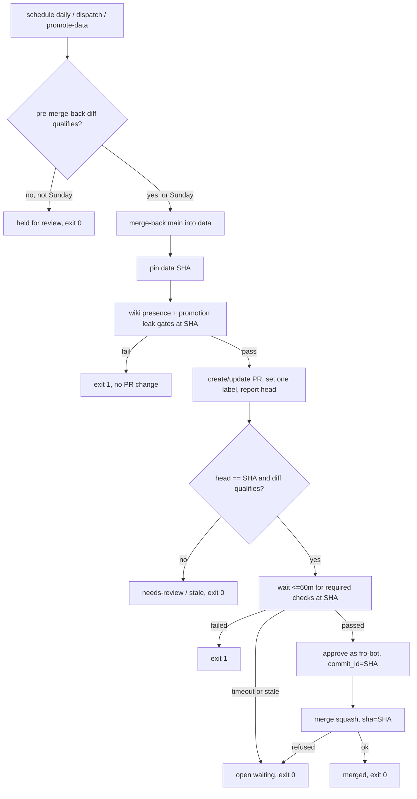

# feat: merge knowledge/metadata promotions in the promotion run and report protection drift

## Overview

`Merge Data Branch` runs daily. Each run fixes one `data` commit and checks it with both promotion leak gates. If that commit's diff touches only `knowledge/` and `metadata/`, the run waits for the required checks on that exact commit, approves as `fro-bot` and squash-merges pinned to it. A promotion that doesn't qualify keeps waiting for the operator, and its head moves only on the weekly run.

A new workflow watches `main` branch-protection edits. It opens one issue when someone other than the settings automation changes the rule, and closes the issue when a later settings write restores the drifted fields.

## Problem Frame

See origin: `docs/brainstorms/2026-11-09-promotion-self-merge-requirements.md`. Today:

- The operator approves and merges every promotion by hand.
- `strict: true` leaves promotions behind until the weekly run.
- A web-session edit to `main` protection twice left the review requirement unenforced for hours, and nothing reported it.

## Requirements Trace

| Origin | Units |
| --- | --- |
| R1 qualification from the live diff, renames, truncation, one label | 1, 2 |
| R2 gates and PR head on one commit | 1, 2 |
| R3 bounded wait on live required checks, superset of `settings.yml`, timeout ends in success | 3 |
| R4 approve as `fro-bot`, pinned | 3 |
| R5 merge pinned, refused on a moved head | 3 |
| R6 deterministic | 1, 3, 4 |
| R7 failures stay open | 2, 3 |
| R8 daily | 2 |
| R8a `needs-review` head moves weekly only; qualify before merge-back | 1, 2 |
| R9–R12 drift report | 4 |
| AE1–AE9 | Units 1–4 test scenarios; Unit 6 live |

## Scope Boundaries

- No change to `main` protection: no bypass, no lower approval count, `strict` unchanged.
- No native auto-merge.
- Renovate PRs, drafted-solution PRs, rulesets and repository-level settings stay out of scope.

### Deferred to Separate Tasks

- Renovate brief or auto-approval: its own brainstorm.
- Fixing `capture-learnings-harvest.ts`'s fail-open required-context read (about lines 1804–1817). It is unrelated to promotion, so it gets a separate issue.

## Context & Research

### Relevant Code and Patterns

- `.github/workflows/merge-data.yaml`:
  - one job with `timeout-minutes: 10`;
  - concurrency groups `merge-data-dispatch` (which cancels) and `merge-data-manual`;
  - steps in order: App token mint, checkout `main`, setup, merge-back, checkout `data`, wiki presence gate, fetch `data`, promotion leak gate, `merge-data-pr`.
- `packages/registry/src/merge-data-pr.ts`:
  - `mergeDataPr`, with the post-PR block copied three times (lines 137–178, 191–232 and 244–285);
  - `maybeUpdateBehindPullRequest`, which calls `updateBranch` after the gates;
  - `selectLabel` and `addLabel` (add-only);
  - `upsertAlertIssue`, which `merge-back-data.ts` consumes.
- `packages/registry/src/merge-back-data.ts`: mutated, in shard 0. It is the pattern for a gate-path decision module with a `*-cli.ts` and a six-line shim.
- `packages/privacy/src/check-private-leak.ts` `--promotion` and `check-wiki-private-presence.ts`:
  - they scan `origin/main...origin/data` and the `data` checkout;
  - they print no scanned SHA.
- `packages/core/src/retry.ts`: a bounded retry with an injectable `sleep`. It is the poll primitive to extend.
- `packages/wiki-ops/src/wiki-lint-issues.ts`: an open/comment/close issue lifecycle with fingerprint markers. Its shape fits the drift issue; its types don't.
- `.github/workflows/status-truth.yaml`: the pattern for a deterministic step using `GH_TOKEN: ${{ secrets.FRO_BOT_PAT }}` as step env.
- `GET repos/fro-bot/.github/branches/main` returns `.protection.required_status_checks.checks[]` to a write token: 14 contexts, all on Actions app 15368 except CodeQL on 57789.

### Institutional Learnings

- `docs/solutions/best-practices/privacy-gate-promotion-leak-prevention-2026-06-04.md`:
  - the promotion gates must scan the content that is promoted;
  - commit statuses can be spoofed by anyone with `statuses: write`, so a merge decision must not trust a status alone. R2 runs the gates in the same run, on the same commit.
- `docs/solutions/best-practices/review-shared-settings-against-effective-inherited-config-2026-10-09.md`: judge protection on the merged settings.
- `docs/plans/2026-10-20-001-fix-keep-data-branch-present-plan.md` (complete): merge-back stays App-authored, non-force and fail-closed.
- `docs/solutions/best-practices/repo-wide-app-token-scope-contract-2026-10-10.md`: App mints keep least privilege.

## Prior-Art Survey

```json
{
  "schema_version": 2,
  "verdict": "extend",
  "scope": "fro-bot/.github @ main: packages/*, scripts/, .github/workflows/, .github/actions/, settings.yml, common-settings.yaml, stryker.config.json, mutation-guards.json",
  "freshness": {
    "vcs_reference": "3150eb4c09b343ec77fbe3e26c896e88f2602f17",
    "scope_baseline": "origin/main 7c263b9 (#4162) is one commit ahead; its diff touches none of the candidate files except one mutate entry, one label and status-truth.yaml env"
  },
  "budget": {"max_search_passes": 10, "max_candidate_inspections": 14, "exhausted": false},
  "candidates": [
    {
      "path_or_symbol": ".github/workflows/merge-data.yaml#merge-data",
      "description": "Promotion run: App token, merge-back, two privacy gates, PR step",
      "disposition": "extend"
    },
    {
      "path_or_symbol": "packages/registry/src/merge-data-pr.ts#mergeDataPr",
      "description": "Creates/updates the data->main PR, updates a behind PR, applies labels; no head SHA in its result, add-only labels, renames and truncation ignored",
      "disposition": "extend"
    },
    {
      "path_or_symbol": "packages/registry/src/merge-data-pr.ts#upsertAlertIssue",
      "description": "Exact-title alert upsert that refreshes the body; no comment or close",
      "disposition": "extend"
    },
    {
      "path_or_symbol": "packages/registry/src/merge-back-data.ts#mergeBackData",
      "description": "Git Data merge of main into data at run start; mutated",
      "disposition": "reuse"
    },
    {
      "path_or_symbol": "packages/privacy/src/check-private-leak.ts#runPromotionCli",
      "description": "Promotion leak gate over origin/main...origin/data; prints no scanned SHA",
      "disposition": "extend"
    },
    {
      "path_or_symbol": ".github/workflows/check-private-leak.yaml",
      "description": "Posts the required Security: Private Leak Scan status per PR head",
      "disposition": "reuse"
    },
    {
      "path_or_symbol": "packages/core/src/retry.ts#retry",
      "description": "Bounded retry with injectable sleep; the only poll primitive",
      "disposition": "extend"
    },
    {
      "path_or_symbol": "packages/knowledge/src/capture-learnings-harvest.ts#getBranchProtection",
      "description": "Reads required contexts but fails open to an empty set",
      "disposition": "insufficient",
      "insufficiency_reason": "Swallows read errors; R3 requires a fail-closed read."
    },
    {
      "path_or_symbol": "packages/wiki-ops/src/wiki-lint-issues.ts#planIssueLifecycle",
      "description": "Fingerprinted issue open/comment/close lifecycle",
      "disposition": "insufficient",
      "insufficiency_reason": "Bound to wiki-lint report types; the drift ledger needs per-field restoration checks."
    },
    {
      "path_or_symbol": ".github/workflows/scorecard.yaml",
      "description": "Only branch_protection_rule consumer; no actor filter or alert",
      "disposition": "insufficient",
      "insufficiency_reason": "Runs Scorecard only; no classification or issue."
    },
    {
      "path_or_symbol": "common-settings.yaml#allow_auto_merge",
      "description": "Native auto-merge, enabled and unused",
      "disposition": "insufficient",
      "insufficiency_reason": "GitHub refuses to enable it on an already-clean PR, and it does not bind the merge to the commit the in-run gates checked."
    },
    {
      "path_or_symbol": ".github/workflows/fro-bot.yaml",
      "description": "LLM agent jobs",
      "disposition": "insufficient",
      "insufficiency_reason": "R6 forbids an LLM in the merge path."
    }
  ]
}
```

## Key Technical Decisions

- **One pinned `data` commit per run.**
  - After merge-back, the run reads `data`'s tip once.
  - The wiki presence gate checks out that SHA. The promotion leak gate fetches it and scans `origin/main...<sha>`.
  - Qualification reads `compare/main...<sha>`.
  - The self-merge step requires the PR head to equal that SHA.
  - Any later move of `data` stops the run, and the next run handles the new commit.
- **No `updateBranch` after the gates.** Merge-back already brings `data` up to date with `main`. If `main` moves during the wait, the PR goes behind and the run stops without merging.
- **The self-merge step is separate from `merge-data-pr`.** The PR step keeps creating and updating the PR, and changes only to replace labels and report the head SHA. This avoids threading new logic through its three copies.
- **`FRO_BOT_PAT` is used only on the self-merge step.** That step reads required checks, check runs and statuses, approves and merges. The App token stays on merge-back and the PR writes. `fro-bot` is a code owner, and the App pushes `data`, so the approval satisfies last-push.
- **Weekly window = a Sunday (UTC) run.** On any other day, a promotion whose pre-merge-back diff doesn't qualify is left alone. The run does no merge-back and no PR update, and ends with exit 0 and a "held for review" summary. A dispatch doesn't override the hold.
- **One concurrency group for every trigger, with no cancellation.** `timeout-minutes: 90` and a 60-minute wait bound. A queued dispatch then runs against the latest state.
- **Required-check list.** It is read from `branches/main` and must be a superset of the `main` contexts in `.github/settings.yml`, read from the checkout. The list is read again before the approval and before the merge.
- **Drift close uses the event's `rule` payload.** On a settings-automation event, the issue closes only when every drifted field recorded in the issue's ledger matches the value declared for `main`. The settings automation is matched by sender type and numeric ID, recorded during implementation. A manually closed issue plus new drift opens a new issue.

## Open Questions

### Resolved During Planning

- Merge method: squash, the only method enabled.
- Exit codes:
  - 0 for merged, no changes, held for review, timeout, a stale head or base, and a PR the operator merged;
  - 1 for a failed gate, a failed or unreadable required check, an unreadable protection, and any API failure.
- Where the drift issue lives: fro-bot/.github, labeled `protection-drift`, which is declared in `settings.yml`.

### Deferred to Implementation

- **The numeric IDs of `settings[bot]` and `fro-bot[bot]`.** Read them from a recorded `branch_protection_rule` run payload.
- **Whether `branch_protection_rule` payloads carry every field the ledger needs.** These are approvals, code owners, dismiss stale, last push, strict and contexts. If a field is missing, it stays open-ended, and only the operator closes the issue.
- **Whether a `FRO_BOT_PAT` approval satisfies code-owner review on an App PR.** Unit 6 proves it live, before the first unattended run.

## High-Level Technical Design

> _This illustrates the intended approach and is directional guidance for review, not implementation specification._



## Implementation Units

- [ ] **Unit 1: Promotion candidate and qualification**

**Goal:** Pure decisions for pre-merge-back qualification, post-gate qualification at a pinned SHA, the weekly window, and the label to set.

**Requirements:** R1, R2, R8a, R6

**Dependencies:** none

**Files:**

- Create: `packages/registry/src/promotion-qualify.ts` and `packages/registry/src/promotion-qualify.test.ts`
- Modify: `packages/registry/package.json` (exports), `stryker.config.json` (`mutate`, `testFiles`), `mutation-guards.json` (one shard list), `packages/registry/README.md`

**Approach:**

- A file list qualifies only when every `filename`, and every `previous_filename` where one exists, is under `knowledge/` or `metadata/`.
- A list the compare API marks as, or sizes as, truncated never qualifies.
- An empty diff counts as "no changes".
- `isWeeklyWindow(date)` is true on a Sunday (UTC).
- The label decision returns the label to add and the label to remove.
- Constants live inside functions.

**Execution note:** test-first. This module is mutated, and its tests import it relatively.

**Test scenarios:**

- Happy path: every path under `knowledge/` or `metadata/` qualifies, and the result is "add `automerge`, remove `needs-review`" (AE1).
- Edge case: renaming `scripts/x.ts` to `knowledge/x.md` doesn't qualify (AE3).
- Edge case: a path that only shares the prefix, such as `knowledgebase/x.md`, doesn't qualify.
- Edge case: a truncated list doesn't qualify. An empty list is "no changes".
- Edge case: Sunday 00:00 and 23:59 UTC fall in the weekly window. Saturday 23:59 does not.
- Error path: a missing `filename` doesn't qualify.

**Verification:** 100% Stryker score on the module, and `bun run check:mutation-guards` is clean.

- [ ] **Unit 2: Workflow wiring, pinned SHA and PR step changes**

**Goal:** Run daily without cancellation, pin and propagate the `data` SHA, hold non-qualifying PRs on weekdays, and make the PR step set one label without moving the head.

**Requirements:** R1, R2, R7, R8, R8a

**Dependencies:** Unit 1

**Files:**

- Modify: `.github/workflows/merge-data.yaml`, `packages/registry/src/merge-data-pr.ts`, `packages/registry/src/merge-data-pr-cli.ts` (if new options), `packages/registry/src/merge-data-pr.test.ts`, `scripts/merge-data-workflow.test.ts`, `mutation-guards.json` (rewrite the `merge-data-pr.ts` not-mutated reason, whose auto-merge clause now fires)

**Approach:**

- Use a daily cron and one concurrency group with `cancel-in-progress: false`, and `timeout-minutes: 90`.
- A pre-merge-back step runs Unit 1 on `compare/main...data`. If the diff doesn't qualify and it isn't the weekly window, the job ends with a held-for-review summary. All later steps are skipped through a step output.
- After merge-back, a step records `data`'s SHA as an output. The wiki presence checkout uses `ref: <sha>`. The leak gate fetches that SHA and compares against it.
- `merge-data-pr`:
  - Replace labels using Unit 1's decision, removing the other label and keeping unrelated labels.
  - Skip `updateBranch` when an expected SHA is given and report "behind".
  - Return the PR number, head SHA and label decision as step outputs.
- Gate steps keep no `if:` and no `continue-on-error` while they run.

**Execution note:** start from failing workflow-contract tests for the cron, the concurrency, the SHA hand-off and the hold path.

**Patterns to follow:** existing step-env token scoping in `merge-data.yaml`, and the `merge-data-workflow.test.ts` ordering assertions.

**Test scenarios:**

- Happy path: the step order is token, checkout, setup, qualify, merge-back, pin, gates at the pinned SHA, PR, then self-merge.
- Edge case: a weekday run with a non-qualifying diff does no merge-back and no PR update, and exits 0 (AE9).
- Edge case: a Sunday run with a non-qualifying diff merges back, updates the PR, labels it `needs-review` and removes `automerge` (AE2).
- Edge case: when the PR head differs from the expected SHA, `merge-data-pr` reports a mismatch and doesn't call `updateBranch`.
- Error path: a failed gate leaves no PR created or changed for merge, and the job fails (AE4).
- Integration: concurrency is the same group for all three triggers, with `cancel-in-progress: false`.

**Verification:** `actionlint` is clean, the workflow tests pass, and `merge-data-pr` tests cover the label replace and the no-update path.

- [ ] **Unit 3: Self-merge step**

**Goal:** Wait for the required checks on the pinned SHA, approve as `fro-bot` and merge pinned to it.

**Requirements:** R3, R4, R5, R6, R7

**Dependencies:** Unit 2

**Files:**

- Create: `packages/registry/src/promotion-self-merge.ts`, `packages/registry/src/promotion-self-merge-cli.ts`, `scripts/promotion-self-merge.ts`, plus tests for the module and the CLI
- Modify: `.github/workflows/merge-data.yaml` (a new step with `GH_TOKEN: ${{ secrets.FRO_BOT_PAT }}` in step env only), `scripts/merge-data-workflow.test.ts`, `scripts/registry-entrypoints.test.ts`, `packages/registry/package.json`, `stryker.config.json`, `mutation-guards.json`, `packages/registry/README.md`

**Approach:**

- Inputs:
  - PR number;
  - pinned SHA;
  - label decision;
  - the `main` contexts from `.github/settings.yml`.
- Before waiting:
  - Read `branches/main`.
  - Fail with exit 1 if the required list is missing, empty or not a superset of the declared contexts (AE8).
  - Re-read the PR. Stop with exit 0 ("stale") if the head isn't the SHA, the PR is closed or merged, or `automerge` isn't the decided label.
- Polling, built on `retry` with an injectable `sleep`, bounded at 60 minutes:
  - For each required context, take the newest check run or status at the SHA from the required app.
  - Treat success, skipped and neutral as passing. Missing or in-progress means keep waiting. Failure, error, cancelled or timed out is a failure.
  - A timeout exits 0 as "open waiting" (AE5).
- Re-read the protection and the PR head, then approve with `commit_id = SHA` and a one-line body.
- Merge with `sha = SHA` and squash. If GitHub refuses (head moved, behind, not mergeable), exit 0 as "open waiting" (AE6).
- Write a summary for every outcome: state, SHA, PR, checks, and the next action. Never echo the token or error bodies.

**Execution note:** test-first with a fake Octokit and fake clock. The module is mutated, and its tests import it relatively.

**Test scenarios:**

- Happy path: all checks pass, then approve with `commit_id`, then merge with `sha`, then exit 0 "merged" (AE1).
- Edge case: a skipped `Fro Bot` and a neutral check count as passing.
- Edge case: the newest of two check runs for the same context wins.
- Edge case: a check from the wrong app is ignored, and the context still counts as missing.
- Edge case: the head moves during the wait, so the run stops before approving and exits 0.
- Edge case: the merge is refused after approval, so the run exits 0 "open waiting".
- Error path: one required check fails, so there is no approval and the run exits 1.
- Error path: the protection read returns 404 or an empty list, or lacks a declared context, so there is no approval and the run exits 1 (AE8).
- Error path: the 60-minute timeout passes, so there is no approval and the run exits 0 with a timeout summary (AE5).
- Integration: the CLI shim exits with usage 1 and is import-only safe, and the entrypoint parity tests pass.

**Verification:** 100% Stryker score on `promotion-self-merge.ts`, `check:mutation-guards` is clean, and `FRO_BOT_PAT` appears only on this step (workflow test).

- [ ] **Unit 4: Protection drift watcher**

**Goal:** Report `main` protection edits made by anyone other than the settings automation, and close the report once a later settings write restores the drifted fields.

**Requirements:** R9, R10, R11, R12

**Dependencies:** none

**Files:**

- Create: `.github/workflows/protection-drift.yaml`, `packages/registry/src/protection-drift.ts`, `packages/registry/src/protection-drift-cli.ts`, `scripts/protection-drift.ts`, `scripts/protection-drift-workflow.test.ts`, and tests for the module and the CLI
- Modify: `.github/settings.yml` (`protection-drift` label), `scripts/settings-labels-effective-set.test.ts`, `packages/registry/package.json`, `stryker.config.json`, `mutation-guards.json`, `scripts/registry-entrypoints.test.ts`, `packages/registry/README.md`

**Approach:**

- Trigger on `branch_protection_rule` (created, edited, deleted) with `permissions: issues: write, contents: read`, `GITHUB_TOKEN` and no App mint.
- Ignore any rule other than `main`.
- Classify by sender type and ID:
  - The settings automation is the only allowed actor.
  - Everyone else, the `fro-bot` user included, is drift.
- On drift, find the open issue labeled `protection-drift` by its marker.
  - Create the issue, or comment on the existing one. Include the actor, the time and the event's `changes`.
  - Add the changed fields to a ledger kept in a hidden marker in the issue body.
  - A recorded event ID makes a redelivered event a no-op.
- On a settings-automation event with an open issue:
  - If every ledger field in the event's `rule` matches the value declared for `main` in the merged settings, comment and close.
  - Otherwise leave the issue open.
- Stderr carries only fixed strings. Exit 1 on API failure.

**Execution note:** test-first. The classification and the restoration check are pure and mutated.

**Test scenarios:**

- Happy path: the `fro-bot` user disables required reviews, an issue opens with the actor, the time and the change, and its ledger holds `required_approving_review_count` (AE7).
- Happy path: a later settings event with reviews restored comments and closes the issue (AE7).
- Edge case: a settings event while no issue is open does nothing.
- Edge case: a settings event that restores only one of two drifted fields leaves the issue open.
- Edge case: drift while an issue is open adds a comment, not a second issue.
- Edge case: a redelivered event with the same ID does nothing.
- Edge case: an edit to a rule other than `main` is ignored.
- Edge case: after a manual close, new drift opens a new issue.
- Error path: an issue API failure exits 1.

**Verification:** 100% Stryker score on `protection-drift.ts`, `actionlint` is clean, and the workflow test pins the trigger, the permissions and the absence of secrets.

- [ ] **Unit 5: Docs and registration**

**Goal:** Every surface that describes the promotion cadence, its tokens or its merge path matches the new behavior.

**Requirements:** all

**Dependencies:** Units 1–4

**Files:**

- Modify: `packages/registry/README.md` (exports, CLI table, C4Component, cadence), `README.md` (registry row, workflow table, data-flow paragraph; scope the "never merges or approves" line to correction PRs), `.github/copilot-instructions.md` (Autonomous Commits, registry paragraph, `FRO_BOT_PAT` uses), `metadata/README.md` (cadence, credential table, PAT scope), and a new `docs/solutions/` entry (the auto-merge clean-status refusal and the edits that left protection drifting)

**Test expectation:** none, because these are docs only. Markdown lint and `check:md-links` must pass.

**Verification:** lint is clean, and no stale "weekly" or "never auto-merges" claims remain for promotions.

- [ ] **Unit 6: Live verification**

**Goal:** Prove the approval counts as a code-owner review, then run one real self-merge and one drift report.

**Requirements:** all success criteria

**Dependencies:** Units 1–5 merged

**Approach:**

- After merge, the operator approves one dispatched `Merge Data Branch` run against a qualifying `data` diff. Confirm the review shows as approved by a code owner and the PR merges.
- Read back the first scheduled daily run.
- The operator makes one harmless edit to `main` protection in the web session, for example toggling and restoring the lock option. Confirm the drift issue opens, then closes after the next settings run.

**Test expectation:** none; this is a live check.

**Verification:** run links and issue links are recorded on the PR.

## System-Wide Impact

- **Interaction graph:**
  - `merge-data.yaml` and `merge-data-pr`;
  - the promotion leak gates, which now run at a pinned SHA;
  - `check-private-leak.yaml`, whose status is read but not trusted alone;
  - the settings workflow, whose writes now drive drift closure;
  - Scorecard, which shares the `branch_protection_rule` trigger and is unchanged.
- **Error propagation:** gate, check and API failures exit 1 and leave the PR open. Timeouts and stale heads exit 0 and leave a summary.
- **State lifecycle risks:**
  - Another App writer can move `data` between the pin and the merge. The pinned merge refuses, and the next run retries.
  - An approval left on a refused merge is dismissed by the next head move.
- **Unchanged invariants:**
  - `main` protection.
  - App-only `data` writes.
  - Merge-back stays App-authored and non-force.
  - Drafted-solution PRs stay manual.
  - The `data-write-token-guard` count, because the new scripts avoid the `commit-metadata` substring.

## Risks & Dependencies

| Risk | Mitigation |
| --- | --- |
| A `FRO_BOT_PAT` approval doesn't count as a code-owner review | Unit 6 checks it before any unattended run. If it fails, the run degrades to "open waiting" and the operator approves. |
| A busy `main` keeps a promotion behind for days | Accepted. Each daily run retries, and the summary names the reason. |
| `branch_protection_rule` payloads lack a ledger field | That field stays open and only the operator closes the issue, so it fails safe. |
| A 90-minute job holds the concurrency slot | Dispatches queue instead of cancelling. |

## Sources & References

- **Origin document:** `docs/brainstorms/2026-11-09-promotion-self-merge-requirements.md`
- Related past work: `docs/ideation/2026-11-07-open-ideation.md`, recorded as unexplored. It assumed an App bypass, which this plan replaces with a pinned `fro-bot` approval.
- Related issue: fro-bot/agent#1520 (App PRs keep manual review; no agent review is added).
