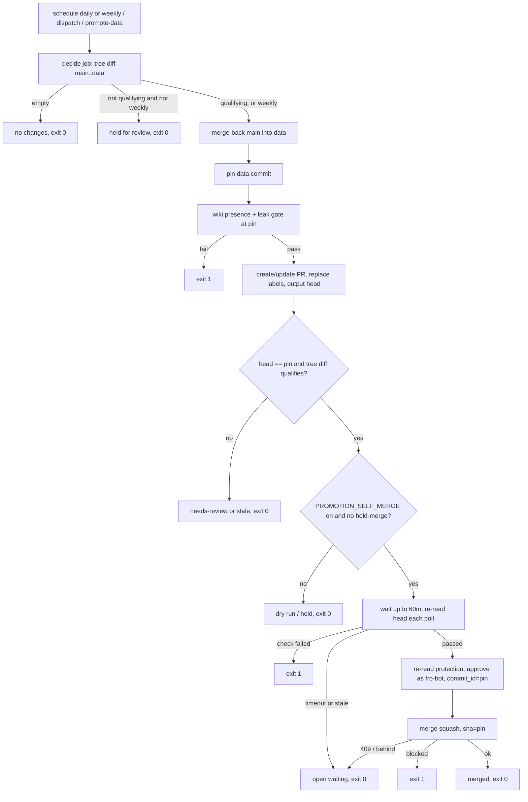

# feat: merge knowledge/metadata promotions in the promotion run and report protection drift

## Overview

`Merge Data Branch` runs daily. A small `decide` job first checks whether the promotion qualifies and whether this is the weekly run. If the diff is held for review and it isn't the weekly run, the promotion job doesn't run.

The promotion job pins one `data` commit, gates it with both leak gates and updates the PR. When that commit's tree diff touches only `knowledge/` and `metadata/`, a self-merge step waits for the required checks on that commit, approves as `fro-bot`, and squash-merges pinned to the commit. A repository variable switches approval and merge on, and an operator label holds a single promotion.

A separate workflow compares `main`'s protection rule with the declared settings on every `branch_protection_rule` event. It opens or comments on one issue when the rule drifts or a non-settings actor edits it, and closes the issue when an event shows the rule matching the declared settings again.

## Problem Frame

See origin: `docs/brainstorms/2026-11-09-promotion-self-merge-requirements.md`. The operator approves and merges every promotion by hand. `strict: true` leaves promotions behind until the weekly run. Web-session edits to `main` protection twice left the review requirement unenforced for hours, and nothing reported it.

## Requirements Trace

| Origin                                                               | Units                                      |
| -------------------------------------------------------------------- | ------------------------------------------ |
| R1 qualification (tree diff, renames, one label)                     | 1, 2                                       |
| R2 gates and PR head on one commit                                   | 2, 3                                       |
| R3 bounded wait, live required list ⊇ `settings.yml`, timeout exit 0 | 3                                          |
| R4 approve as `fro-bot`, pinned, one-line body                       | 3                                          |
| R5 merge pinned, refused head → stop                                 | 3                                          |
| R6 deterministic                                                     | 1, 3, 4                                    |
| R7 failures stay open                                                | 2, 3                                       |
| R8 daily                                                             | 2                                          |
| R8a weekday hold, qualification before merge-back                    | 1, 2                                       |
| R9–R12 drift report                                                  | 4                                          |
| R13 operator controls (kill switch, per-PR hold)                     | 2, 3                                       |
| AE1–AE10                                                             | unit scenarios; AE1 and AE7 live in Unit 6 |

## Scope Boundaries

- No change to `main` protection: no bypass, no lower count, `strict` unchanged.
- No native auto-merge.
- Out of scope: Renovate PRs, drafted-solution PRs, rulesets, repository-level settings.

### Deferred to Separate Tasks

- Renovate brief or auto-approval: its own brainstorm.
- `capture-learnings-harvest.ts` reads the required contexts and fails open (about lines 1804–1817). This is filed as its own issue.

## Context & Research

### Relevant Code and Patterns

- **`.github/workflows/merge-data.yaml`.**
  - One job, `timeout-minutes: 10`.
  - Concurrency groups `merge-data-dispatch` (cancels) and `merge-data-manual`.
  - Steps, in order: App token, checkout `main`, setup, merge-back, checkout `data`, wiki presence gate, fetch `data`, promotion leak gate, `merge-data-pr`.
  - `scripts/merge-data-workflow.test.ts` pins:
    - the step names (`:170-181`)
    - the cron (`:106`)
    - the permissions and concurrency
    - the rule that gate steps carry no `if:` (`:93-101`)
- **`packages/registry/src/merge-data-pr.ts`.**
  - The post-PR block in `mergeDataPr` appears three times.
  - `maybeUpdateBehindPullRequest` calls `updateBranch` after the gates.
  - `selectLabel` and `addLabel` (add-only).
- **`packages/privacy/src/check-private-leak.ts:967`.** It hard-codes `git diff origin/main...origin/data`, and `check-private-leak.test.ts:5880` pins that argv. `check-wiki-private-presence.ts` reads the working directory.
- **`packages/registry/src/merge-back-data.ts`.** Mutated, in shard 0. The pattern for a gate-path decision module with a `*-cli.ts` and a six-line shim.
- **`.github/workflows/status-truth.yaml`.** A deterministic step that receives `GH_TOKEN: ${{ secrets.FRO_BOT_PAT }}` as step env.
- **`GET repos/fro-bot/.github/branches/main`.** Returns 14 required contexts. All come from Actions (app 15368) except CodeQL (app 57789). `Security: Private Leak Scan` is a commit status, which has a creator but no app.
- **Settings writes.** They come from the Fro Bot App, `fro-bot[bot]`, user ID 109017866 (`update-repo-settings.yaml` passes the App secrets).

### Institutional Learnings

- `docs/solutions/best-practices/privacy-gate-promotion-leak-prevention-2026-06-04.md`: anyone with `statuses: write` can spoof a commit status. The merge decision here rests on the in-run gates at the pinned commit; the status only matters to GitHub's own merge check.
- `docs/solutions/best-practices/review-shared-settings-against-effective-inherited-config-2026-10-09.md`: compare against the merged settings.
- `docs/plans/2026-10-20-001-fix-keep-data-branch-present-plan.md`, recorded as complete: merge-back stays App-authored, non-force and fail-closed.

## Prior-Art Survey

```json
{
  "schema_version": 2,
  "verdict": "extend",
  "scope": "fro-bot/.github @ main: packages/*, scripts/, .github/workflows/, .github/actions/, settings.yml, common-settings.yaml, stryker.config.json, mutation-guards.json",
  "freshness": {
    "vcs_reference": "3150eb4c09b343ec77fbe3e26c896e88f2602f17",
    "scope_baseline": "origin/main 7c263b9 (#4162) is one commit ahead; its diff touches none of the candidate files except one mutate entry, one label and status-truth.yaml env"
  },
  "budget": {"max_search_passes": 10, "max_candidate_inspections": 14, "exhausted": false},
  "candidates": [
    {
      "path_or_symbol": ".github/workflows/merge-data.yaml#merge-data",
      "description": "Promotion run: App token, merge-back, two privacy gates, PR step",
      "disposition": "extend"
    },
    {
      "path_or_symbol": "packages/registry/src/merge-data-pr.ts#mergeDataPr",
      "description": "Creates/updates the data->main PR, updates a behind PR, applies labels; no head SHA in its result, add-only labels",
      "disposition": "extend"
    },
    {
      "path_or_symbol": "packages/registry/src/merge-back-data.ts#mergeBackData",
      "description": "Git Data merge of main into data at run start; mutated",
      "disposition": "reuse"
    },
    {
      "path_or_symbol": "packages/privacy/src/check-private-leak.ts#runPromotionCli",
      "description": "Promotion leak gate over origin/main...origin/data",
      "disposition": "reuse"
    },
    {
      "path_or_symbol": ".github/workflows/check-private-leak.yaml",
      "description": "Posts the required Security: Private Leak Scan status per PR head",
      "disposition": "reuse"
    },
    {
      "path_or_symbol": "packages/knowledge/src/capture-learnings-harvest.ts#getBranchProtection",
      "description": "Reads required contexts but fails open to an empty set",
      "disposition": "insufficient",
      "insufficiency_reason": "Swallows read errors; R3 requires a fail-closed read."
    },
    {
      "path_or_symbol": "packages/core/src/retry.ts#retry",
      "description": "Attempt-bounded retry with injectable sleep",
      "disposition": "insufficient",
      "insufficiency_reason": "Bounds attempts, not elapsed time; the wait needs a time-bounded loop. Its transient-error retry is reused per read."
    },
    {
      "path_or_symbol": "packages/wiki-ops/src/wiki-lint-issues.ts#planIssueLifecycle",
      "description": "Fingerprinted issue open/comment/close lifecycle",
      "disposition": "insufficient",
      "insufficiency_reason": "Bound to wiki-lint report types; the drift watcher compares a full rule against declared settings."
    },
    {
      "path_or_symbol": ".github/workflows/scorecard.yaml",
      "description": "Only branch_protection_rule consumer",
      "disposition": "insufficient",
      "insufficiency_reason": "Runs Scorecard only; no comparison or issue."
    },
    {
      "path_or_symbol": "common-settings.yaml#allow_auto_merge",
      "description": "Native auto-merge, enabled and unused",
      "disposition": "insufficient",
      "insufficiency_reason": "Refused on an already-clean PR and not bound to the commit the in-run gates checked."
    },
    {
      "path_or_symbol": ".github/workflows/fro-bot.yaml",
      "description": "LLM agent jobs",
      "disposition": "insufficient",
      "insufficiency_reason": "R6 forbids an LLM in the merge path."
    }
  ]
}
```

## Key Technical Decisions

- **A `decide` job before the promotion job.**
  - It checks out `main` and fetches `data`. It takes the three-dot diff `git diff --name-status -M origin/main...origin/data`, then drops every path whose content at `origin/data` already equals `origin/main` (both blobs equal, or both absent). This is the same rule merge-back uses for unowned changes. Qualification is computed from what remains.
  - It outputs `run` (true or false) and `reason`. The promotion job has a job-level `if: needs.decide.outputs.run == 'true'`, so the gate steps keep no step-level `if:`.
  - Changes made on `main` since the last merge-back aren't in the three-dot diff. Content the operator already squash-merged drops out at the blob check. The local diff has no file cap and no truncation.
- **The weekly run comes from the trigger, not the clock.**
  - Two schedule entries: `0 22 * * 0` is the weekly run and `0 22 * * 1-6` the daily runs. `github.event.schedule` says which one fired.
  - A `workflow_dispatch` input `refresh-review` (default false) and `repository_dispatch` count as daily runs.
  - A late Sunday run that starts on Monday is still the weekly run.
- **One pinned `data` commit per run.**
  - After merge-back, the run reads `data` once and outputs the commit.
  - The wiki presence gate checks out that commit.
  - After the fetch, `git update-ref refs/remotes/origin/data <pin>` makes the unchanged leak gate scan exactly the pinned commit.
  - Qualification is recomputed from the tree diff at the pin.
  - The self-merge step requires the PR head to equal the pin.
  - The App token is not used after the PR step, because it expires in an hour.
- **No `updateBranch` after the gates.** Merge-back already makes `data` current. If `main` moves during the wait, the merge is refused with 409 or 405-behind, and the next run picks it up.
- **The self-merge step is separate from `merge-data-pr`.** The PR step only replaces labels, keeps unrelated labels, skips `updateBranch` when given a pin, and outputs the PR number and head.
- **`FRO_BOT_PAT` on one step.** The self-merge step reads checks and statuses, approves and merges as `fro-bot`, a code owner. The App pushed `data` last, so the last-push rule is met.
- **Operator controls (origin R13).**
  - The repository variable `PROMOTION_SELF_MERGE` must be `on` for the step to approve or merge. Unset or any other value means a dry run that logs "would approve".
  - A `hold-merge` label on the PR stops approval for that promotion. The run doesn't remove it.
  - When the newest promotion PR was closed unmerged, the operator closed it. No scheduled run recreates it. Only a dispatch with `refresh-review` does.
  - The step reads the variable and the PR labels through the API at three points: before the wait, before the approval, and before the merge. A switch or label change made during the wait takes effect.
  - A dry run waits and polls like a live run, then stops right before the approval call with "would approve".
- **Wait loop.**
  - A time-bounded loop of 60 minutes inside a 90-minute job, with a `sleep` seam and per-read retry for transient 5xx.
  - Check runs use `filter=latest` with pagination, matched by context name and required app ID. Commit statuses are matched by context only, newest first, since statuses carry no app.
  - The PR head is re-read on every poll. A moved head means "stale" (exit 0), and a cancelled check on a superseded commit is ignored.
- **Merge outcomes.**
  - 409 or a 405 where `mergeable_state` is `behind` means "open waiting" (exit 0).
  - `mergeable_state` is computed lazily. While it reads `unknown`, the step re-reads it a few times.
  - A 405 that stays `blocked` after those re-reads means the approval didn't count or a change request is outstanding. That exits 1 so it stays visible, and it never produces a silent green.
  - A 422 on the approval because the head moved maps to "stale" (exit 0).
  - A held run doesn't touch labels, and the weekly run sets them. The hold summary says the unowned-changes alert waits for the weekly run.
- **The drift watcher is stateless.**
  - On every `branch_protection_rule` event for `main`, it compares the event's `rule` with the declared values. These include the review count, code owners, dismiss stale and last push from `common-settings.yaml`, plus strict and a contexts superset from `.github/settings.yml`. It also checks the enforcement levels `pull_request_reviews_enforcement_level` and `required_status_checks_enforcement_level`, which must not be `off`, and `enforce_admins`.
  - Each field is either present and matching, present and different, or absent.
  - It opens or comments on the open `protection-drift` issue when the actor is not `fro-bot[bot]` (type Bot, ID 109017866), or when any field is present and different. The report names the actor, the time, the event `changes`, the mismatched fields, any absent fields, and the settings workflow that restores the rule.
  - It closes an open issue only on an event from the settings App in which every declared field is present and matching. A manual restore therefore closes the issue at the next daily settings write.
  - An absent field is never drift and never a match. It is listed in the job summary.
  - A deleted rule counts as drift.
  - There is no concurrency group: a group keeps one pending run and drops the middle events of a burst. Two runs that open an issue at once are reconciled afterwards, and a match closes every open report.

## Open Questions

### Resolved During Planning

- Merge method: squash.
- **Exit codes.**
  - 0: merged, no changes, held for review, dry run, `hold-merge`, timeout, stale head, 409 or behind, already merged.
  - 1: a failed gate, a failed required check, unreadable or short protection, a 405 `blocked` after approval, any other API failure.
- Drift issue home: fro-bot/.github, label `protection-drift` declared in `settings.yml`.
- Shipping safety: the step ships in dry run. Unit 6 enables it after one live approval.

### Deferred to Implementation

- Which declared fields real payloads carry, `require_last_push_approval` in particular. The first daily settings write after Unit 4 merges lists any absent fields in its summary. If a field is always absent, the issue can never auto-close, and the operator closes it by hand. Unit 6 records which case applies.

## High-Level Technical Design

> _This illustrates the intended approach and is directional guidance for review, not implementation specification._



## Implementation Units

- [x] **Unit 1: Promotion qualification**

**Goal:** Pure decisions covering:

- tree-diff qualification
- the weekly-run test
- the run/hold decision
- the label to set

**Requirements:** R1, R8a, R6

**Dependencies:** none

**Files:**

- Create: `packages/registry/src/promotion-qualify.ts`, `packages/registry/src/promotion-qualify-cli.ts`, `scripts/promotion-qualify.ts`, and tests for the module and the CLI
- Modify: `packages/registry/package.json` (exports), `stryker.config.json` (`mutate`, `testFiles`), `mutation-guards.json` (shard list; the CLI and shim are `not-mutated` with reasons), `scripts/registry-entrypoints.test.ts`, `packages/registry/README.md`

**Approach:**

- Parse `git diff --name-status -M` three-dot output and drop paths whose blobs are equal on both sides, using a git seam. Every remaining path must be under `knowledge/` or `metadata/`, including both sides of a rename or copy.
- An empty diff means "no changes".
- Weekly is true for `schedule` with `0 22 * * 0`, or for dispatch with `refresh-review=true`.
- Run is "no changes", "held", or "run".
- The label decision returns what to add and what to remove.
- The CLI writes `run`, `reason` and `qualifies` to `GITHUB_OUTPUT`.
- Constants live inside functions.

**Execution note:** write tests first. The module is mutated, and its tests import it relatively.

**Test scenarios:**

- Happy path: only `knowledge/` and `metadata/` paths gives `qualifies` and add `automerge`, remove `needs-review` (AE1).
- Edge case: a three-dot path whose `data` content equals `main`, such as a squash-merged change or an unchanged file, is dropped before qualification.
- Edge case: a `main`-only change since the last merge-back doesn't appear and doesn't disqualify.
- Edge case: `R100 scripts/x.ts knowledge/x.md` doesn't qualify (AE3).
- Edge case: the lookalike prefix `knowledgebase/x.md` doesn't qualify.
- Edge case: an empty diff gives "no changes".
- Edge case: a non-qualifying daily run is "held" (AE9). A non-qualifying run on the weekly schedule is "run". So is a dispatch with `refresh-review`.
- Error path: malformed diff lines don't qualify.

**Verification:** 100% Stryker on `promotion-qualify.ts`. `bun run check:mutation-guards` is clean.

- [x] **Unit 2: Workflow and PR step**

**Goal:** Add the `decide` job, the daily and weekly schedules, a non-cancelling queue, the pinned commit through both gates, and a PR step that replaces labels and never moves the head.

**Requirements:** R1, R2, R7, R8, R8a, R13

**Dependencies:** Unit 1

**Files:**

- Modify:
  - `.github/workflows/merge-data.yaml`, including its header comment about the token
  - `packages/registry/src/merge-data-pr.ts`, `merge-data-pr-cli.ts`, `merge-data-pr.test.ts`
  - `scripts/merge-data-workflow.test.ts`
  - `scripts/app-token-scope-guard.test.ts`, if the mint moves
  - `mutation-guards.json`: rewrite the `merge-data-pr.ts` not-mutated reason, since its auto-merge clause now fires

**Approach:**

- **Triggers and concurrency:**
  - Two crons.
  - A `refresh-review` dispatch input.
  - One concurrency group for every trigger, with `cancel-in-progress: false`.
  - Promotion job `timeout-minutes: 90`.
- **`decide` job:** `contents: read` only. It runs the Unit 1 CLI and outputs `run`.
- **Pinned commit:**
  - After merge-back, a step outputs the `data` commit. The wiki gate checks out `ref: <pin>`.
  - After `git fetch origin data`, the job runs `git update-ref refs/remotes/origin/data <pin>`.
- **`merge-data-pr`:**
  - Takes the pin and replaces labels. Unrelated labels are kept, `hold-merge` included.
  - Skips `updateBranch` when given a pin.
  - On a daily run, it doesn't recreate a PR the operator closed.
  - Outputs the PR number and head.
- **Gate steps** keep no step-level `if:`.

**Execution note:** start with failing workflow-contract tests for each change.

**Test scenarios:**

- Happy path: `decide` runs, then the promotion job steps run in this order: token, checkout, setup, merge-back, pin, gates at the pin, PR, self-merge.
- Edge case: a held `decide` skips the promotion job entirely, and the run is green (AE9).
- Edge case: on a weekly run with a mixed diff, the run merges back, updates the PR to `needs-review`, and removes `automerge` (AE2).
- Edge case: given a pin, `merge-data-pr` never calls `updateBranch` and reports `behind`.
- Edge case: a promotion PR the operator closed stays closed on daily and weekly scheduled runs. A dispatch with `refresh-review` recreates it (AE10).
- Edge case: `hold-merge` survives the label replace.
- Error path: a failed gate leaves the PR unchanged and fails the job (AE4).
- Integration: the leak gate's diff resolves `origin/data` to the pin, even though `data` moved after the fetch.

**Verification:** actionlint is clean. The workflow and `merge-data-pr` tests pass.

- [x] **Unit 3: Self-merge step**

**Goal:** Wait for the required checks at the pin, then approve as `fro-bot` and merge pinned to it, behind the kill switch and the per-PR hold.

**Requirements:** R3, R4, R5, R6, R7, R13

**Dependencies:** Unit 2

**Files:**

- Create: `packages/registry/src/promotion-self-merge.ts`, `promotion-self-merge-cli.ts`, `scripts/promotion-self-merge.ts`, and tests for each
- Modify:
  - `.github/workflows/merge-data.yaml`: a step with `GH_TOKEN: ${{ secrets.FRO_BOT_PAT }}` in step env, and `PROMOTION_SELF_MERGE: ${{ vars.PROMOTION_SELF_MERGE }}`
  - `scripts/merge-data-workflow.test.ts`, `scripts/registry-entrypoints.test.ts`, `packages/registry/package.json`, `stryker.config.json`, `mutation-guards.json`, `packages/registry/README.md`

**Approach:**

- Inputs: the PR, the pin, the label decision, and the `main` contexts declared in `.github/settings.yml`.
- **Before the wait:**
  - Read `branches/main`. The required list must be non-empty and contain every declared context; if not, exit 1 (AE8).
  - Re-read the PR. Stop with exit 0 if:
    - it is closed or merged;
    - the head isn't the pin;
    - it isn't labeled `automerge`;
    - it carries `hold-merge`;
    - the switch isn't `on` (dry run).
- **Wait:** follow Key Decisions. A timeout exits 0 (AE5). A failed check at the pin exits 1.
- **Approve and merge:**
  - Re-read the protection and the head.
  - Approve with `commit_id` set to the pin. The body is one line: "Approved by Merge Data Branch: <pin> touches only knowledge/ and metadata/ and passed the promotion gates."
  - Merge, squash, with `sha` set to the pin. Map the outcome as Key Decisions describes (AE6).
- **Summary and safety:**
  - Write a step summary for every outcome.
  - Stderr carries fixed strings only.
  - Never use the App token.

**Execution note:** test first, with a fake Octokit and a fake clock. The module is mutated and imported relatively.

**Test scenarios:**

- Happy path: switch on, checks green, then approve with `commit_id` and the one-line body, then merge with `sha`, exit 0 (AE1).
- Edge case: a skipped `Fro Bot` run and a neutral check count as passing.
- Edge case: a second page of check runs is read.
- Edge case: a check run from another app is ignored.
- Edge case: the newest commit status wins.
- Edge case: the head moves mid-wait, giving exit 0 "stale" and no approval. A cancelled check on the old commit doesn't fail the run.
- Edge case: with the switch unset, the run waits and polls, logs "would approve", doesn't approve, and exits 0. With `hold-merge` it doesn't approve and exits 0.
- Edge case: `hold-merge` added during the wait means no approval. The variable turned off between the approval and the merge means no merge.
- Edge case: `mergeable_state` `unknown` and then `clean` merges. `unknown` and then `blocked` exits 1.
- Edge case: a 422 on the approval because the head moved exits 0 "stale".
- Edge case: a 409 merge, or a 405 while behind, gives exit 0 (AE6).
- Error path: a 405 while blocked after the approval exits 1.
- Error path: a failed required check exits 1. A 404, an empty list or a short list exits 1 (AE8).
- Error path: a transient 503 on one poll is retried, and the wait continues.
- Error path: the 60-minute timeout exits 0 with a summary (AE5).
- Integration: the shim's usage error exits 1. It is safe to import, and the parity arrays include it.

**Verification:**

- `promotion-self-merge.ts` has a 100% Stryker score, and `check:mutation-guards` is clean.
- The workflow test pins `FRO_BOT_PAT` to this step only, and pins that no App token is used after the PR step.

- [x] **Unit 4: Protection drift watcher**

**Goal:** Report any `main` rule that doesn't match the declared settings, or that was edited by a non-settings actor, and close the report when an event shows the rule restored.

**Requirements:** R9, R10, R11, R12

**Dependencies:** none

**Files:**

- Create: `.github/workflows/protection-drift.yaml`, `packages/registry/src/protection-drift.ts`, `protection-drift-cli.ts`, `scripts/protection-drift.ts`, `scripts/protection-drift-workflow.test.ts`, and tests for the module and the CLI
- Modify: `.github/settings.yml` (`protection-drift` label), `scripts/settings-labels-effective-set.test.ts`, `packages/registry/package.json`, `stryker.config.json`, `mutation-guards.json`, `scripts/registry-entrypoints.test.ts`, `packages/registry/README.md`

**Approach:**

- **Workflow:**
  - Triggered by `branch_protection_rule` on `created`, `edited` and `deleted`.
  - Permissions: `contents: read` and `issues: write`. It uses `GITHUB_TOKEN`, mints no App token and needs no secrets.
  - No concurrency group (see Key Technical Decisions).
- **Inputs:** the event payload, plus the declared values read from the checkout.
- **Comparison:** pure, against the declared values. Missing or unknown fields don't match.
- **Issue handling:** create or comment on the open issue labeled `protection-drift`, or comment on it and close it, as described in Key Decisions.
- **Errors:** stderr carries only fixed strings, and any API failure exits 1.

**Execution note:** write the tests first. The comparison and the actor classification are pure and mutated.

**Test scenarios:**

- Happy path: the user `fro-bot` sets the review count to 0. An issue opens, naming the actor, the time, the changes and the mismatched fields (AE7).
- Happy path: a later event by `fro-bot[bot]` with the declared values comments on the issue and closes it (AE7).
- Happy path: the operator restores the rule by hand. That event is reported as a non-settings edit, and the next settings write closes the issue.
- Edge case: the settings App writes a rule that is missing reviews, as with an `_extends` fallback. That is reported.
- Edge case: a non-settings actor changes an undeclared field. That opens or comments on the issue, because the actor is not the settings App.
- Edge case: a settings event with one field absent and the rest matching doesn't close the issue and doesn't report drift. The absent field is listed in the summary.
- Edge case: unchecking "Require a pull request" shows up as a reviews enforcement level of `off` and is reported.
- Edge case: the second drift event comments on the existing issue rather than opening another.
- Edge case: after a manual close, new drift opens a new issue.
- Edge case: a missing `require_last_push_approval` never counts as a match.
- Edge case: deleting the rule is reported.
- Edge case: a rule other than `main` is ignored.
- Error path: an issue API failure exits 1.

**Verification:** `protection-drift.ts` scores 100% under Stryker, actionlint is clean, and the workflow test pins the trigger, the permissions, the concurrency and the absence of secrets.

- [x] **Unit 5: Docs**

**Goal:** Bring every surface that describes promotion cadence, tokens, merge path or operator controls in line with the new behaviour.

**Requirements:** all

**Dependencies:** Units 1–4

**Files:**

- Modify:
  - `packages/registry/README.md`
  - `README.md`: the registry row, the workflow table, the data-flow paragraph, and the "never merges or approves" line, scoped to correction PRs
  - `.github/copilot-instructions.md`: Autonomous Commits, the registry paragraph, and `FRO_BOT_PAT` uses
  - `metadata/README.md`: cadence, credentials, the PAT scope, `PROMOTION_SELF_MERGE` and `hold-merge`
- Create: a `docs/solutions/` entry on the auto-merge clean-status refusal and protection edits that persist until the next settings run

**Test expectation:** none, since these are docs. Markdown lint and `check:md-links` pass.

**Verification:** lint is clean, and no stale "weekly only" or "never auto-merges" claim remains for promotions.

- [ ] **Unit 6: Live verification and enablement**

**Goal:** Prove a live approval counts, then enable the step.

**Requirements:** all success criteria

**Dependencies:** Units 1–5 merged (the step ships in dry run)

**Approach:**

1. Read back the first daily runs in dry run, checking the decision, the pin, the gates and the "would approve" summary.
2. With operator approval, set `PROMOTION_SELF_MERGE=on` and dispatch one run against a qualifying diff. Confirm that GitHub counts the `fro-bot` approval as a code-owner review and that the PR merges. If it is `blocked`, unset the variable and record the result.
3. The operator makes one harmless edit to a declared field in the web session, for example the review count 1→2→1. Confirm the issue opens and later closes.

**Test expectation:** none, since this is live.

**Verification:** the run and issue links are recorded on the PR.

## System-Wide Impact

- **Interaction graph:** `merge-data.yaml` (two jobs), `merge-data-pr`, the leak gates (now fed a pinned ref), `check-private-leak.yaml`, the settings workflow (whose writes close drift issues), and Scorecard, which also runs on `branch_protection_rule` and is unchanged.
- **Error propagation:**
  - Gate, check, protection and approval-not-counted failures exit 1 and leave the PR open.
  - Timeouts, stale heads and holds exit 0 and write a summary.
- **State lifecycle risks:**
  - Another App writer can move `data` after the pin. The pinned merge then refuses, and the next run retries.
  - An approval left on a refused merge is dismissed by the next head move.
- **Unchanged invariants:**
  - `main` protection.
  - `data` writes stay App-only.
  - Merge-back stays App-authored and non-force.
  - Drafted-solution PRs stay manual.
  - The `data-write-token-guard` count stays the same, because the new script names avoid `commit-metadata`.

## Risks & Dependencies

| Risk | Mitigation |
| --- | --- |
| A `fro-bot` approval doesn't count as a code-owner approval | The step ships in dry run. Unit 6 tests the approval before enabling it. A `blocked` result exits 1, never green. |
| A busy `main` keeps a promotion behind | Accepted. Each daily run retries and names the reason. |
| A payload field is missing | The field never matches, so the issue stays open and fails safe. |
| A 90-minute job holds the queue | One run waits and later triggers coalesce. The next run handles the latest state. |
| A commit status satisfies its context by name, because statuses carry no app | GitHub's own merge check still enforces the binding, so the worst case is a refused merge and exit 1. |
| A manual dispatch during an active Sunday run can replace the pending weekly run | GitHub keeps one pending run per group. The next Sunday recovers. |

## Sources & References

- **Origin document:** `docs/brainstorms/2026-11-09-promotion-self-merge-requirements.md`
- Related past work: `docs/ideation/2026-11-07-open-ideation.md`, recorded as unexplored. It assumed an App bypass; this plan uses a pinned `fro-bot` approval instead.
- Related issue: fro-bot/agent#1520 (App PRs keep manual review; this plan adds no agent review).
