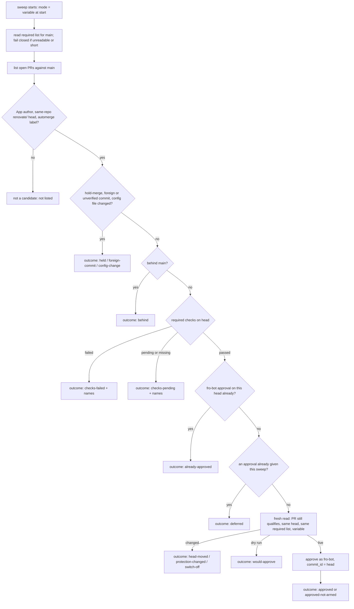

# feat: approve automerge-labelled Renovate PRs from a default-branch sweep

## Overview

A new workflow on the default branch sweeps the open Renovate PRs that carry `automerge`. For each one it checks who wrote it, what it changes, whether it is up to date and whether every required check passed on its head. It then approves at most one PR per sweep as the `fro-bot` user, pinned to that head. GitHub's native auto-merge, which Renovate arms, does the merge. The sweep ships in dry run behind a repository variable.

## Problem Frame

Renovate PRs wait for the operator's approval and nothing else (see origin: `docs/brainstorms/2026-11-11-renovate-automerge-approval-requirements.md`). The promotion run already gives the same kind of approval to `data` promotions, but it works on one pinned commit inside one run. Renovate PRs need something that notices finished checks, new heads and new labels across many PRs.

## Requirements Trace

Origin requirements, and the unit that carries each:

- R1, R3, R4 (who qualifies, config PRs excluded, what is never touched): Unit 2.
- R2 (the label is the only class rule): Unit 2. The approver holds no package list.
- R5 (live required checks on the current head): Units 1 and 2.
- R6 (fresh read before approving, pinned approval): Unit 2.
- R7 (a new head starts over): Unit 2, by judging every PR from scratch on every sweep.
- R8 (does not merge): Unit 2. No merge call and no auto-merge call exist in the module.
- R9 (the approval says why; reports name only the PR, labels and commits): Unit 2. Amended below.
- R10 (default branch's definition and code): Unit 3.
- R11 (variable, dry run, mode fixed at start): Units 2 and 3.
- R12 (controls work only before the approval): Unit 2, and stated in the docs in Unit 4.
- R13 (failing or behind PRs get no approval and stay visible): Unit 2.
- R14 (protection unchanged): no unit edits protection. Unit 3's test asserts the workflow has no settings write.
- R15, R16 (dry-run and first-live read-backs): Unit 5.

**Amendment to R9.** The job summary also shows fixed outcome codes and the names of required checks that are missing or failed. Check names are already public on the PR. It shows no API response text.

## Scope Boundaries

- No advisory brief, no change to which updates the preset labels, no other repositories, no content review (origin Scope Boundaries).
- The approver never merges, never arms or disarms auto-merge, and never dismisses a review.
- No new label. `hold-merge` is reused.
- No issue or comment is written for stuck PRs. The job summary is the report.

### Deferred to Separate Tasks

- Measuring the four-week success criteria: a read of merged Renovate PRs after four weeks with the variable on, done by hand from the PR history.
- An advisory brief for the PRs left to the operator: waits on fro-bot/agent#1520.

## Context & Research

### Relevant Code and Patterns

- `packages/registry/src/promotion-self-merge.ts`: the approval mechanics. General parts: `evaluateChecks`, `sameChecks`, `parseDeclaredContexts`, the protection, check-run and status readers, the request deadline wrappers, the switch read, the pinned `createReview`, the review reconcile after an ambiguous write. Promotion-specific parts: the pin, the wait loop, the merge call, the `PROMOTION_*` env and the outcome text.
- `packages/registry/src/promotion-self-merge-cli.ts` and `scripts/promotion-self-merge.ts`: the CLI and six-line `import.meta.main` shim shape.
- `.github/workflows/check-private-leak.yaml` with `packages/privacy/src/check-private-leak.ts`: the only `workflow_run` consumer that acts on PRs. It runs default-branch code and never checks out the PR.
- `.github/workflows/merge-data.yaml`: one step holds `FRO_BOT_PAT`, as step env.
- `packages/registry/src/protection-drift.ts` (`isSettingsActor`): the App is matched by type `Bot` and numeric id 109017866, never by login.
- `packages/core/src/wiki-authority.ts` (`fetchChangedFiles`): paged PR file read that throws at the API's 3,000-file cap.
- `scripts/merge-data-workflow.test.ts` and `scripts/protection-drift-workflow.test.ts`: workflow contract tests (triggers, permissions, secret placement, concurrency).
- Required contexts for `main` are check runs from GitHub Actions and from code scanning, plus one commit status (`Security: Private Leak Scan`). The `Fro Bot` check is skipped on bot-authored PRs, and a skipped run counts as passed.
- Live facts: Renovate's branch prefix is the default `renovate/`. Its commits have author `fro-bot[bot]` (id 109017866), committer `web-flow`, and are verified. Auto-merge is armed on labelled PRs and stays armed across force-pushes (#4170).

### Institutional Learnings

- `docs/solutions/workflow-issues/auto-merge-refuses-a-clean-pr-and-protection-edits-persist-2026-11-09.md`: no event reliably follows the last required check on an Actions-authored head; a concurrency group keeps one running and one pending run; a required list that is unreadable or shorter than the declared one must stop the approval.
- `docs/solutions/best-practices/check-the-first-live-event-before-trusting-a-workflow-2026-11-11.md`: fix the mode at start; read back a dry run and then one live run; a check run and a status of the same name must both pass.
- `docs/solutions/best-practices/dispatch-ref-guard-is-not-a-security-boundary-2026-10-10.md`: a credentialed job must run trusted code, and a ref check alone does not make it so.
- `docs/solutions/best-practices/equivalence-refactors-need-differential-proofs-2026-09-06.md`: a refactor claimed to be behaviour-preserving needs a differential test against the old code.
- `docs/solutions/workflow-issues/github-actions-step-output-interpolation-2026-04-21.md`: pass expression values through step `env:`.

## Prior-Art Survey

```json
{
  "schema_version": 2,
  "verdict": "extend",
  "scope": "fro-bot/.github: .github/workflows, packages/registry, packages/privacy, scripts, .github/settings.yml, mutation-guards.json",
  "freshness": {
    "vcs_reference": "origin/main 9d1b1ececba5e99f1372aa2a1b15651f80f1cbda"
  },
  "budget": {
    "max_search_passes": 6,
    "max_candidate_inspections": 12,
    "exhausted": false
  },
  "candidates": [
    {
      "path_or_symbol": "packages/registry/src/promotion-self-merge.ts: selfMerge/promote, evaluateChecks, guard, readSwitch, createReview{commit_id}",
      "description": "pinned approve and squash-merge of one data promotion after the live required checks pass; automerge/hold-merge guards; PROMOTION_SELF_MERGE switch",
      "disposition": "extend"
    },
    {
      "path_or_symbol": "packages/registry/src/promotion-self-merge-cli.ts: runSelfMerge",
      "description": "env PROMOTION_PR/PIN/QUALIFIES wiring, owner/repo literals",
      "disposition": "insufficient",
      "insufficiency_reason": "bound to PROMOTION_* env and the promotion PR; no PR discovery or Renovate identity"
    },
    {
      "path_or_symbol": ".github/workflows/merge-data.yaml: Self-merge step",
      "description": "the only FRO_BOT_PAT holder; runs once per promotion run",
      "disposition": "insufficient",
      "insufficiency_reason": "pins one data commit inside one run; has no trigger for a Renovate head change"
    },
    {
      "path_or_symbol": ".github/workflows/check-private-leak.yaml + packages/privacy/src/check-private-leak.ts",
      "description": "workflow_run topology that runs default-branch code against PR state",
      "disposition": "reuse"
    },
    {
      "path_or_symbol": "packages/registry/src/protection-drift.ts: isSettingsActor",
      "description": "App identity by type and numeric id 109017866",
      "disposition": "reuse"
    },
    {
      "path_or_symbol": "packages/registry/src/merge-data-pr.ts, promotion-qualify.ts",
      "description": "own the automerge/needs-review label pair on the data promotion PR",
      "disposition": "insufficient",
      "insufficiency_reason": "promotion only; the promotion PR also carries automerge and must be excluded"
    },
    {
      "path_or_symbol": ".github/settings.yml: label hold-merge",
      "description": "per-PR hold label",
      "disposition": "extend"
    },
    {
      "path_or_symbol": ".github/workflows/fro-bot.yaml: TRUSTED AUTHORS / HARD_BOUNDARIES",
      "description": "agent prompt text naming renovate[bot]",
      "disposition": "insufficient",
      "insufficiency_reason": "prompt text that forbids approvals; not deterministic code"
    },
    {
      "path_or_symbol": "native auto-merge armed by Renovate (default.json platformAutomerge)",
      "description": "merges after approval; never approves",
      "disposition": "reuse"
    }
  ]
}
```

## Key Technical Decisions

- **Every start is a full sweep.** The workflow starts when a CI workflow completes, every 30 minutes, and on dispatch. It never reads the event payload to choose a PR. It lists the open PRs and judges each one from current state. A lost or replaced event costs at most 30 minutes, and there is no payload to trust.
- **Judge once, no wait loop.** A PR whose checks are pending or failed is left for the next sweep. The promotion step's 60-minute wait is not reused.
- **Candidates are found by identity, then qualified.** A candidate is an open PR against `main`, authored by the App (type and numeric id), from a same-repository head whose ref starts with `renovate/`, carrying `automerge`. Anything else is not listed at all, which keeps the `data` promotion and human PRs out. A candidate then fails qualification when it carries `hold-merge`, when any commit is not authored by the App or is unverified, or when it changes `default.json` or `.github/renovate.json5`.
- **Reads fail closed per PR.** Commits, files, check runs, statuses and reviews are read to the end. A list that reaches the API's cap, or a read that fails, gives that PR an error outcome and no approval. The other PRs are still judged.
- **Up to date is measured, not inferred.** The sweep compares the PR head with `main` and skips a PR that is behind. `mergeable_state` is not used for this, because a PR that lacks a review reports `blocked` whether or not it is behind.
- **One approval per sweep, lowest PR number first.** Under the up-to-date rule only one PR can merge at a time, and the cap bounds the first live sweep. Further ready PRs are reported as deferred.
- **An existing approval is respected.** If the `fro-bot` user's latest review on the PR is an approval of the current head and has not been dismissed, the sweep does nothing for that PR.
- **Approve even when auto-merge is not armed.** The outcome says so. Merging such a PR stays with the operator (origin AE4).
- **Mode is the variable at step start.** `RENOVATE_APPROVE` is passed into the step env. Anything but `on` is a dry run for the whole sweep. Right before an approval a fresh API read of the variable, the PR and the required list must still agree, and can only stop the approval.
- **Required-check logic is shared, not copied.** `evaluateChecks`, `sameChecks`, `parseDeclaredContexts` and the protection, check-run and status readers move to one module that both the promotion step and the sweep import. A drift between two copies of fail-closed check logic is the worse risk. Orchestration and outcome text stay separate in each caller.
- **Trusted code only.** The workflow has no `pull_request` trigger. Its checkout is the default branch. Dispatch from another ref is refused. The PR is read through the API only.

Past work with the same surface: recorded as deferred in `docs/plans/2026-11-09-001-feat-promotion-self-merge-plan.md` (Renovate approval). This plan is that work, and it differs from the promotion step by sweeping many PRs and never merging.

## Open Questions

### Resolved During Planning

- What starts the approver: `workflow_run` on the CI workflows, a 30-minute schedule and dispatch, each doing a full sweep.
- How to tell a Renovate branch and App-only commits: head ref prefix `renovate/` on a same-repository head, PR author and every commit author matched by type and numeric id, every commit verified. The committer is not tested, because GitHub's web flow commits for the App.
- Reuse of the promotion code: one shared required-checks module (Unit 1).
- No auto-merge armed: approve and report.
- Stuck PRs: the job summary lists every candidate with its outcome and the missing or failed checks.

### Deferred to Implementation

- The exact `workflow_run` workflow names and whether the dependency-review workflow needs to be one of them. The schedule covers any gap.
- The request budget per sweep with about ten open candidates. Measure it in the dry run and adjust page sizes.
- Whether GitHub accepts an approval whose `commit_id` is no longer the head. The fresh read makes this rare, and the next sweep handles the new head either way.

## High-Level Technical Design

> _This illustrates the intended approach and is directional guidance for review, not implementation specification. The implementing agent should treat it as context, not code to reproduce._



## Implementation Units

- [ ] **Unit 1: Share the required-check logic**

**Goal:** One module owns reading and evaluating the required checks for a commit, used by the promotion step with no change in its behaviour.

**Requirements:** R5.

**Dependencies:** None.

**Files:**

- Create: `packages/registry/src/required-checks.ts`
- Create: `packages/registry/src/required-checks.test.ts`
- Modify: `packages/registry/src/promotion-self-merge.ts`
- Modify: `packages/registry/src/promotion-self-merge.test.ts`
- Modify: `packages/registry/package.json` (exports)
- Modify: `stryker.config.json` (`mutate`, `testFiles`)
- Modify: `mutation-guards.json` (one shard list)

**Approach:**

- Move the check types, `evaluateChecks`, `sameChecks`, `parseDeclaredContexts` and the protection, check-run and status readers. The readers take the commit and the request wrapper as arguments.
- `promotion-self-merge.ts` imports them by relative path. Its orchestration, wait loop, merge and outcome text do not move.
- Tests for the moved functions move with them, so each mutated module is killed by tests that import it relatively.

**Execution note:** Characterization first. Before moving anything, add a differential test that runs a frozen copy of the current `evaluateChecks` and `sameChecks` against seeded inputs, then keep it pointed at the moved functions.

**Patterns to follow:** `packages/registry/src/reconcile-*.ts` seams; `docs/solutions/best-practices/equivalence-refactors-need-differential-proofs-2026-09-06.md`.

**Test scenarios:**

- Happy path: every existing `promotion-self-merge` test passes unchanged in meaning after the move.
- Edge case: the differential test agrees on seeded mixes of check runs and statuses (passed, failed, pending, skipped, neutral, absent, wrong app, both present).
- Error path: a required list that is empty, unreadable or shorter than the declared contexts is reported as such by the shared reader.

**Verification:** `promotion-self-merge.ts` and `required-checks.ts` are both at 100% mutation score, and the mutation gate is clean.

- [ ] **Unit 2: The sweep**

**Goal:** A decision module and CLI that lists candidates, qualifies them, evaluates checks once, approves at most one PR and reports every outcome.

**Requirements:** R1–R9, R11–R13.

**Dependencies:** Unit 1.

**Files:**

- Create: `packages/registry/src/renovate-approve.ts`
- Create: `packages/registry/src/renovate-approve.test.ts`
- Create: `packages/registry/src/renovate-approve-cli.ts`
- Create: `packages/registry/src/renovate-approve-cli.test.ts`
- Create: `scripts/renovate-approve.ts`
- Modify: `packages/registry/package.json` (exports)
- Modify: `scripts/registry-entrypoints.test.ts`
- Modify: `stryker.config.json` (`mutate`, `testFiles`)
- Modify: `mutation-guards.json` (one shard list; `not-mutated` rows for the CLI and the shim)

**Approach:**

- Follow the flow in the design above. Constants live inside functions. Every Octokit call goes through one wrapper that carries an abort signal and a sweep-wide budget, as the promotion and drift modules do.
- The App identity check is by type and numeric id. The Renovate config paths are a fixed pair.
- Lists are read to the end. Reaching a cap is an error outcome for that PR.
- The review body states the label, the head commit and that the required checks passed.
- After a failed or cut-off `createReview`, read the reviews once before deciding the outcome, so a retry never posts a second approval.
- The job summary is one table: PR number, head (short), outcome code, detail (names of missing or failed required checks, or the disqualifying reason) and whether auto-merge is armed. Stderr gets fixed strings only.
- Exit 0 when every candidate got a non-error outcome. Exit 1 when the required list could not be trusted, the candidate list could not be read, or any candidate ended in an error.

**Execution note:** Test-first, with a fake GitHub client. No test sleeps or touches the network.

**Patterns to follow:** `packages/registry/src/promotion-self-merge.ts`, `packages/registry/src/protection-drift.ts`, `packages/registry/src/merge-back-data-cli.ts`.

**Test scenarios:**

- Happy path: one labelled `renovate/` PR by the App, up to date, all required checks passed, no review yet, mode on → one approval with `commit_id` equal to the head, outcome `approved` (origin AE1, AE2).
- Happy path: the same PR with mode unset → no review call, outcome `would-approve`. The variable API is not asked to turn it live (AE8).
- Edge case: two ready PRs → the lower number is approved, the other is `deferred`.
- Edge case: the `fro-bot` user's latest review approves the current head → `already-approved`, no call. Its latest review approves an older head, or was dismissed → treated as not approved (AE3).
- Edge case: a skipped required check run counts as passed; a required context with no run and no status is pending and named; a check run and a status of one name where the status is pending → pending.
- Edge case: auto-merge not armed → `approved-not-armed` (AE4).
- Edge case: a PR without the label, the `data` promotion PR, a PR from a fork, a PR by a person from a `renovate/` branch → not candidates, never approved (AE5, AE10).
- Edge case: `hold-merge` present → `held`. A commit by another author, or an unverified commit → `foreign-commit` (AE5, AE9).
- Edge case: the PR changes `default.json` or `.github/renovate.json5` → `config-change` (AE6).
- Edge case: the PR is behind `main` with green checks → `behind`, no approval.
- Error path: the head differs at the fresh read → `head-moved`, no approval for either head (AE7). The required list differs at the fresh read → `protection-changed`. The variable reads off at the fresh read → `switch-off`; unreadable → error.
- Error path: the commit or file list reaches its cap, or a read fails for one PR → that PR errors, the others are still judged, exit 1.
- Error path: the required list is unreadable, empty or shorter than the declared contexts → no PR is judged, exit 1.
- Error path: `createReview` fails with a server error after the review was recorded → the reconcile read finds it, outcome `approved`, no second review. With no review found → error.
- Integration: the CLI maps env to inputs, writes the summary table, and exits per the rule above. A missing token fails closed with a fixed message.

**Verification:** `renovate-approve.ts` is at 100% mutation score with no disable directives. The entrypoint parity test covers the shim.

- [ ] **Unit 3: The workflow**

**Goal:** A default-branch workflow that runs the sweep on CI completion, every 30 minutes and on dispatch, with the PAT in one step.

**Requirements:** R10, R11, R14.

**Dependencies:** Unit 2.

**Files:**

- Create: `.github/workflows/renovate-approve.yaml`
- Create: `scripts/renovate-approve-workflow.test.ts`
- Modify: `.github/settings.yml` (`hold-merge` description)
- Modify: `scripts/settings-labels-effective-set.test.ts` only if its fixtures name the old description

**Approach:**

- Triggers: `workflow_run` (completed) for the CI workflows that produce required checks, a schedule every 30 minutes at off-minutes, and `workflow_dispatch`. No `pull_request` or `pull_request_target`.
- One job. It refuses to run unless the ref is the default branch. Checkout has no `ref` from the event and `persist-credentials: false`.
- Job permissions `contents: read`. `FRO_BOT_PAT` and `vars.RENOVATE_APPROVE` appear only in the sweep step's `env:`. No `${{ }}` inside `run:`.
- One concurrency group, `cancel-in-progress: false`. A replaced pending run is harmless because every run is a full sweep.
- A short job timeout that leaves margin over the sweep's own budget.
- The `hold-merge` description is reworded to cover both the promotion and Renovate approvals, within GitHub's 100-character limit.

**Patterns to follow:** `.github/workflows/protection-drift.yaml`, `.github/workflows/check-private-leak.yaml`, `scripts/merge-data-workflow.test.ts`.

**Test scenarios:**

- Happy path: the workflow has exactly the three trigger kinds, and the schedule is every 30 minutes.
- Edge case: no `pull_request` or `pull_request_target` trigger; the checkout takes no ref from the event; the job is gated on the default branch.
- Edge case: `FRO_BOT_PAT` appears in exactly one step's `env:` and nowhere else in the file; no App token is minted; permissions are `contents: read` only.
- Edge case: the concurrency group does not cancel; no step writes repository settings.
- Edge case: every label description in the settings files stays within 100 characters (existing test).

**Verification:** `actionlint` passes on the new workflow, and the workflow test fails if the secret moves to job or workflow level.

- [ ] **Unit 4: Docs and registration**

**Goal:** The docs describe the approver, its switch, its limits and how it relates to the promotion step.

**Requirements:** R12 (stated limits), registration.

**Dependencies:** Units 1–3.

**Files:**

- Modify: `packages/registry/README.md` (CLI table, C4 diagram)
- Modify: `README.md` (workflow list, package view)
- Modify: `.github/copilot-instructions.md` (registry CLI count and list, Autonomous Commits section)
- Modify: `metadata/README.md` (a short section beside the promotion and drift sections)
- Modify: `docs/plans/2026-11-11-001-feat-renovate-automerge-approval-plan.md` (unit checkboxes)

**Approach:** State current facts in short sentences: what qualifies, the one-per-sweep cap, the variable and dry run, that `hold-merge`, unlabelling and the variable only stop an approval that has not been given, and that the approver never merges.

**Test scenarios:** Test expectation: none -- documentation only. The link and solutions-example checks in `bun run lint` cover it.

**Verification:** `bun run lint` passes, and the registry CLI count in the instructions matches the package.

- [ ] **Unit 5: Rollout read-backs**

**Goal:** Prove the dry run and the first live approval on real PRs before leaving the variable on.

**Requirements:** R15, R16.

**Dependencies:** Units 1–4 merged.

**Files:**

- Modify: `docs/plans/2026-11-11-001-feat-renovate-automerge-approval-plan.md` (record the results, tick the unit)

**Approach:**

- With the variable unset, read back the first sweeps that list a real candidate: its identity fields, labels, head, the checks read, the `would-approve` outcome, and that the PR has no review.
- Before turning the variable on, look at one Renovate PR that groups updates of different kinds and record how it is labelled.
- The operator sets `RENOVATE_APPROVE` to `on`. The cap means the first live sweep approves one PR. Read back the review's author and commit, that protection counted it, that auto-merge merged the PR, and the time from the last check to the merge.
- If any part differs, the operator unsets the variable. PRs already approved are the operator's to dismiss or merge.

**Test scenarios:** Test expectation: none -- live verification of shipped behaviour.

**Verification:** One Renovate PR merged with no operator action other than setting the variable, and the read-back is recorded in this plan.

## System-Wide Impact

- **Interaction graph:** The sweep reads PRs, commits, files, checks, statuses, reviews, the `main` branch and one repository variable, and writes at most one review per run. Renovate reacts to merges by rebasing its other PRs, which starts CI, which starts the next sweep.
- **Error propagation:** A per-PR failure becomes that PR's outcome and a non-zero exit. A failure to trust the required list stops the whole sweep before any PR is judged.
- **State lifecycle risks:** The read before the approval and the approval are separate calls. A head or label change between them is possible and accepted; the next sweep judges the new state. The module keeps no stored state and writes no markers, so a re-run of an older run cannot misread anything.
- **API surface parity:** The promotion step keeps its own orchestration and now shares the check logic. A change to check evaluation reaches both.
- **Integration coverage:** That GitHub counts the approval and that auto-merge fires can only be shown live (Unit 5).
- **Unchanged invariants:** `main` protection, the Renovate config, the release age, the promotion step's behaviour and the agent's rule against approving are not changed.

## Risks & Dependencies

| Risk | Mitigation |
| --- | --- |
| The refactor in Unit 1 changes how the live promotion step evaluates checks | Characterization-first differential test; both modules at 100% mutation score; the promotion step's own tests unchanged in meaning |
| The first live sweep does something unexpected | Dry run first; one approval per sweep; the read-back in Unit 5 before the variable stays on |
| A release that passes CI but is unsound merges unattended | Accepted in the origin. Limits are the release age for third-party updates, the required checks and the mutation gate |
| An approved PR cannot be stopped by the label or the variable | Stated in the docs (Unit 4); the operator dismisses the review or disables auto-merge |
| Renovate rebases faster than checks finish, so a PR keeps getting new heads | Each head is judged afresh and approved at most once; the summary shows the PR as pending or behind on every sweep |
| The 30-minute sweep adds about 48 short runs a day | Each run is one job with no build; the schedule can be widened later without changing behaviour |
| A grouped Renovate PR is labelled in a way nobody has looked at | Checked on a real PR in Unit 5 before the variable is turned on |

## Documentation / Operational Notes

- The switch is the repository variable `RENOVATE_APPROVE`. Setting it needs admin, so the operator does it.
- To hold one PR, add `hold-merge` before its checks finish.
- To see why a labelled PR has not merged, open the latest `Renovate Approve` run summary.

## Sources & References

- **Origin document:** [docs/brainstorms/2026-11-11-renovate-automerge-approval-requirements.md](../brainstorms/2026-11-11-renovate-automerge-approval-requirements.md)
- Related code: `packages/registry/src/promotion-self-merge.ts`, `packages/registry/src/protection-drift.ts`, `.github/workflows/check-private-leak.yaml`
- Related past work: `docs/plans/2026-11-09-001-feat-promotion-self-merge-plan.md`, recorded active. That plan merges one pinned promotion inside its own run; this plan sweeps many PRs and never merges.
- Related PRs/issues: #4168, #4174, #4175, #4170, fro-bot/agent#1520
