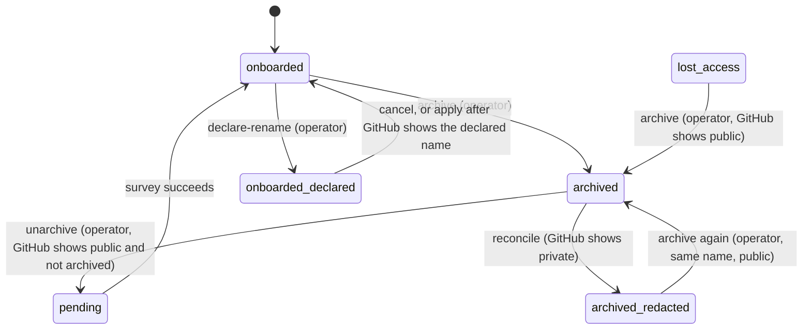

# feat: repository lifecycle actions: archive, unarchive and declared rename

## Overview

The operator rename workflow becomes a repository lifecycle workflow. Phase 1 adds `archive` and `unarchive`: a tracked public repository gets a named `archived` state, its page is marked in place, active jobs skip it, and the privacy gates keep protecting it. Phase 2 adds `declare-rename`: the operator records a new name, and when GitHub shows exactly that name on the same node, reconcile starts the workflow, which applies the rename and leaves a redirect from the old page address.

## Problem Frame

Archiving and renaming are noticed after the fact and handled defensively (see origin: `docs/brainstorms/2026-11-15-repo-lifecycle-archive-and-declared-rename-requirements.md`). An archived repository becomes a redacted `lost-access` row, which blocked every promotion on 2026-11-15. A rename pauses surveys until the operator dispatches a workflow, and the old page address then returns 404.

Research for this plan corrected three assumptions in the origin:

- There are three leak scans, not two: the per-PR scan, the promotion scan, and `scanPrivateLeak` in the published package (`packages/wiki-write-core/src/private-leak-adapter.ts`).
- The dashboard does not constrain the registry data. At its deployed tag it never validates a row's state, never writes the registry, and keeps unknown frontmatter keys on save. No gate-contract bump is needed.
- The dashboard does constrain the index and the notice. It rebuilds `knowledge/index.md` on every save with its own pinned copy of the shared package, and a save replaces the page body. Until it runs the release that contains Unit 5, a save would move an archived page back under Repos and could drop the notice. The first archive waits for that deploy.
- The site writes a redirect at exactly the alias text. The 20 pages that carry bare aliases today redirect from the site root; their old page addresses return 404.

## Requirements Trace

Archive (phase 1):

- R1, R7. One dispatch archives a tracked public repository, before or after the GitHub archive. Unit 6.
- R2. Named `archived` state that persists. Units 1, 4.
- R3, R4. Page marked in place; the index page groups archived pages. Units 5, 6.
- R5, R6, R11. Active jobs skip; passive readers keep; surveys refused, including one in flight. Unit 2.
- R8, R9. Reconcile leaves the row alone, redacts only when GitHub shows it private, never un-redacts. Unit 4.
- R10. Every leak scan checks archived repositories live. Unit 3.
- R12. Edits and repair keep the marker; a redacted row's page cannot be edited. Units 3, 5.
- R21, R22, R27. Refusals and the row with no node ID. Unit 6.
- R23. Schema on `main` before any row carries the state. Units 1-5 precede Unit 6.
- R24. `copiloting` is the first live use. Unit 7.
- R25. `unarchive`. Unit 6.

Declared rename (phase 2):

- R13, R14, R19, R27. Declare, replace, cancel, collisions. Unit 8.
- R16, R17, R20. Apply in one commit; redirect from the old page address; the operator path gets the redirect too. Unit 9.
- R15, R18, R19. Reconcile detects the exact match, starts the workflow, reports. Unit 10.
- R26. Existing old-slug aliases gain a working redirect. Unit 11.

## Scope Boundaries

- Owner transfers stay detected and blocked.
- Renaming an archived repository.
- A dashboard control, or asking Fro Bot to run an action.
- Rewriting old names in prose and in old log entries.
- Archiving or renaming a private row.
- Reconcile archiving a repository by itself.
- A physical `archived` wiki directory, and an archived grouping on the site beyond the index page.

### Deferred to Separate Tasks

- The wiki lint accepts an alias as a wikilink target, and the site resolves wikilinks by slug only. This plan writes no link that depends on an alias and does not change the lint.
- The rename CLI does not pass private-name tokens to the page-move planner (`private-name-collision`). Unchanged here.
- A dashboard read-model field that shows the archived mark in its page list.

## Context & Research

### Relevant Code and Patterns

- `packages/wiki-write-core/src/schemas.ts`: `OnboardingStatus`, `RepoEntry`, `assertRepoEntry`, `isOnboardingStatus`. Closed lists; an unknown status throws in every `assertReposFile` caller.
- `packages/registry/src/rename-tracked-repo.ts`: `readSnapshot`, `proveIdentity` (by `database_id`), `writeCommit` (one non-force Git Data commit), the ref-race retry, `assertChangePolicy`, `RenameBlockReason`. `readRows` locates a row by `node_id` only.
- `packages/wiki-write-core/src/repo-page-move.ts`: `planRepoPageMove`, `updateRepoPageValues`, `collidesWithAnotherRow`, `attributesPageTo`.
- `packages/registry/src/reconcile-plan.ts`: `classifyTracked` (its first statement, `migrateRepoEntry`, already rewrites rows), the `access.archived` flip, `detectRenames`, `mergeDuplicateEntries`, `restrictGroupVisibility`, `keepProtectedName`, `isNoOp`.
- `packages/registry/src/reconcile-effects.ts`: `runDispatches` and `dispatchWithTimeout`; the reconcile writer token already holds `actions: write` on this repository.
- `packages/privacy/src/check-private-leak.ts`: `resolvePrivateRows`, the three selection sites. `packages/privacy/src/check-wiki-private-presence.ts`: `buildPublicSlugMap` admits any `private: false` row.
- `packages/registry/src/repos-metadata.ts`: `publicRepoEntryExists` (survey admission and persist recheck), `applySurveyResult`.
- `packages/dispatch/src/dispatch-plan.ts`: `gateTarget`. `packages/reports/src/daily-digest-counts.ts`.
- `packages/wiki-write-core/src/wiki-ingest.ts`: `buildIndexDocument` (the only index builder, four fixed sections), `updateRepoPageFrontmatter` (keeps only incoming keys), `mergeRepoPageContent` (writes a bare alias on a node-ID migration), `buildWikiIngestChanges`.
- `packages/wiki-ops/src/wiki-index.ts`: the daily index for agents; a blockquote first paragraph yields no opening sentence.
- Tests to extend: `scripts/rename-tracked-repo-workflow.test.ts`, `packages/registry/src/reconcile-repos.test.ts`, `packages/registry/src/check-repo-onboarded.test.ts`, `packages/registry/src/repos-metadata.test.ts`, `packages/privacy/src/check-private-leak.test.ts`, `scripts/fro-bot-workflow.test.ts`.

### Institutional Learnings

- `docs/solutions/best-practices/fix-a-fail-safe-flags-false-positive-in-the-consumer-2026-11-15.md`: a new stored state must be kept correct by every path that writes or preserves the row; put the precision in the consumer. This plan gives reconcile one early exit for an archived row and puts the live check in the scans.
- `docs/solutions/integration-issues/identity-probe-follows-redirects-hides-repo-renames-2026-10-10.md`: compare observed names even on a node-ID match; never apply silently. A declaration is the approval.
- `docs/solutions/best-practices/an-import-closure-does-not-see-what-a-test-reads-at-run-time-2026-11-14.md`: the mutation gate's trigger set; `packages/privacy/` changes run it.
- `docs/solutions/best-practices/check-the-first-live-event-before-trusting-a-workflow-2026-11-11.md`: each unit that changes a workflow ends with a named live read.

## Prior-Art Survey

```json
{"schema_version":2,"verdict":"extend","scope":"fro-bot/.github: packages/{registry,wiki-write-core,privacy,dispatch,reports,wiki-ops}, .github/workflows","freshness":{"vcs_reference":"1d6c1ef1632a388f2265a6f71b3de3d2b4328e3f"},"budget":{"max_search_passes":12,"max_candidate_inspections":30,"exhausted":false},"candidates":[{"path_or_symbol":"packages/registry/src/rename-tracked-repo.ts#renameTrackedRepo","description":"Operator-dispatched atomic Git Data commit of row, page move, index and log; identity proof by database_id; fixed block reasons.","disposition":"extend"},{"path_or_symbol":".github/workflows/rename-tracked-repo.yaml","description":"Dispatch-only workflow, contents:write App token for this repo, node_id and old_name inputs.","disposition":"extend"},{"path_or_symbol":"packages/wiki-write-core/src/repo-page-move.ts#planRepoPageMove","description":"Pure page-move planner: slug collisions, attribution by node_id or sources, link repair; writes no alias.","disposition":"extend"},{"path_or_symbol":"packages/registry/src/reconcile-plan.ts#detectRenames","description":"Detects same-node same-owner name change and transfers; excludedNodeIds blocks every dispatch path.","disposition":"extend"},{"path_or_symbol":"packages/registry/src/reconcile-effects.ts#runDispatches","description":"Dispatches survey-repo.yaml with the writer token under dispatchWithTimeout.","disposition":"extend"},{"path_or_symbol":"packages/registry/src/reconcile-issues.ts#renderRenamePendingIssue","description":"Public rename-pending issue by node ID, auto-closed when no longer pending.","disposition":"extend"},{"path_or_symbol":"packages/wiki-write-core/src/wiki-ingest.ts#buildIndexDocument","description":"The single index builder, fixed four sections by page type.","disposition":"extend"},{"path_or_symbol":"packages/wiki-write-core/src/wiki-ingest.ts#mergeRepoPageContent","description":"Writes aliases:[oldSlug] when ingest migrates a page by trusted node ID; the alias semantics to mirror.","disposition":"reuse"},{"path_or_symbol":"packages/registry/src/repos-metadata.ts#publicRepoEntryExists","description":"Survey admission and persist recheck predicate (private===false by owner/name).","disposition":"extend"},{"path_or_symbol":"packages/privacy/src/check-private-leak.ts#resolvePrivateRows","description":"Live node visibility resolution for private rows in PR and promotion scans.","disposition":"extend"},{"path_or_symbol":"packages/dispatch/src/dispatch-plan.ts#gateTarget","description":"Cross-repo dispatch gate on owner, private and workflow flags.","disposition":"extend"},{"path_or_symbol":"packages/registry/src/reconcile-plan.ts#normalizeLostAccessEntry","description":"lost-access state: persistent non-active status, but redacts as private and is regained to pending when the repo reappears in the access list.","disposition":"insufficient","insufficiency_reason":"Stores private:true, hides the name, and reconcile reverses it; archive needs a named, stable state."},{"path_or_symbol":"packages/registry/src/commit-metadata.ts","description":"Sole programmatic metadata writer; edits the row file only.","disposition":"insufficient","insufficiency_reason":"Cannot commit a row and a wiki page atomically; rename is already the documented exception."},{"path_or_symbol":"packages/registry/src/reconcile-plan.ts#keepProtectedName","description":"Keeps a stored public name while its wiki page exists.","disposition":"insufficient","insufficiency_reason":"A transient guard against stranding pages, not an operator-declared persistent state."}]}
```

## Key Technical Decisions

- `archived` is a new `onboarding_status` value, not a separate flag: every reader that allowlists `onboarded` and `pending` skips it without a change, and a row cannot be active and archived at once. The archive date lives on the page.
- Reconcile exits early for an archived row, before `migrateRepoEntry`. The exit has one write: redaction when an access-list entry for the row's node says `private === true`. A duplicate, a missing flag, conflicting entries with no explicit private, and a failed or missing lookup write nothing. `accessPrivateForStorage` is not used here, because it treats any duplicate as private.
- A duplicate of an archived row is handled by the existing duplicate merge, with one rule: when a duplicate group, formed as on `origin/main`, contains an archived row, the first archived row of the group is the survivor and is returned exactly as stored, taking no field from the others. Groups, the wiki guard and the `merged` count are otherwise unchanged. Special handling of duplicates (a held group, then absorption before classification) produced a new failure in each of two designs: a stale `database_id` deleting a different repository, a bypassed wiki guard, and a duplicate that only becomes one mid-run. Duplicates do not arise in steady state, because reconcile merges them every run and the `archive` action refuses when another row shares the node or database ID. An archived row with no node ID is not supported beyond the early exit (the action always stores the IDs). Rename detection skips archived rows.
- "Unchanged" means the serialized row is identical, not only that the same object is returned.
- The leak scans select `private: true` rows and archived rows. For an archived row, a live `PUBLIC` contributes no private name. A live result that is not public contributes both the stored owner and name and the live owner and name, because an archived row keeps its stored name through a rename or transfer on GitHub. A failed lookup or a missing node ID contributes the stored name. None of these blocks the scan. A private row's failed lookup still blocks, as today.
- The wiki-presence gate attributes a changed page to an archived row only when GitHub confirms that row's node public at check time. Without that confirmation the row is left out of the public slug map, so its page passes only when it is unchanged from `main`. A stored `private: false` alone is not enough for an archived row, because reconcile keeps the row named when it cannot see the repository.
- The lifecycle module stays `packages/registry/src/rename-tracked-repo.ts` and the workflow file stays `rename-tracked-repo.yaml`, with a new `action` input: no new CLI, shim or token mint. The default action is today's apply, so existing dispatches keep working.
- The workflow's concurrency group is keyed by node ID, so dispatches for different repositories do not replace each other while pending.
- A survey is refused at one predicate: `publicRepoEntryExists` requires a non-archived row. That gates the survey's start and its persist recheck. The survey-result writer gains an outcome that writes nothing for an archived row.
- The recheck alone can race an archive. The trusted wiki writer therefore also reads the target's row from the same `data` commit it writes onto, on every retry, and writes nothing when that row is archived. The re-dispatch job and the gateway announce skip an archived target.
- Jobs that read the registry read `data`'s copy at the moment they act. Renovate dispatch and `update-metadata` read no registry row today: the Renovate list is built by discovery, which skips repositories GitHub reports archived, and the dispatch planner filters only by access and owner. Both gain a filter against `data`'s archived rows, so a declared archive stops them even when the GitHub archive never follows. When the registry cannot be read, they act on no repository.
- The archive notice is a plain first paragraph under the page's H1, under 200 characters. It then also becomes the page's sentence in the agents' daily index.
- The marker is enforced in the trusted writer: when the stored page carries `archived` and an incoming page omits it, a survey or repair write restores it, and a dashboard save keeps it through the dashboard's own frontmatter round-trip. No new lint kind is added, because the dashboard matches lint kinds exhaustively.
- A redirect alias is the page's full site path, `wiki/repos/<old-slug>`. Both writers of a rename use it: the page-move planner and the ingest's node-ID migration. When old and new slugs are equal, no alias is written.
- Existing bare aliases are kept. The one-time fix adds the full-path alias beside a bare alias that is an old page slug, so nothing that passes lint today starts failing.
- A declared rename is detected in `detectRenames`: every observed name equals the declared name and the owner is unchanged. Reconcile starts the workflow after its own metadata commit and writes nothing for that row. The node stays excluded from survey dispatch until the rename lands.
- A declaration requires a row with a `node_id` and a `database_id`, because the apply proof uses them. Only `archive` accepts a row with no stored ID.
- An automatic apply is its own action, `apply-declared`. It requires the same declaration to be present on every fresh snapshot and retry, so a cancelled or replaced declaration is never applied by a queued run. The operator's `apply` stays available for an undeclared rename.
- Reconcile carries declared matches through both of its plan exits and dispatches after the metadata commit, or after it has confirmed there is nothing to write.
- `unarchive` always returns the row to `pending` and keeps its survey history fields. Reconcile then surveys it under its normal throttling: a future eligibility date is kept, and a missing or past one makes it due.
- Identity evidence is read with the workflow's read-only `github.token` through a GraphQL node lookup, which returns a public repository whoever owns it. A null result or an API failure refuses the action. The App token is used only for the commit.
- The published adapter keeps its behaviour for a row stored private: it throws when GitHub reports that row public. It gains the archived-row table for a named archived row. A redacted archived row is a private row to the adapter. The adapter has no production caller in this repository or in the dashboard.
- Results are reported where they are known: the lifecycle run's summary carries the outcome of an action; reconcile's summary lists declarations that are pending, started or mismatched. The existing rename-pending issue covers a mismatch. No new issue type.

## Open Questions

### Resolved During Planning

- Does the dashboard break on the new state or keys: no, per its source at the deployed tag.
- Does the gate contract version change: no. The marker's source hash changes with any `src/` edit and is regenerated.
- Can reconcile dispatch the workflow with its existing token: yes.
- What address does an alias produce: exactly the alias text from the site root.
- Can a mistaken archive be undone by hand: no, hence `unarchive`.

### Deferred to Implementation

- The exact input the early exit reads for "positively private" (resolved in Unit 4): the node IDs whose raw owned, contrib or collaborator response said `private === true`, read before the collaborator flag is made fail-closed, before each channel's eligibility filters and before channel precedence. Archived rows are not probed, so a probe result is never evidence.
- Whether `GITHUB_TOKEN`'s GraphQL `node()` distinguishes a public repository from one it cannot see, for the legacy-row lookup in Unit 6. The refusal must name nothing either way.
- Whether a pending `workflow_dispatch` run is dropped when a second arrives in the same concurrency group; Unit 6 keys the group by node regardless.
- Whether the wiki lint flags an unknown `archived` key on a repo page.

## High-Level Technical Design

> *This illustrates the intended approach and is directional guidance for review, not implementation specification. The implementing agent should treat it as context, not code to reproduce.*

Row states and who moves them:



Leak-scan decision for one selected row:

| Row | Live result | Private name used | Scan blocks |
|---|---|---|---|
| `private: true` | `PUBLIC` | none | no (the published adapter throws here, as today) |
| `private: true` | other value | live name | no |
| `private: true` | lookup failed or no node ID | none available | yes |
| archived, named | `PUBLIC` | none | no |
| archived, named | not public | stored owner and name, and live owner and name | no |
| archived, named | failure or no node ID | stored owner and name | no |
| archived, redacted | as `private: true` | as `private: true` | as `private: true` |

## Implementation Units

### Phase 1: archive and unarchive

- [x] **Unit 1: the `archived` row state**

**Goal:** The registry schema accepts `archived`, so every reader on `main` parses a row that carries it.

**Requirements:** R2, R23

**Dependencies:** None

**Files:**
- Modify: `packages/wiki-write-core/src/schemas.ts`, `packages/wiki-write-core/dist/gate-contract.json`, `packages/wiki-write-core/README.md`, `metadata/README.md`
- Test: `scripts/schemas.test.ts`

**Approach:**
- Add the value to the status type and both validators. Document it beside `lost-access`.
- Regenerate the gate-contract marker; the version stays 1.
- The PR title is `feat(wiki-write-core): …`, which publishes a minor release.

**Patterns to follow:** the existing status list and its error text in `assertRepoEntry`.

**Test scenarios:**
- Happy path: a row with `onboarding_status: archived` passes `assertRepoEntry` and `assertReposFile`.
- Error path: an unknown status still throws with the list of accepted values, which now includes `archived`.
- Happy path: an archived row with `private: false`, owner, name, `node_id` and `database_id` round-trips through the registry serializer unchanged.

**Verification:** the package check passes with the regenerated marker; nothing in the repository writes the state yet.

**Result (2026-11-16):** merged as #4265 (2026-11-16T02:44:31Z); package release 0.5.0.

- [x] **Unit 2: active jobs skip an archived repository**

**Goal:** No survey, dispatch, survey-result write or attention item is produced for an archived row, and the digest counts it separately.

**Requirements:** R5, R6, R11

**Dependencies:** Unit 1

**Files:**
- Modify: `packages/registry/src/repos-metadata.ts`, `packages/registry/src/check-repo-onboarded.ts`, `packages/wiki-write-core/src/wiki-ingest.ts`, `scripts/wiki-ingest.ts`, `packages/dispatch/src/dispatch-renovate.ts`, `packages/registry/src/update-metadata.ts`, `.github/workflows/dispatch-renovate.yaml`, `.github/workflows/update-metadata.yaml`, `packages/dispatch/src/dispatch-plan.ts`, `packages/dispatch/src/dispatch-cli.ts`, `packages/reports/src/daily-digest-counts.ts`, `packages/reports/src/gateway-announce.ts`, `.github/workflows/survey-repo.yaml`, `.github/workflows/fro-bot.yaml`
- Test: `packages/registry/src/repos-metadata.test.ts`, `packages/registry/src/check-repo-onboarded.test.ts`, `packages/dispatch/src/cross-repo-dispatch.test.ts`, `packages/reports/src/daily-digest-counts.test.ts`, `scripts/survey-repo-workflow.test.ts`, `scripts/fro-bot-workflow.test.ts`

**Approach:**
- `publicRepoEntryExists` is false for an archived row. That refuses a survey at its start and at the persist recheck that gates the wiki commit.
- A manual survey must stop before the agent runs, not only before the hand-off: gate the agent steps on the start check.
- `applySurveyResult` writes nothing for an archived row, for success and failure results, so a survey in flight leaves no trace and triggers no re-dispatch.
- `gateTarget` blocks an archived target with a reason; the CLI passes the status through.
- Renovate discovery and the Renovate dispatch planner drop a repository whose registry row on `data` is archived. The match is by the repository's node ID or database ID from the access list, because an archived row keeps its stored name through a rename on GitHub. A row with neither ID is matched by owner and name. An unreadable registry yields an empty list.
- The survey gate and the cross-repo dispatch gate look a target up by name and admit only a row they find, so a renamed archived repository has no row under its new name and is refused.
- The trusted wiki writer checks the target's row in the tree it commits onto and writes nothing for an archived target. The survey's re-dispatch job and its announce step are conditioned on the same result.
- The digest gains an archived count and stops counting archived rows as tracked. Every Observe duty that enumerates repositories and can open an issue or list an attention item excludes archived rows: the tracked-repository list and the accessible-repository sweep. The daily report shows the archived count.
- Remediate reads `main`'s registry today. Its repository list is filtered against `data`'s registry before it acts; when that read fails, it acts on no repository from the list.
- Passive readers are untouched: search, lint, the agents' index, trackers and capture.

**Execution note:** test-first; add the in-flight survey case as a failing test before changing `applySurveyResult`.

**Patterns to follow:** the `lost-access` handling in `applySurveyResult`; the existing blocked-target reasons in `gateTarget`.

**Test scenarios:**
- Happy path: `publicRepoEntryExists` is true for an onboarded public row and false for the same row archived.
- Edge case: a survey result (success, then failure) for an archived row returns the registry unchanged and reports the archived outcome.
- Integration: the survey workflow's agent steps are conditioned on the start check, and the persist job's wiki commit is conditioned on the recheck.
- Integration: an archive commit lands between the recheck and the wiki write; the writer rereads the row at the new head and writes nothing, and no re-dispatch or announce follows.
- Happy path: a row with status `archived` is accepted wherever the survey-result tests enumerate statuses.
- Integration: both Observe duties that enumerate repositories exclude archived rows, and Remediate's list is filtered against `data`.
- Error path: Remediate's read of `data`'s registry fails while its stale list is populated: it acts on no repository from the list.
- Happy path: Renovate discovery and the dispatch planner drop a repository with an archived row that GitHub does not report archived; error path: an unreadable registry yields no repositories.
- Edge case: a repository with an archived row, not archived on GitHub and renamed there: discovery and the dispatch planner still drop it, and a survey or cross-repo dispatch under the new name is refused.
- Happy path: `gateTarget` blocks an archived row and allows the same row onboarded.
- Happy path: the digest reports an archived row in the archived count and not in the tracked count.
- Integration: the Observe prompt text excludes archived rows from tracked repositories and names the archived count.

**Verification:** with a fixture registry holding one archived row, no planner selects it and the digest shows it as archived.

**Result (2026-11-16):** merged as #4270 (2026-11-16T05:28:51Z); package release 0.6.0.

- [x] **Unit 3: privacy gates cover an archived repository**

**Goal:** Every leak scan treats an archived repository as private unless GitHub confirms it public at scan time.

**Requirements:** R10, R12

**Dependencies:** Unit 1

**Files:**
- Modify: `packages/privacy/src/check-private-leak.ts`, `packages/privacy/src/check-wiki-private-presence.ts`, `packages/privacy/src/check-wiki-private-presence-cli.ts`, `packages/privacy/src/private-repo-resolution.ts`, `packages/wiki-ops/src/wiki-repair.ts`, `.github/workflows/merge-data.yaml`, `packages/wiki-write-core/src/private-leak-adapter.ts`, `packages/wiki-write-core/dist/gate-contract.json`, `packages/privacy/README.md`, `metadata/README.md`, `docs/solutions/best-practices/privacy-gate-promotion-leak-prevention-2026-06-04.md`
- Test: `packages/privacy/src/check-private-leak.test.ts`, `packages/wiki-write-core/src/private-leak-adapter.test.ts`, `packages/privacy/src/check-wiki-private-presence.test.ts`

**Approach:**
- One selector serves the three selection sites: rows stored private, plus archived rows.
- `resolvePrivateRows` takes the row, not only its node ID, and follows the decision table above. An archived row's failed lookup is not a scan failure.
- The published adapter applies the same table.
- The wiki-presence gate resolves each archived row's node through the same shared resolution and keeps the row in the public slug map only on a live `PUBLIC`. A redacted row, a non-public result and a failed lookup leave it out, so a changed page is `unattributable-page` and an unchanged page passes. Every caller of the gate gets the lookup, wiki repair included; the workflow steps that run it pass the read-only token.
- Both mutated modules stay at their current mutation score with no new directive.

**Execution note:** test-first, relative imports, constants inside functions.

**Patterns to follow:** the public-skip table tests added for #4256; the both-modes agreement test.

**Test scenarios:**
- Happy path: an archived named row resolving `PUBLIC`, named on an added line, passes in both scan modes and in the adapter.
- Error path: the same row resolving `PRIVATE`, a missing visibility, a lookup failure, and with no node ID each fail the scan on that line, with the path redacted, and none is reported as a resolution failure.
- Edge case: an archived row beside an unresolvable private row still blocks as a resolution failure.
- Edge case: a redacted archived row behaves exactly as a private row.
- Integration: both scan modes and the adapter agree on every row of the decision table.
- Error path: an archived row whose live identity is a different, non-public owner and name: an added line naming the live name fails, and so does one naming the stored name.
- Happy path: the wiki-presence gate attributes an edited page to a named archived row that resolves `PUBLIC`.
- Error path: the same edited page, with body-only additions that name no repository, is blocked when the row resolves non-public, when the lookup fails, and when the row is redacted; the page unchanged from `main` passes in each case.

**Verification:** the mutation gate passes; the promotion scan run against a fixture with one archived row prints counts and no name.

**Result (2026-11-16):** merged as #4273 (2026-11-16T18:22:04Z); package release 0.7.0.

- [x] **Unit 4: reconcile leaves an archived row alone**

**Goal:** No reconcile path changes an archived row, except a redaction when GitHub shows the repository private.

**Requirements:** R2, R8, R9

**Dependencies:** Unit 1

**Files:**
- Modify: `packages/registry/src/reconcile-plan.ts`, `packages/registry/src/reconcile-handler.ts`, `.github/workflows/reconcile-repos.yaml`, `packages/registry/README.md`
- Test: `packages/registry/src/reconcile-repos.test.ts`

**Approach:**
- An early exit at the top of `classifyTracked`, before the entry migration, returns the row by reference.
- Its one write: when the row's node is in the explicit-evidence set (a raw response of any channel said `private === true`, collected before any filter), store the row redacted with the archived state, `node_id` and `database_id` kept, queue the went-private notice, and bump a counter so the commit happens.
- Archived rows are not probed (`fetchPerRepoStatus`, `fetchFieldProbes`), and the handler's lookups by `owner/name` (survey order, channel counts) skip them.
- A redacted archived row is returned unchanged whatever the evidence.
- In `mergeDuplicateEntries`, a group that contains an archived row keeps the first archived row exactly as stored; `restrictGroupVisibility` never alters it. Rename detection skips archived rows.
- The job summary gains an archived count and an archived-redacted count.

**Execution note:** characterization first: pin today's outcome for an archived-on-GitHub row, then add the archived-state cases.

**Patterns to follow:** the multi-run sequence tests written for #4251, kept in `.context` history, and the existing `lost-access` cases in the same file.

**Test scenarios:**
- Happy path: an archived named row whose node is in the access list as archived and public is returned by reference; no counter moves.
- Happy path: the same row with the node not archived on GitHub (un-archived there) is unchanged and no survey is planned.
- Error path: the node is in the access list and private: the row is redacted, still archived, one went-private notice is queued.
- Edge case: the node is absent from the access list, with each probe result (revoked, deleted, transient, malformed, none): unchanged.
- Edge case: the node appears twice, both public: unchanged. Twice with one explicit private: redacted. Once with the flag missing: unchanged. Owned says public and the collaborator listing says private: redacted. An owned or contrib response that says private is evidence although discovery drops the entry (archived, fork, wrong owner, workflow-ineligible).
- Edge case: a same-node duplicate of an archived row is merged away by the normal duplicate merge: the archived row is byte-identical and the only row for the node, `merged` counts it, and its outcome is whatever `origin/main` does for any merged-away duplicate (the survey is dropped; a regain or rename issue it queued is still filed). The wiki guard protects the duplicate's name as on main. A database ID shared with another node merges that node's row away as on main (pre-existing). Two archived rows for one node: the first survives.
- Edge case: an archived row is not probed, including when the probe would abort the run.
- Edge case: the serialized registry for an unchanged archived row is byte-identical before and after the run.
- Edge case: a redacted archived row whose node is public again: unchanged.
- Edge case: the node is observed under another name, and under another owner: no rename or transfer is reported for an archived row.
- Integration: a three-run sequence, archived then private then public again, ends redacted and archived.

**Verification:** the whole-registry reconcile over a fixture with one archived row produces a plan with no change for that row.

**Result (2026-11-16):** merged as #4278 (2026-11-16T22:02:53Z); it changes `packages/registry` only, so it published no package release.

- [x] **Unit 5: the page marker, the index section and marker survival**

**Goal:** A page can carry an archive date, the index groups such pages, and no permitted writer drops the marker.

**Requirements:** R3, R4, R6, R12

**Dependencies:** None (ships with Unit 3 or separately)

**Files:**
- Modify: `packages/wiki-write-core/src/wiki-ingest.ts`, `packages/wiki-write-core/src/wiki-utils.ts`, `packages/wiki-write-core/dist/gate-contract.json`, `packages/wiki-ops/src/wiki-index.ts`, `knowledge/schema.md`, `packages/wiki-write-core/README.md`
- Test: `scripts/wiki-ingest.test.ts`, `packages/wiki-ops/src/wiki-index.test.ts`, `packages/wiki-ops/src/wiki-repair.test.ts`

**Approach:**
- The parsed page model reads `archived`. The index builder adds an `## Archived` section after the last existing section and lists a repo page there, not under Repos, when it carries the key. Curated index lines follow their page.
- When the stored page carries `archived` and an incoming survey or repair page omits it, the writer restores the key. When the incoming body lacks the notice, a survey or repair write restores it and a dashboard save is refused with a new error code. This holds in the writer alone, whether or not Unit 2 is merged.
- A dashboard built on an older package rebuilds the index without the Archived section and cannot enforce the notice. Unit 7 therefore waits for the dashboard to run this unit's release.
- The agents' daily index needs no change: the notice is the page's opening sentence.
- `knowledge/schema.md` documents the key, the notice and the Archived section.

**Patterns to follow:** how `mergeRepoPageContent` carries `sources` and `aliases` across a write.

**Test scenarios:**
- Happy path: a wiki with one archived repo page builds an index with that page under Archived and absent from Repos; a second build of the same input is byte-identical.
- Edge case: no archived page: the index has no Archived section and is byte-identical to today's output.
- Edge case: the header and footer scans still find their anchors with the new section present.
- Error path: an incoming page without `archived`, for a stored page that has it, is written with the key restored.
- Happy path: wiki repair of an archived page keeps the key and the notice.
- Error path: a dashboard-style save of an archived page whose body lacks the notice is refused; the same save with the notice present is accepted and keeps the key.
- Happy path: the agents' index lists an archived page with its notice as the sentence.

**Verification:** rebuilding the index from current `data` produces no diff.

**Result (2026-11-17):** merged as #4281 (2026-11-17T04:40:45Z), together with Unit 6; package release 0.8.0 (published 2026-11-17T04:43Z). The page marker and the Archived section are seen working live in Unit 7.

- [x] **Unit 6: `archive` and `unarchive` actions**

**Goal:** One dispatch archives or un-archives a tracked public repository in one commit.

**Requirements:** R1, R3, R7, R9, R21, R22, R25, R27

**Dependencies:** Units 1-5 merged

**Files:**
- Modify: `packages/registry/src/rename-tracked-repo.ts`, `packages/registry/src/rename-tracked-repo-cli.ts`, `.github/workflows/rename-tracked-repo.yaml`, `metadata/README.md`, `packages/registry/README.md`, `README.md`, `.github/copilot-instructions.md`
- Test: `packages/registry/src/rename-tracked-repo.test.ts`, `scripts/rename-tracked-repo-workflow.test.ts`, `scripts/registry-entrypoints.test.ts`

**Approach:**
- The workflow gains an `action` input (`apply`, `archive`, `unarchive`; default `apply`) and a concurrency group keyed by node ID. Inputs still reach the script through step env only.
- `archive`: prove the node public and the same repository; set the state; write the archive date and the notice; rebuild the index; append a log entry; one commit through the existing writer and its ref-race retry.
- A row is located by node ID. For a row with no node ID, accept the supplied node only when GitHub's owner and name equal exactly one such row and exactly one page at that slug lists the repository's URL in `sources`; store `node_id`, `database_id` and `private: false` in the same commit.
- A redacted archived row is re-archived only when GitHub shows the same node public under the name its page is attributed to; otherwise refuse.
- `unarchive`: prove the node public and not archived on GitHub; set the state to `pending`; keep the survey history fields; remove the date and notice; rebuild the index; log.
- Identity evidence comes from a GraphQL node lookup with the read-only token: node ID, database ID, owner, name, visibility and archived flag. The stored `database_id` is kept through a redaction, so a redacted row can be proven again.
- Refusals carry fixed reasons and name no repository: not tracked, private row, identity not confirmed, declaration pending, already in the requested state, ambiguous legacy match, another row shares this repository's node ID or database ID.
- The change-policy check compares the row and the page before and after, field by field. Archive may change the row's state, its ID fields when they were missing, its redaction, and nothing else; on the page, the `archived` key and the notice paragraph only. Unarchive may change the state and remove that key and paragraph. Any other difference fails the action.
- The run summary states the action, the outcome and the node ID.

**Execution note:** test-first, with the fake Git Data client from the test kit.

**Patterns to follow:** `renameTrackedRepo`'s snapshot, proof, plan and commit sequence; `RenameBlockReason`.

**Test scenarios:**
- Happy path: archive of an onboarded public row writes one commit with the row archived and named, the page marked, the index regrouped and one log entry.
- Happy path: archive of a `lost-access` redacted row whose node GitHub shows public restores the name and archives it.
- Happy path: archive of the legacy row shape (no node ID, no `private`) with a matching node stores the IDs and archives it.
- Error path: the legacy match is refused when two rows lack a node ID and share the name, when no page lists the URL, and when GitHub's owner or name differs.
- Error path: a private row, an untracked node, a node GitHub cannot confirm, and a row with a pending declaration are each refused with their reason and no write.
- Error path: `archive` is refused, with no write, when another row shares the target's node ID or database ID.
- Edge case: archiving an archived named row is a no-op that reports the state and writes nothing.
- Error path: re-archiving a redacted archived row whose repository now has another name is refused.
- Happy path: unarchive sets `pending`, keeps `last_survey_at` and `last_survey_status`, removes the date and notice, and regroups the index. Cases: a previously onboarded row, a never-surveyed row, and a row with a future eligibility date, which is kept.
- Error path: a change set that alters any other row field or page line is rejected by the change-policy check.
- Error path: the node lookup returns null, or fails: refused, no write.
- Error path: unarchive is refused when GitHub shows the repository archived or private.
- Edge case: a ref race rebuilds from the new head and retries once; a second race fails with the existing error.
- Integration: the workflow passes `action` through env, keys concurrency by node, and keeps a single token consumer.

**Verification:** a dry dispatch against a fixture produces the expected one-commit change set; the workflow test pins the new input and group.

**Result (2026-11-17):** merged as #4281 (2026-11-17T04:40:45Z), together with Unit 5. `archive` is seen live in Unit 7; `unarchive` is covered by tests only.

- [ ] **Unit 7: first live use and read-backs**

**Goal:** `copiloting` is archived through the action, and each protection is seen working.

**Requirements:** R24, success criteria

**Dependencies:** Unit 6 merged; the package release from Units 1, 3 and 5 published; the dashboard deployed on that release

**Files:**
- Modify: this plan (results)

**Approach:**
- Before the first archive: confirm the dashboard's deployed package version includes Unit 5. Confirm the node lookup with the read-only token returns a public repository owned by another account.
- Dispatch `archive` for `copiloting`. Read the commit on `data`: the row, the page, the index, the log.
- Read the next reconcile run: the row is unchanged and counted as archived.
- Read the next promotion: both leak scans and the wiki-presence gate pass, and the scan's count line no longer reports a row resolving to public.
- Over seven days, confirm no survey or dispatch selected it.
- A dashboard save of the archived page keeps the date and notice, and the index still lists the page under Archived afterwards.
- `unarchive` is proven by tests only unless a real need arises; record that.

**Test expectation:** none -- operational read-backs recorded in this plan.

**Verification:** each read-back above is recorded with its run ID.

**Results (2026-11-17), partial:**

- [x] **Archive dispatched.** The `Rename Tracked Repo` run [44019346503](https://github.com/fro-bot/.github/actions/runs/44019346503) (2026-11-17, 04:45Z, two minutes after package 0.8.0 was published) succeeded and printed `{"action":"archive","result":"archived"}`.
- [x] **The commit on `data`.** `11bf08c` (`chore(archive): archive marcusrbrown/copiloting`) changed `knowledge/index.md`, `knowledge/log.md`, the repo page and `metadata/repos.yaml`. The row for `marcusrbrown/copiloting` reads `onboarding_status: archived` with `private: false`, `node_id` and `database_id` stored. The page gained `archived: 2026-11-17` and the notice. The index lists the page under `## Archived` and not under Repos. The log has one entry. Side effect: the action re-serialized the page's frontmatter in the writer's standard layout (an inline tag list became a block list and the title lost its quotes); no value changed.
- [x] **Next reconcile.** The `Reconcile Repos` run [44019864901](https://github.com/fro-bot/.github/actions/runs/44019864901) reported `committed: false`, `archived: 1` and `unchanged: 35`. The row was left alone.
- [x] **Next promotion: both leak gates pass.** The `Merge Data Branch` run [44020147146](https://github.com/fro-bot/.github/actions/runs/44020147146) ran both gates on a `data` head that contains the archived row. `Block private wiki pages` printed `no private wiki leaks detected`; `Block private repo names in promotion diff` printed `check-private-leak [promotion]: ok (scanned 3 private node_id(s))`.
- [ ] **The promotion merged.** Not yet. The run opened #4283 (label `automerge`), and its self-merge step ended `promotion-self-merge: STALE_HEAD` because two surveys committed to `data` during the wait. When this was written #4283 was open, `BEHIND` and still waiting for a review; a later promotion run or a merge of #4283 settles it.
- [ ] **Dashboard on package 0.8.0.** Not seen. Until it runs the release, a dashboard save rebuilds the index without the Archived section and cannot enforce the notice. The plan's precondition for the first archive named this deploy, and the archive ran two minutes after the release was published, so it did not wait for it.
- [ ] **A dashboard save of the archived page.** Not run, for the same reason.
- [ ] **Seven days with no survey or dispatch for the archived row.** Not yet run. The window opens 2026-11-17.
- **`unarchive`.** Proven by tests only, as the approach allowed; no real need has arisen.

Unit 7 stays unticked until the promotion has merged, the dashboard check has run and the seven-day window has closed with no survey or dispatch for the row.

### Phase 2: declared rename

Not built. Decided 2026-11-16: the feature is the archive and unarchive actions and archived pages; the existing rename workflow is unchanged.

- [ ] **Unit 8: declare, replace and cancel**

**Goal:** A row can carry a declared new name, validated when it is written.

**Requirements:** R13, R14, R19, R27

**Dependencies:** Phase 1

**Files:**
- Modify: `packages/wiki-write-core/src/schemas.ts`, `packages/wiki-write-core/dist/gate-contract.json`, `packages/registry/src/rename-tracked-repo.ts`, `.github/workflows/rename-tracked-repo.yaml`, `metadata/README.md`
- Test: `scripts/schemas.test.ts`, `packages/registry/src/rename-tracked-repo.test.ts`, `scripts/rename-tracked-repo-workflow.test.ts`

**Approach:**
- An optional declared-name field on the row, validated as a repository name.
- `declare-rename` takes the node ID and the name; an empty name cancels. It writes the row only.
- Refuse: an archived row, a private row, a row with no `node_id` or `database_id`, the row's current name, a name or slug that belongs to another tracked row, a slug with a page that is not this repository's own, and a slug reserved by another page's full-path alias. The repository's own page at the same slug is not a collision, which is the case-only rename.
- A declaration for a repository GitHub has already renamed to that name is accepted; reconcile then applies it.

**Test scenarios:**
- Happy path: a declaration is stored; a second replaces it; an empty name clears it.
- Error path: each refusal above, with its reason and no write.
- Edge case: two names that fold to one slug collide.
- Edge case: the declared name differs from the current name only by letter case: accepted, and compared exactly later.

**Verification:** a declared row parses everywhere; surveys still run under the current name.

- [ ] **Unit 9: apply writes a redirect and clears the declaration**

**Goal:** Every rename leaves a redirect from the old page address, and a declared rename clears its declaration in the same commit.

**Requirements:** R16, R17, R20

**Dependencies:** Unit 8

**Files:**
- Modify: `packages/wiki-write-core/src/repo-page-move.ts`, `packages/wiki-write-core/src/wiki-ingest.ts`, `packages/wiki-write-core/dist/gate-contract.json`, `packages/registry/src/rename-tracked-repo.ts`, `knowledge/schema.md`
- Test: `packages/privacy/src/repo-page-move.test.ts`, `scripts/wiki-ingest.test.ts`, `packages/registry/src/rename-tracked-repo.test.ts`

**Approach:**
- When a page moves, add `wiki/repos/<old-slug>` to its `aliases`, deduplicated. The ingest's node-ID migration writes the same form.
- No alias when old and new slugs are equal.
- `apply-declared` carries the declared name it was started for. It requires the row's declaration and GitHub's name to both equal that name, checked on every snapshot and retry, so a run queued for one declaration never applies its replacement. It refuses with `no-declaration` or `declared-name-differs` and clears the field in the rename commit. The operator's `apply` on a row with a declaration follows the same equality rule; with no declaration it behaves as today.
- Both apply actions refuse an archived row on every snapshot and retry.
- A redirect alias survives ordinary writes: when the stored page carries full-path aliases and an incoming page for the same path omits them, the writer keeps them.
- An alias equal to the page's own address is removed when a page moves, so a rename back to an earlier name leaves no redirect onto the live page.
- Collisions are rechecked at apply time.
- `knowledge/schema.md` states that a rename adds a redirect alias and what form it takes.

**Test scenarios:**
- Happy path: a rename adds the full-path alias and repairs inbound links; a second rename keeps the first alias and adds another.
- Edge case: same-slug rename writes no alias.
- Happy path: the ingest migration writes the full-path form.
- Happy path: applying a declared rename clears the declaration in the same commit.
- Error path: GitHub's name differs from the declaration: refused, no write, declaration kept.
- Error path: `apply-declared` on a row whose declaration was cancelled, or replaced, after the dispatch: refused, no write.
- Edge case: `apply-declared` when the rename has already been applied: reports it and writes nothing.
- Error path: a run started for name A, after the declaration was replaced by B and GitHub shows B: refused.
- Error path: `apply` and `apply-declared` on an archived row: refused, no write.
- Integration: rename, then a survey rewrite of the page that omits `aliases`: the full-path alias is still present.
- Edge case: A to B to A: the page at A carries the alias for B and none for A.
- Error path: a page now exists at the target slug: refused.

**Verification:** a local site build of a fixture page with the alias serves a redirect at the old page address.

- [ ] **Unit 10: reconcile starts a declared rename and reports**

**Goal:** A declared rename is started by reconcile with no operator dispatch, and every pending or mismatched declaration is visible.

**Requirements:** R15, R18, R19

**Dependencies:** Unit 9

**Files:**
- Modify: `packages/registry/src/reconcile-plan.ts`, `packages/registry/src/reconcile-effects.ts`, `packages/registry/src/reconcile-handler.ts`, `packages/registry/src/reconcile-issues.ts`, `.github/workflows/reconcile-repos.yaml`, `packages/registry/README.md`
- Test: `packages/registry/src/reconcile-repos.test.ts`, `scripts/reconcile-repos-workflow.test.ts` (new)

**Approach:**
- `detectRenames` classifies a same-owner name change as declared when every observed name equals the declaration, and as pending otherwise, with a flag when a declaration exists and differs. Transfers are checked first and stay blocked.
- Declared matches are returned from both plan exits, including the no-op exit.
- A new effect dispatches the lifecycle workflow with `apply-declared`, the node ID and the declared name for each declared match, after the metadata commit or after the handler has confirmed there is nothing to write, with the existing dispatch timeout. A failed or unknown dispatch is counted and retried on the next run, because the declaration is still present.
- The lifecycle run's summary is the authoritative result of an apply. Reconcile's summary lists pending declarations, started applies and mismatches; a declaration that is still present on the next run is listed again. The rename-pending issue body says when a declaration differs.

**Test scenarios:**
- Happy path: a declared match yields one dispatch with the apply action and the node ID, and no row write.
- Edge case: no GitHub rename yet: nothing is dispatched and the declaration is listed as pending.
- Error path: a different new name: no dispatch, a pending rename with the differs flag, the issue text says so.
- Error path: a transfer with a declaration: blocked as a transfer, declaration kept.
- Error path: the dispatch times out: counted as outcome unknown, exit as today, retried next run.
- Edge case: a declared match keeps the node out of survey dispatch.
- Integration: the dispatch happens after the metadata commit in the handler's step order.
- Edge case: a run whose only finding is a declared match, with nothing to commit, still dispatches once.

**Verification:** the reconcile summary for a fixture run shows the three counts.

- [ ] **Unit 11: redirects for pages renamed earlier**

**Goal:** Old page addresses of already-renamed pages redirect.

**Requirements:** R26

**Dependencies:** Unit 9

**Files:**
- Modify: `packages/registry/src/rename-tracked-repo.ts`, `.github/workflows/rename-tracked-repo.yaml`, `metadata/README.md`
- Test: `packages/registry/src/rename-tracked-repo.test.ts`, `scripts/rename-tracked-repo-workflow.test.ts`

**Approach:**
- For each repo page, an alias that is slug-shaped and is not a live page's slug gains the full-path alias beside it. Bare aliases stay.
- An alias that equals a live page's slug is reported and left alone.
- It runs as an `add-redirects` action of the lifecycle workflow, with a dry-run input that lists the changes and writes nothing. The write is one commit; a ref race rebuilds from the new head.

**Test scenarios:**
- Happy path: a page with a bare old-slug alias gains the full-path alias; a second run changes nothing.
- Edge case: a free-text alias that is not slug-shaped is untouched.
- Integration: a dry run with eligible changes lists them, makes no Git Data write, and the workflow passes the dry-run input through env.
- Edge case: an alias equal to a live page's slug is reported and untouched.

**Verification:** the dry run on current `data` lists the pages; after the write and a site publish, one old page address returns a redirect.

- [ ] **Unit 12: phase 2 read-backs**

**Goal:** One declared rename is seen end to end.

**Requirements:** success criteria

**Dependencies:** Units 8-11

**Files:**
- Modify: this plan (results)

**Approach:** Record the first real declared rename: the declaration commit, the reconcile run that started the apply, the apply run, the published redirect. If no rename is due, record that the path is proven by tests only.

**Test expectation:** none -- operational read-backs.

**Verification:** run IDs recorded, or the test-only note.

## System-Wide Impact

- **Interaction graph:** the registry schema is read by reconcile, the survey gates, the dispatch gate, the digest, the three leak scans, the wiki-presence gate, wiki repair and the published adapter. The index builder is reached by ingest, repair, rename and dashboard saves.
- **Error propagation:** an action that cannot prove identity writes nothing and exits with a fixed reason. A reconcile dispatch failure is counted, not fatal.
- **State lifecycle risks:** a survey in flight when an archive lands; a duplicate row group; a rename observed on an archived row. Each has a test in Units 2 and 4.
- **API surface parity:** the per-PR scan, the promotion scan and the adapter share one decision table. Both rename writers share one alias form.
- **Integration coverage:** the survey workflow's step conditions, the lifecycle workflow's inputs and group, and reconcile's dispatch order are pinned by workflow tests.
- **Unchanged invariants:** `data` takes writes only from trusted workflows; the lifecycle workflow remains the only writer of a row together with a page; `lost-access` handling for an undeclared GitHub archive; the gate contract version; the operator's existing rename dispatch.

## Risks & Dependencies

| Risk | Mitigation |
|------|------------|
| A reader on `main` throws on `archived` before it understands it | Unit 1 lands first; no writer exists until Unit 6 |
| An archived row can be written before it is protected | Units 2-5 merge before Unit 6; the sequencing is a requirement |
| A reconcile path other than the early exit alters an archived row | The early exit precedes migration; rename detection and the probes skip archived rows; the duplicate merge keeps the archived row as stored; each with a test. The `archive` action refuses when another row shares the node or database ID, so duplicates do not arise |
| A repository turns private while reconcile cannot see it, and its name stays in the registry | Accepted. The scans treat it as private at every scan |
| A redacted archived row makes its page uneditable | Stated in the docs; re-running `archive` restores the name |
| A dashboard on an older package moves an archived page back under Repos or drops the notice | Unit 7 waits for the dashboard deploy; a dashboard save of an archived page is read back first |
| Duplicate and ambiguous access-list entries redact a public archived row for good | Redaction needs an explicit raw `private: true` from some channel; tests cover public duplicates, a missing flag and channel precedence |
| An alias equals a live page's slug and the site silently picks one | Declarations and the one-time fix refuse or skip that case |
| Stryker survivors in the privacy modules | Table-driven tests in both modes; the mutation gate runs on Unit 3 |

## Phased Delivery

### Phase 1

Units 1 to 5 are separate pull requests, each inert without the action. Units 1, 3 and 5 change the published package and each publishes a minor release. Unit 6 is the last pull request. Unit 7 is the live use.

Phase 1 shipped as five pull requests: #4265 (Unit 1), #4270 (Unit 2), #4273 (Unit 3), #4278 (Unit 4) and #4281 (Units 5 and 6 together). Four of them changed the published package (0.5.0 to 0.8.0).

### Phase 2

Unit 8 (field, release), Unit 9 (apply and aliases, release), Unit 10 (reconcile), Unit 11 (one-time fix), then Unit 12.

## Documentation / Operational Notes

- `metadata/README.md`: the archived state, what redacts it, the three actions and how to find a node ID.
- `README.md` and `.github/copilot-instructions.md`: the workflow's new actions; the rename exception to the metadata writer now covers archive and unarchive.
- `knowledge/schema.md` changes through a normal pull request to `main` and reaches `data` at the next merge-back.
- `docs/brainstorms/2026-04-17-repo-reconciliation-requirements.md` and the fail-safe solution doc gain a line that a declared archive is a separate state.
- Rollback: reverting Unit 6 removes the writer. An archived row already on `data` stays readable, because the schema and protections remain.
- The published adapter's new handling of archived rows is a behaviour change of the package and is named in that release's notes.

## Sources & References

- **Origin document:** [docs/brainstorms/2026-11-15-repo-lifecycle-archive-and-declared-rename-requirements.md](../brainstorms/2026-11-15-repo-lifecycle-archive-and-declared-rename-requirements.md)
- Related past work: `docs/plans/2026-10-09-004-fix-reconcile-redirect-rename-plan.md`, recorded complete. This plan keeps operator approval for renames and moves it ahead of the GitHub rename.
- Related past work: `docs/brainstorms/2026-04-17-repo-reconciliation-requirements.md`, status unspecified. This plan separates a declared archive from `lost-access`.
- Related PRs: #4251 (closed), #4256, #4261.
