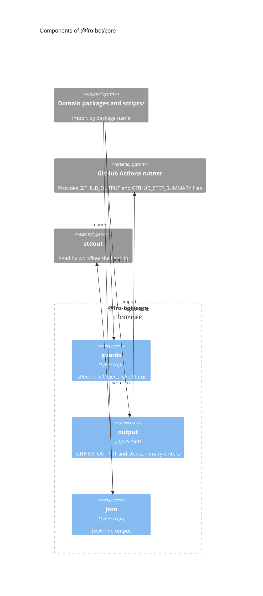

# `@fro-bot/core`

Shared primitives for the Fro Bot control plane: type guards, `$GITHUB_OUTPUT` and step-summary writers, and JSON line output. The package is private (`"private": true`), is never published, and exports `.ts` source with no build step, so Bun, Node strip-only loading, `tsc` and Vitest all load it as written. It depends on nothing but Node built-ins.

Where callers need different behavior, the primitive takes the difference as an explicit option or a separate export, so a caller states the behavior it means. No `scripts/` module uses these primitives yet; each domain package migrates its own copies when it moves.

## Modules

| Subpath | Exports | Notes |
| --- | --- | --- |
| `@fro-bot/core/guards` | `isRecord`, `isObject`, `isApiStatus`, `isApiStatusOfAnyObject` | `isRecord` rejects arrays and `isObject` (narrows to `object`) accepts them. `isApiStatus` rejects arrays and compares `status` strictly; `isApiStatusOfAnyObject` accepts any object. |
| `@fro-bot/core/output` | `writeGithubOutputs`, `appendStepSummary` | A required `onMissing: 'skip' \| 'throw'` policy for an unset or empty variable. A multiline value uses a heredoc with a UUID delimiter and is rejected if it contains the delimiter. |
| `@fro-bot/core/json` | `formatJsonLine`, `writeJsonLine` | Compact JSON plus a newline. Both take `{indent}`; `{indent: 2}` is the output `reset-survey-status` prints. `writeJsonLine` also takes `{sink}`. A value with no JSON form throws. |

### `output`

- `writeGithubOutputs({name: value}, {onMissing})` appends every entry in one write and returns whether it wrote: no entries (or an empty summary) returns false and appends nothing. Names must match `[\w-]+`, so a name cannot carry a line break or `=` into the file. Every entry is formatted before the write, so a bad name or a colliding value writes nothing.
- `onMissing` is required, with no default: `wiki-change-detect` throws when `$GITHUB_OUTPUT` is unset and `dispatch-renovate` throws in plan mode, while the other writers skip. `missingMessage` sets the error text. An empty variable counts as unset.
- `appendStepSummary(markdown, {onMissing})` appends the text as given to `$GITHUB_STEP_SUMMARY`.
- The `env`, `append` and `delimiter` options are seams for tests.

### Mutation coverage

`guards`, `output` and `json` are in the `mutate` set of `stryker.config.json` and held at 100% kills by `bun run check:mutation-guards`. Their tests import them by relative path, because the Stryker sandbox links `node_modules` to the real tree and a package-name import would run against the un-mutated file. Core's tests must kill core's mutants on their own: a consumer's tests never run against them.

## Package diagram

No CLI runs on this package yet.

## Adding a module

1. Add `src/<name>.ts` and its subpath to `exports` in `package.json`. Use erasable TypeScript syntax only: Node strip-only loads the file, and Test Scripts Load fails on `enum`, `namespace` and parameter properties.
2. Add `src/<name>.test.ts` and import the module by relative path.
3. Keep regexes and other constants whose mutants matter inside functions. Stryker covers a mutant in a module-level constant with no test, so it survives.
4. List the module in `stryker.config.json` `mutate` (and its test in `testFiles`), or in `mutation-guards.json` `not-mutated` with a reason. `scripts/mutation-guards-config.test.ts` fails an unlisted module.
5. Update the diagram above and the package graph in the root `README.md`.
