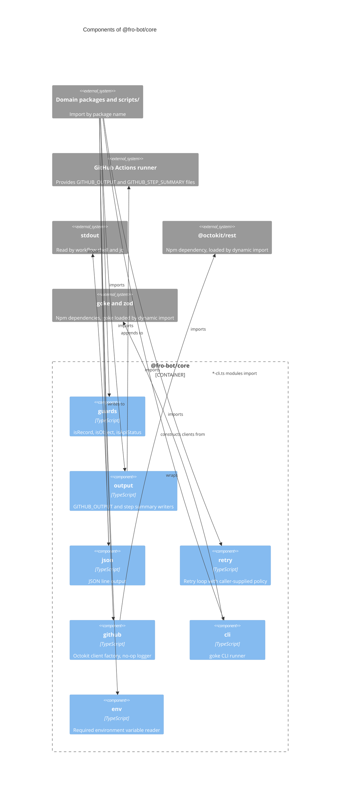

# `@fro-bot/core`

Shared primitives for the Fro Bot control plane: type guards, `$GITHUB_OUTPUT` and step-summary writers, JSON line output, a retry loop, the Octokit client factory, the goke CLI runner and the required-env reader. The package is private (`"private": true`), is never published, and exports `.ts` source with no build step, so Bun, Node strip-only loading, `tsc` and Vitest all load it as written. It depends on `@octokit/rest` (only `github` imports it), `goke` and `zod` (only `cli` imports them). `goke` is pinned to an exact version and `zod` follows the root `zod@4` floor, which resolves to one copy.

Where callers need different behavior, the primitive takes the difference as an explicit option or a separate export, so a caller states the behavior it means. `retry` is used by nine `scripts/` modules and `github` by every `scripts/` module that builds an Octokit client (both listed below). `@fro.bot/wiki-write-core` builds its own clients and does not import core. `guards`, `output`, `json`, `cli` and `env` have no `scripts/` caller.

## Modules

| Subpath | Exports | Notes |
| --- | --- | --- |
| `@fro-bot/core/guards` | `isRecord`, `isObject`, `isApiStatus`, `isApiStatusOfAnyObject` | `isRecord` rejects arrays and `isObject` (narrows to `object`) accepts them. `isApiStatus` rejects arrays and compares `status` strictly; `isApiStatusOfAnyObject` accepts any object. |
| `@fro-bot/core/output` | `writeGithubOutputs`, `appendStepSummary` | A required `onMissing: 'skip' \| 'throw'` policy for an unset or empty variable. A multiline value uses a heredoc with a UUID delimiter and is rejected if it contains the delimiter. |
| `@fro-bot/core/github` | `createOctokit`, `noopLog`, `loadOctokitConstructor`, `OctokitLoadError` | One authenticated `@octokit/rest` client per call. The caller passes the token and any `timeoutMs` and `log`; neither has a default. See below. |
| `@fro-bot/core/cli` | `runCli`, `runCliMain`, `defineCommand`, `z` | The runner every goke CLI goes through. Returns `{exitCode, stdout, stderr}`. See below. |
| `@fro-bot/core/env` | `requiredEnv` | An empty value counts as missing; the caller's `missing` factory sets the error. |
| `@fro-bot/core/retry` | `retry` | `retry(operation, {attempts, delayMs, shouldRetry, retryResult, onRetry, sleep})`. The caller owns the numbers and the predicates. |
| `@fro-bot/core/json` | `formatJsonLine`, `writeJsonLine` | Compact JSON plus a newline. Both take `{indent}`; `{indent: 2}` is the output `reset-survey-status` prints. `writeJsonLine` also takes `{sink}`. A value with no JSON form throws. |

### `output`

- `writeGithubOutputs({name: value}, {onMissing})` appends every entry in one write and returns whether it wrote: no entries (or an empty summary) returns false and appends nothing. Names must match `[\w-]+`, so a name cannot carry a line break or `=` into the file. Every entry is formatted before the write, so a bad name or a colliding value writes nothing.
- `onMissing` is required, with no default: `wiki-change-detect` throws when `$GITHUB_OUTPUT` is unset and `dispatch-renovate` throws in plan mode, while the other writers skip. `missingMessage` sets the error text. An empty variable counts as unset.
- `appendStepSummary(markdown, {onMissing})` appends the text as given to `$GITHUB_STEP_SUMMARY`.
- The `env`, `append` and `delimiter` options are seams for tests.

### `cli`

`defineCommand({name?, readOnly, positionals?, options?, action})` declares a command; `runCli({name, commands, ...}, {argv, env?})` runs one CLI and returns `{exitCode, stdout, stderr}`. `runCliMain` is the entry for a `scripts/<name>.ts` shim: it runs against `process.argv`, writes the result and sets `process.exitCode`, never calling `process.exit`. Only `*-cli.ts` modules import `@fro-bot/core/cli`; `scripts/package-layout.test.ts` fails any other non-test module. `z` is re-exported so a CLI module imports only this subpath.

- **Each command declares `readOnly`.** `false` if it can mutate GitHub, `data`, an external service, or a tracked path in the checkout; writes to a caller-supplied artifact path, `$GITHUB_OUTPUT` or stdout do not count. A CLI that splits its commands declares it per command: a read-only `plan` next to a dispatching root.
- **Declared argument shapes.** A command with no name is the root: it runs for no argv and for argv that names no command. Positionals are `required`, `optional` or `variadic`; options are a goke flag plus a zod schema. Argv that matches nothing declared is a usage error and runs no action.
- **No-argv category.** `noArgv: 'run'` (default) runs the root. `noArgv: 'usage'` prints usage and returns the usage code without running anything.
- **Usage and help.** `usageCode` (default 1), `usageStream` (default `stderr`) and `helpCode` (default: the usage code) are per CLI. `.help()` is always registered, because without it goke exits 0 silently on an unknown command or a stray positional. `--help` on a CLI that documents none is unmatched argv: usage code, stdout empty, no action. A CLI that documents help sets `helpCode: 0` and `usageStream: 'stdout'`.
- **The runner checks what goke does not.** It counts the positionals itself (goke drops extras on a root that declares positionals and accepts any on a root that declares none), rejects `--` (bare or followed by arguments, since a terminator is never declared), runs goke's unknown-option and required-argument checks (it parses with `run: false`), and validates the parsed options against the full zod schemas, because goke enforces only type, int and enum, not refinements such as `.min(1)`. The action receives what zod parsed. `options['--']` never reaches it.
- **Exit codes are recorded, not decided by goke.** The injected `exit` throws a sentinel the runner catches around `parse()`. A no-op `exit` would let `parse()` reject with the original error on a parse error and resolve with the code only recorded on an async action error, so a caller-supplied `exit` is not accepted. The action wrapper writes the CLI's message and records the code itself. It never calls `exit`, so no `error: exit:1` line and no stack reach a workflow. An action returns a number for a non-zero code; a throw uses `errorExitCode` (default 1; 0 for a CLI that must never fail its job) and `errorFormat` (default: the message and a newline).
- **No colour.** goke reads `NO_COLOR` when it loads, so the runner sets it around a dynamic import of goke and puts it back; goke is imported once and every run shares that import, so overlapping runs cannot leave `NO_COLOR` changed; every sink also strips SGR sequences, as a backstop for a goke loaded earlier. That covers goke's own output, the runner's usage errors and what an action writes through its `stdout` and `stderr`. `CI=true` alone turns ANSI on even when piped.
- **Direct writes bypass the sinks.** Output a command writes straight to `process.stdout` or `process.stderr` is not in the result. A spawned test of the `scripts/<name>.ts` entrypoint through `@fro-bot/test-kit/spawn-entrypoint` is the parity authority; `src/cli.spawn.test.ts` does this for the runner on a fixture CLI under Bun and Node, including a 300 KB stdout payload that survives a natural exit and is truncated by a `process.exit(0)` control.
- **Mutation coverage.** The spawned tests do not run under Stryker. `cli.test.ts` kills the runner's mutants in process.
- **Seams.** `importGoke` replaces the shared goke import for that run, so a test can drive a stand-in. It still runs with `NO_COLOR` set, and overlapping seam imports share one set and one restore.
- **Running an action.** A `Command` has no `run`. `prepare(rawOptions)` parses the options with the full schemas and returns `{ok: true, run}` or `{ok: false, message}`; `run` calls the action with what zod parsed. No exported member accepts options the schemas have not checked.

### `env`

`requiredEnv(env, name, {missing})` returns the value, or throws for an unset or empty one. The error is `<NAME> is required` unless `missing(name)` builds the caller's own.

### `retry`

- `operation(attempt)` runs up to `attempts` times (an integer of at least 1, otherwise a `RangeError` before any attempt). An attempt fails by throwing (`shouldRetry(error, attempt)`) or by returning a value the caller wants to try again (`retryResult(value, attempt)`); both default to never.
- The last attempt is never asked and never waited after: its error is thrown, or its value returned, exactly as the operation produced it, so the caller maps an exhausted outcome to its own error or result.
- `delayMs(attempt)` is the wait after failed attempt `attempt`; omitted, zero or negative means no wait. `onRetry(error, attempt)` runs after `shouldRetry` says yes and before the wait, for error retries only.
- `sleep` is a seam for tests. The default is a `setTimeout` looked up when it is used, so fake timers work.
- Callers: `commit-metadata` (409, plus the data-branch bootstrap), `wiki-repair` (tip moved), `rename-tracked-repo` (ref race), `cross-repo-dispatch` (compare-and-swap miss), `private-repo-resolution` (rate limit, 2s doubling), `merge-data-pr` (unknown mergeable state; PR not yet visible or retryable API error, 1s), `merge-back-data` (`raced` or `main-moved`), `gateway-announce` (one retry after 5s on a network error) and `check-renovate-config` (non-200/404). Each keeps its own error type or exhausted result around the call.

### `github`

- `createOctokit(token, {timeoutMs, log, loadConstructor, missingToken})` constructs the client with `{auth: token}` and adds `request: {timeout: timeoutMs}` and `log` only when they are given. There is no default timeout and no default logger: each caller passes the numbers it uses (10 s or 15 s, the no-op logger) or none.
- A token read from the environment passes `missingToken`, a function returning the caller's own error. An undefined or empty token throws it before the constructor is loaded. Without `missingToken`, the token is used as given, an empty string included.
- `@octokit/rest` is loaded by a dynamic import inside this module, so a test's `vi.mock('@octokit/rest')` reaches every client built here, however a caller imports `@octokit/rest` itself. `loadConstructor` is the seam for a test that would rather not touch the module registry.
- The default path returns the real `Octokit` type and takes no client-type argument. A caller takes the client into its own interface by assignment or return type, and the compiler checks `Octokit` against it. `status-truth-proposals`, `status-truth-prs` and `status-truth-detect` declare narrower response shapes than the real client, so they cast at the boundary with `as unknown as`. A client type is inferred only from a custom `loadConstructor`.
- A missing or non-function `Octokit` export throws `OctokitLoadError`, a `TypeError` with `reason` of `'missing-export'` or `'not-a-constructor'`. Callers with a domain error class (`reconcile-repos`, `handle-invitation`, `commit-metadata`, `merge-data-pr`, `wiki-repair`) catch it and rethrow their own.
- `noopLog()` returns four no-op log methods; it is a function so Stryker covers its mutants.
- Callers: the nine `createOctokitFromEnv` factories (`capture-learnings-harvest`, `cross-repo-dispatch`, `status-truth-proposals`, `reconcile-repos` for three credentials, `status-truth-prs`, `wiki-repair`, `merge-data-pr`, `handle-invitation` for two, `commit-metadata`) and the inline sites in `dispatch-renovate`, `drafted-solutions-*`, `merge-back-data`, `rename-tracked-repo`, `status-truth-detect`, `update-metadata`, `wiki-lint-issues` and four `improvement-metrics-*` and `capture-patterns-*` entrypoints. `reconcile-repos` and `handle-invitation` keep one client per credential.

### Mutation coverage

`guards`, `output`, `json`, `retry`, `github`, `cli` and `env` are in the `mutate` set of `stryker.config.json` and held at 100% kills by `bun run check:mutation-guards`. Their tests import them by relative path, because the Stryker sandbox links `node_modules` to the real tree and a package-name import would run against the un-mutated file. Core's tests must kill core's mutants on their own: a consumer's tests never run against them.

## Package diagram

`src/cli.spawn.test.ts` runs a fixture CLI (`fixtures/cli-fixture.ts`) through the runner.

## Adding a module

1. Add `src/<name>.ts` and its subpath to `exports` in `package.json`. Use erasable TypeScript syntax only: Node strip-only loads the file, and Test Scripts Load fails on `enum`, `namespace` and parameter properties.
2. Add `src/<name>.test.ts` and import the module by relative path.
3. Keep regexes and other constants whose mutants matter inside functions. Stryker covers a mutant in a module-level constant with no test, so it survives.
4. List the module in `stryker.config.json` `mutate` (and its test in `testFiles`), or in `mutation-guards.json` `not-mutated` with a reason. `scripts/mutation-guards-config.test.ts` fails an unlisted module.
5. Update the diagram above and the package graph in the root `README.md`.
