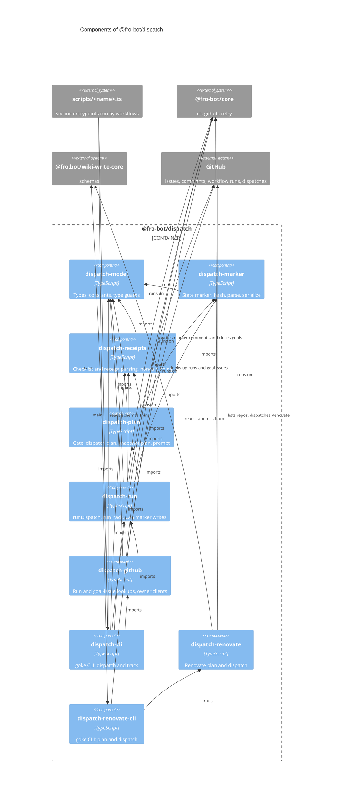

# `@fro-bot/dispatch`

The two dispatchers of the Fro Bot control plane: `cross-repo-dispatch`, which runs an approved multi-repository goal item by item and tracks its receipts, and `dispatch-renovate`, which plans and dispatches Renovate runs. The package is private (`"private": true`), is never published, and exports `.ts` source with no build step, so Bun, Node strip-only loading, `tsc` and Vitest all load it as written.

It depends on `@fro-bot/core` (the Octokit client factory, retry, and the goke runner for the two CLI modules), `@fro.bot/wiki-write-core` (the `schemas` subpath, for the registry read), `@octokit/rest` and `yaml`. It depends on no other package in the workspace.

Each CLI keeps a `scripts/<name>.ts` entrypoint of six lines: `main` from the package's `-cli` module under the entry guard. Workflows run the same paths as before.

## Modules

`cross-repo-dispatch` is split by responsibility. The imports run one way: `dispatch-model` is a leaf, and nothing imports `dispatch-cli`.

| Subpath | Exports | Notes |
| --- | --- | --- |
| `@fro-bot/dispatch/dispatch-model` | The goal, item, marker and plan types, `CrossRepoDispatchOctokitClient`, the constants (`MARKER_PREFIX`, `ELIGIBLE_OWNERS`, `FROBOT_COMMENT_AUTHORS`, `REQUIRED_APPROVER`, `RECEIPT_SLA_MS`, `CAS_MAX_RETRIES`, ...), the status sets and the type guards | Imports nothing from the package. |
| `@fro-bot/dispatch/dispatch-marker` | `hashState`, `extractMarker`, `selectStateMarker`, `computeApprovalFingerprint`, `serializeMarker`, `buildMarkerComment` | The state marker embedded in a coordination issue's comments. The last bot-authored marker wins. |
| `@fro-bot/dispatch/dispatch-receipts` | `parseDecomposition`, `extractItemPrompts`, `buildResultMarker`, `parseResult`, `repairJsonStringEscapes`, `resolveReceipts`, `computeCorrelationId`, `mintNonce`, `hashNonce` | Text parsing of the planner checklist and the worker receipt, the three-gate receipt resolver, and the nonce primitives that bind a receipt to its item. |
| `@fro-bot/dispatch/dispatch-plan` | `gateTarget`, `classifyReceiptCapability`, `planDispatch`, `planSnapshot`, `isPromptSafe`, `buildDispatchPrompt` | Pure planners and the prompt safety policy. |
| `@fro-bot/dispatch/dispatch-run` | `runDispatch`, `runTrack`, `writeResult`, `readLatestMarker`, the input, counts and result types | The executors and the compare-and-swap marker write they share. |
| `@fro-bot/dispatch/dispatch-github` | `findRunByCorrelationId`, `findRunConclusion`, `loadOpenGoalIssues`, `loadOtherOpenGoalMarkers`, `parseTargetTokens`, `createTargetClientResolver`, `buildTargetClients` | Adapters over an injected client. |
| `@fro-bot/dispatch/dispatch-cli` | `runDispatchCli`, `runTrackCli`, `crossRepoDispatchCli`, `main` | The production composition and the goke CLI. The only module here that imports the runner for this CLI. |
| `@fro-bot/dispatch/dispatch-renovate` | `buildDispatchPlan`, `planDispatchRepositories`, `runPlanMode`, `dispatchRenovate`, `runRenovatePlanCli`, `runRenovateDispatchCli` | Renovate plan and dispatch. |
| `@fro-bot/dispatch/dispatch-renovate-cli` | `dispatchRenovateCli`, `main` | The goke CLI over the two Renovate modes. |

## CLIs

Each command declares `readOnly`, a static capability: `true` unless the command can mutate GitHub, `data`, an external service, or a tracked path in the checkout. `$GITHUB_OUTPUT` and stdout do not count.

| CLI | Caller and argv | Runtime | `readOnly` | Exit codes and outputs |
| --- | --- | --- | --- | --- |
| `cross-repo-dispatch dispatch` | `cross-repo-dispatch.yaml`: argv `dispatch` | Bun | `false` | The result file `.counts.{refused,dispatched,deferred,blocked,reconciled,skippedUnsafePrompt,casDeferred}`, also printed on stdout. Without `GITHUB_EVENT_PATH` it writes a message to stderr and exits 1. |
| `cross-repo-dispatch track` | `cross-repo-dispatch.yaml`: argv `track` | Bun | `false` | The result file `.counts.{goalsProcessed,itemsCompleted,itemsFailed,itemsBlocked,itemsStillOpen,goalsClosed,idempotentNoop,casDeferred}`. |
| `dispatch-renovate plan` | `dispatch-renovate.yaml`: argv `plan` | Bun | `true` | `repositories=a,b` on `$GITHUB_OUTPUT`. Throws `GITHUB_OUTPUT is required in plan mode` when the variable is unset. |
| `dispatch-renovate` | `dispatch-renovate.yaml`: no argv, step-if `plan.outputs.repositories != ''` | Bun | `false` | A JSON summary on stdout; `dispatch-renovate: failed <name>: <error>` on stderr for each failed dispatch. |

`cross-repo-dispatch` declares one optional `mode` positional. A missing or unknown mode keeps the message `cross-repo-dispatch: expected argv[2] to be "dispatch" or "track"` on stderr and exits 1. Extra positionals, `--help` and unknown flags are usage errors.

`dispatch-renovate` accepts `plan` or no argument. Any other argv, `--help` and `pln` included, is a usage error: exit 1, usage on stderr, nothing planned or dispatched.

A thrown error prints its message and exits 1; no stack trace reaches stderr.

## The coordination contract

- **Approval is scripted twice.** The workflow gates on the label and the sender; `runDispatch` checks `REQUIRED_APPROVER` and the label again before it reads anything, and removes the label when either check fails.
- **Single writer.** Every marker write is a compare-and-swap against the hash the caller read, retried `CAS_MAX_RETRIES` times and then deferred, never overwritten. The executors re-read and re-compare the approval fingerprint before each item.
- **Receipts are the completion oracle.** A receipt resolves an item only if its author is Fro Bot, its correlation id maps to an item, and `hashNonce` of its nonce equals the item's stored hash. The earliest authentic receipt wins. A run lookup annotates an item that is already `needs-attention` and never changes its state.
- **One client per owner.** `fro-bot` and `marcusrbrown` are separate App installations, so every target-repo call (dispatch, run lookup) goes through the client built from that owner's token in `CROSS_REPO_DISPATCH_TARGET_TOKENS`. A target owner with no token is blocked, not dispatched with another owner's token.
- **15 s per request.** Every `cross-repo-dispatch` client is built with the core factory and a 15 s timeout.

## Component diagram

## Verification

- `packages/dispatch/src/cross-repo-dispatch.test.ts` pins the pure modules and the executors against injected clients.
- `packages/dispatch/src/dispatch-cli.test.ts` and `dispatch-renovate-cli.test.ts` pin the two CLI configs and their argv rules.
- `scripts/dispatch-flows.test.ts` runs the real `scripts/<name>.ts` shims in a child process against a fake GitHub API: the result-file keys the workflow reads, the per-owner token on each lookup, the mode errors and the Renovate usage errors.

## Adding a module

1. Add `src/<name>.ts` and its subpath to `exports` in `package.json`. Use erasable TypeScript syntax only: Node strip-only loads the file, and Test Scripts Load fails on `enum`, `namespace` and parameter properties.
2. Add `src/<name>.test.ts` and import the module by relative path.
3. Keep the import direction: `dispatch-model` imports nothing from the package, and nothing imports `dispatch-cli`. A new `cross-repo-dispatch` module goes in the seam that owns its responsibility; keep every module under 2,000 lines.
4. List the module in `stryker.config.json` `mutate` (and its test in `testFiles`), or in `mutation-guards.json` `not-mutated` with a reason. `scripts/mutation-guards-config.test.ts` fails an unlisted module.
5. Update the diagram above and the package graph in the root `README.md`.
6. A new CLI gets a `*-cli.ts` module (the only kind that may import `@fro-bot/core/cli`), a six-line `scripts/<name>.ts` entrypoint, and a case in `scripts/dispatch-flows.test.ts`.
