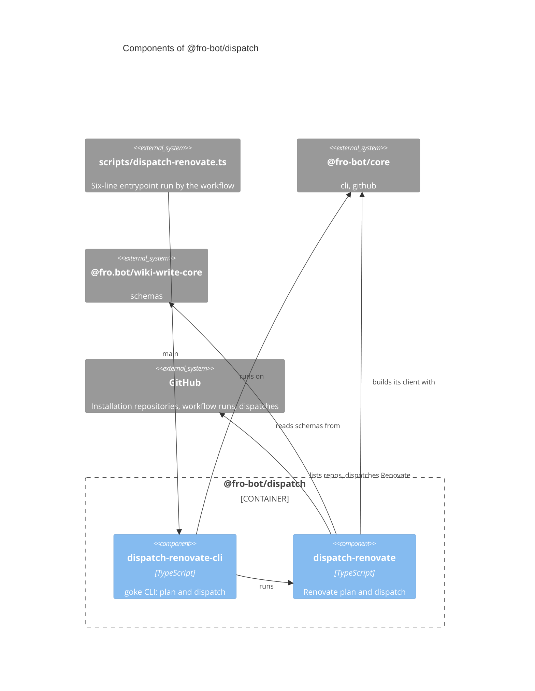

# `@fro-bot/dispatch`

The dispatchers of the Fro Bot control plane. The package is private (`"private": true`), is never published, and exports `.ts` source with no build step, so Bun, Node strip-only loading, `tsc` and Vitest all load it as written.

It depends on `@fro-bot/core` (the Octokit client factory and the goke runner), `@fro.bot/wiki-write-core` (the `schemas` subpath), `@octokit/rest` and `yaml`.

## Modules

| Subpath | Exports | Notes |
| --- | --- | --- |
| `@fro-bot/dispatch/dispatch-renovate` | `buildDispatchPlan`, `planDispatchRepositories`, `runPlanMode`, `dispatchRenovate`, `runRenovatePlanCli`, `runRenovateDispatchCli` | Renovate plan and dispatch. |
| `@fro-bot/dispatch/dispatch-renovate-cli` | `dispatchRenovateCli`, `main` | The goke CLI over the two Renovate modes. |

## CLIs

| CLI | Caller and argv | Runtime | `readOnly` | Exit codes and outputs |
| --- | --- | --- | --- | --- |
| `dispatch-renovate plan` | `dispatch-renovate.yaml`: argv `plan` | Bun | `true` | `repositories=a,b` on `$GITHUB_OUTPUT`. Throws `GITHUB_OUTPUT is required in plan mode` when the variable is unset. |
| `dispatch-renovate` | `dispatch-renovate.yaml`: no argv, step-if `plan.outputs.repositories != ''` | Bun | `false` | A JSON summary on stdout; `dispatch-renovate: failed <name>: <error>` on stderr for each failed dispatch. |

`dispatch-renovate` accepts `plan` or no argument. Any other argv, `--help` and `pln` included, is a usage error: exit 1, usage on stderr, nothing planned or dispatched. A thrown error prints its message and exits 1.

