# `@fro-bot/knowledge`

The learning capture, pattern synthesis and drafted solution doc tools of the Fro Bot control plane: the weekly harvest of merged PRs into `learning-proposal` issues, the pattern clustering and `pattern-proposal` issues built on them, and the three-job drafted-solutions pipeline (harvest, an agent that drafts without write access, and a trusted publish). The package is private (`"private": true`), is never published, and exports `.ts` source with no build step, so Bun, Node strip-only loading, `tsc` and Vitest all load it as written.

It depends on `@fro-bot/core` (guards, env, output, JSON lines, the Octokit client factory and the goke runner), `@fro-bot/privacy` (the fail-closed denylist, the redacted-ID loader and the public-output gate), `@fro-bot/wiki-ops` (`solution-docs-paths` and the `wiki-handoff-core` contract that the drafted handoff shares with the wiki), `@octokit/rest` (a type) and `yaml`. It does not import `@fro-bot/status-truth`. Tests also import `@fro.bot/wiki-write-core`.

Nothing here holds a credential of its own. Every module that writes to GitHub checks the privacy gate first and fails closed: `capture-learnings-open` and `capture-patterns-open` run each issue title and body through the denylist and the public-output gate, and `drafted-solutions-publish` gates every file, row and reason before its first write. The harvest and detect halves are fail-soft by design (a failed scan writes an empty digest and exits 0), and the open and publish halves are fail-hard (a missing input exits 1 before any write). The harvest-to-open and harvest-to-publish digest files are an artifact contract between jobs of different ages, so their key sets and bytes do not change. Each CLI keeps a six-line `scripts/<name>.ts` entrypoint that calls `main` from the package's `*-cli` module, so workflow paths do not change.

## Modules

| Subpath | Exports | Notes |
| --- | --- | --- |
| `@fro-bot/knowledge/capture-learnings-harvest`, `-cli` | `runCaptureLearningsHarvest`, `buildCandidateDigest`, `harvestCandidates`, `harvestCiFixCandidates`, `buildLogExcerpt`, `parseMergeShaMarker`, `createOctokitFromEnv`, ...; `captureLearningsHarvestCli`, `main` | Merged PRs of the last 30 days with two or more Fro Bot review rounds, or a CI failure fixed by a later commit. Stdout is the digest, whose `.telemetry` carries twelve counters. |
| `@fro-bot/knowledge/capture-learnings-open`, `-cli` | `runCaptureLearningsOpen`, `openLearningIssues`, `ensureLabelsExist`, `LEARNING_PROPOSAL_LABEL_DESCRIPTOR`; `captureLearningsOpenCli`, `main` | Opens a `learning-proposal` issue per clean body; counts only on stdout and in the result file. |
| `@fro-bot/knowledge/capture-patterns-synthesis` | `parsePatternProposalSourceIds`, `parsePatternProposalFingerprint`, `collectSolutionDocSources`, `collectLearningProposalSources`, `tokenizeTitle`, `PATTERN_PROPOSAL_REQUIRED_LABELS`, ... | The shared source model and the hidden issue markers. `parsePatternProposalSourceIds` is linear on an issue body of unclosed prefixes. |
| `@fro-bot/knowledge/capture-patterns-cluster`, `-cli` | `runCapturePatternsCluster`, `planPatternCandidates`, `loadSolutionDocFilesFromDisk`, ...; `capturePatternsClusterCli`, `main` | Detect. Writes the pattern digest and prints the thirteen summary keys; a failed token load or scan is flagged in the result and exits 0. |
| `@fro-bot/knowledge/capture-patterns-open`, `-cli` | `runCapturePatternsOpen`, `derivePatternProposalTitle`, `ensurePatternProposalLabelsExist`, ...; `capturePatternsOpenCli`, `main` | Validates the agent's body file, gates every surface and opens at most three issues; fourteen result keys. |
| `@fro-bot/knowledge/drafted-solutions-shared` | `DraftedSolutionsError`, `missingDraftedEnv`, `parseDigest`, `findOpenDraftedPr`, `readRefSha`, ... | The digest shape, constants and API helpers shared by harvest and publish. |
| `@fro-bot/knowledge/drafted-solutions-pr-body` | `parseCoverageBlock`, `validateCoverageRows`, `mergeCoverageRows`, `renderPrBody`, `FIELD_LIMITS`, ... | The hidden coverage block in the drafted PR body. Cell text is length-capped before its whitespace pattern runs. |
| `@fro-bot/knowledge/drafted-solutions-harvest`, `-cli` | `runDraftedSolutionsHarvest`, `harvestDraftedProposals`; `draftedSolutionsHarvestCli`, `main` | Writes the digest, `has_work`, `draft_base_sha` and `main_sha`. Failures print `::error::drafted-solutions-harvest: <message>`. |
| `@fro-bot/knowledge/drafted-solutions-validate-rows`, `-cli` | `runDraftedSolutionsValidateRows`, `validateDraftedRows`; `draftedSolutionsValidateRowsCli`, `main` | The agent's offline check, looped until exit 0. |
| `@fro-bot/knowledge/drafted-solutions-handoff-build`, `-cli` | `runDraftedSolutionsHandoffBuild`, `buildDraftedHandoff`; `draftedSolutionsHandoffBuildCli`, `main` | Builds `manifest.json` and `files/` from git objects in the checkout it is given. |
| `@fro-bot/knowledge/drafted-solutions-publish`, `-cli` | `runCli`, `publishDraftedSolutions`, ...; `draftedSolutionsPublishCli`, `main` | The trusted publish. `runCli` returns the exit code and writes the result file. |

## CLIs

Each command declares `readOnly`, a static capability: `true` unless the command can mutate GitHub, `data`, an external service, or a tracked path in the checkout. A caller-supplied artifact path, `$GITHUB_OUTPUT`, the step summary and stdout do not count.

| CLI | Caller and argv | `readOnly` | Outputs and exit codes |
| --- | --- | --- | --- |
| `capture-learnings-harvest` | `capture-learnings.yaml`: no argv, `\| tee`, `shell: bash` | `true` | Stdout is the digest; `.telemetry.*` carries twelve keys. The digest file is the artifact. Any failure falls back to an empty digest and exit 0. |
| `capture-learnings-open` | `capture-learnings.yaml`: no argv, `\| tee`, `shell: bash` | `false` | Result file `.learningsOpened .blockedOnPrivacy .skippedDuplicate .failed`. A missing input or token throws a message-only error, exit 1. |
| `capture-patterns-cluster` | `capture-patterns.yaml`: no argv, `\| tee`, `bash -Eeuo pipefail {0}` | `true` | Stdout has thirteen keys, `sourcesLoaded` to `tokenLoadFailure`. The digest file is uploaded `if: always()`. Exit 0 on a failed token load or scan. |
| `capture-patterns-open` | `capture-patterns.yaml`: no argv, `\| tee`, `bash -Eeuo pipefail {0}`; job-level dry-run gating | `false` | Result file with fourteen keys. A missing input or token throws a message-only error, exit 1. |
| `drafted-solutions-harvest` | `draft-solutions.yaml`: no argv, `\| tee`, `shell: bash` | `true` | `has_work`, `draft_base_sha`, `main_sha` on `$GITHUB_OUTPUT`; stdout `.hasWork .proposals .prState`; stderr `::error::drafted-solutions-harvest: <message>` and exit 1. |
| `drafted-solutions-validate-rows` | The agent prompt in `draft-solutions.yaml`, looped until exit 0 | `true` | Stdout `rows valid: N row(s), one per digest proposal`; stderr one error per line, then `N error(s): fix rows.json and run this again.`; exit 1. An unreadable or non-JSON input prints one message and exits 1. |
| `drafted-solutions-handoff-build` | `draft-solutions.yaml`, step-if `steps.agent.outcome == 'success'` | `true` | `changed=` on `$GITHUB_OUTPUT`; stdout `{"changed":n}`; stderr `::error::<message>` and exit 1. |
| `drafted-solutions-publish` | `draft-solutions.yaml`: no argv, `shell: bash` | `false` | Result file `.mode .prNumber`; the exit code is `runCli`'s; stderr `::error::drafted-solutions-publish: <message>`. |

Argv that matches nothing declared, `--help` included, is a usage error on every CLI: exit 1, usage on stderr, and nothing runs.

## Package diagram

```mermaid
C4Component
  title Components of @fro-bot/knowledge

  Container_Boundary(knowledge, "@fro-bot/knowledge") {
    Component(capture_learnings_harvest, "capture-learnings-harvest", "TypeScript", "Merged-PR harvest into a candidate digest; privacy-scrubs log diffs; fail-soft")
    Component(capture_learnings_harvest_cli, "capture-learnings-harvest-cli", "TypeScript", "goke CLI; read-only")
    Component(capture_learnings_open, "capture-learnings-open", "TypeScript", "Opens learning-proposal issues behind the privacy gate; fail-hard on inputs")
    Component(capture_learnings_open_cli, "capture-learnings-open-cli", "TypeScript", "goke CLI; writing")
    Component(capture_patterns_cluster, "capture-patterns-cluster", "TypeScript", "Detect: clusters accepted docs and proposals into a pattern digest; fail-soft")
    Component(capture_patterns_cluster_cli, "capture-patterns-cluster-cli", "TypeScript", "goke CLI; read-only")
    Component(capture_patterns_open, "capture-patterns-open", "TypeScript", "Validates the agent bodies and opens pattern-proposal issues; fail-hard on inputs")
    Component(capture_patterns_open_cli, "capture-patterns-open-cli", "TypeScript", "goke CLI; writing")
    Component(capture_patterns_synthesis, "capture-patterns-synthesis", "TypeScript", "Source collection, fingerprints, markers, outcome classification, labels")
    Component(drafted_solutions_handoff_build, "drafted-solutions-handoff-build", "TypeScript", "Agent-side handoff built from git objects")
    Component(drafted_solutions_handoff_build_cli, "drafted-solutions-handoff-build-cli", "TypeScript", "goke CLI; read-only")
    Component(drafted_solutions_harvest, "drafted-solutions-harvest", "TypeScript", "Finds proposals the open drafted PR does not cover; writes the digest")
    Component(drafted_solutions_harvest_cli, "drafted-solutions-harvest-cli", "TypeScript", "goke CLI; read-only; ::error:: format")
    Component(drafted_solutions_pr_body, "drafted-solutions-pr-body", "TypeScript", "Coverage block parse, merge and render; length-capped")
    Component(drafted_solutions_publish, "drafted-solutions-publish", "TypeScript", "Trusted publish: gates, branch and PR writes, proposal closure")
    Component(drafted_solutions_publish_cli, "drafted-solutions-publish-cli", "TypeScript", "goke CLI; writing; runCli owns the exit code")
    Component(drafted_solutions_shared, "drafted-solutions-shared", "TypeScript", "Digest, labels, markers and API helpers shared by harvest and publish")
    Component(drafted_solutions_validate_rows, "drafted-solutions-validate-rows", "TypeScript", "Offline rows check; its strings are a prompt-visible contract")
    Component(drafted_solutions_validate_rows_cli, "drafted-solutions-validate-rows-cli", "TypeScript", "goke CLI; read-only; exit code from the check")
  }

  System_Ext(entrypoints, "scripts/<name>.ts", "Six-line entrypoints run by workflows")
  System_Ext(core, "@fro-bot/core", "cli, env, guards, json, output, github")
  System_Ext(privacy, "@fro-bot/privacy", "capture-learnings-privacy, redacted-ids, status-truth-public-output")
  System_Ext(wikiops, "@fro-bot/wiki-ops", "solution-docs-paths, wiki-handoff-core")
  System_Ext(github, "GitHub", "REST and Git Data API")

  Rel(entrypoints, capture_learnings_harvest_cli, "main")
  Rel(entrypoints, capture_learnings_open_cli, "main")
  Rel(entrypoints, capture_patterns_cluster_cli, "main")
  Rel(entrypoints, capture_patterns_open_cli, "main")
  Rel(entrypoints, drafted_solutions_handoff_build_cli, "main")
  Rel(entrypoints, drafted_solutions_harvest_cli, "main")
  Rel(entrypoints, drafted_solutions_publish_cli, "main")
  Rel(entrypoints, drafted_solutions_validate_rows_cli, "main")
  Rel(capture_learnings_harvest_cli, capture_learnings_harvest, "imports")
  Rel(capture_learnings_open, capture_learnings_harvest, "imports")
  Rel(capture_learnings_open_cli, capture_learnings_open, "imports")
  Rel(capture_patterns_cluster, capture_patterns_synthesis, "imports")
  Rel(capture_patterns_cluster_cli, capture_patterns_cluster, "imports")
  Rel(capture_patterns_open, capture_patterns_cluster, "types with")
  Rel(capture_patterns_open, capture_patterns_synthesis, "imports")
  Rel(capture_patterns_open_cli, capture_patterns_open, "imports")
  Rel(drafted_solutions_handoff_build_cli, drafted_solutions_handoff_build, "imports")
  Rel(drafted_solutions_harvest, capture_learnings_harvest, "types with")
  Rel(drafted_solutions_harvest, drafted_solutions_pr_body, "imports")
  Rel(drafted_solutions_harvest, drafted_solutions_shared, "imports")
  Rel(drafted_solutions_harvest_cli, drafted_solutions_harvest, "imports")
  Rel(drafted_solutions_publish, capture_learnings_harvest, "types with")
  Rel(drafted_solutions_publish, drafted_solutions_pr_body, "imports")
  Rel(drafted_solutions_publish, drafted_solutions_shared, "imports")
  Rel(drafted_solutions_publish_cli, drafted_solutions_publish, "imports")
  Rel(drafted_solutions_shared, capture_learnings_harvest, "types with")
  Rel(drafted_solutions_shared, drafted_solutions_pr_body, "imports")
  Rel(drafted_solutions_validate_rows, drafted_solutions_shared, "imports")
  Rel(drafted_solutions_validate_rows_cli, drafted_solutions_validate_rows, "imports")
  Rel(capture_learnings_harvest, core, "imports")
  Rel(capture_learnings_harvest, privacy, "imports")
  Rel(capture_learnings_harvest_cli, core, "runs on")
  Rel(capture_learnings_open, core, "imports")
  Rel(capture_learnings_open, privacy, "imports")
  Rel(capture_learnings_open_cli, core, "runs on")
  Rel(capture_patterns_cluster, core, "imports")
  Rel(capture_patterns_cluster, privacy, "imports")
  Rel(capture_patterns_cluster, wikiops, "imports")
  Rel(capture_patterns_cluster_cli, core, "runs on")
  Rel(capture_patterns_open, core, "imports")
  Rel(capture_patterns_open, privacy, "imports")
  Rel(capture_patterns_open_cli, core, "runs on")
  Rel(capture_patterns_synthesis, core, "imports")
  Rel(capture_patterns_synthesis, wikiops, "imports")
  Rel(drafted_solutions_handoff_build, core, "imports")
  Rel(drafted_solutions_handoff_build, wikiops, "imports")
  Rel(drafted_solutions_handoff_build_cli, core, "runs on")
  Rel(drafted_solutions_harvest, core, "imports")
  Rel(drafted_solutions_harvest_cli, core, "runs on")
  Rel(drafted_solutions_pr_body, core, "imports")
  Rel(drafted_solutions_pr_body, wikiops, "imports")
  Rel(drafted_solutions_publish, core, "imports")
  Rel(drafted_solutions_publish, privacy, "imports")
  Rel(drafted_solutions_publish, wikiops, "imports")
  Rel(drafted_solutions_publish_cli, core, "runs on")
  Rel(drafted_solutions_shared, core, "imports")
  Rel(drafted_solutions_validate_rows_cli, core, "runs on")
  Rel(capture_learnings_harvest, github, "reads")
  Rel(capture_patterns_cluster, github, "reads")
  Rel(drafted_solutions_harvest, github, "reads")
  Rel(capture_learnings_open, github, "writes")
  Rel(capture_patterns_open, github, "writes")
  Rel(drafted_solutions_publish, github, "writes")

  UpdateRelStyle(entrypoints, capture_learnings_harvest_cli, $offsetX="35", $offsetY="21")
  UpdateRelStyle(entrypoints, capture_learnings_open_cli, $offsetX="39", $offsetY="7")
  UpdateRelStyle(entrypoints, capture_patterns_cluster_cli, $offsetX="50", $offsetY="25")
  UpdateRelStyle(entrypoints, capture_patterns_open_cli, $offsetX="-32", $offsetY="-27")
  UpdateRelStyle(entrypoints, drafted_solutions_handoff_build_cli, $offsetX="51", $offsetY="10")
  UpdateRelStyle(entrypoints, drafted_solutions_harvest_cli, $offsetX="77", $offsetY="-27")
  UpdateRelStyle(entrypoints, drafted_solutions_publish_cli, $offsetX="-56", $offsetY="7")
  UpdateRelStyle(entrypoints, drafted_solutions_validate_rows_cli, $offsetX="-3", $offsetY="-32")
  UpdateRelStyle(capture_learnings_harvest_cli, capture_learnings_harvest, $offsetX="-57", $offsetY="18")
  UpdateRelStyle(capture_learnings_open, capture_learnings_harvest, $offsetX="-70", $offsetY="26")
  UpdateRelStyle(capture_learnings_open_cli, capture_learnings_open, $offsetX="21", $offsetY="7")
  UpdateRelStyle(capture_patterns_cluster, capture_patterns_synthesis, $offsetX="77", $offsetY="33")
  UpdateRelStyle(capture_patterns_cluster_cli, capture_patterns_cluster, $offsetX="-40", $offsetY="29")
  UpdateRelStyle(capture_patterns_open, capture_patterns_cluster, $offsetX="-77", $offsetY="17")
  UpdateRelStyle(capture_patterns_open, capture_patterns_synthesis, $offsetX="-64", $offsetY="-43")
  UpdateRelStyle(capture_patterns_open_cli, capture_patterns_open, $offsetX="-71", $offsetY="-26")
  UpdateRelStyle(drafted_solutions_handoff_build_cli, drafted_solutions_handoff_build, $offsetX="-19", $offsetY="26")
  UpdateRelStyle(drafted_solutions_harvest, capture_learnings_harvest, $offsetX="-73", $offsetY="49")
  UpdateRelStyle(drafted_solutions_harvest, drafted_solutions_pr_body, $offsetX="38", $offsetY="-9")
  UpdateRelStyle(drafted_solutions_harvest, drafted_solutions_shared, $offsetX="32", $offsetY="25")
  UpdateRelStyle(drafted_solutions_harvest_cli, drafted_solutions_harvest, $offsetX="-30", $offsetY="16")
  UpdateRelStyle(drafted_solutions_publish, capture_learnings_harvest, $offsetX="-21", $offsetY="31")
  UpdateRelStyle(drafted_solutions_publish, drafted_solutions_pr_body, $offsetX="-5", $offsetY="13")
  UpdateRelStyle(drafted_solutions_publish, drafted_solutions_shared, $offsetX="-79", $offsetY="34")
  UpdateRelStyle(drafted_solutions_publish_cli, drafted_solutions_publish, $offsetX="-59", $offsetY="8")
  UpdateRelStyle(drafted_solutions_shared, capture_learnings_harvest, $offsetX="-9", $offsetY="2")
  UpdateRelStyle(drafted_solutions_shared, drafted_solutions_pr_body, $offsetX="61", $offsetY="-40")
  UpdateRelStyle(drafted_solutions_validate_rows, drafted_solutions_shared, $offsetX="-15", $offsetY="-10")
  UpdateRelStyle(drafted_solutions_validate_rows_cli, drafted_solutions_validate_rows, $offsetX="-22", $offsetY="15")
  UpdateRelStyle(capture_learnings_harvest, core, $offsetX="-7", $offsetY="-47")
  UpdateRelStyle(capture_learnings_harvest, privacy, $offsetX="-63", $offsetY="22")
  UpdateRelStyle(capture_learnings_harvest_cli, core, $offsetX="-53", $offsetY="1")
  UpdateRelStyle(capture_learnings_open, core, $offsetX="-53", $offsetY="-13")
  UpdateRelStyle(capture_learnings_open, privacy, $offsetX="18", $offsetY="-42")
  UpdateRelStyle(capture_learnings_open_cli, core, $offsetX="-76", $offsetY="37")
  UpdateRelStyle(capture_patterns_cluster, core, $offsetX="-80", $offsetY="-23")
  UpdateRelStyle(capture_patterns_cluster, privacy, $offsetX="-27", $offsetY="-44")
  UpdateRelStyle(capture_patterns_cluster, wikiops, $offsetX="40", $offsetY="-2")
  UpdateRelStyle(capture_patterns_cluster_cli, core, $offsetX="21", $offsetY="3")
  UpdateRelStyle(capture_patterns_open, core, $offsetX="-62", $offsetY="22")
  UpdateRelStyle(capture_patterns_open, privacy, $offsetX="-30", $offsetY="49")
  UpdateRelStyle(capture_patterns_open_cli, core, $offsetX="-11", $offsetY="-7")
  UpdateRelStyle(capture_patterns_synthesis, core, $offsetX="-58", $offsetY="-11")
  UpdateRelStyle(capture_patterns_synthesis, wikiops, $offsetX="5", $offsetY="-49")
  UpdateRelStyle(drafted_solutions_handoff_build, core, $offsetX="24", $offsetY="47")
  UpdateRelStyle(drafted_solutions_handoff_build, wikiops, $offsetX="-50", $offsetY="-33")
  UpdateRelStyle(drafted_solutions_handoff_build_cli, core, $offsetX="-17", $offsetY="40")
  UpdateRelStyle(drafted_solutions_harvest, core, $offsetX="-55", $offsetY="-49")
  UpdateRelStyle(drafted_solutions_harvest_cli, core, $offsetX="-65", $offsetY="9")
  UpdateRelStyle(drafted_solutions_pr_body, core, $offsetX="44", $offsetY="-28")
  UpdateRelStyle(drafted_solutions_pr_body, wikiops, $offsetX="63", $offsetY="-26")
  UpdateRelStyle(drafted_solutions_publish, core, $offsetX="34", $offsetY="15")
  UpdateRelStyle(drafted_solutions_publish, privacy, $offsetX="-32", $offsetY="43")
  UpdateRelStyle(drafted_solutions_publish, wikiops, $offsetX="-47", $offsetY="3")
  UpdateRelStyle(drafted_solutions_publish_cli, core, $offsetX="18", $offsetY="-36")
  UpdateRelStyle(drafted_solutions_shared, core, $offsetX="21", $offsetY="3")
  UpdateRelStyle(drafted_solutions_validate_rows_cli, core, $offsetX="-26", $offsetY="-50")
  UpdateRelStyle(capture_learnings_harvest, github, $offsetX="-11", $offsetY="25")
  UpdateRelStyle(capture_patterns_cluster, github, $offsetX="-3", $offsetY="-48")
  UpdateRelStyle(drafted_solutions_harvest, github, $offsetX="-27", $offsetY="-27")
  UpdateRelStyle(capture_learnings_open, github, $offsetX="20", $offsetY="27")
  UpdateRelStyle(capture_patterns_open, github, $offsetX="67", $offsetY="-38")
  UpdateRelStyle(drafted_solutions_publish, github, $offsetX="-70", $offsetY="-32")
```

## Adding a module

Add `src/<name>.ts` and an `exports` entry in `package.json`. A CLI adds `src/<name>-cli.ts`, which is the only kind of module that imports `@fro-bot/core/cli`, and a six-line `scripts/<name>.ts` that calls its `main`. Tests sit beside the module and import it by relative path. Then do all of these:

- Classify the module in `stryker.config.json` (`mutate`) or `mutation-guards.json` (`not-mutated`, with a measured score).
- A test that reaches a file write or a git call passes only test-owned temp paths, as the working directory and the target. A function that accepts `cwd` passes it to every child process it starts.
- Time any regex that GitHub-controlled or agent-controlled text reaches in `src/regex-scaling.test.ts`, with a long run and with many separate matches in one document, and prove each input reaches the code under test.
- Update this diagram, the root `README.md` graph and `llms.txt`.
