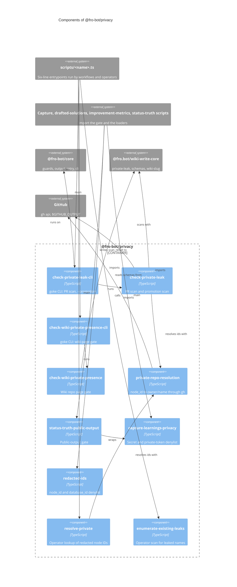

# `@fro-bot/privacy`

The privacy family of the Fro Bot control plane: the gates that keep a private repository's name, node ID and wiki page off every public surface, the loaders that feed them, and the operator tools that map a redacted ID back to a name. The package is private (`"private": true`), is never published, and exports `.ts` source with no build step, so Bun, Node strip-only loading, `tsc` and Vitest all load it as written.

It depends on `@fro-bot/core` (guards, output, retry, and the goke runner for the four CLI modules), `@fro.bot/wiki-write-core` (the `schemas` and `wiki-slug` subpaths, and `private-leak`, whose pure scan `check-private-leak` wraps) and `yaml`. It depends on nothing else in the workspace, so the knowledge and status-truth packages can depend on it without a cycle.

Each CLI keeps a `scripts/<name>.ts` entrypoint of six lines: `main` from the package's `-cli` module under the entry guard. Workflows and operators run the same paths as before.

## Modules

| Subpath | Exports | Notes |
| --- | --- | --- |
| `@fro-bot/privacy/check-private-leak` | `main`, `runPromotionCli`, `runPromotionScan`, `checkPrivateLeak`, `writeScanResult`, `isGh404Error`, `assertCompareNotTruncated`, ... | The PR scan (`main`) and the promotion scan (`runPromotionCli`). Writes `scan_result` before every exit of the PR scan. Mutated. |
| `@fro-bot/privacy/check-private-leak-cli` | `checkPrivateLeakCli`, `main` | The goke CLI over the two scans. Mutated. |
| `@fro-bot/privacy/check-wiki-private-presence` | `runCli`, `detectPrivateWikiLeaks`, `buildPublicSlugMap`, `formatLeakReport`, ... | The `data` to `main` wiki-page gate. `runCli(argv, env)` returns `{exitCode, stdout, stderr}`. Mutated. |
| `@fro-bot/privacy/check-wiki-private-presence-cli` | `checkWikiPrivatePresenceCli`, `main` | The goke CLI over `runCli`. Mutated. |
| `@fro-bot/privacy/capture-learnings-privacy` | `learningBodyHasPrivateLeak`, `logDiffHasSecret`, `redactLogDiffSecrets`, `loadPrivateTokensFromDisk` | The fail-closed denylist for learning bodies and log diffs. |
| `@fro-bot/privacy/status-truth-public-output` | `applyPublicOutputGate`, `makePublicOutputTokens`, `PublicOutputTokens`, ... | The public-output gate every public surface passes through. |
| `@fro-bot/privacy/redacted-ids` | `loadRedactedCanonicalIdsFromDisk`, `extractRedactedCanonicalIds` | The `node_id` and `database_id` denylist of private repos. Lives here, not in `status-truth`, so the knowledge package can load it without importing `status-truth`. |
| `@fro-bot/privacy/private-repo-resolution` | `makeGhNodeIdResolver`, `NodeIdResolver`, `RetryOptions` | Resolves a node ID to `owner/name` through `gh api graphql`, with the 2s doubling retry on a rate limit. |
| `@fro-bot/privacy/resolve-private`, `resolve-private-cli` | `resolvePrivateEntries`, `requireToken`, `formatTable`; `resolvePrivateCli`, `main` | Operator lookup of redacted IDs. |
| `@fro-bot/privacy/enumerate-existing-leaks`, `enumerate-existing-leaks-cli` | `enumerateLeaks`, `formatLeakReport`, `parsePrivateArgs`, `runCli`; `enumerateExistingLeaksCli`, `main` | Operator scan of the checkout for surfaces that name a supplied private repo. |

## CLIs

Each command declares `readOnly`, a static capability: `true` unless the command can mutate GitHub, `data`, an external service, or a tracked path in the checkout. `$GITHUB_OUTPUT` and stdout do not count.

| CLI | Caller and argv | Runtime | `readOnly` | Exit codes and outputs |
| --- | --- | --- | --- | --- |
| `check-private-leak` | `check-private-leak.yaml`: no argv (`continue-on-error`) | Node | `false` | `scan_result` is `success`, `detection` or `error`, written before every exit of the scan. Exit 0 on `success`, 1 otherwise. The default scan can post the override transparency comment on the pull request, so the command is not read-only. |
| `check-private-leak --promotion` | `merge-data.yaml`: `--promotion`, no `continue-on-error` | Node | `false` (same command) | Exit 0 when the diff is clean, 1 when it names a private repo or cannot be checked. No `scan_result`: a scheduled promotion run posts no commit status. A non-zero exit blocks `merge-data-pr`. |
| `check-wiki-private-presence` | `merge-data.yaml`: no argv, `bun --no-install --no-env-file ../scripts/...` from `data-branch-check/` | Bun | `true` | 0 clean, 1 leak (redacted report on stderr), 2 for `--operator-report` in CI. `--operator-report` is local only. |
| `enumerate-existing-leaks` | operator: `--private <node_id>:<owner>/<name>` (repeatable), `--branch <ref>` | Node | `true` | Usage on stdout. No argv exits 1, `--help` exits 0. |
| `resolve-private` | operator: `GH_TOKEN=... bun scripts/resolve-private.ts [repos-path]` | Bun | `true` | The table on stdout. Exit 1 without `GH_TOKEN`. |

`check-private-leak` declares only `--promotion`. Argv that matches nothing declared, `--help` included, is a usage error: it writes `scan_result=error` to `$GITHUB_OUTPUT` (through the runner's `onUsage` hook), exits 1 and scans nothing, so the status step never reads a stale result for a run that did not scan. `check-wiki-private-presence`, `resolve-private` and `enumerate-existing-leaks` treat unmatched argv the same way (usage code 1; `enumerate-existing-leaks` prints its fixed usage text on stdout).

## The privacy boundary

- **Fail closed.** A token, an event payload, a repos file or a diff that cannot be read, parsed or resolved blocks. An empty set is never a stand-in for a failed load.
- **Redact on output.** A failure report lists file paths or per-run labels, never a matched name, a node ID in a public log, or a canonical `owner--repo` filename.
- **The PAT stays on its resolver.** `FRO_BOT_POLL_PAT` reaches only `makeGhNodeIdResolver`. The `gh` and `git` subprocesses that fetch a diff run with it removed from their environment.
- **Both scans run on Node.** `check-private-leak.yaml` installs with `bun install --frozen-lockfile --ignore-scripts` and runs Node strip-only, so every module in this package that the CLI loads uses erasable syntax only.
- **Object shapes.** `private-repo-resolution` and `check-private-leak` read API and event payloads with `isObject`, which accepts an array the way the old local guard did; `capture-learnings-privacy` and `redacted-ids` parse YAML mappings with `isRecord`, which rejects arrays.

## Mutation coverage

`check-private-leak`, `check-private-leak-cli`, `check-wiki-private-presence` and `check-wiki-private-presence-cli` are in the `mutate` set of `stryker.config.json` and held at 100% kills by `bun run check:mutation-guards`. Their tests sit beside them and import them by relative path, because the Stryker sandbox links `node_modules` to the real tree and a name import loads the un-mutated file. The other modules are listed in `mutation-guards.json` as not mutated, each with its reason. `src/repo-page-move.test.ts` tests the wiki-write-core page move through `@fro.bot/wiki-write-core`; it lives here because it imports `check-wiki-private-presence` and so cannot stay in `scripts/` and reach a mutated module by name.

The spawned surface tests of the four entrypoints are in `scripts/privacy-entrypoints.test.ts`: they run the real `scripts/<name>.ts` under Bun or Node with a fake `gh` and assert the exit code, stdout, the stderr prefix and `$GITHUB_OUTPUT`, including the `merge-data.yaml` form from a foreign working directory.

## Package diagram

## Adding a module

1. Add `src/<name>.ts` and its subpath to `exports` in `package.json`. Use erasable TypeScript syntax only: Node strip-only loads the file, and Test Scripts Load fails on `enum`, `namespace` and parameter properties.
2. Add `src/<name>.test.ts` and import the module by relative path.
3. Keep regexes and other constants whose mutants matter inside functions.
4. List the module in `stryker.config.json` `mutate` (and its test in `testFiles`), or in `mutation-guards.json` `not-mutated` with a reason. `scripts/mutation-guards-config.test.ts` fails an unlisted module.
5. Update the diagram above and the package graph in the root `README.md`.
6. A new CLI gets a `*-cli.ts` module (the only kind that may import `@fro-bot/core/cli`), a six-line `scripts/<name>.ts` entrypoint, and a case in `scripts/privacy-entrypoints.test.ts`.
