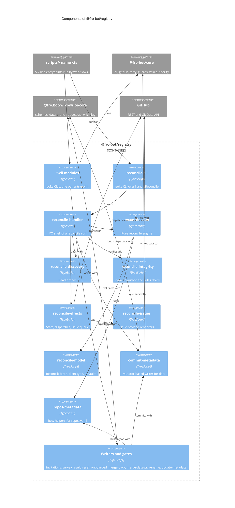

# `@fro-bot/registry`

The writers of `metadata/repos.yaml` and the data-branch merges of the Fro Bot control plane: the App-token metadata writer, the reconcile that syncs the registry with real collaborator access, invitation polling, the survey write-back and its recovery tool, the onboarded gate, `merge-back-data`, `merge-data-pr`, `rename-tracked-repo` and the Renovate metadata refresh. The package is private (`"private": true`), is never published, and exports `.ts` source with no build step, so Bun, Node strip-only loading, `tsc` and Vitest all load it as written.

It depends on `@fro-bot/core` (guards, retry, the Octokit client factory, the goke runner and the PR wiki-authority check), `@fro.bot/wiki-write-core` (the `schemas`, `data-branch-bootstrap` and `wiki-slug` subpaths, and the `assertBranchWritable` guard), `@octokit/rest` (types, and the test mocks) and `yaml`. It depends on nothing else in the workspace.

Every data writer here uses an App token and writes only to the `data` branch, which a repository ruleset restricts to the Fro Bot App; `main` receives those writes only through the weekly `Merge Data Branch` promotion and its gates. Nothing here runs in an agent job. Each CLI keeps a six-line `scripts/<name>.ts` entrypoint that calls `main` from the package's `*-cli` module, so workflow paths do not change.

## Modules

| Subpath | Exports | Notes |
| --- | --- | --- |
| `@fro-bot/registry/commit-metadata` | `commitMetadata`, `CommitMetadataError`, `deepEquals` | The mutator-based writer for `metadata/*.yaml` on `data`: bootstraps the branch, refuses a protected or non-`data` branch, retries a 409 through `@fro-bot/core/retry`. A library with no CLI. |
| `@fro-bot/registry/repos-metadata` | `addRepoEntry`, `applySurveyResult`, `resetSurveyResult`, `publicRepoEntryExists`, `RepoEntryNotFoundError`, `DuplicateRepoIdentityError`, ... | The shape and lookup helpers for `metadata/repos.yaml`. Every writer builds new rows through `addRepoEntry`. |
| `@fro-bot/registry/metadata-wiki-rename-guard` | `findBlockedPublicAssociations`, `lookupRepoWikiPage`, `publicAssociationKey` | Stops a rename or merge from stranding a wiki page. |
| `@fro-bot/registry/update-metadata`, `update-metadata-cli` | `runUpdateMetadata`, `runFromEnv`, `discoverRenovateRepos`, `buildRenovateFile`; `updateMetadataCli`, `main` | Refreshes `metadata/renovate.yaml` from the repos the App installation can see. |
| `@fro-bot/registry/handle-invitation`, `handle-invitation-cli` | `handleInvitations`, `formatInvitationGithubOutput`, `countPublicAcceptedInvitations`, `runHandleInvitation`; `handleInvitationCli`, `main` | Polls repository invitations against the allowlist, with one client per credential. |
| `@fro-bot/registry/record-survey-result`, `record-survey-result-cli` | `runRecordSurveyResult`, `createSurveyWriteBack`, `buildRecordSurveyResultInput`, ...; `recordSurveyResultCli`, `main` | Writes a Survey Repo outcome back to the matching row. |
| `@fro-bot/registry/reset-survey-status`, `reset-survey-status-cli` | `runResetSurveyStatus`, `parseTargets`, `formatResetSurveyTarget`; `resetSurveyStatusCli`, `main` | Operator recovery for survey fields. |
| `@fro-bot/registry/check-repo-onboarded`, `check-repo-onboarded-cli` | `runCheck`, `runCheckRepoOnboarded`; `checkRepoOnboardedCli`, `main` | The survey routing gate. Fails closed to `onboarded=false`. |
| `@fro-bot/registry/merge-back-data`, `merge-back-data-cli` | `mergeBackData`, `runCli`, `MergeBackError`; `mergeBackDataCli`, `main` | Merges `main` into `data` at the start of a merge-data run. Mutated. |
| `@fro-bot/registry/merge-data-pr`, `merge-data-pr-cli` | `mergeDataPr`, `upsertAlertIssue`, `MergeDataPrError`, `runMergeDataPr`; `mergeDataPrCli`, `main` | Opens or refreshes the `data` to `main` promotion PR. |
| `@fro-bot/registry/rename-tracked-repo`, `rename-tracked-repo-cli` | `renameTrackedRepo`, `runCli`, `RenameError`; `renameTrackedRepoCli`, `main` | The operator-dispatched rename: it commits the row and the wiki page move in one Git Data commit. |
| `@fro-bot/registry/reconcile-cli` | `reconcileReposCli`, `main` | The goke CLI over `handleReconcile`. |
| `@fro-bot/registry/reconcile-handler` | `handleReconcile`, `formatCommitMessage`, `HandleReconcileParams`, `HandleReconcileResult` | The I/O shell: read, plan, verify `data`, commit, then dispatch, file issues and sync stars. |
| `@fro-bot/registry/reconcile-plan` | `reconcileRepos`, `detectRenames`, `migrateRepoEntry`, `isEligibleForSurvey`, the probe, input and result types | The pure engine. |
| `@fro-bot/registry/reconcile-discovery` | `fetchPerRepoStatus`, `fetchFieldProbes`, `mergeAccessChannels`, `containsFroBotAgentReference`, ... | The read probes. |
| `@fro-bot/registry/reconcile-integrity` | none outside the handler | The `data` tip-author and rules check, and the alert issue. |
| `@fro-bot/registry/reconcile-issues` | `renderIssuePayload`, `IssuePayload` | Pure issue renderers. |
| `@fro-bot/registry/reconcile-effects` | `syncStars`, `loadDispatchStaggerFromEnv`, `loadMaxDispatchesPerRunFromEnv`, `DISPATCH_DEFAULTS` | The writes: stars, survey dispatches, the issue queue, labels, auto-close and self-heal. |
| `@fro-bot/registry/reconcile-labels` | `TRANSITION_LABELS`, `RENAME_PENDING_LABELS` | The reconcile label constants, a leaf with no imports. |
| `@fro-bot/registry/reconcile-model` | `ReconcileError`, `ReconcileLogger`, `OctokitClient`, `toApiError`, the owner, repo and path defaults | The shared vocabulary, a leaf. |
| `@fro-bot/registry/registry-io` | `RegistryIo` | The stdout and stderr sinks a CLI body writes to. Type only. |

`reconcile-repos` was one 4,280-line module. No non-test module in this package reaches 2,000 lines, and each top-level declaration of the original lives in exactly one seam. `reconcile-repos.test.ts` stays whole and imports the seams by relative path; there is no facade that re-exports them.

## CLIs

Each command declares `readOnly`, a static capability: `true` unless the command can mutate GitHub, `data`, an external service, or a tracked path in the checkout. `$GITHUB_OUTPUT` and stdout do not count.

| CLI | Caller and argv | `readOnly` | Exit codes and outputs |
| --- | --- | --- | --- |
| `reconcile-repos` | `reconcile-repos.yaml`: no argv, piped to `tee`, `shell: bash` | `false` | stdout is one JSON object; the summary step reads 27 `jq` fields from it, and a missing field falls back to 0, so a renamed field fails silently (a test pins every path). Exit 1 on a `ReconcileError`, with its message on stderr. |
| `handle-invitation` | `poll-invitations.yaml`: no argv | `false` | `$GITHUB_OUTPUT` `public_invitations_accepted` and `public_invitations_accepted_repos`, written only when `GITHUB_OUTPUT` is set and non-empty. Exit 1 on a failure. |
| `record-survey-result` | `survey-repo.yaml`: no argv, after the agent and the recheck | `false` | Exit 0 when the target has no entry (stderr `record-survey-result: ...; skipping (non-fatal)`) and for a duplicate identity; exit 1 otherwise. |
| `reset-survey-status` | `reset-survey-status.yaml`: no argv | `false` | stdout JSON indented by two spaces, the only indented output; stderr `reset-survey-status: <message>`; exit 1. |
| `check-repo-onboarded` | `survey-repo.yaml`: no argv | `true` | `onboarded=true\|false` on `$GITHUB_OUTPUT`; stderr `check-repo-onboarded: <reason>`. Never fails. |
| `merge-back-data` | `merge-data.yaml`: no argv, no `continue-on-error` | `false` | stderr `::error::merge-back-data: <CODE>`; exit 1 stops the job before the privacy gates. |
| `merge-data-pr` | `merge-data.yaml`: no argv | `false` | stdout JSON; exit 1 when the PR is conflicted or its mergeability could not be read. |
| `rename-tracked-repo` | `rename-tracked-repo.yaml`: no argv, `refs/heads/main` only | `false` | stdout `{"result": ...}`; stderr `::error::rename-tracked-repo: <CODE>`; exit 1 when blocked or failed. |
| `update-metadata` | `update-metadata.yaml`: no argv | `false` | stdout JSON summary, unconsumed. |

Argv that matches nothing declared, `--help` included, is a usage error: exit 1, usage on stderr, and nothing runs. A failure that used to escape as an uncaught throw now prints its message and exits 1 with no stack.

## Package diagram

## Adding a module

1. Add `src/<name>.ts` and its subpath to `exports` in `package.json`. Use erasable TypeScript syntax only: Node strip-only loads the file, and Test Scripts Load fails on `enum`, `namespace` and parameter properties.
2. Add `src/<name>.test.ts` and import the module by relative path.
3. Keep regexes and other constants whose mutants matter inside functions.
4. List the module in `stryker.config.json` `mutate` (and its test in `testFiles`), or in `mutation-guards.json` `not-mutated` with a reason. `scripts/mutation-guards-config.test.ts` fails an unlisted module.
5. Update the diagram above and the package graph in the root `README.md`.
6. A new CLI gets a `*-cli.ts` module (the only kind that may import `@fro-bot/core/cli`), a six-line `scripts/<name>.ts` entrypoint, and a case in `scripts/registry-entrypoints.test.ts`.
