# `@fro-bot/reports`

The improvement-metrics loop, the daily digest counts and the gateway announcer of the Fro Bot control plane. The loop is two jobs of `improvement-metrics.yaml`: `improvement-metrics-detect` computes a counts-only digest of codified solution classes and the proposal issues that may recur against them, and `improvement-metrics-report` upserts the perpetual report issue from that digest. `daily-digest-counts` derives the numbers the daily digest announces, and `gateway-announce` posts the invitation, survey and digest events to the gateway presence endpoint. The package is private (`"private": true`), is never published, and exports `.ts` source with no build step, so Bun, Node strip-only loading, `tsc` and Vitest all load it as written.

It depends on `@fro-bot/core` (guards, env, JSON lines, retry, the Octokit client factory and the goke runner), `@fro-bot/privacy` (the fail-closed denylist, the redacted-ID loader and the public-output gate) and `yaml`. It imports no other domain package. Tests also import `@fro-bot/test-kit` (the spawn helper and the fake GitHub).

Nothing here holds a credential of its own. `improvement-metrics-report` routes every rendered surface through the public-output gate and writes nothing when the gate or the token load fails. `gateway-announce` signs the exact bytes it sends and never prints the secret, the signature, the body or the context. The detect half falls back to an empty digest and exits 0 on any failure, because detection must never fail the workflow; the report half throws on a GitHub error and exits 1. The detect-to-report digest file is an artifact contract between two jobs, so its key set and bytes do not change.

## Modules

| Subpath | Exports | Notes |
| --- | --- | --- |
| `@fro-bot/reports/improvement-metrics-core` | `buildClassKey`, `buildEdgeFingerprint`, `buildReportVersionMarker`, `parseReportVersionMarker`, `buildEdgeChecklistLine`, `parseEdgeChecklistLine`, `recoverPriorTickState`, `buildLiveStateSummary`, `parseLiveStateSummary`, `classifySourceType`, ... | Pure. The marker and checklist patterns are anchored or fixed-width and linear on a body of unclosed prefixes. |
| `@fro-bot/reports/improvement-metrics-detect`, `-cli` | `runImprovementMetricsDetect`, `computeMetrics`, `scoreCandidateLink`, `tokenizeText`, `splitFrontmatter`, `isMetricsDigest`, `loadGitAddDates`, `writeImprovementMetricsDigestFile`, ...; `improvementMetricsDetectCli`, `main` | Writes `{digest, edges}` to `IMPROVEMENT_METRICS_DIGEST_PATH` and prints a different, flat counts shape on stdout. |
| `@fro-bot/reports/improvement-metrics-report`, `-cli` | `runImprovementMetricsReport`, `renderReportBody`, `renderRunSummary`, `upsertReportIssue`, `ensureReportLabelExists`, `readDigestFile`, `trimTrailingSlashes`, `ReportRenderBlockedError`, ...; `improvementMetricsReportCli`, `main` | Gate-first: a blocked surface performs no create and no update. Writes the counts-only result to stdout and `IMPROVEMENT_METRICS_RESULT_PATH`. |
| `@fro-bot/reports/daily-digest-counts`, `-cli` | `deriveCounts`, `runDailyDigestCounts`; `dailyDigestCountsCli`, `main` | Never throws: a read or derive failure prints `count_status: "error"`. Counts the prior UTC day's surveys. |
| `@fro-bot/reports/gateway-announce`, `-cli` | `announce`, `runCli`, `runGatewayAnnounce`, `isEventType`; `gatewayAnnounceCli`, `main` | The HMAC payload is `v`, `event_type`, `fired_at`, `context`, `rendered_text`, signed as `<timestamp>.<body>`. |

## CLIs

Each command declares `readOnly`, a static capability: `true` unless the command can mutate GitHub, `data`, an external service, or a tracked path in the checkout. A caller-supplied artifact path, `$GITHUB_OUTPUT`, the step summary and stdout do not count.

| CLI | Caller and argv | `readOnly` | Outputs and exit codes |
| --- | --- | --- | --- |
| `improvement-metrics-detect` | `improvement-metrics.yaml`: no argv, no pipe, `bash -Eeuo pipefail {0}` | `true` | The digest file (`.digest.state`, `.edges`), not stdout. Stdout is the flat result (`windowDays` to `gitHistoryUnavailable`) and is never redirected onto the digest path. Any failure falls back to an empty digest and exit 0. |
| `improvement-metrics-report` | `improvement-metrics.yaml`: no argv, `bash -Eeuo pipefail {0}`; the job is skipped on a dry run | `false` | Result file `.outcome .tokenLoadFailure .digestReadFailure`. An empty or missing `GITHUB_TOKEN` with a readable digest throws a message-only error, exit 1, and no result file. |
| `daily-digest-counts` | `fro-bot.yaml`: `metadata/repos.yaml "$TODAY_UTC"`, inside `RESULT="$(...)"` under `set -euo pipefail` | `true` | Stdout `.repos_tracked .surveys_today .count_status`; stderr `daily-digest-counts: ...`. Exit 0 on every data error, with `count_status: "error"`. The date is the second positional, else `TODAY_UTC`, else the UTC clock. |
| `gateway-announce` | `poll-invitations.yaml`, `survey-repo.yaml`, `fro-bot.yaml`: no argv, each step-if gated | `false` | Stdout one JSON result; stderr `gateway-announce: ...`. Exit 0 on every outcome: the kill switch, a missing `EVENT_TYPE`, malformed context JSON, a non-2xx, and any argv. |

Argv that matches nothing declared, `--help` included, is a usage error: exit 1 and usage on stderr, with nothing run. `gateway-announce` sets its usage and error codes to 0, so no argv can fail a step; it posts nothing on a usage error. A bare `-` is not read as a positional, so `daily-digest-counts metadata/repos.yaml -` runs as if the date were absent.

## Package diagram

```mermaid
C4Component
  title Components of @fro-bot/reports

  Container_Boundary(reports, "@fro-bot/reports") {
    Component(daily_digest_counts, "daily-digest-counts", "TypeScript", "Counts public repos and the surveys of the prior UTC day from metadata/repos.yaml; never throws")
    Component(daily_digest_counts_cli, "daily-digest-counts-cli", "TypeScript", "goke CLI; read-only; two optional positionals")
    Component(gateway_announce, "gateway-announce", "TypeScript", "HMAC-signed POST to the gateway presence endpoint; best-effort, one retry")
    Component(gateway_announce_cli, "gateway-announce-cli", "TypeScript", "goke CLI; POSTs; exits 0 on every outcome")
    Component(improvement_metrics_core, "improvement-metrics-core", "TypeScript", "Report states, class keys, edge fingerprints, markers and checklist lines; pure")
    Component(improvement_metrics_detect, "improvement-metrics-detect", "TypeScript", "Computes the metrics digest and edge list from solution docs and proposal issues")
    Component(improvement_metrics_detect_cli, "improvement-metrics-detect-cli", "TypeScript", "goke CLI; read-only")
    Component(improvement_metrics_report, "improvement-metrics-report", "TypeScript", "Renders the public-safe report and upserts the perpetual issue; gate-first")
    Component(improvement_metrics_report_cli, "improvement-metrics-report-cli", "TypeScript", "goke CLI; writing")
  }

  System_Ext(entrypoints, "scripts/<name>.ts", "Six-line entrypoints run by workflows")
  System_Ext(core, "@fro-bot/core", "cli, env, guards, json, retry, github")
  System_Ext(privacy, "@fro-bot/privacy", "capture-learnings-privacy, redacted-ids, status-truth-public-output")
  System_Ext(github, "GitHub", "REST API")
  System_Ext(gateway, "Gateway", "Presence endpoint, HMAC-signed POST")

  Rel(entrypoints, daily_digest_counts_cli, "main")
  Rel(entrypoints, gateway_announce_cli, "main")
  Rel(entrypoints, improvement_metrics_detect_cli, "main")
  Rel(entrypoints, improvement_metrics_report_cli, "main")
  Rel(daily_digest_counts_cli, daily_digest_counts, "imports")
  Rel(gateway_announce_cli, gateway_announce, "imports")
  Rel(improvement_metrics_detect, improvement_metrics_core, "imports")
  Rel(improvement_metrics_detect_cli, improvement_metrics_detect, "imports")
  Rel(improvement_metrics_report, improvement_metrics_core, "imports")
  Rel(improvement_metrics_report, improvement_metrics_detect, "imports")
  Rel(improvement_metrics_report_cli, improvement_metrics_report, "imports")
  Rel(daily_digest_counts, core, "imports")
  Rel(daily_digest_counts_cli, core, "runs on")
  Rel(gateway_announce, core, "imports")
  Rel(gateway_announce_cli, core, "runs on")
  Rel(improvement_metrics_detect, core, "imports")
  Rel(improvement_metrics_detect, privacy, "imports")
  Rel(improvement_metrics_detect_cli, core, "runs on")
  Rel(improvement_metrics_report, core, "imports")
  Rel(improvement_metrics_report, privacy, "imports")
  Rel(improvement_metrics_report_cli, core, "runs on")
  Rel(improvement_metrics_detect, github, "reads")
  Rel(improvement_metrics_report, github, "writes")
  Rel(gateway_announce, gateway, "POSTs")

  UpdateRelStyle(entrypoints, daily_digest_counts_cli, $offsetX="41", $offsetY="-16")
  UpdateRelStyle(entrypoints, gateway_announce_cli, $offsetX="55", $offsetY="35")
  UpdateRelStyle(entrypoints, improvement_metrics_detect_cli, $offsetX="9", $offsetY="-32")
  UpdateRelStyle(entrypoints, improvement_metrics_report_cli, $offsetX="17", $offsetY="-49")
  UpdateRelStyle(daily_digest_counts_cli, daily_digest_counts, $offsetX="15", $offsetY="11")
  UpdateRelStyle(gateway_announce_cli, gateway_announce, $offsetX="-10", $offsetY="32")
  UpdateRelStyle(improvement_metrics_detect, improvement_metrics_core, $offsetX="37", $offsetY="38")
  UpdateRelStyle(improvement_metrics_detect_cli, improvement_metrics_detect, $offsetX="73", $offsetY="-21")
  UpdateRelStyle(improvement_metrics_report, improvement_metrics_core, $offsetX="62", $offsetY="-50")
  UpdateRelStyle(improvement_metrics_report, improvement_metrics_detect, $offsetX="79", $offsetY="-32")
  UpdateRelStyle(improvement_metrics_report_cli, improvement_metrics_report, $offsetX="32", $offsetY="-3")
  UpdateRelStyle(daily_digest_counts, core, $offsetX="-39", $offsetY="-7")
  UpdateRelStyle(daily_digest_counts_cli, core, $offsetX="-27", $offsetY="-43")
  UpdateRelStyle(gateway_announce, core, $offsetX="67", $offsetY="-25")
  UpdateRelStyle(gateway_announce_cli, core, $offsetX="-61", $offsetY="15")
  UpdateRelStyle(improvement_metrics_detect, core, $offsetX="6", $offsetY="37")
  UpdateRelStyle(improvement_metrics_detect, privacy, $offsetX="23", $offsetY="-39")
  UpdateRelStyle(improvement_metrics_detect_cli, core, $offsetX="-76", $offsetY="-43")
  UpdateRelStyle(improvement_metrics_report, core, $offsetX="50", $offsetY="-22")
  UpdateRelStyle(improvement_metrics_report, privacy, $offsetX="-57", $offsetY="4")
  UpdateRelStyle(improvement_metrics_report_cli, core, $offsetX="33", $offsetY="-36")
  UpdateRelStyle(improvement_metrics_detect, github, $offsetX="28", $offsetY="-33")
  UpdateRelStyle(improvement_metrics_report, github, $offsetX="58", $offsetY="-10")
  UpdateRelStyle(gateway_announce, gateway, $offsetX="79", $offsetY="21")
```

## Adding a module

Add `src/<name>.ts` and an `exports` entry in `package.json`. A CLI adds `src/<name>-cli.ts`, which is the only kind of module that imports `@fro-bot/core/cli`, and a six-line `scripts/<name>.ts` that calls its `main`. Tests sit beside the module and import it by relative path. Then do all of these:

- Classify the module in `stryker.config.json` (`mutate`) or `mutation-guards.json` (`not-mutated`, with a measured score).
- A test that reaches a file write or a git call passes only test-owned temp paths, as the working directory and the target. A function that accepts `cwd` passes it to every child process it starts.
- Time any regex that GitHub-controlled or agent-controlled text reaches in `src/regex-scaling.test.ts`, with a long run and with many separate matches in one document, and prove each input reaches the code under test.
- Update this diagram, the root `README.md` graph and `llms.txt`.
