# `@fro-bot/status-truth`

The status-truth maintenance loop and the rollout tracker preflight of the Fro Bot control plane. The loop is three steps that `status-truth.yaml` runs in order: `status-truth-detect` scans the public docs and the issues of this repository for claims about pull requests, issues, releases, plans and the rollout tracker, resolves them against live state and writes a sanitized report; `status-truth-proposals` turns that report into proposal issues; `status-truth-prs` opens bounded correction PRs for the claim kinds that have graduated. `rollout-tracker-snapshot` is the preflight of `gateway-rollout-tracker.yaml`, and `status-truth.yaml` pipes it to `jq` for the rollout-tracker claims.

It depends on `@fro-bot/core` (the Octokit client factory with its no-op logger, the guards, and the goke runner for the four CLI modules), `@fro-bot/privacy` (the public-output gate and the private-token and redacted-ID loaders) and `@fro.bot/wiki-write-core` (the frontmatter splitter that `detect-plan-consistency` reads a plan's block through, and the reader its corrector checks the block with). The package is private and exports `.ts` source with no build step.

Each CLI keeps a `scripts/<name>.ts` entrypoint of six lines: `main` from the package's `-cli` module under the entry guard. Workflows run the same paths as before.

## Modules

`status-truth-detect` and `status-truth-proposals` are each split by responsibility. The imports run one way: `report-model`, `proposal-labels` and `proposal-markers` are leaves of their families, and nothing imports a `-cli` module.

| Subpath | Exports | Notes |
| --- | --- | --- |
| `@fro-bot/status-truth/report-model` | The claim, finding and report types, `CLAIM_KIND_DEFINITIONS`, `KNOWN_SCHEMA_VERSION`, `KNOWN_FINGERPRINT_VERSION`, `normalizeClaimText`, `computeClaimFingerprint`, `buildStatusTruthReport`, `selectDetectFailureClass`, `isKnownReportVersion`, `validateStatusTruthArtifact` | Shared by detect, proposals and prs. Imports only the snapshot types. |
| `@fro-bot/status-truth/detect-classify` | `detectStatusTruthClaims`, `classifyClaim`, `buildProposedCorrection` | Pure verdicts. Imports only `report-model`. |
| `@fro-bot/status-truth/detect-extract` | `SCAN_GLOB_PATTERNS`, `extractStatusTruthClaimsFromText`, `scanStatusTruthClaims`, `scanIssueStatusTruthClaims`, `isStatusTruthProposalIssue`, the linear matchers (`matchCrossRepoRefs`, `matchCrossRepoPrIssueClaims`, `matchCrossRepoReleaseClaims`, `matchPlanStatusClaims`) and the lister and reader types | Claim extraction and the scans. |
| `@fro-bot/status-truth/detect-rollout` | `resolveRolloutTrackerClaim`, `isValidSnapshotItem`, `loadRolloutSnapshot` | Depends on the snapshot types and never on `detect-live-state`. |
| `@fro-bot/status-truth/detect-live-state` | `DetectOctokitClient`, `listCurrentRepoIssues`, `listCurrentRepoIssueComments`, `proveRepoPublic`, `resolveClaimLiveState`, `resolveFileParseClaims`, `resolveAllClaims` | Read-only resolution against the current repository. |
| `@fro-bot/status-truth/detect-plan-consistency` | `resolvePlanStatusClaim`, `parsePlanUnitCheckboxes`, `buildPlanConsistencyClaim`, `resolvePlanConsistencyVerdict`, `correctPlanConsistencyStatusLine`, `reverifyPlanConsistencyCorrection`, `scanPlanConsistencyFindings` | The plan-status detector accepts only `complete`. `status-truth-prs` writes with the corrector. |
| `@fro-bot/status-truth/detect-cli` | `runDetect`, `buildDetectOctokitOptions`, `statusTruthDetectCli`, `main` | The production composition and the goke CLI. |
| `@fro-bot/status-truth/proposal-labels` | `PROPOSAL_LABEL`, `OUTCOME_LABELS`, the terminal, resolving and accuracy-signal sets, `REQUIRED_LABELS` | A leaf. `scripts/settings-labels-effective-set.test.ts` loads it. |
| `@fro-bot/status-truth/proposal-markers` | `extractProposalFingerprint`, `extractRecordedLiveState`, `extractProposalKind`, `recoverProposalKind`, `buildFingerprintMarker`, `buildLiveStateMarker`, `buildKindMarker`, `isWithinCooldown` | A leaf. The marker prefixes and patterns and the cooldown length are private to it. |
| `@fro-bot/status-truth/proposal-outcomes` | `classifyProposalOutcome`, `buildOutcomeCounts`, `buildOutcomeCountsByKind` and their types | Counts only. |
| `@fro-bot/status-truth/proposal-plan` | `planStatusTruthProposalActions`, the action and input types, the title, body and comment builders | Pure. One long planner function. |
| `@fro-bot/status-truth/proposal-exec` | `StatusTruthOctokitClient`, `fetchExistingProposalIssues`, `ensureStatusTruthLabels`, `executeStatusTruthProposalActions` | The label gate and the writes. |
| `@fro-bot/status-truth/proposals-cli` | `runOpen`, `statusTruthProposalsCli`, `main` | The production composition and the goke CLI. |
| `@fro-bot/status-truth/status-truth-prs` | `planStatusTruthPrActions`, `executeStatusTruthPrActions`, `fetchExistingCorrectionPrs`, `fetchTerminalFingerprints`, `isPrExecutionArmed`, `runPrsCore`, `runPrs`, `buildEnvBackedRunPrsCoreDeps`, `GRADUATED_CLAIM_KINDS` | Planner, executor and the testable core. |
| `@fro-bot/status-truth/prs-cli` | `statusTruthPrsCli`, `main` | The goke CLI. |
| `@fro-bot/status-truth/rollout-tracker-snapshot` | `runRolloutTrackerSnapshot`, `buildSnapshot`, `hashSnapshot`, `decideComment`, the marker and mention helpers, the types | The preflight. Reads through `gh` and the health endpoint. Takes its tracker issue, Project and operator from the program config. |
| `program-trackers` (relative import, not exported) | `parseProgramTrackers`, `loadProgramTrackers`, `selectProgram`, `issueRef`, `isOperatorComment`, `isAuthorizedTrigger`, `confirmedReposMissing`, `isPublicVisibility`, the entry types | Reads and validates [`program-trackers.json`](../../program-trackers.json) (an entry may name its `domain` and, with one, the confirmed repos that get `part0`) and holds the pure predicates the snapshot uses. Every failure is an `Error` with a fixed message. Mutated by Stryker. |
| `rollout-tracker-attention` (relative import, not exported) | `withAttention`, `bootstrapInstructions`, `domainReasonSuffix`, `countOf`, `STALE_RUN`, `LOOKUP_FAILED` | The domain-only wording of the preflight (the bootstrap instructions and the words a domain adds to the wake reason) and the digest and count of what needs attention in a domain program. |
| `rollout-tracker-goals` (relative import, not exported) | `planGoals`, `planAnswers`, `goalReaders`, `memoizeReaders`, `goalMarker`, `parityFollowsComment`, the batch, plan, part and reader types | The goal and answer duties of a domain program: which batches of the program's repositories still need a goal issue, its checklist comment or its Project item, with every text written; and where each repository's part stands (its answer, hold or stall) and which Part 0 hand-overs are due. Imports `@fro-bot/dispatch/dispatch-model` for the prompt and item limits and `@fro-bot/dispatch/dispatch-marker` for the goal marker. Reads through `gh`, or the fixtures below. |
| `program-domains` (relative import, not exported) | `parseProgramDomains`, `loadProgramDomains`, `selectDomain`, `findIneligibleDomainRepos`, `checkDomainReposInRegistry`, `checkProgramDomainRefs`, the domain, brief and registry types | Reads and validates [`program-domains.json`](../../program-domains.json): each domain's repositories (by name and node ID, a repository in at most one domain, and no node ID twice anywhere in the file) and its brief, the bar for security, agent automation and developer experience as standards plus per-repository exceptions. `findIneligibleDomainRepos` and `checkDomainReposInRegistry` are pure functions for the point of use (the first lists every ineligible repository with its position, the second throws on the first): they require each listed repository's name and node ID to resolve to exactly one registry row (a name or node ID that matches several rows, or that points at different rows, fails) that is public and not archived; `checkProgramDomainRefs` requires every `domain` of a program in `program-trackers.json` to name a listed domain. Every failure is an `Error` with a fixed message that names a position, never content. Mutated by Stryker. |
| `@fro-bot/status-truth/rollout-tracker-snapshot-cli` | `rolloutTrackerSnapshotCli`, `main` | The goke CLI. |

## CLIs

Each command declares `readOnly`, a static capability: `true` unless the command can mutate GitHub, `data`, an external service, or a tracked path in the checkout. `$GITHUB_OUTPUT` and stdout do not count.

| CLI | Caller and argv | Runtime | `readOnly` | Exit codes and outputs |
| --- | --- | --- | --- | --- |
| `status-truth-detect` | `status-truth.yaml`: no argv | Bun | `true` | The report file, uploaded `if: always()`, and the summary keys `.status .scan_complete .counts.{total,current,drifted,unresolved,unsafe,proposal_eligible}`; a counts-only line on stdout. A missing `STATUS_TRUTH_REPORT_PATH`, a malformed `GITHUB_REPOSITORY` and an unwritable report print one message and exit 1. |
| `status-truth-proposals` | `status-truth.yaml`: no argv, job `if: always()` | Bun | `false` | The result file `.dryRun .labelGateFailed .counts.* .plannedCounts.* .outcomeCounts.* .plannedCountsByKind .outcomeCountsByKind`, also printed on stdout. Exit 1 on a missing report path, an unreadable, unparsable or invalid report, a token-load failure, a missing token on a live run, and a failed issue fetch on a live run. |
| `status-truth-prs` | `status-truth.yaml`: no argv, only on a manual dispatch | Bun | `false` | The result file `.armed .dryRun .plannedCounts.* .executedCounts.* .terminalFingerprint* .error`, also printed on stdout. The exit code is 1 on an early failure, with a closed-vocabulary `error`. |
| `rollout-tracker-snapshot` | `gateway-rollout-tracker.yaml`: `RESULT="$(...)"` under `set -euo pipefail`; `status-truth.yaml`: `... 2>file \| jq -e '.snapshot'` inside an `if` | Bun | `true` | One JSON line on stdout: `.should_comment .reason .pending_mention_ids .marker .marker_comment_id .operator_comment_ids .bootstrap_repos .bootstrap_blocked .public_items .program.{key,issue,repo,project_url,operator_login,evidence} .domain.bootstrap_instructions .domain.goal_instructions` (the last two only for a program with a `domain`) for the job outputs, and `.snapshot` for the rollout-tracker claims. The exit code is set without `process.exit`, so a result of any size is delivered whole through a pipe. A failed signal read exits 1 with an empty stdout. |

Every CLI declares one root command with no positional and no option. Any argument, `--help` and `--help=false` included, is a usage error: exit 1, usage on stderr, and nothing is read or written. Before the runner an argument was ignored and the step ran.

A thrown error prints its message and exits 1; no stack trace reaches stderr.

## The program config

`program-domains.json` at the repository root groups repositories into domains and gives each a brief; a program entry in `program-trackers.json` may name its `domain`, which must be a key there. The first domain is `harness-tools` (`marcusrbrown/systematic`, `fro-bot/space-bus`, `fro-bot/dashboard`, `marcusrbrown/metacogs`, `marcusrbrown/opencode-copilot-delegate`, `marcusrbrown/dev-like`, `marcusrbrown/mothership`). The preflight of a program that names a `domain` reads the domain file (see [Domain programs](#domain-programs)); a program with no `domain` reads neither file. The domain file's pull request checks structure only. Eligibility is checked where a domain is used: only public tracked repositories are eligible, `findIneligibleDomainRepos` is the check the tracker's preflight runs against the `data` branch's `metadata/repos.yaml`, and dispatch's eligibility gate refuses an ineligible target, so a registry change (a repository turning private or being archived) never blocks a pull request or a data promotion.

`program-trackers.json` at the repository root maps each cross-repo program to its tracker issue, its Project and its operator. #3512 is the `gateway` entry. `rollout-tracker-snapshot` reads the entry named by `ROLLOUT_TRACKER_PROGRAM` (default `gateway`) from the file at `ROLLOUT_TRACKER_CONFIG` (default: the committed file). A missing file, malformed JSON, a duplicate key or issue, a bad field or an unknown program key prints `rollout-tracker-snapshot: FATAL — program config: <fixed message>` and exits 1 before any read.

An empty `programs` array is valid: it is what closing out the last program leaves. The fan-out job then logs `program-trackers.json lists no program; nothing to dispatch` and succeeds, and an explicit request for a removed program still fails with `unknown program key`. The operator is matched by numeric user ID when a comment carries one (the relay routes by ID, and a login can change case); the login, compared ignoring case, is the fallback for a comment with no ID. When a bootstrap is due, the preflight reads `program-trackers.json` from the tracker repository's default branch through the contents API (`ROLLOUT_TRACKER_DEFAULT_CONFIG` replaces the read in tests) and keeps only the repos that branch still confirms for the same program key, by name and node ID. A re-run of an old revision therefore cannot bootstrap a program that has been removed since. A failed or unparsable read exits 1 with `failed to read the default-branch program config`.

`status-truth.yaml` passes `ROLLOUT_TRACKER_PROGRAM=gateway` itself. When that key is gone from the config (a closed-out program), the snapshot step prints `program gateway is not in program-trackers.json; rollout-tracker claims are skipped` and produces no snapshot, so those claims stay unresolved and no proposal is made. This is the existing unavailable-snapshot path with a different log line; the consumer has no separate "closed" verdict.

| Field | Meaning |
| --- | --- |
| `key` | The program name. Lowercase letters, digits and hyphens |
| `issue` | The tracker issue as `owner/repo#n` |
| `project` | `owner`, `number` and `gateField`, the name of the free-text gate column |
| `operator` | The numeric `id` and the `login` of the one person whose comments drive the program |
| `evidence` | `gateway` reads #3512's releases, deploys and health contract. `none` reads nothing outside GitHub, and `snapshot.external` is `{}` |
| `repos` | Optional. The confirmed repos (`nameWithOwner`, `nodeId`) |

The file is owned by `@marcusrbrown` in `.github/CODEOWNERS`. The operator comment check compares the login, and also the numeric ID when the comment carries one.

## Starting a program

A program enters `program-trackers.json` through a PR that lists its confirmed `repos`. Once that PR is on `main`, `rollout-tracker-snapshot` returns `bootstrap_repos`: the confirmed repos that are still public and have no Project item, in config order. A non-empty list wakes the tracker with a reason that starts with `bootstrap`, even when the hash and the mentions are unchanged, and the tracker prompt files one issue in each listed repo and adds it to the Project. A run that stops partway is finished by the next one, because the list is recomputed from the Project every time. A confirmed repo that has turned private, or answers 404, is never listed. A confirmed repo with issues disabled (`has_issues` is read with the visibility, in one call per repo) is left out of `bootstrap_repos` and listed in `bootstrap_blocked` instead. It never wakes the tracker; the prompt lists it once, as an operator step, whenever the tracker wakes for another reason. The visibility of every confirmed repo is read like the repos of the Project items, and a read that fails for any other reason exits 1.

## Domain programs

A program entry that names a `domain` runs its bootstrap through part issues that carry the domain's brief. The preflight adds one field, `domain`, to its result; a program without a `domain` prints no such field, and #3512's whole line and rendered tracker prompt are pinned unchanged.

```json
{
  "...": "every field a program without a domain prints",
  "domain": {
    "key": "harness-tools",
    "brief_commit": "<the 40-hex commit of main this run reads>",
    "brief_error": null,
    "registry_error": null,
    "part_issue_error": null,
    "part0_repos": [{"nameWithOwner": "fro-bot/space-bus", "nodeId": "R_kgDOTMGFnQ"}],
    "ineligible_repos": ["domains[0].repos[1] is private"],
    "part_issues": [{"repo": "fro-bot/dashboard", "title": "Program <key>: your part", "body": "<fixed text>", "marker": "<!-- fro-bot-program-part program=<key> node=<node ID> -->", "existing": null}],
    "deferred_repos": [],
    "bootstrap_instructions": "\n\nDomain program. ...",
    "goal_batches": [
      {
        "batch": "initial",
        "marker": "<!-- fro-bot-program-goal program:<key> batch:initial -->",
        "title": "Program <key>: your part, first batch",
        "body": "<fixed text, ending in the marker>",
        "checklist": "<one comment: the items region with one checklist line per repo>",
        "repos": ["fro-bot/dashboard"],
        "goal_issue": null,
        "has_checklist": false,
        "in_project": false,
        "error": null,
        "part0_pr": null
      }
    ],
    "goal_error": null,
    "part0_unreadable": [],
    "goal_instructions": "\n\nGoals. ..."
  }
}
```

- **A run is current only at main's head.** The brief stays pinned to the run's commit and decides what a part issue says; it never authorizes the write. The preflight reads main's head from the brief repository (`gh api repos/<repo>/commits/main --jq .sha`; `ROLLOUT_TRACKER_MAIN_HEAD` replaces the read in tests) and compares it with the pinned commit. A run on an older commit sets `brief_error` to `stale-run`, files nothing for the program, and leaves a fresh run to file; a head that cannot be read sets `the head of main cannot be read`. Nothing is read from main beyond that sha, so the domain file is read once, from the checkout.
- **The brief** is read from `program-domains.json` in the checkout (`ROLLOUT_TRACKER_DOMAINS` replaces the path in tests) and pinned to the commit the workflow passes as `ROLLOUT_TRACKER_BRIEF_COMMIT`, which is `github.sha` only for a run on `main` and empty otherwise, with `ROLLOUT_TRACKER_BRIEF_REPO` naming the repository. A missing or invalid domain file, a domain the file does not list, an empty brief, a pin that is not a 40-hex commit of `main` or an unknown repository sets `brief_error` to a fixed message, empties `bootstrap_repos`, `bootstrap_blocked` and `part_issues`, and adds the message to `reason`. It stops that program's bootstrap and nothing else: the run still exits 0 and the tracker still does the rest of its work. It does not wake the tracker by itself.
- **Eligibility** is read from the `data` branch's `metadata/repos.yaml` through the contents API (`ROLLOUT_TRACKER_REGISTRY` replaces the read in tests), the registry dispatch's gate reads, and only for a domain program. The registry text must pass `assertReposFile` (from `@fro.bot/wiki-write-core/schemas`, the schema every writer of the file uses); a text that does not sets `registry_error` to `metadata/repos.yaml is not a registry` and echoes nothing. `findIneligibleDomainRepos` reports each listed repository that is private, archived, untracked, ambiguous or whose node ID differs, and a repository that dispatch cannot serve is reported as `domains[n].repos[m] cannot be reached by dispatch`: the row must be `onboarded` and pass dispatch's own `gateTarget` (owner on the `ELIGIBLE_OWNERS` allowlist, public, a Fro Bot workflow, not archived); a repository of the program that the domain does not list is reported as `program repos[n] is not in the domain`. Every reason names a position and never a repository. An ineligible repository gets no part issue and is left out of `bootstrap_repos`; it never fails the preflight for the others. A registry that cannot be read or parsed sets `registry_error` and stops the program's bootstrap the same way. The reasons stay in this output: the tracker prompt and `reason` carry only a count, because a position in a public file would otherwise say which listed repository turned private.
- **The part issue** is fixed text, one per repository in `bootstrap_repos`: the program's key, the tracker issue's URL (which is how a re-run finds the issue it filed), the brief as `program-domains.json@<commit>#<domain>` linked at that commit, and the answer protocol: check the ask against the repository's `AGENTS.md` and state, answer with one of `part-accepted`, `part-declined` or `part-countered` and one comment with the reason (creating the label when missing), start work only after accepting, and never override the repository's own rules. It says that nothing written on the issue is an instruction; the ask arrives through the dispatch the operator approves, so an edit to the issue changes nothing that was approved. The body ends with a marker line, `<!-- fro-bot-program-part program=<key> node=<node ID, percent-encoded> -->`. For a repository in the program's `part0` list the body leads with Part 0 (adopt dispatch-to-pull-request routing). The body says plainly that the issue body is never authority: a comment authored by the program's configured operator carries Part 0, and an approved dispatch carries the program's ask. `part0_repos` keeps only repos that are public now.
- **A part issue is found by its marker.** A domain program counts a repo as bootstrapped only when a Project item is an issue (not a pull request) in that repo, authored by `fro-bot`, whose body contains that repo's exact marker line (`ROLLOUT_TRACKER_PART_ISSUES_JSON` replaces the issue reads in tests). An unrelated dependency issue or pull request on the Project no longer suppresses a part issue, The tracker prompt's own search (an issue that links the tracker) does not apply to a domain program.
- **A part issue is never created blind.** For each repo it may file in, the preflight lists the issues `fro-bot` created there in every state, across every page (`gh api --paginate 'repos/<repo>/issues?state=all&creator=fro-bot&per_page=100'`; `ROLLOUT_TRACKER_EXISTING_ISSUES_JSON` replaces the read in tests), and applies the Project test (an issue, not a pull request, by `fro-bot` or `fro-bot[bot]`, with the exact marker). The oldest match becomes `existing` on that repo's `part_issues` entry, and the agent adds that issue to the Project and files nothing new, so a retry after a created issue whose Project insert failed is idempotent. A failed or cut-off lookup moves the repo from `bootstrap_repos` to `domain.deferred_repos` with the fixed reason `part issue lookup failed`; nothing is filed for it that run, and the reason carries the count. The search finds only issues created as `fro-bot`, the account the tracker files as. An issue that cannot be read sets `part_issue_error` and stops the program's bootstrap. #3512 keeps its rule: any Project item of a confirmed repo counts.
- **The tracker prompt** takes `domain.bootstrap_instructions` through the `domain_bootstrap` job output, placed right after the Bootstrap duty. It hands the agent each part issue to file as JSON and tells it to use the title and body exactly. For a program with no `domain` the output is empty and the rendered prompt is unchanged.

### Goal batches

The same preflight lists the goals the tracker still has to open, as `domain.goal_batches`. A batch is a set of the program's eligible, public repositories that dispatch as one goal with one approval.

- **The first batch** (`initial`) is every eligible repo that is not in the program's `part0` list, and is listed only once every eligible repo has a part issue on the Project. **Its members and brief commit are fixed when its goal is created**: the goal body records them on lines of their own, `<!-- fro-bot-program-goal-repos owner/a,owner/b -->` and `<!-- fro-bot-program-goal-brief <40-hex commit> -->`, ahead of the key. A repair of an existing goal (a missing checklist) uses only those lines, never today's repos or today's pin: when a recorded member's part issue is missing from the Project (or the repo is no longer eligible), the batch is listed with the fixed `error` `a member of the goal is not ready, so its checklist waits`, an empty `checklist` and nothing to write, until the member is back; a goal that records neither line gets the fixed `error` `the goal does not record its members and brief commit` when its checklist is missing. A repo that is eligible later and not recorded gets its own `join-<node ID>` batch (a part issue on the Project is all it needs); the first batch is not listed again and no replacement checklist is ever posted on an existing goal.
- **Each repo in `part0`** has its own batch (`parity-<node ID>`) once a Part 0 pull request has merged. Part 0 is a merged pull request in that repo that references the repo's part issue: the part issue's timeline (`gh api --paginate repos/<repo>/issues/<n>/timeline` filtered to `cross-referenced` events; one read) names the referencing issue or pull request, its repository and whether it merged, and the lowest merged pull request of that repo counts. A pull request merely linked in a comment, whoever wrote it, does not. A repo whose timeline cannot be read is named in `part0_unreadable` and gets no batch yet; it never fails the run. A repo with Part 0 unmerged is in no batch. **A parity batch is listed, and a missing checklist on an existing parity goal repaired, only once the tracker's parity-follows comment exists on the part issue** (until then the batch is listed with the fixed `error` `the parity-follows comment is missing, so its checklist waits` and nothing to write) (see [Answers, holds and stalls](#answers-holds-and-stalls)); a part issue that cannot be read is named in `part0_unreadable` too.
- **The goal is found by its key.** The goal body ends with `<!-- fro-bot-program-goal program:<key> batch:<name> -->`; an issue of the tracker repo, labeled `cross-repo-goal`, created by `fro-bot` (or `fro-bot[bot]`), not a pull request, carrying that exact line is the batch's goal (`gh api --paginate 'repos/<tracker repo>/issues?state=all&creator=fro-bot&labels=cross-repo-goal&per_page=100'`; the oldest wins). The preflight reads the goals only when a batch could be listed.
- **Repair.** A batch whose goal, its checklist comment (a `fro-bot` comment with the items region and a line for each repo of the batch, whatever brief commit it pins) and its Project item all exist is not listed again. Any other batch stays listed, with `goal_issue`, `has_checklist` and `in_project` saying what exists; the tracker reuses the goal and writes only what is missing, so an approved goal keeps the brief commit it was approved with. A goal that is closed is done: it is not listed, so an operator who closes a goal declines it.
- **The text is the preflight's.** Each checklist line is `- [ ] owner/repo: <ask>. Brief: program-domains.json@<commit>#<domain>. Part issue: <url>`, and the ask is a fixed template: the program, the domain, the tracker issue, the instruction to answer on the part issue (`part-accepted`, `part-declined` or `part-countered`, with the reason) before changing anything, and never to override the repository's rules. What follows `owner/repo: ` is at most `MAX_PROMPT_LENGTH` (4,000) characters, the limit dispatch applies to a prompt; a batch with a longer line, or with more repos than `MAX_ITEMS_PER_GOAL` (20), is listed with a fixed `error` and an empty `checklist`, and the tracker writes nothing for it and says why.
- **Wake.** A batch without an `error` wakes the tracker with the reason `goal batches — N batch(es) need a goal issue, its checklist or its Project item`, even when the hash and the mentions are unchanged; the list is recomputed on every run, so a run that stops partway is finished by the next. A batch with an `error`, and a `goal_error`, do not wake it by themselves, but they feed the domain digest below, so the tracker wakes once when they change. A goal issue or comment read that fails sets `goal_error` (`goal issues cannot be read`, `goal comments cannot be read`), lists nothing and stops the goal duty for the run.
- **The tracker prompt** takes `domain.goal_instructions` through the `domain_goals` job output, flush after `domain_bootstrap`, so a program with no `domain` renders the prompt it always did. The instructions carry the one exception to the tracker prompt's public item set: a goal issue created in this run may be named and linked, only after the agent has read live that its repository is public and that the issue is on the Project. It lives in this output, not in the static prompt, so #3512's prompt stays byte-identical. Fixtures for tests: `ROLLOUT_TRACKER_GOAL_ISSUES_JSON` (`[{number, state, pull_request, author, body}]`), `ROLLOUT_TRACKER_GOAL_COMMENTS_JSON` (`{"<number>": [{id, author, body}]}`) and `ROLLOUT_TRACKER_PART0_JSON` (`{"owner/repo": {"references": [{number, repo, pull_request, merged}]}}`).

### Answers, holds and stalls

For a program with a `domain` the preflight also reads each repository's part. Everything below is added to `domain` (a program without a `domain` prints none of it) and none of it is read from the target repository's prose.

```json
{
  "parts": [{"repo": "fro-bot/dashboard", "part_issue": 13, "attempt": "first", "state": "awaiting-answer", "stalled": "answer", "reason": null, "dispatched_at": "2026-11-20T12:00:00.000Z", "accepted_at": null, "answer_comment": null, "labels": [], "age_days": 4}],
  "stalled_parts": [{"repo": "fro-bot/dashboard", "part_issue": 13, "stalled": "answer", "age_days": 4}],
  "held_parts": [{"repo": "marcusrbrown/systematic", "part_issue": 11, "reason": "part-0-unmerged"}],
  "unknown_parts": [],
  "parity_transitions": [],
  "answer_instructions": "\n\nAnswers. ...",
  "attention_digest": "<64 hex>",
  "attention_count": 1
}
```

- **Answers bind to the attempt.** An accept is the earliest `labeled` event that adds `part-accepted`, by `fro-bot`, after the attempt's anchor: the part issue's creation for the first ask, and for a repo with Part 0 the tracker's parity-follows comment. The label standing on the issue, the dispatch epoch and any other account's label count for nothing. An item whose goal the operator closed with no terminal receipt is `closed`: its clocks stop, it is not stalled, not declined and not in the digest, while a recorded `completed`, `failed`, `declined` or `countered` outcome on a closed goal is kept. A decline or counter is the item's `blockedReason` in the goal's dispatch marker (an authenticated `declined` or `countered` receipt); a `part-declined` label alone changes nothing. `labels` is display only. The part's reason comment is the first comment of Fro Bot's after the anchor, and only its link (`answer_comment`) reaches the prompt. The answers a receipt or an accept settled (`accepted`, `declined`, `countered`, `completed`, `failed`) enter the snapshot as `answers`, and so the hash, for a domain program only.
- **Clocks.** The answer clock starts at the item's dispatch `epoch` in the goal marker (`ANSWER_WINDOW_MS`, 3 days); the outcome clock at the accept (`OUTCOME_WINDOW_MS`, 14 days). A window that has run out (the time is the window or more) sets `stalled` to `answer` or `outcome`. `age_days` is the whole days the running clock has read (since the epoch while awaiting an answer, since the accept once accepted; null when no clock runs), so a reader never recomputes it; the tracker's "Parts" row shows it and Observe copies it. It is not in the digest, or the digest would change daily. The clock is `ROLLOUT_TRACKER_NOW` in tests and the real time otherwise.
- **Holds are never stalls.** A part is `held` with a fixed `reason`: `part-0-unmerged`, `parity-anchor-missing`, `not-dispatched` (no epoch yet), `brief-read-held` (dispatch's `hold`) or `dispatch-blocked` (a gate block). An accept after the anchor is kept even before the epoch is written, and starts the outcome clock at the accept.
- **Part 0 to parity.** When a Part 0 repo's Part 0 has merged and its part issue has no parity-follows comment, `parity_transitions` lists it with the answer labels to clear and the comment to post. The comment is fixed text (`parityFollowsComment`) ending with `<!-- fro-bot-program-parity-follows program=<key> -->`, and it counts as the anchor only when `fro-bot` (or `fro-bot[bot]`) wrote it. The tracker clears the labels, then posts the comment even when there were none (the operator may have authored Part 0); a label that cannot be cleared stops that repo, so no comment and no parity goal follow. The parity batch is listed on the next run, once the comment exists.
- **Unknown, and local.** A read that fails marks that part `unknown` with a fixed reason (`part-issue-unreadable`, `part-0-unreadable`, `goals-unreadable`) and the run goes on, for a domain program only. A Project item whose issue identity read fails (the REST read behind the marker check) marks only its repo's part unknown: nothing is filed or written for it, and the healthy parts keep their rows and their answers. A goal whose comments cannot be read stops only its own batch (a listed batch with the fixed `error` `goal comments cannot be read` and nothing to write) and its parts are unknown; other batches go on and their answers still move the hash. A tracked issue of a domain repo that `gh issue view` cannot read does not fail the run. Only a whole-domain failure (the goal issues list, the brief, the registry, a part issue fixture that is not an object) is a stopped run.
- **The domain-only wake.** `attention_digest` is a sha256 of the stalled and unknown parts (repo and kind), the brief, registry, part issue and goal errors, the errored goal batches, the unreadable Part 0 repos, the deferred repos and the count of ineligible ones; `attention_count` is how many things it covers. The marker carries the digest (`domain_digest`, only for a domain program, so #3512's marker is what it was). The tracker wakes when `attention_count` is not zero and the digest differs from the last marker's, and for a Part 0 hand-over, never daily on the same state. A `stale-run` neither wakes for the digest nor replaces it: its marker carries the previous one through. A list that returns to nothing wakes the tracker once (`domain attention cleared`): the agent rewrites the "Parts" section from the new list, which Observe reads, and writes the empty digest into its marker as usual, so the next run with the same empty state is quiet and the same stall returning differs from the marker and wakes. A marker with no digest never wakes for a clear.
- **A stopped run keeps the hash.** When the brief, the registry, the part issue fixture or the goal issues list cannot be read (a stale run included) the run knows no answers, so its snapshot would drop them; it carries the previous marker's hash into its decision and its marker instead (with no marker to carry, the computed hash stands). It still wakes for the digest, never for a gating transition it cannot see, and the run that recovers compares the same answers against the same hash.
- **The tracker prompt** takes `domain.answer_instructions` through the `domain_answers` job output, flush after `domain_goals`. It hands the agent the parts as JSON, asks it to keep a "Parts" section in the tracker issue body (which Observe's category 8 reads for stalled parts), and gives the Part 0 hand-over steps. Only repos that are public and eligible appear; nothing from a target repo's comments but a link does. Fixtures for tests: `ROLLOUT_TRACKER_PART_ACTIVITY_JSON` (`{"owner/repo": {created_at, labels, timeline: [{event, id, login, label, created_at, body}]}}`) and `ROLLOUT_TRACKER_NOW`.

## Evidence the tracker may tick on

`operator_comment_ids` lists every comment the program's operator wrote on the tracker issue, ascending, judged by the API author (the login and, when the comment carries one, the numeric user ID). The tracker prompt ticks a gate only when the tick cites one of those IDs (operator-reported) or links a run, a pull request or a release (agent-verified), and says which kind it is. A comment by anyone else is data. A comment ID that triggers a run is pending only when the operator wrote it on the tracker issue: a created comment must also mention `@fro-bot`, and an edit needs no mention and is pending even when its ID is below the last answered mention. `ROLLOUT_TRACKER_COMMENT_EVENT` (`created`, `edited` or empty) carries the event kind from the relay.

## Public repos only

`public_items` carries the items that survived this filter, as keys only (`item_id`, `repo`, `number`, sorted by repo and number; drafts are not in it). The tracker prompt takes it as the only set of Project items the agent may name, count or describe in the body, the matrix and comments, so the agent cannot read a private item live and write it back. An item outside the set stays out silently. A program covers public repos only. After the Project items are read, `rollout-tracker-snapshot` reads each distinct repo's visibility once (`gh api repos/<owner>/<repo> --jq .visibility`) and keeps an item only when the answer is `public`. A private or internal repo, and a 404 (which covers a repo the token cannot see and a deleted one), leave their items out of the snapshot, the hash, the marker and the prompt, with no count and no name, and the issue state of an omitted item is never read. Any other failure (a 5xx, a rate limit, a network error, an answer that is none of the three visibilities) prints one message that names no repo and exits 1, so an outage cannot empty the snapshot. `ROLLOUT_TRACKER_VISIBILITY_JSON` (`{"owner/repo": "public" | "private" | "internal" | null}`) replaces the reads in tests; a repo it lacks fails the run.

## The dry-run default

`STATUS_TRUTH_DRY_RUN` is a dry run only when it is exactly `true`. The script's own default for an unset variable, or any other value, is the live path. The dry run is the default of the workflow: `status-truth.yaml` sets `STATUS_TRUTH_DRY_RUN: ${{ github.event.inputs.dry_run || 'true' }}` for all three steps, and the correction-PR step runs only on a manual dispatch with `open_prs` and `dry_run=false`, with the repository variable and the graduated claim kinds also required to agree. `scripts/status-truth-flows.test.ts` pins both halves: a run with the workflow's default makes zero mutating calls, and a run with the variable unset, `1` or `TRUE` takes the live path.

## Regexes and input size

The package reads text that anyone can write: issue bodies and comments of this repository. Three patterns were quadratic on it: the cross-repo reference and claim grammars (`owner/repo#N`, a run of `[\w.-]` is re-read from each of its positions), the `plan-status` path grammar (a chain of `docs/plans/` is re-read from each occurrence) and the tracker marker search (each unclosed prefix rescans to the end). `detect-extract` now matches them with linear matchers that attempt the original pattern only at the starts that can differ, and `extractPreviousMarker` stops its search at the last `-->`. `detect-extract-linear.test.ts` pins every result against the original patterns on seeded random text, and `regex-scaling.test.ts` fails when doubling the input quadruples the time.

## Component diagram

```mermaid
C4Component
  title Components of @fro-bot/status-truth

  Container_Boundary(statustruth, "@fro-bot/status-truth") {
    Component(classify, "detect-classify", "TypeScript", "Pure verdicts and proposed corrections")
    Component(detectcli, "detect-cli", "TypeScript", "goke CLI: scan, resolve, write the report")
    Component(extract, "detect-extract", "TypeScript", "Scan globs, claim grammars, file and issue scans")
    Component(live, "detect-live-state", "TypeScript", "Current-repo PR, issue and release resolution")
    Component(planc, "detect-plan-consistency", "TypeScript", "Plan-status and plan-consistency resolvers, corrector")
    Component(rollout, "detect-rollout", "TypeScript", "Rollout-tracker resolver and snapshot loader")
    Component(pexec, "proposal-exec", "TypeScript", "Label gate, issue fetch, action executor")
    Component(labels, "proposal-labels", "TypeScript", "Outcome label vocabulary, required labels")
    Component(markers, "proposal-markers", "TypeScript", "Hidden body markers, kind recovery, cooldown")
    Component(outcomes, "proposal-outcomes", "TypeScript", "Outcome classification and counts")
    Component(pplan, "proposal-plan", "TypeScript", "Proposal lifecycle planner and body builders")
    Component(proposalscli, "proposals-cli", "TypeScript", "goke CLI: plan and apply proposals")
    Component(prscli, "prs-cli", "TypeScript", "goke CLI: bounded correction PRs")
    Component(model, "report-model", "TypeScript", "Claim kinds, finding and report types, fingerprint, artifact validator")
    Component(programs, "program-trackers", "TypeScript", "Program config parser and the operator, trigger and bootstrap predicates")
    Component(goals, "rollout-tracker-goals", "TypeScript", "Goal batches of a domain program")
    Component(domains, "program-domains", "TypeScript", "Domain config parser, its briefs, and the registry and program checks")
    Component(snapshot, "rollout-tracker-snapshot", "TypeScript", "Tracker preflight: snapshot, hash, wake decision")
    Component(snapshotcli, "rollout-tracker-snapshot-cli", "TypeScript", "goke CLI: print the preflight result")
    Component(prs, "status-truth-prs", "TypeScript", "Correction-PR planner, executor, env-backed deps")
  }

  System_Ext(entrypoints, "scripts/<name>.ts", "Six-line entrypoints run by workflows")
  System_Ext(core, "@fro-bot/core", "cli, github, guards")
  System_Ext(privacy, "@fro-bot/privacy", "public-output gate, token loaders")
  System_Ext(wwc, "@fro.bot/wiki-write-core", "frontmatter splitter and reader")
  System_Ext(gh, "GitHub", "Issues, pull requests, refs, contents, releases")

  Rel(entrypoints, detectcli, "main")
  Rel(entrypoints, proposalscli, "main")
  Rel(entrypoints, prscli, "main")
  Rel(entrypoints, snapshotcli, "main")
  Rel(classify, model, "imports")
  Rel(detectcli, classify, "imports")
  Rel(detectcli, extract, "imports")
  Rel(detectcli, live, "imports")
  Rel(detectcli, planc, "imports")
  Rel(detectcli, rollout, "imports")
  Rel(detectcli, model, "imports")
  Rel(extract, model, "imports")
  Rel(live, extract, "imports")
  Rel(live, planc, "imports")
  Rel(live, rollout, "imports")
  Rel(live, model, "imports")
  Rel(planc, extract, "imports")
  Rel(planc, model, "imports")
  Rel(planc, wwc, "imports")
  Rel(rollout, extract, "imports")
  Rel(rollout, model, "imports")
  Rel(rollout, snapshot, "imports")
  Rel(snapshot, programs, "imports")
  Rel(snapshot, goals, "imports")
  Rel(domains, programs, "imports")
  Rel(pexec, outcomes, "imports")
  Rel(pexec, pplan, "imports")
  Rel(pexec, labels, "imports")
  Rel(outcomes, labels, "imports")
  Rel(outcomes, markers, "imports")
  Rel(pplan, labels, "imports")
  Rel(pplan, markers, "imports")
  Rel(pplan, outcomes, "imports")
  Rel(pplan, model, "imports")
  Rel(proposalscli, outcomes, "imports")
  Rel(proposalscli, pexec, "imports")
  Rel(proposalscli, pplan, "imports")
  Rel(proposalscli, model, "imports")
  Rel(prscli, prs, "imports")
  Rel(model, snapshot, "imports")
  Rel(snapshotcli, snapshot, "imports")
  Rel(prs, model, "imports")
  Rel(prs, planc, "imports")
  Rel(detectcli, core, "runs on")
  Rel(pexec, core, "runs on")
  Rel(pplan, privacy, "gates output with")
  Rel(proposalscli, core, "runs on")
  Rel(proposalscli, privacy, "gates output with")
  Rel(prscli, core, "runs on")
  Rel(snapshotcli, core, "runs on")
  Rel(prs, privacy, "gates output with")
  Rel(prs, core, "runs on")
  Rel(live, gh, "reads PRs, issues and releases")
  Rel(pexec, gh, "opens, updates and closes proposals")
  Rel(prs, gh, "opens and closes correction PRs")
  Rel(snapshot, gh, "reads the Project and tracker issues")

  UpdateRelStyle(entrypoints, detectcli, $offsetX="-60", $offsetY="-20")
  UpdateRelStyle(entrypoints, proposalscli, $offsetX="-30", $offsetY="10")
  UpdateRelStyle(entrypoints, prscli, $offsetX="0", $offsetY="-10")
  UpdateRelStyle(entrypoints, snapshotcli, $offsetX="30", $offsetY="20")
  UpdateRelStyle(classify, model, $offsetX="60", $offsetY="0")
  UpdateRelStyle(detectcli, classify, $offsetX="90", $offsetY="30")
  UpdateRelStyle(detectcli, extract, $offsetX="-60", $offsetY="-20")
  UpdateRelStyle(detectcli, live, $offsetX="-30", $offsetY="10")
  UpdateRelStyle(detectcli, planc, $offsetX="0", $offsetY="-10")
  UpdateRelStyle(detectcli, rollout, $offsetX="30", $offsetY="20")
  UpdateRelStyle(detectcli, model, $offsetX="60", $offsetY="0")
  UpdateRelStyle(extract, model, $offsetX="90", $offsetY="30")
  UpdateRelStyle(live, extract, $offsetX="-60", $offsetY="-20")
  UpdateRelStyle(live, planc, $offsetX="-30", $offsetY="10")
  UpdateRelStyle(live, rollout, $offsetX="0", $offsetY="-10")
  UpdateRelStyle(live, model, $offsetX="30", $offsetY="20")
  UpdateRelStyle(planc, extract, $offsetX="60", $offsetY="0")
  UpdateRelStyle(planc, model, $offsetX="90", $offsetY="30")
  UpdateRelStyle(planc, wwc, $offsetX="-40", $offsetY="-30")
  UpdateRelStyle(rollout, extract, $offsetX="-60", $offsetY="-20")
  UpdateRelStyle(rollout, model, $offsetX="-30", $offsetY="10")
  UpdateRelStyle(rollout, snapshot, $offsetX="0", $offsetY="-10")
  UpdateRelStyle(pexec, outcomes, $offsetX="30", $offsetY="20")
  UpdateRelStyle(pexec, pplan, $offsetX="60", $offsetY="0")
  UpdateRelStyle(pexec, labels, $offsetX="90", $offsetY="30")
  UpdateRelStyle(outcomes, labels, $offsetX="-60", $offsetY="-20")
  UpdateRelStyle(outcomes, markers, $offsetX="-30", $offsetY="10")
  UpdateRelStyle(pplan, labels, $offsetX="0", $offsetY="-10")
  UpdateRelStyle(pplan, markers, $offsetX="30", $offsetY="20")
  UpdateRelStyle(pplan, outcomes, $offsetX="60", $offsetY="0")
  UpdateRelStyle(pplan, model, $offsetX="90", $offsetY="30")
  UpdateRelStyle(proposalscli, outcomes, $offsetX="-60", $offsetY="-20")
  UpdateRelStyle(proposalscli, pexec, $offsetX="-30", $offsetY="10")
  UpdateRelStyle(proposalscli, pplan, $offsetX="0", $offsetY="-10")
  UpdateRelStyle(proposalscli, model, $offsetX="30", $offsetY="20")
  UpdateRelStyle(prscli, prs, $offsetX="60", $offsetY="0")
  UpdateRelStyle(model, snapshot, $offsetX="90", $offsetY="30")
  UpdateRelStyle(snapshotcli, snapshot, $offsetX="-60", $offsetY="-20")
  UpdateRelStyle(prs, model, $offsetX="-30", $offsetY="10")
  UpdateRelStyle(prs, planc, $offsetX="0", $offsetY="-10")
  UpdateRelStyle(detectcli, core, $offsetX="30", $offsetY="20")
  UpdateRelStyle(pexec, core, $offsetX="60", $offsetY="0")
  UpdateRelStyle(pplan, privacy, $offsetX="90", $offsetY="30")
  UpdateRelStyle(proposalscli, core, $offsetX="-60", $offsetY="-20")
  UpdateRelStyle(proposalscli, privacy, $offsetX="-30", $offsetY="10")
  UpdateRelStyle(prscli, core, $offsetX="0", $offsetY="-10")
  UpdateRelStyle(snapshotcli, core, $offsetX="30", $offsetY="20")
  UpdateRelStyle(prs, privacy, $offsetX="60", $offsetY="0")
  UpdateRelStyle(prs, core, $offsetX="90", $offsetY="30")
  UpdateRelStyle(live, gh, $offsetX="-60", $offsetY="-20")
  UpdateRelStyle(pexec, gh, $offsetX="-30", $offsetY="10")
  UpdateRelStyle(prs, gh, $offsetX="0", $offsetY="-10")
  UpdateRelStyle(snapshot, gh, $offsetX="30", $offsetY="20")
```



## Verification

- `packages/status-truth/src/rollout-tracker-snapshot.test.ts` pins the snapshot functions, the fixture path, the live `gh` and health reads against stub binaries and a local server, and the shape of `gateway-rollout-tracker.yaml`.
- `packages/status-truth/src/status-truth-detect.test.ts`, `status-truth-proposals.test.ts` and `status-truth-prs.test.ts` pin the pure modules and the executors against injected clients.
- `packages/status-truth/src/*-cli.test.ts` pin the four CLI configs, their argv rules and their message-only errors.
- `scripts/status-truth-flows.test.ts` runs the real `scripts/<name>.ts` shims in a child process against a fake GitHub API: the report and result-file keys the workflow reads with `jq`, the token on each request, zero mutating calls in a dry run, the live writes, every exit-1 path and the usage errors.
- `scripts/octokit-entrypoints.test.ts` and `scripts/octokit-client-options.test.ts` pin the client options each entrypoint hands the core factory.

## Adding a module

1. Add `src/<name>.ts` and its subpath to `exports` in `package.json`. Use erasable TypeScript syntax only: Node strip-only loads the file, and Test Scripts Load fails on `enum`, `namespace` and parameter properties.
2. Add the module to the diagram above, classify it in `mutation-guards.json` (or add it to `stryker.config.json`'s `mutate` list), and name the test that pins it.
3. A module that leaves the package imports `@fro-bot/*` names. Only a `*-cli.ts` module imports `@fro-bot/core/cli`.
4. Keep every non-test module under 2,000 lines.
