# `@fro-bot/status-truth`

The status-truth maintenance loop and the rollout tracker preflight of the Fro Bot control plane. The loop is three steps that `status-truth.yaml` runs in order: `status-truth-detect` scans the public docs and the issues of this repository for claims about pull requests, issues, releases, plans and the rollout tracker, resolves them against live state and writes a sanitized report; `status-truth-proposals` turns that report into proposal issues; `status-truth-prs` opens bounded correction PRs for the claim kinds that have graduated. `rollout-tracker-snapshot` is the preflight of `gateway-rollout-tracker.yaml`, and `status-truth.yaml` pipes it to `jq` for the rollout-tracker claims.

It depends on `@fro-bot/core` (the Octokit client factory with its no-op logger, the guards, and the goke runner for the four CLI modules) and `@fro-bot/privacy` (the public-output gate and the private-token and redacted-ID loaders). It does not import `@fro.bot/wiki-write-core`. The package is private and exports `.ts` source with no build step.

Each CLI keeps a `scripts/<name>.ts` entrypoint of six lines: `main` from the package's `-cli` module under the entry guard. Workflows run the same paths as before.

## Modules

`status-truth-detect` and `status-truth-proposals` are each split by responsibility. The imports run one way: `report-model`, `proposal-labels` and `proposal-markers` are leaves of their families, and nothing imports a `-cli` module.

| Subpath | Exports | Notes |
| --- | --- | --- |
| `@fro-bot/status-truth/report-model` | The claim, finding and report types, `CLAIM_KIND_DEFINITIONS`, `KNOWN_SCHEMA_VERSION`, `KNOWN_FINGERPRINT_VERSION`, `normalizeClaimText`, `computeClaimFingerprint`, `buildStatusTruthReport`, `selectDetectFailureClass`, `isKnownReportVersion`, `validateStatusTruthArtifact` | Shared by detect, proposals and prs. Imports only the snapshot types. |
| `@fro-bot/status-truth/detect-classify` | `detectStatusTruthClaims`, `classifyClaim`, `buildProposedCorrection` | Pure verdicts. Imports only `report-model`. |
| `@fro-bot/status-truth/detect-extract` | `SCAN_GLOB_PATTERNS`, `extractStatusTruthClaimsFromText`, `scanStatusTruthClaims`, `scanIssueStatusTruthClaims`, `isStatusTruthProposalIssue`, the linear matchers (`matchCrossRepoRefs`, `matchCrossRepoPrIssueClaims`, `matchCrossRepoReleaseClaims`, `matchPlanStatusClaims`) and the lister and reader types | Claim extraction and the scans. |
| `@fro-bot/status-truth/detect-rollout` | `resolveRolloutTrackerClaim`, `isValidSnapshotItem`, `loadRolloutSnapshot` | Depends on the snapshot types and never on `detect-live-state`. |
| `@fro-bot/status-truth/detect-live-state` | `DetectOctokitClient`, `listCurrentRepoIssues`, `listCurrentRepoIssueComments`, `proveRepoPublic`, `resolveClaimLiveState`, `resolveFileParseClaims`, `resolveAllClaims` | Read-only resolution against the current repository. |
| `@fro-bot/status-truth/detect-plan-consistency` | `resolvePlanStatusClaim`, `parsePlanUnitCheckboxes`, `buildPlanConsistencyClaim`, `resolvePlanConsistencyVerdict`, `correctPlanConsistencyStatusLine`, `reverifyPlanConsistencyCorrection`, `scanPlanConsistencyFindings` | The plan-status detector accepts only `complete`. `status-truth-prs` writes with the corrector. |
| `@fro-bot/status-truth/detect-cli` | `runDetect`, `buildDetectOctokitOptions`, `statusTruthDetectCli`, `main` | The production composition and the goke CLI. |
| `@fro-bot/status-truth/proposal-labels` | `PROPOSAL_LABEL`, `OUTCOME_LABELS`, the terminal, resolving and accuracy-signal sets, `REQUIRED_LABELS` | A leaf. `scripts/settings-labels-effective-set.test.ts` loads it. |
| `@fro-bot/status-truth/proposal-markers` | `extractProposalFingerprint`, `extractRecordedLiveState`, `extractProposalKind`, `recoverProposalKind`, `buildFingerprintMarker`, `buildLiveStateMarker`, `buildKindMarker`, `isWithinCooldown` | A leaf. The marker prefixes and patterns and the cooldown length are private to it. |
| `@fro-bot/status-truth/proposal-outcomes` | `classifyProposalOutcome`, `buildOutcomeCounts`, `buildOutcomeCountsByKind` and their types | Counts only. |
| `@fro-bot/status-truth/proposal-plan` | `planStatusTruthProposalActions`, the action and input types, the title, body and comment builders | Pure. One long planner function. |
| `@fro-bot/status-truth/proposal-exec` | `StatusTruthOctokitClient`, `fetchExistingProposalIssues`, `ensureStatusTruthLabels`, `executeStatusTruthProposalActions` | The label gate and the writes. |
| `@fro-bot/status-truth/proposals-cli` | `runOpen`, `statusTruthProposalsCli`, `main` | The production composition and the goke CLI. |
| `@fro-bot/status-truth/status-truth-prs` | `planStatusTruthPrActions`, `executeStatusTruthPrActions`, `fetchExistingCorrectionPrs`, `fetchTerminalFingerprints`, `isPrExecutionArmed`, `runPrsCore`, `runPrs`, `buildEnvBackedRunPrsCoreDeps`, `GRADUATED_CLAIM_KINDS` | Planner, executor and the testable core. |
| `@fro-bot/status-truth/prs-cli` | `statusTruthPrsCli`, `main` | The goke CLI. |
| `@fro-bot/status-truth/rollout-tracker-snapshot` | `runRolloutTrackerSnapshot`, `buildSnapshot`, `hashSnapshot`, `decideComment`, the marker and mention helpers, the types | The preflight. Reads through `gh` and the health endpoint. Takes its tracker issue, Project and operator from the program config. |
| `program-trackers` (relative import, not exported) | `parseProgramTrackers`, `loadProgramTrackers`, `selectProgram`, `issueRef`, `isOperatorComment`, `isAuthorizedTrigger`, `confirmedReposMissing`, `isPublicVisibility`, the entry types | Reads and validates [`program-trackers.json`](../../program-trackers.json) and holds the pure predicates the snapshot uses. Every failure is an `Error` with a fixed message. Mutated by Stryker. |
| `@fro-bot/status-truth/rollout-tracker-snapshot-cli` | `rolloutTrackerSnapshotCli`, `main` | The goke CLI. |

## CLIs

Each command declares `readOnly`, a static capability: `true` unless the command can mutate GitHub, `data`, an external service, or a tracked path in the checkout. `$GITHUB_OUTPUT` and stdout do not count.

| CLI | Caller and argv | Runtime | `readOnly` | Exit codes and outputs |
| --- | --- | --- | --- | --- |
| `status-truth-detect` | `status-truth.yaml`: no argv | Bun | `true` | The report file, uploaded `if: always()`, and the summary keys `.status .scan_complete .counts.{total,current,drifted,unresolved,unsafe,proposal_eligible}`; a counts-only line on stdout. A missing `STATUS_TRUTH_REPORT_PATH`, a malformed `GITHUB_REPOSITORY` and an unwritable report print one message and exit 1. |
| `status-truth-proposals` | `status-truth.yaml`: no argv, job `if: always()` | Bun | `false` | The result file `.dryRun .labelGateFailed .counts.* .plannedCounts.* .outcomeCounts.* .plannedCountsByKind .outcomeCountsByKind`, also printed on stdout. Exit 1 on a missing report path, an unreadable, unparsable or invalid report, a token-load failure, a missing token on a live run, and a failed issue fetch on a live run. |
| `status-truth-prs` | `status-truth.yaml`: no argv, only on a manual dispatch | Bun | `false` | The result file `.armed .dryRun .plannedCounts.* .executedCounts.* .terminalFingerprint* .error`, also printed on stdout. The exit code is 1 on an early failure, with a closed-vocabulary `error`. |
| `rollout-tracker-snapshot` | `gateway-rollout-tracker.yaml`: `RESULT="$(...)"` under `set -euo pipefail`; `status-truth.yaml`: `... 2>file \| jq -e '.snapshot'` inside an `if` | Bun | `true` | One JSON line on stdout: `.should_comment .reason .pending_mention_ids .marker .marker_comment_id` for the job outputs, and `.snapshot` for the rollout-tracker claims. The exit code is set without `process.exit`, so a result of any size is delivered whole through a pipe. A failed signal read exits 1 with an empty stdout. |

Every CLI declares one root command with no positional and no option. Any argument, `--help` and `--help=false` included, is a usage error: exit 1, usage on stderr, and nothing is read or written. Before the runner an argument was ignored and the step ran.

A thrown error prints its message and exits 1; no stack trace reaches stderr.

## The program config

`program-trackers.json` at the repository root maps each cross-repo program to its tracker issue, its Project and its operator. #3512 is the `gateway` entry. `rollout-tracker-snapshot` reads the entry named by `ROLLOUT_TRACKER_PROGRAM` (default `gateway`) from the file at `ROLLOUT_TRACKER_CONFIG` (default: the committed file). A missing file, malformed JSON, a duplicate key or issue, a bad field or an unknown program key prints `rollout-tracker-snapshot: FATAL — program config: <fixed message>` and exits 1 before any read.

| Field | Meaning |
| --- | --- |
| `key` | The program name. Lowercase letters, digits and hyphens |
| `issue` | The tracker issue as `owner/repo#n` |
| `project` | `owner`, `number` and `gateField`, the name of the free-text gate column |
| `operator` | The numeric `id` and the `login` of the one person whose comments drive the program |
| `evidence` | `gateway` reads #3512's releases, deploys and health contract. `none` reads nothing outside GitHub, and `snapshot.external` is `{}` |
| `repos` | Optional. The confirmed repos (`nameWithOwner`, `nodeId`) |

The file is owned by `@marcusrbrown` in `.github/CODEOWNERS`. The operator comment check compares the login, and also the numeric ID when the comment carries one.

## Public repos only

A program covers public repos only. After the Project items are read, `rollout-tracker-snapshot` reads each distinct repo's visibility once (`gh api repos/<owner>/<repo> --jq .visibility`) and keeps an item only when the answer is `public`. A private or internal repo, and a 404 (which covers a repo the token cannot see and a deleted one), leave their items out of the snapshot, the hash, the marker and the prompt, with no count and no name, and the issue state of an omitted item is never read. Any other failure (a 5xx, a rate limit, a network error, an answer that is none of the three visibilities) prints one message that names no repo and exits 1, so an outage cannot empty the snapshot. `ROLLOUT_TRACKER_VISIBILITY_JSON` (`{"owner/repo": "public" | "private" | "internal" | null}`) replaces the reads in tests; a repo it lacks fails the run.

## The dry-run default

`STATUS_TRUTH_DRY_RUN` is a dry run only when it is exactly `true`. The script's own default for an unset variable, or any other value, is the live path. The dry run is the default of the workflow: `status-truth.yaml` sets `STATUS_TRUTH_DRY_RUN: ${{ github.event.inputs.dry_run || 'true' }}` for all three steps, and the correction-PR step runs only on a manual dispatch with `open_prs` and `dry_run=false`, with the repository variable and the graduated claim kinds also required to agree. `scripts/status-truth-flows.test.ts` pins both halves: a run with the workflow's default makes zero mutating calls, and a run with the variable unset, `1` or `TRUE` takes the live path.

## Regexes and input size

The package reads text that anyone can write: issue bodies and comments of this repository. Three patterns were quadratic on it: the cross-repo reference and claim grammars (`owner/repo#N`, a run of `[\w.-]` is re-read from each of its positions), the `plan-status` path grammar (a chain of `docs/plans/` is re-read from each occurrence) and the tracker marker search (each unclosed prefix rescans to the end). `detect-extract` now matches them with linear matchers that attempt the original pattern only at the starts that can differ, and `extractPreviousMarker` stops its search at the last `-->`. `detect-extract-linear.test.ts` pins every result against the original patterns on seeded random text, and `regex-scaling.test.ts` fails when doubling the input quadruples the time.

## Component diagram

```mermaid
C4Component
  title Components of @fro-bot/status-truth

  Container_Boundary(statustruth, "@fro-bot/status-truth") {
    Component(classify, "detect-classify", "TypeScript", "Pure verdicts and proposed corrections")
    Component(detectcli, "detect-cli", "TypeScript", "goke CLI: scan, resolve, write the report")
    Component(extract, "detect-extract", "TypeScript", "Scan globs, claim grammars, file and issue scans")
    Component(live, "detect-live-state", "TypeScript", "Current-repo PR, issue and release resolution")
    Component(planc, "detect-plan-consistency", "TypeScript", "Plan-status and plan-consistency resolvers, corrector")
    Component(rollout, "detect-rollout", "TypeScript", "Rollout-tracker resolver and snapshot loader")
    Component(pexec, "proposal-exec", "TypeScript", "Label gate, issue fetch, action executor")
    Component(labels, "proposal-labels", "TypeScript", "Outcome label vocabulary, required labels")
    Component(markers, "proposal-markers", "TypeScript", "Hidden body markers, kind recovery, cooldown")
    Component(outcomes, "proposal-outcomes", "TypeScript", "Outcome classification and counts")
    Component(pplan, "proposal-plan", "TypeScript", "Proposal lifecycle planner and body builders")
    Component(proposalscli, "proposals-cli", "TypeScript", "goke CLI: plan and apply proposals")
    Component(prscli, "prs-cli", "TypeScript", "goke CLI: bounded correction PRs")
    Component(model, "report-model", "TypeScript", "Claim kinds, finding and report types, fingerprint, artifact validator")
    Component(programs, "program-trackers", "TypeScript", "Program config parser and the operator, trigger and bootstrap predicates")
    Component(snapshot, "rollout-tracker-snapshot", "TypeScript", "Tracker preflight: snapshot, hash, wake decision")
    Component(snapshotcli, "rollout-tracker-snapshot-cli", "TypeScript", "goke CLI: print the preflight result")
    Component(prs, "status-truth-prs", "TypeScript", "Correction-PR planner, executor, env-backed deps")
  }

  System_Ext(entrypoints, "scripts/<name>.ts", "Six-line entrypoints run by workflows")
  System_Ext(core, "@fro-bot/core", "cli, github, guards")
  System_Ext(privacy, "@fro-bot/privacy", "public-output gate, token loaders")
  System_Ext(gh, "GitHub", "Issues, pull requests, refs, contents, releases")

  Rel(entrypoints, detectcli, "main")
  Rel(entrypoints, proposalscli, "main")
  Rel(entrypoints, prscli, "main")
  Rel(entrypoints, snapshotcli, "main")
  Rel(classify, model, "imports")
  Rel(detectcli, classify, "imports")
  Rel(detectcli, extract, "imports")
  Rel(detectcli, live, "imports")
  Rel(detectcli, planc, "imports")
  Rel(detectcli, rollout, "imports")
  Rel(detectcli, model, "imports")
  Rel(extract, model, "imports")
  Rel(live, extract, "imports")
  Rel(live, planc, "imports")
  Rel(live, rollout, "imports")
  Rel(live, model, "imports")
  Rel(planc, extract, "imports")
  Rel(planc, model, "imports")
  Rel(rollout, extract, "imports")
  Rel(rollout, model, "imports")
  Rel(rollout, snapshot, "imports")
  Rel(snapshot, programs, "imports")
  Rel(pexec, outcomes, "imports")
  Rel(pexec, pplan, "imports")
  Rel(pexec, labels, "imports")
  Rel(outcomes, labels, "imports")
  Rel(outcomes, markers, "imports")
  Rel(pplan, labels, "imports")
  Rel(pplan, markers, "imports")
  Rel(pplan, outcomes, "imports")
  Rel(pplan, model, "imports")
  Rel(proposalscli, outcomes, "imports")
  Rel(proposalscli, pexec, "imports")
  Rel(proposalscli, pplan, "imports")
  Rel(proposalscli, model, "imports")
  Rel(prscli, prs, "imports")
  Rel(model, snapshot, "imports")
  Rel(snapshotcli, snapshot, "imports")
  Rel(prs, model, "imports")
  Rel(prs, planc, "imports")
  Rel(detectcli, core, "runs on")
  Rel(pexec, core, "runs on")
  Rel(pplan, privacy, "gates output with")
  Rel(proposalscli, core, "runs on")
  Rel(proposalscli, privacy, "gates output with")
  Rel(prscli, core, "runs on")
  Rel(snapshotcli, core, "runs on")
  Rel(prs, privacy, "gates output with")
  Rel(prs, core, "runs on")
  Rel(live, gh, "reads PRs, issues and releases")
  Rel(pexec, gh, "opens, updates and closes proposals")
  Rel(prs, gh, "opens and closes correction PRs")
  Rel(snapshot, gh, "reads the Project and tracker issues")

  UpdateRelStyle(entrypoints, detectcli, $offsetX="-60", $offsetY="-20")
  UpdateRelStyle(entrypoints, proposalscli, $offsetX="-30", $offsetY="10")
  UpdateRelStyle(entrypoints, prscli, $offsetX="0", $offsetY="-10")
  UpdateRelStyle(entrypoints, snapshotcli, $offsetX="30", $offsetY="20")
  UpdateRelStyle(classify, model, $offsetX="60", $offsetY="0")
  UpdateRelStyle(detectcli, classify, $offsetX="90", $offsetY="30")
  UpdateRelStyle(detectcli, extract, $offsetX="-60", $offsetY="-20")
  UpdateRelStyle(detectcli, live, $offsetX="-30", $offsetY="10")
  UpdateRelStyle(detectcli, planc, $offsetX="0", $offsetY="-10")
  UpdateRelStyle(detectcli, rollout, $offsetX="30", $offsetY="20")
  UpdateRelStyle(detectcli, model, $offsetX="60", $offsetY="0")
  UpdateRelStyle(extract, model, $offsetX="90", $offsetY="30")
  UpdateRelStyle(live, extract, $offsetX="-60", $offsetY="-20")
  UpdateRelStyle(live, planc, $offsetX="-30", $offsetY="10")
  UpdateRelStyle(live, rollout, $offsetX="0", $offsetY="-10")
  UpdateRelStyle(live, model, $offsetX="30", $offsetY="20")
  UpdateRelStyle(planc, extract, $offsetX="60", $offsetY="0")
  UpdateRelStyle(planc, model, $offsetX="90", $offsetY="30")
  UpdateRelStyle(rollout, extract, $offsetX="-60", $offsetY="-20")
  UpdateRelStyle(rollout, model, $offsetX="-30", $offsetY="10")
  UpdateRelStyle(rollout, snapshot, $offsetX="0", $offsetY="-10")
  UpdateRelStyle(pexec, outcomes, $offsetX="30", $offsetY="20")
  UpdateRelStyle(pexec, pplan, $offsetX="60", $offsetY="0")
  UpdateRelStyle(pexec, labels, $offsetX="90", $offsetY="30")
  UpdateRelStyle(outcomes, labels, $offsetX="-60", $offsetY="-20")
  UpdateRelStyle(outcomes, markers, $offsetX="-30", $offsetY="10")
  UpdateRelStyle(pplan, labels, $offsetX="0", $offsetY="-10")
  UpdateRelStyle(pplan, markers, $offsetX="30", $offsetY="20")
  UpdateRelStyle(pplan, outcomes, $offsetX="60", $offsetY="0")
  UpdateRelStyle(pplan, model, $offsetX="90", $offsetY="30")
  UpdateRelStyle(proposalscli, outcomes, $offsetX="-60", $offsetY="-20")
  UpdateRelStyle(proposalscli, pexec, $offsetX="-30", $offsetY="10")
  UpdateRelStyle(proposalscli, pplan, $offsetX="0", $offsetY="-10")
  UpdateRelStyle(proposalscli, model, $offsetX="30", $offsetY="20")
  UpdateRelStyle(prscli, prs, $offsetX="60", $offsetY="0")
  UpdateRelStyle(model, snapshot, $offsetX="90", $offsetY="30")
  UpdateRelStyle(snapshotcli, snapshot, $offsetX="-60", $offsetY="-20")
  UpdateRelStyle(prs, model, $offsetX="-30", $offsetY="10")
  UpdateRelStyle(prs, planc, $offsetX="0", $offsetY="-10")
  UpdateRelStyle(detectcli, core, $offsetX="30", $offsetY="20")
  UpdateRelStyle(pexec, core, $offsetX="60", $offsetY="0")
  UpdateRelStyle(pplan, privacy, $offsetX="90", $offsetY="30")
  UpdateRelStyle(proposalscli, core, $offsetX="-60", $offsetY="-20")
  UpdateRelStyle(proposalscli, privacy, $offsetX="-30", $offsetY="10")
  UpdateRelStyle(prscli, core, $offsetX="0", $offsetY="-10")
  UpdateRelStyle(snapshotcli, core, $offsetX="30", $offsetY="20")
  UpdateRelStyle(prs, privacy, $offsetX="60", $offsetY="0")
  UpdateRelStyle(prs, core, $offsetX="90", $offsetY="30")
  UpdateRelStyle(live, gh, $offsetX="-60", $offsetY="-20")
  UpdateRelStyle(pexec, gh, $offsetX="-30", $offsetY="10")
  UpdateRelStyle(prs, gh, $offsetX="0", $offsetY="-10")
  UpdateRelStyle(snapshot, gh, $offsetX="30", $offsetY="20")
```

## Verification

- `packages/status-truth/src/rollout-tracker-snapshot.test.ts` pins the snapshot functions, the fixture path, the live `gh` and health reads against stub binaries and a local server, and the shape of `gateway-rollout-tracker.yaml`.
- `packages/status-truth/src/status-truth-detect.test.ts`, `status-truth-proposals.test.ts` and `status-truth-prs.test.ts` pin the pure modules and the executors against injected clients.
- `packages/status-truth/src/*-cli.test.ts` pin the four CLI configs, their argv rules and their message-only errors.
- `scripts/status-truth-flows.test.ts` runs the real `scripts/<name>.ts` shims in a child process against a fake GitHub API: the report and result-file keys the workflow reads with `jq`, the token on each request, zero mutating calls in a dry run, the live writes, every exit-1 path and the usage errors.
- `scripts/octokit-entrypoints.test.ts` and `scripts/octokit-client-options.test.ts` pin the client options each entrypoint hands the core factory.

## Adding a module

1. Add `src/<name>.ts` and its subpath to `exports` in `package.json`. Use erasable TypeScript syntax only: Node strip-only loads the file, and Test Scripts Load fails on `enum`, `namespace` and parameter properties.
2. Add the module to the diagram above, classify it in `mutation-guards.json` (or add it to `stryker.config.json`'s `mutate` list), and name the test that pins it.
3. A module that leaves the package imports `@fro-bot/*` names. Only a `*-cli.ts` module imports `@fro-bot/core/cli`.
4. Keep every non-test module under 2,000 lines.
