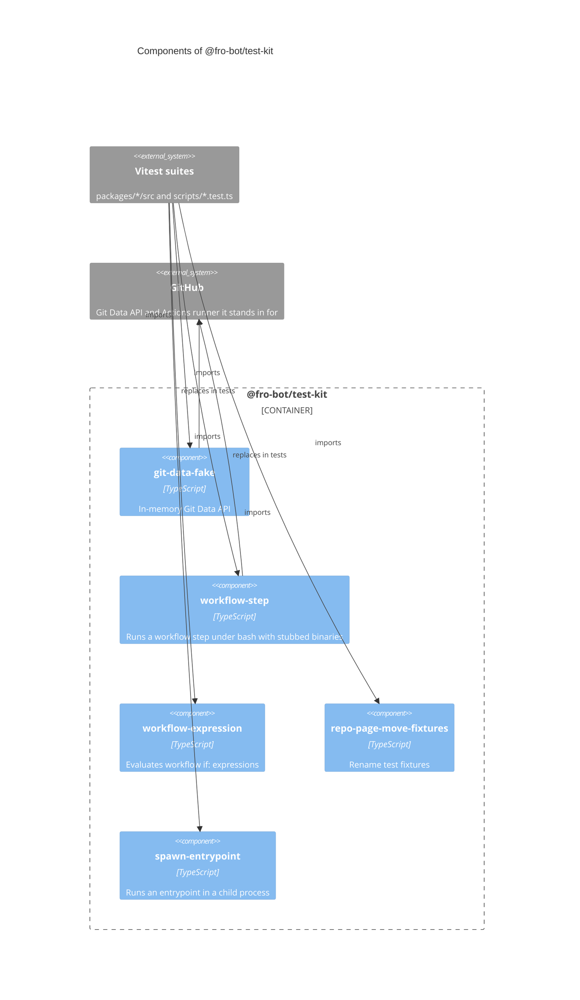

# `@fro-bot/test-kit`

Shared test fakes and helpers for the Fro Bot control plane. The package is private (`"private": true`), is never published, and exports `.ts` source with no build step. It depends on nothing: the helpers use only Node built-ins.

Tests import it by package name. No non-test module may import it, and `scripts/package-layout.test.ts` fails one that does. A package declares it under `devDependencies` as `workspace:*`; root tests under `scripts/` import it by name with no declaration.

## Modules

| Subpath | Provides |
| --- | --- |
| `@fro-bot/test-kit/git-data-fake` | `createGitDataFake`: an in-memory Git Data API (blobs, trees, commits, refs, compare) with a real fast-forward check on `updateRef`, holding several branches over one commit graph |
| `@fro-bot/test-kit/workflow-step` | `runStepWithStubs`, `overlayWasAttempted`: run a workflow step's `run:` block under bash with stub `git`, `bun` and `node` binaries and a temp `$GITHUB_OUTPUT` |
| `@fro-bot/test-kit/workflow-expression` | `evaluateExpression`: a GitHub Actions `if:` expression evaluator for the predicates under test |
| `@fro-bot/test-kit/spawn-entrypoint` | `spawnEntrypoint`: runs a `scripts/<name>.ts` entrypoint in a child process under Bun or Node with a minimal environment and a fresh `$GITHUB_OUTPUT`, and returns the exit code, stdout, stderr and the file's content. `bun` and `node` come from `PATH`, not from the parent's executable, so a Bun parent still gets Node for `runtime: 'node'`; `executable` names the program outright. `GITHUB_OUTPUT` is applied after the caller's `env`. The parity authority for a CLI, because direct writes bypass the runner's sinks |
| `@fro-bot/test-kit/repo-page-move-fixtures` | Redacted-shape fixtures for the operator rename tests: the repo page, the topic page that references it, and their index and log rows |

All five are test support. None is in the mutated set; `mutation-guards.json` lists each as not-mutated with its reason.

## Mutated code and name imports

A test that kills mutants must import the mutated module by relative path. The Stryker sandbox links `node_modules` to the real tree, so a name import loads the un-mutated file and every mutant survives. A package-name import kills none of a module's mutants; a relative import kills all of them. `scripts/mutation-guards-config.test.ts` rejects a `mutate` entry whose tests reach it only through an `@fro-bot/` name.

The helpers here are not mutated, so importing them by name is safe: a mutated module's tests may use them.

## Package diagram

No CLI runs on this package.

## Adding a helper

1. Add `src/<name>.ts` and its subpath to `exports` in `package.json`. Use erasable TypeScript syntax only (Node strip-only loads it).
2. List the module in `mutation-guards.json` under `not-mutated` with a reason. `mutation-guards-config.test.ts` fails an unlisted module.
3. Put a test beside it when the helper has logic of its own (`src/workflow-expression.test.ts` is the pattern).
