# `@fro-bot/wiki-ops`

The wiki handoff, change detection, context, query, repair, index and corrections tools of the Fro Bot control plane: the build and apply halves of the agent-to-trusted handoff, the survey change detector, the wiki and solutions queries that feed the agent prompt, `wiki-context-expand`, the integrity repair and lint-issue sync, the index rebuild, and the corrections lifecycle and context. The package is private (`"private": true`), is never published, and exports `.ts` source with no build step, so Bun, Node strip-only loading, `tsc` and Vitest all load it as written.

It depends on `@fro-bot/core` (guards, env, output, JSON lines, retry, the Octokit client factory and the goke runner), `@fro-bot/privacy` (the wiki-presence gate that `wiki-repair` runs before it commits), `@fro.bot/wiki-write-core` (the `wiki-ingest`, `wiki-lint`, `wiki-slug`, `wiki-utils`, `corrections` and `schemas` subpaths), `@octokit/rest` (a type) and `yaml`. Tests also import `@fro-bot/test-kit`.

Nothing here holds a credential of its own. `wiki-handoff-build` runs in the untrusted agent job and `wiki-handoff-apply` in the trusted job, and the artifact between them is the contract. `packages/wiki-ops/src/wiki-handoff-core.ts` validates, before anything is written, every manifest path (traversal, absolute paths, backslashes, scope), the top-level entries of the artifact, the size cap, and the source file of each changed entry, which must be a regular file and not a symlink (`lstat` on the file itself). It does not `lstat` the directories above that file, and it does not check whether a directory in the destination workspace is a symlink. Both rest on assumptions about who controls those directories. The artifact directory is the output of `actions/download-artifact`, and `actions/upload-artifact` builds its file list with a glob that follows symbolic links (`followSymbolicLinks: true`, `omitBrokenSymbolicLinks: true`) and zips regular files, so an uploaded artifact holds regular files only. The workspace is the trusted job's fresh default-branch checkout, so a symlinked directory there would have to be tracked on `main`. On the build side, `wiki-handoff-build` refuses a symlink or non-regular source and any out-of-scope path from `git status`, and `buildHandoffFromGitIndex` accepts only mode `100644` blobs. `wiki-repair` and `wiki-lint-issues` run with an App token minted by their own jobs. Each CLI keeps a six-line `scripts/<name>.ts` entrypoint that calls `main` from the package's `*-cli` module, so workflow paths do not change.

## Modules

| Subpath | Exports | Notes |
| --- | --- | --- |
| `@fro-bot/wiki-ops/wiki-handoff-core` | `buildWikiHandoff`, `buildHandoffFromGitIndex`, `captureWikiBaseline`, `validateAndApplyWikiHandoff`, `validateAndApplyHandoff`, `assertSafeHandoffPath`, `wikiHandoffPolicy`, `draftedSolutionsHandoffPolicy`, `WikiHandoffValidationError`, ... | The artifact contract between build and apply, shared with the drafted-solutions publish step in `scripts/`. |
| `@fro-bot/wiki-ops/wiki-handoff-baseline`, `-cli` | `runWikiHandoffBaseline`; `wikiHandoffBaselineCli`, `main` | The pre-agent baseline. Stdout `{"files":N}`. |
| `@fro-bot/wiki-ops/wiki-handoff-build`, `-cli` | `runWikiHandoffBuild`; `wikiHandoffBuildCli`, `main` | Writes `manifest.json` and `files/`, appends `changed=` to `$GITHUB_OUTPUT`, prints `{"changed":n,"deleted":n}`. |
| `@fro-bot/wiki-ops/wiki-handoff-apply`, `-cli` | `runWikiHandoffApply`, `formatWikiHandoffApplyError`; `wikiHandoffApplyCli`, `main` | Validates, then applies into the workspace. Stdout `{applied,deleted,skipped}`; stderr `::error::wiki-handoff-apply: <message>`. |
| `@fro-bot/wiki-ops/wiki-change-detect-core`, `wiki-change-detect`, `-cli` | `computeWikiChangeHash`, `captureWikiScopeSnapshot`, `hashWikiScopeSnapshot`; `runWikiChangeDetect`, `formatWikiChangeDetectError`; `wikiChangeDetectCli`, `main` | The survey change detector: `hash=` for `baseline`, `changed=` for `detect`. The core is mutated at full kills. |
| `@fro-bot/wiki-ops/wiki-query`, `-cli` | `assembleWikiContext`, `writeSelectedPathsHandoff`, `runWikiQuery`; `wikiQueryCli`, `main` | The baseline wiki excerpt, selected paths and byte length, plus the owner-only handoff file. |
| `@fro-bot/wiki-ops/solutions-query`, `-cli` | `assembleSolutionsContext`, `runSolutionsQuery`; `solutionsQueryCli`, `main` | The `docs/solutions` excerpt. Falls back to an empty result on any error. |
| `@fro-bot/wiki-ops/solution-docs-paths` | `SOLUTION_SUBDIRS` | The canonical category list; a leaf. |
| `@fro-bot/wiki-ops/wiki-context-safety` | `evaluateCandidateSafety`, `filterSafeCandidates` | The candidate safety filter. Mutated at full kills. |
| `@fro-bot/wiki-ops/wiki-context-expand`, `-cli` | `runWikiContextExpandCli`, `assembleExpandedContext`, `validateQuery`, `parseHandoffContent`, ...; `main` | The agent's `linked` and `query` expansion. Hand-parsed, because the query text may start with `-`. |
| `@fro-bot/wiki-ops/correction-lifecycle`, `-cli` | `main`, `buildHelp`, `findRepositoryRoot`, `CorrectionLifecycleCliError`, ...; `main` | Records, retires, reconfirms and supersedes entries in `knowledge/corrections.yaml`. Hand-parsed, because an option value such as `--text --help` must stay a value. |
| `@fro-bot/wiki-ops/render-corrections-context`, `-cli` | `renderCorrectionsContext`, `formatCorrectionsContext`; `renderCorrectionsContextCli`, `main` | Writes `.github/corrections-context.json`. The `corrections:warning:` lines go to stderr before the error is rethrown. |
| `@fro-bot/wiki-ops/route-stderr`, `-cli` | `parseRoute`, `buildSummary`, `runRouteStderr`, `RouteStderrUsageError`; `routeStderrCli`, `main` | The warning router: runs a command with no shell, replays its stderr unchanged and lifts routed prefixes into the job summary. `route-stderr` is mutated at full kills. |
| `@fro-bot/wiki-ops/rebuild-wiki-index`, `-cli` | `runRebuildWikiIndex`; `rebuildWikiIndexCli`, `main` | Rebuilds `knowledge/index.md`, or with `--merge-logs <path> [path...]` merges logs into `knowledge/log.md`. |
| `@fro-bot/wiki-ops/wiki-repair`, `-cli` | `runWikiRepairCli`, `planWikiRepairs`, `gateWikiRepairs`, `runAndRecordWikiRepair`, `recordWikiRepairResult`, ...; `wikiRepairCli`, `main` | The integrity repair. Writes its result file before it sets the exit code. |
| `@fro-bot/wiki-ops/wiki-lint-issues`, `-cli` | `runWikiLintIssues`, `planIssueLifecycle`, `syncWikiLintIssues`, `validateWikiLintJsonReport`, `WikiLintIssuesExit`; `wikiLintIssuesCli`, `main` | Syncs lint issues. Writes the five counters before the exit-1 path. |

## CLIs

Each command declares `readOnly`, a static capability: `true` unless the command can mutate GitHub, `data`, an external service, or a tracked path in the checkout. A caller-supplied artifact path, `$GITHUB_OUTPUT`, the step summary and stdout do not count.

| CLI | Caller and argv | `readOnly` | Outputs and exit codes |
| --- | --- | --- | --- |
| `wiki-change-detect` | `survey-repo.yaml`: `baseline`, then `detect` (one optional mode positional) | `true` | `hash=` and `changed=` on `$GITHUB_OUTPUT`. A bad mode prints `::error::wiki-change-detect: mode must be "baseline" or "detect" (got <mode>)` and exits 1. It throws when `$GITHUB_OUTPUT` is unset. |
| `wiki-handoff-baseline` | `survey-repo.yaml`, `fro-bot.yaml`: no argv | `true` | Stdout `{"files":N}`; the baseline file is read later by the build. |
| `wiki-handoff-build` | `survey-repo.yaml`, `fro-bot.yaml`: no argv | `true` | `changed=` and stdout `{"changed":n,"deleted":n}`. |
| `wiki-handoff-apply` | `survey-repo.yaml`, `fro-bot.yaml`: no argv | `false` | Stdout `{applied,deleted,skipped}`; stderr `::error::wiki-handoff-apply: <message>`; exit 1. Writes the workspace tree. |
| `wiki-query` | `fro-bot.yaml`: no argv | `true` | `excerpt`, `selected-paths`, `byte-length`; a 0600 handoff file; stderr `wiki-query:warn:handoff-write-failed` and `wiki-query:warn:baseline-query-failed`, both exit 0. |
| `solutions-query` | `fro-bot.yaml`: no argv | `true` | `excerpt`, `selected-paths`, `byte-length`; exit 0 on every error. |
| `wiki-context-expand` | The agent prompt: `linked`, `query "<text>"`, `--help`, `-h` | `true` | Stdout JSON. Bad arguments give a structured result and exit 1, not a throw. Hand-parsed. |
| `correction-lifecycle` | The agent through bash: `record`, `retire`, `reconfirm`, `supersede`, `help`, per-command `--help` | `false` | JSON; the exit code is the lifecycle `main()`. Hand-parsed. |
| `render-corrections-context` | `survey-repo.yaml`: wrapped by `route-stderr`, which reads its `corrections:warning:` lines | `false` | `corrections:warning:` lines on stderr, then the error and exit 1. Writes `.github/corrections-context.json`. |
| `route-stderr` | `fro-bot.yaml` (both ingest steps) and `survey-repo.yaml` (the wiki commit and the corrections load): router flags, then the wrapped command as the trailing positional, no `--`. `--route <prefix>=<heading>` (one or more), `--summary filtered\|all`, `--conflict-exit <code> --conflict-output <name>` | `false` | The wrapped command's exit code. Its stderr is replayed unchanged, as bytes. A summary section is written only when a line starts with a routed prefix: `filtered` writes the matching lines as bullets, `all` the heading and the whole stderr. `<name>=true` is appended to `$GITHUB_OUTPUT` on the conflict exit code only. A missing route or command, an unknown flag, a `--` and a half-declared conflict are usage errors (exit 1) and the command never starts. A command that cannot start exits 127 (not found) or 126 with a fixed line naming only the error code. No line it writes names the command, its arguments or the environment. |
| `wiki-repair` | `wiki-lint.yaml`: no argv | `false` | The result file read by the `if: always()` summary; exit 1 on an abort. Dry-run capable. |
| `wiki-lint-issues` | `wiki-lint.yaml`: no argv, or the report path as the one optional positional | `false` | `opened`, `updated`, `reopened`, `closed`, `failed` and the summary table, then exit 1 on a failed issue call. |
| `rebuild-wiki-index` | No workflow caller: no argv, or `--merge-logs <path> [path...]` | `false` | Stdout `rebuilt ...` or `merged ...`. |

Argv that matches nothing declared, `--help` included, is a usage error on every CLI on the runner: exit 1, usage on stderr, and nothing runs. `wiki-context-expand` and `correction-lifecycle` keep their own parsers and their own help.

## Package diagram

```mermaid
C4Component
  title Components of @fro-bot/wiki-ops

  Container_Boundary(wikiops, "@fro-bot/wiki-ops") {
    Component(correction_lifecycle, "correction-lifecycle", "TypeScript", "record, retire, reconfirm and supersede in the corrections sidecar; hand-parsed")
    Component(correction_lifecycle_cli, "correction-lifecycle-cli", "TypeScript", "Process wiring: exit code from the lifecycle main; hand-parsed")
    Component(rebuild_wiki_index, "rebuild-wiki-index", "TypeScript", "Rebuild index.md from disk, or merge log.md files")
    Component(rebuild_wiki_index_cli, "rebuild-wiki-index-cli", "TypeScript", "goke CLI; writing")
    Component(render_corrections_context, "render-corrections-context", "TypeScript", "corrections-context.json for one page; warns before it rethrows")
    Component(render_corrections_context_cli, "render-corrections-context-cli", "TypeScript", "goke CLI; writing")
    Component(route_stderr, "route-stderr", "TypeScript", "Runs one command, replays its stderr unchanged, lifts routed prefixes into the step summary; mutated at full kills")
    Component(route_stderr_cli, "route-stderr-cli", "TypeScript", "goke CLI; writing; the wrapped command is the trailing variadic positional")
    Component(solution_docs_paths, "solution-docs-paths", "TypeScript", "The canonical docs/solutions category list; a leaf")
    Component(solutions_query, "solutions-query", "TypeScript", "docs/solutions retrieval for the agent prompt; best-effort")
    Component(solutions_query_cli, "solutions-query-cli", "TypeScript", "goke CLI; read-only")
    Component(wiki_change_detect, "wiki-change-detect", "TypeScript", "baseline and detect modes; throwing output writer")
    Component(wiki_change_detect_cli, "wiki-change-detect-cli", "TypeScript", "goke CLI; optional mode positional")
    Component(wiki_change_detect_core, "wiki-change-detect-core", "TypeScript", "Content hash of the eligible wiki scope; fails closed; mutated at full kills")
    Component(wiki_context_expand, "wiki-context-expand", "TypeScript", "linked and query expansion for the agent; hand-parsed; free text may start with a dash")
    Component(wiki_context_expand_cli, "wiki-context-expand-cli", "TypeScript", "Process wiring: Node readers and exit code; hand-parsed")
    Component(wiki_context_safety, "wiki-context-safety", "TypeScript", "Candidate safety filter; mutated at full kills")
    Component(wiki_handoff_apply, "wiki-handoff-apply", "TypeScript", "Trusted apply step")
    Component(wiki_handoff_apply_cli, "wiki-handoff-apply-cli", "TypeScript", "goke CLI; writing")
    Component(wiki_handoff_baseline, "wiki-handoff-baseline", "TypeScript", "Pre-agent baseline step")
    Component(wiki_handoff_baseline_cli, "wiki-handoff-baseline-cli", "TypeScript", "goke CLI; read-only")
    Component(wiki_handoff_build, "wiki-handoff-build", "TypeScript", "Agent-side build step")
    Component(wiki_handoff_build_cli, "wiki-handoff-build-cli", "TypeScript", "goke CLI; read-only")
    Component(wiki_handoff_core, "wiki-handoff-core", "TypeScript", "The handoff contract: policies, build, validating apply")
    Component(wiki_lint_issues, "wiki-lint-issues", "TypeScript", "Lint findings to issues; typed exit, counters before the exit code")
    Component(wiki_lint_issues_cli, "wiki-lint-issues-cli", "TypeScript", "goke CLI; writing; optional report-path positional")
    Component(wiki_query, "wiki-query", "TypeScript", "Baseline wiki context query for the agent prompt")
    Component(wiki_query_cli, "wiki-query-cli", "TypeScript", "goke CLI; read-only")
    Component(wiki_repair, "wiki-repair", "TypeScript", "Wiki integrity repair, one commit to data")
    Component(wiki_repair_cli, "wiki-repair-cli", "TypeScript", "goke CLI; writing")
  }

  System_Ext(entrypoints, "scripts/<name>.ts", "Six-line entrypoints run by workflows")
  System_Ext(core, "@fro-bot/core", "cli, env, guards, json, output, github, retry")
  System_Ext(privacy, "@fro-bot/privacy", "check-wiki-private-presence")
  System_Ext(wwc, "@fro.bot/wiki-write-core", "wiki-ingest, wiki-lint, wiki-slug, wiki-utils, corrections, schemas")
  System_Ext(github, "GitHub", "REST and Git Data API")

  Rel(entrypoints, correction_lifecycle_cli, "main")
  Rel(entrypoints, rebuild_wiki_index_cli, "main")
  Rel(entrypoints, render_corrections_context_cli, "main")
  Rel(entrypoints, route_stderr_cli, "main")
  Rel(entrypoints, solutions_query_cli, "main")
  Rel(entrypoints, wiki_change_detect_cli, "main")
  Rel(entrypoints, wiki_context_expand_cli, "main")
  Rel(entrypoints, wiki_handoff_apply_cli, "main")
  Rel(entrypoints, wiki_handoff_baseline_cli, "main")
  Rel(entrypoints, wiki_handoff_build_cli, "main")
  Rel(entrypoints, wiki_lint_issues_cli, "main")
  Rel(entrypoints, wiki_query_cli, "main")
  Rel(entrypoints, wiki_repair_cli, "main")
  Rel(correction_lifecycle_cli, correction_lifecycle, "imports")
  Rel(rebuild_wiki_index_cli, rebuild_wiki_index, "imports")
  Rel(render_corrections_context_cli, render_corrections_context, "imports")
  Rel(route_stderr_cli, route_stderr, "imports")
  Rel(solutions_query_cli, solutions_query, "imports")
  Rel(wiki_change_detect, wiki_change_detect_core, "imports")
  Rel(wiki_change_detect_cli, wiki_change_detect, "imports")
  Rel(wiki_change_detect_core, wiki_handoff_core, "imports")
  Rel(wiki_context_expand, wiki_context_safety, "imports")
  Rel(wiki_context_expand_cli, wiki_context_expand, "imports")
  Rel(wiki_handoff_apply, wiki_handoff_core, "imports")
  Rel(wiki_handoff_apply_cli, wiki_handoff_apply, "imports")
  Rel(wiki_handoff_baseline, wiki_handoff_core, "imports")
  Rel(wiki_handoff_baseline_cli, wiki_handoff_baseline, "imports")
  Rel(wiki_handoff_build, wiki_handoff_core, "imports")
  Rel(wiki_handoff_build_cli, wiki_handoff_build, "imports")
  Rel(wiki_handoff_core, solution_docs_paths, "imports")
  Rel(wiki_lint_issues_cli, wiki_lint_issues, "imports")
  Rel(wiki_query_cli, wiki_query, "imports")
  Rel(wiki_repair_cli, wiki_repair, "imports")
  Rel(rebuild_wiki_index_cli, core, "runs on")
  Rel(render_corrections_context_cli, core, "runs on")
  Rel(route_stderr_cli, core, "runs on")
  Rel(solutions_query_cli, core, "runs on")
  Rel(wiki_change_detect_cli, core, "runs on")
  Rel(wiki_handoff_apply_cli, core, "runs on")
  Rel(wiki_handoff_baseline_cli, core, "runs on")
  Rel(wiki_handoff_build_cli, core, "runs on")
  Rel(wiki_lint_issues_cli, core, "runs on")
  Rel(wiki_query_cli, core, "runs on")
  Rel(wiki_repair_cli, core, "runs on")
  Rel(correction_lifecycle, core, "imports")
  Rel(correction_lifecycle, wwc, "imports")
  Rel(rebuild_wiki_index, wwc, "imports")
  Rel(render_corrections_context, wwc, "imports")
  Rel(route_stderr, core, "imports")
  Rel(solutions_query, core, "imports")
  Rel(solutions_query, wwc, "imports")
  Rel(wiki_change_detect, core, "imports")
  Rel(wiki_context_expand, wwc, "imports")
  Rel(wiki_handoff_apply, core, "imports")
  Rel(wiki_handoff_baseline, core, "imports")
  Rel(wiki_handoff_build, core, "imports")
  Rel(wiki_handoff_core, wwc, "imports")
  Rel(wiki_lint_issues, core, "imports")
  Rel(wiki_lint_issues, wwc, "imports")
  Rel(wiki_query, core, "imports")
  Rel(wiki_query, wwc, "imports")
  Rel(wiki_repair, core, "imports")
  Rel(wiki_repair, privacy, "imports")
  Rel(wiki_repair, wwc, "imports")
  Rel(wiki_repair, github, "calls")
  Rel(wiki_lint_issues, github, "calls")

  UpdateRelStyle(entrypoints, correction_lifecycle_cli, $offsetX="66", $offsetY="-46")
  UpdateRelStyle(entrypoints, rebuild_wiki_index_cli, $offsetX="29", $offsetY="11")
  UpdateRelStyle(entrypoints, render_corrections_context_cli, $offsetX="67", $offsetY="-49")
  UpdateRelStyle(entrypoints, route_stderr_cli, $offsetX="40", $offsetY="-30")
  UpdateRelStyle(entrypoints, solutions_query_cli, $offsetX="-28", $offsetY="9")
  UpdateRelStyle(entrypoints, wiki_change_detect_cli, $offsetX="45", $offsetY="-15")
  UpdateRelStyle(entrypoints, wiki_context_expand_cli, $offsetX="-39", $offsetY="-46")
  UpdateRelStyle(entrypoints, wiki_handoff_apply_cli, $offsetX="53", $offsetY="12")
  UpdateRelStyle(entrypoints, wiki_handoff_baseline_cli, $offsetX="3", $offsetY="-41")
  UpdateRelStyle(entrypoints, wiki_handoff_build_cli, $offsetX="-17", $offsetY="45")
  UpdateRelStyle(entrypoints, wiki_lint_issues_cli, $offsetX="12", $offsetY="-45")
  UpdateRelStyle(entrypoints, wiki_query_cli, $offsetX="27", $offsetY="-33")
  UpdateRelStyle(entrypoints, wiki_repair_cli, $offsetX="74", $offsetY="-5")
  UpdateRelStyle(correction_lifecycle_cli, correction_lifecycle, $offsetX="17", $offsetY="3")
  UpdateRelStyle(rebuild_wiki_index_cli, rebuild_wiki_index, $offsetX="-8", $offsetY="36")
  UpdateRelStyle(render_corrections_context_cli, render_corrections_context, $offsetX="-13", $offsetY="8")
  UpdateRelStyle(route_stderr_cli, route_stderr, $offsetX="-20", $offsetY="10")
  UpdateRelStyle(solutions_query_cli, solutions_query, $offsetX="-36", $offsetY="37")
  UpdateRelStyle(wiki_change_detect, wiki_change_detect_core, $offsetX="-3", $offsetY="34")
  UpdateRelStyle(wiki_change_detect_cli, wiki_change_detect, $offsetX="12", $offsetY="-33")
  UpdateRelStyle(wiki_change_detect_core, wiki_handoff_core, $offsetX="36", $offsetY="48")
  UpdateRelStyle(wiki_context_expand, wiki_context_safety, $offsetX="-19", $offsetY="6")
  UpdateRelStyle(wiki_context_expand_cli, wiki_context_expand, $offsetX="77", $offsetY="-2")
  UpdateRelStyle(wiki_handoff_apply, wiki_handoff_core, $offsetX="-69", $offsetY="24")
  UpdateRelStyle(wiki_handoff_apply_cli, wiki_handoff_apply, $offsetX="-79", $offsetY="-20")
  UpdateRelStyle(wiki_handoff_baseline, wiki_handoff_core, $offsetX="-46", $offsetY="-26")
  UpdateRelStyle(wiki_handoff_baseline_cli, wiki_handoff_baseline, $offsetX="-3", $offsetY="18")
  UpdateRelStyle(wiki_handoff_build, wiki_handoff_core, $offsetX="13", $offsetY="48")
  UpdateRelStyle(wiki_handoff_build_cli, wiki_handoff_build, $offsetX="-19", $offsetY="-10")
  UpdateRelStyle(wiki_handoff_core, solution_docs_paths, $offsetX="60", $offsetY="7")
  UpdateRelStyle(wiki_lint_issues_cli, wiki_lint_issues, $offsetX="31", $offsetY="10")
  UpdateRelStyle(wiki_query_cli, wiki_query, $offsetX="-64", $offsetY="33")
  UpdateRelStyle(wiki_repair_cli, wiki_repair, $offsetX="69", $offsetY="-9")
  UpdateRelStyle(rebuild_wiki_index_cli, core, $offsetX="48", $offsetY="-30")
  UpdateRelStyle(render_corrections_context_cli, core, $offsetX="-23", $offsetY="2")
  UpdateRelStyle(route_stderr_cli, core, $offsetX="-30", $offsetY="6")
  UpdateRelStyle(solutions_query_cli, core, $offsetX="-19", $offsetY="-46")
  UpdateRelStyle(wiki_change_detect_cli, core, $offsetX="-72", $offsetY="13")
  UpdateRelStyle(wiki_handoff_apply_cli, core, $offsetX="-3", $offsetY="27")
  UpdateRelStyle(wiki_handoff_baseline_cli, core, $offsetX="-62", $offsetY="18")
  UpdateRelStyle(wiki_handoff_build_cli, core, $offsetX="-60", $offsetY="-31")
  UpdateRelStyle(wiki_lint_issues_cli, core, $offsetX="18", $offsetY="22")
  UpdateRelStyle(wiki_query_cli, core, $offsetX="15", $offsetY="26")
  UpdateRelStyle(wiki_repair_cli, core, $offsetX="-42", $offsetY="-36")
  UpdateRelStyle(correction_lifecycle, core, $offsetX="-56", $offsetY="6")
  UpdateRelStyle(correction_lifecycle, wwc, $offsetX="-38", $offsetY="-26")
  UpdateRelStyle(rebuild_wiki_index, wwc, $offsetX="9", $offsetY="5")
  UpdateRelStyle(render_corrections_context, wwc, $offsetX="26", $offsetY="7")
  UpdateRelStyle(route_stderr, core, $offsetX="20", $offsetY="-8")
  UpdateRelStyle(solutions_query, core, $offsetX="-18", $offsetY="37")
  UpdateRelStyle(solutions_query, wwc, $offsetX="-10", $offsetY="-32")
  UpdateRelStyle(wiki_change_detect, core, $offsetX="78", $offsetY="16")
  UpdateRelStyle(wiki_context_expand, wwc, $offsetX="-35", $offsetY="-35")
  UpdateRelStyle(wiki_handoff_apply, core, $offsetX="-12", $offsetY="8")
  UpdateRelStyle(wiki_handoff_baseline, core, $offsetX="-3", $offsetY="-29")
  UpdateRelStyle(wiki_handoff_build, core, $offsetX="-36", $offsetY="49")
  UpdateRelStyle(wiki_handoff_core, wwc, $offsetX="-35", $offsetY="11")
  UpdateRelStyle(wiki_lint_issues, core, $offsetX="8", $offsetY="-9")
  UpdateRelStyle(wiki_lint_issues, wwc, $offsetX="31", $offsetY="-22")
  UpdateRelStyle(wiki_query, core, $offsetX="-79", $offsetY="19")
  UpdateRelStyle(wiki_query, wwc, $offsetX="-69", $offsetY="-8")
  UpdateRelStyle(wiki_repair, core, $offsetX="1", $offsetY="-19")
  UpdateRelStyle(wiki_repair, privacy, $offsetX="-60", $offsetY="-17")
  UpdateRelStyle(wiki_repair, wwc, $offsetX="34", $offsetY="1")
  UpdateRelStyle(wiki_repair, github, $offsetX="69", $offsetY="-30")
  UpdateRelStyle(wiki_lint_issues, github, $offsetX="19", $offsetY="13")
```

## Adding a module

Add `src/<name>.ts` and an `exports` entry in `package.json`. A CLI adds `src/<name>-cli.ts`, which is the only kind of module that imports `@fro-bot/core/cli`, and a six-line `scripts/<name>.ts` that calls its `main`. Tests sit beside the module and import it by relative path. Then do all of these:

- Classify the module in `stryker.config.json` (`mutate`) or `mutation-guards.json` (`not-mutated`, with the test that really pins it). A test that must kill mutants imports the module by relative path.
- A test that reaches a file write passes only test-owned temp paths, as the working directory and the target, because a Stryker mutant once deleted the Node binary through an unguarded filesystem call.
- Time any regex that GitHub-controlled or agent-controlled text reaches in `src/regex-scaling.test.ts`, with a long run and with many separate matches in one document.
- Update this diagram, the root `README.md` graph and `llms.txt`.
